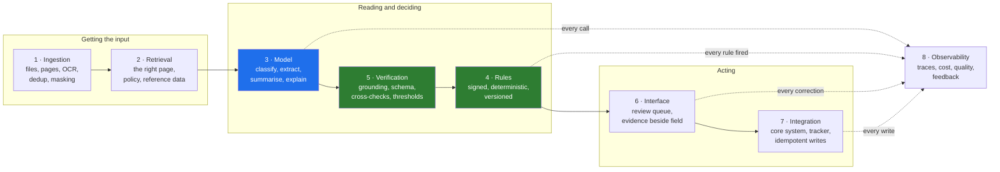
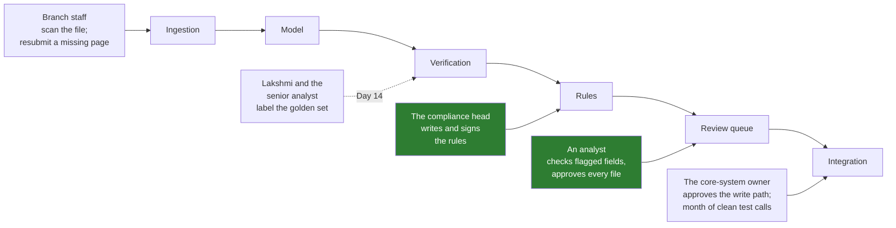

# 02 · The Eight Boxes: Drawing the System So the Model Is One Box Among Eight

> Day 11 · Section 2 of 16 · [Chapter overview](README.md) · Previous: [01 · Why the system around the model](01-why-the-system-around-the-model.md) · Next: [03 · Deterministic versus LLM](03-deterministic-versus-llm.md)

---

## 2.1 The picture

Every enterprise AI system an FDE ships, whether it reads loan files, triages insurance claims, drafts
replies to customers or reviews contracts, can be drawn as the same eight boxes. Their sizes change from
system to system. Their presence does not.

The model is box 3, coloured blue. Boxes 4 and 5, in green, are where this chapter spends most of its
time, because they are the boxes that decide whether box 3's output can be trusted. The other five
belong to later Days, and this chapter only places them.

## 2.2 Each box, what it does, and how it fails

| # | Box | Its job at Godavari | How it fails | Who notices first | Owned by |
|---|---|---|---|---|---|
| 1 | **Ingestion** | pick up the nightly SFTP batch, split each PDF into pages, OCR them, mask what must be masked, drop duplicates from re-uploads | a re-uploaded file processed twice; a page rotated 90 degrees read as noise; a 40-page scan truncated at page 30 | the analyst, who sees a file with half its pages | Day 16 (files and SFTP), Day 15 (OCR quality) |
| 2 | **Retrieval** | find the right page in a 40-page bundle; fetch the gold rate for the appraisal date, the empanelled dealer list, the signed checklist version | the wrong page sent to the model; a stale rate table; a branch manager retrieving another branch's file | the CISO, in the security review, if it is the permissions failure | Day 15 |
| 3 | **Model** | classify each page; extract fields with a quote and a page; pick the salary account; write the analyst's note | a confident wrong value; a document claimed that is not there; "lost in the middle" on page 38 | nobody, if boxes 4 and 5 are missing; that is the danger | Day 12 (the call), Day 13 (the prompt) |
| 4 | **Rules** | the fourteen-document checklist, the address-proof list, the Aadhaar mask, the margin and LTV caps, the age and date rules | a rule that is wrong; a rule that changed without a signature; a rule that lives in a prompt | the compliance head, or the RBI auditor in March | **this chapter** |
| 5 | **Verification** | check every model claim against the page; check formats, ranges, cross-field consistency and confidence before any rule sees the data | missing entirely, so the rules run on hallucinated inputs | the analyst, eventually, on a file that looked fine | **this chapter**, then Day 18 (thresholds) |
| 6 | **Interface** | the review queue: each field beside its crop, each finding with its rule, sorted by risk and age | a queue the analysts ignore, keeping the Excel tracker open beside it | Srinivas and the Vijayawada team lead, in the first pilot week | Day 18 |
| 7 | **Integration** | write the approved application into the 2009 core system over SOAP, once; write status back to the tracker | a retry that creates a duplicate application; a write in the 17:30 to 20:00 window | the core-system owner, the next morning | Days 16 and 17 |
| 8 | **Observability** | a trace per file: which pages, which model calls, which rules fired, what it cost, what the analyst corrected | nobody can say why one file cost three times the others, or whether quality is drifting | the COO, when the bill arrives | Day 19 |

Read the "who notices first" column again. It is the most useful column in the table, because it tells
you which failure will reach a person with power over the engagement, and in what order. A model error
with no verification box behind it is noticed by nobody until it is noticed by the auditor. That is the
worst possible order, and it is why boxes 4 and 5 come first.

## 2.3 Which failure the customer notices first

At Godavari the order, from the discovery work in Days 5 and 6, is roughly this:

1. **A file sent back for a document the branch already sent.** The Kukatpally branch manager phones
   Srinivas the same afternoon. This is a false positive of the rules box, usually caused by the model
   missing a page, and it costs trust with the upstream producer. (Section 06 shows the seam rule that
   prevents most of it: a missing document plus unclassified pages goes to review, not to the branch.)
2. **A queue that is slower than the tracker.** The analysts notice in a day and stop opening it. This is
   an interface failure, and Day 18 and Day 33 own it.
3. **A duplicate application in the core system.** The core-system owner notices the next morning and
   remembers the three vendors who failed before you. Day 16's idempotency key prevents it.
4. **A wrong value in a sanctioned file.** Noticed weeks later, by the senior analyst on a sample, or months
   later by the auditor. This is the failure the whole chapter exists to make rare, because it is the one
   with the compliance head's name on the response.

The first three are visible and loud. The fourth is silent. A good architecture turns as many silent
failures as possible into loud ones, early: a rule that fires, a check that fails, a field that goes to
review with its reason attached.

## 2.4 Where the humans sit, by design

A system diagram that shows only software is lying about how the system works. At Godavari people sit in
five places, and each is there on purpose:

| Person | Where | Why they are there | What would happen without them |
|---|---|---|---|
| the compliance head | owns box 4 | the rules are hers in law; she answers to the auditor | the rules are whatever the FDE guessed from a Word file |
| an analyst | box 6, on every file | decision D07 (Day 10): a named human decides every file, no auto-approval in these 90 days | the RBI's question "who decided, on what documents" has no answer |
| Lakshmi and the senior analyst | beside box 5, through the golden set | thresholds and accuracy claims are measured against their labels (Day 14) | nobody can say whether 0.85 is a sensible threshold |
| branch staff | box 1, as producers | the fastest fix for a missing document is the branch knowing on day one | the WhatsApp channel keeps growing (finding A3) |
| the core-system owner | box 7 | his condition for live writes is a month of logged, duplicate-free sandbox calls | the integration is a vendor writing into a system it does not own |

Notice what the analyst is *not* doing: re-reading every page from scratch. The system has done the
reading and the checking. The analyst sees the fields the envelope flagged, the findings with their rule
ids, and the note that explains them. Her job moves from re-keying 61 fields to judging the dozen things
the system could not settle. That is the change Day 9's business case counts as addressable hours.

## 2.5 Drawing your own

When you draw the eight boxes for a new customer, do three things:

1. **Write the customer's name for each box**, not the vendor's. "Ingestion" at Godavari is "the 2 a.m.
   SFTP batch and the region folders". "Integration" is "CreateApplication on the 2009 SOAP API". If you
   cannot name it, you have not finished discovery.
2. **Put a person in every box that makes a decision.** If a box decides something and no one owns it,
   either it is a rule that needs an owner or it is a judgement that needs a reviewer.
3. **Mark which boxes are thin in the walking skeleton.** Day 7's skeleton has every box, each thin. The
   one-page architecture in [`worksheet/godavari-architecture-one-page.md`](worksheet/godavari-architecture-one-page.md)
   has a "week 3" column for exactly this.

## 2.6 Key takeaways

- Eight boxes: ingestion, retrieval, model, rules, verification, interface, integration, observability.
  The model is one of them.
- For each box, know its job, how it fails, and who notices first; the order of noticing tells you what
  to build first.
- Rules and verification are the boxes that turn the model's silent failures into loud ones.
- Draw the humans in. A box that decides something has an owner or a reviewer, by design.
