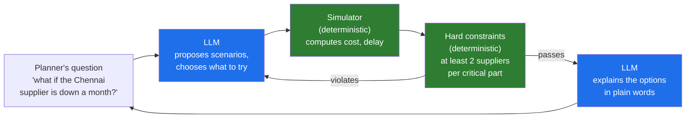

# 03 · Deterministic Versus LLM: 100 Percent of the Time, and Where the Model Earns Its Place

> Day 11 · Section 3 of 16 · [Chapter overview](README.md) · Previous: [02 · The eight boxes](02-the-eight-boxes.md) · Next: [04 · Sorting the customer's rules](04-sorting-the-customers-rules.md)

---

## 3.1 Two kinds of software, in plain words

**Deterministic code** gives the same output for the same input, every time. `amount * 100 > price * 90`
is either true or false for a given amount and price, today, next March, and on the auditor's laptop. You
can test it at the boundary (99,000 against 1,10,000 is exactly 90 percent; 99,001 is not), and once the
test passes it stays passed until someone changes the code.

**A language model** produces the most likely good continuation of its input. Ask it twice and you may get
two different answers. Ask it on a page it has never seen, in a layout nobody anticipated, with a stamp
across the middle and half the labels in Telugu, and it will very often read it correctly, which no
regular expression ever written could do. Its strength and its weakness are the same property: it
generalises.

Neither is smarter than the other. They make different promises.

| Property | Deterministic code | LLM |
|---|---|---|
| Same input, same output | always | not guaranteed; usually close at low temperature, never promised |
| Handles inputs nobody listed | no; it handles what it was written for | yes; that is what it is for |
| How it fails | loudly and the same way every time | quietly, fluently and differently each time |
| How you know it is right | tests at every boundary; read the code | measure on a labelled set (Day 14); you cannot read the weights |
| Cost per decision | effectively zero | real money and real seconds per call (Day 12) |
| Can a rule owner sign it | yes, from a table generated from the code | no; she can sign the measured accuracy and the review process around it |
| When a rule changes | edit, test, re-sign, release | edit a prompt and hope every case moved the same way |

A useful consequence of the first row: a wrong deterministic rule is wrong **in the same way for every
file**, which means one test finds it and one fix repairs every file. A wrong model behaviour is wrong in a
scattered way, and you discover its shape only by measuring.

## 3.2 Why "99 percent" is the wrong kind of number for a rule

Here is the arithmetic that ends most arguments about putting a rule in a prompt.

Day 7's inventory puts Godavari's volume at about 2,400 new loan files a month across 300 branches.
Suppose the model, prompted with the checklist, applies the address-proof rule correctly 99 percent of the
time. That sounds excellent. It means about 24 files a month, nearly 300 a year, where a KYC rule was
applied wrongly. The RBI auditor samples files every March. The compliance head told you what happens
next: an observation, then a finding, with her name on the response.

Now suppose the rule is code. It is either right for every file or wrong for every file. If it is right,
the error rate from the rule itself is zero, and the remaining risk is in what the rule is given (the
model's reading of the page), which is a different problem with a different control (verification,
section 05). If it is wrong, the first boundary test or the first file reviewed shows it, and one change
fixes all 2,400.

Three things are worth noticing about that argument:

1. It does not depend on the model being bad. A better model moves 99 to 99.7. The kind of number does
   not change: it is still a rate, measured on a sample, that could be different next month.
2. It does depend on the cost of an error. For a summary of a call note, 99 percent is wonderful. For a
   regulatory check, a rate is not acceptable when an exact answer is available.
3. It separates two questions people blur: **"is the rule applied correctly?"** (a rules question, which
   code answers exactly) and **"is the input to the rule read correctly?"** (a perception question, which
   the model answers well and verification checks).

## 3.3 The OpenAI automotive example

The cleanest published example of the split comes from OpenAI's forward deployed engineering team,
describing a supply-chain system for an automotive customer (ZenML LLMOps database summary, section 16;
quoted as published).

The customer had hard constraints, the kind that must never be violated, such as "always maintaining at
least two suppliers for critical components like tires". The team "implemented hard constraints that must
be verified deterministically", and "these constraints are checked 100% of the time through deterministic
code rather than trusting the LLM". The general principle in the same summary: "use determinism wherever
possible and LLMs only where their probabilistic nature adds value", and "critical business rules,
mathematical constraints, and verification steps should be deterministic code, not LLM outputs".

The second half of the example is as important as the first. The model was not asked to optimise the supply
plan itself. "Rather than asking the LLM to optimize directly, it's given access to a simulator and allowed
to explore the parameter space as an educated business user would." The model proposes scenarios, the
simulator (deterministic code) computes their consequences, the hard constraints (deterministic code)
reject any plan with one supplier for tyres, and the model explains the surviving options in language a
planner can act on.

Map it onto Godavari and the shape is identical. The model reads and explains; the gold-rate lookup and the
LTV arithmetic are the simulator; the RBI's LTV tiers and the fourteen documents are the hard constraints.
No version of the system lets the model's arithmetic decide whether a gold loan is within 75 percent of the
collateral.

## 3.4 Where each kind of logic belongs: the decision table

This is the table to carry into every engagement. Each row is a kind of logic you will meet in a customer's
process, where it belongs, and why.

| Kind of logic | Goes to | Why | Godavari example |
|---|---|---|---|
| Hard business rules and regulatory constraints | code | must hold every time; owner signs; auditor asks | the fourteen two-wheeler documents; LTV caps for gold |
| Arithmetic and dates | code | models are unreliable calculators; integer and Decimal arithmetic are exact | 90 percent margin; age on the application date; statement within 30 days |
| Lookups and joins against reference data | code | the answer is in a table the customer owns; the model should not remember it | the gold rate on the appraisal date; the empanelled dealer list; branch codes |
| ID and format validation | code | formats are specified exactly; checksums exist for a reason | PAN pattern and holder letter; Aadhaar 12 digits with a Verhoeff check digit |
| Permissions and visibility | code, inside the query | a leak cannot be undone; must be enforced before anything is returned | an analyst sees only files of branches in her AD groups (Day 15, Day 22) |
| Writes to systems of record | code, behind approval | must happen once, with a key, after a named human approves | CreateApplication with an idempotency key (Days 16, 17) |
| Reading messy documents | model | layouts vary without limit; stamps, handwriting, two scripts | the hand-filled application form; a phone photo of a Telugu income declaration |
| Classifying free text and pages | model | categories are clear to a person and impossible to enumerate as patterns | "which of these 38 pages is the address proof?" |
| Summarising and explaining | model | language is the model's native output | the note to the analyst explaining why the file is in review |
| Drafting for a human to edit | model | a first draft saves time; a person owns the final text | the message to the branch listing what is missing |
| Choosing among plausible readings | model, behind verification | judgement with evidence; code checks the evidence | which bank statement is the salary account |
| The seams between them | both, with a contract | see section 06 | model picks the account; code checks three salary credits |

Two rows deserve a warning.

**"Arithmetic and dates" is not a judgement call.** Models in 2026 are much better at arithmetic than they
were, and some will get the LTV right most of the time. The run in section 11 includes a file (GF-25032)
where the model, asked to judge in its prompt, put the eligible amount at Rs 6,07,478 because it used the
wrong weight or the wrong cap; the code's figure, from net weight, purity and the published rate, is
Rs 4,97,027. The requested Rs 5,75,000 is within the model's number and 86.8 percent of the collateral by
code's arithmetic, over the 75 percent cap. "Mostly right" arithmetic is a regulatory breach waiting for a
sample.

**"Reading messy documents" is not a place for code to show off.** The opposite mistake is real too, and
section 07 covers it: a regular expression that finds "PAN:" on the clean scans and nothing on the phone
photos, or a keyword list for "salary account" that breaks the first time a bank prints "SALARY CR" instead
of "SAL CREDIT". When the input varies, a model reads; code checks what it read.

## 3.5 Key takeaways

- Deterministic code promises the same answer every time; the model promises a likely good answer for
  inputs nobody listed. Use each for what it promises.
- For a rule, a rate is the wrong kind of number when an exact answer exists: 99 percent of 2,400 files a
  month is about 24 regulatory errors a month.
- OpenAI's pattern: hard constraints checked deterministically every time; the model explores through a
  simulator and explains, rather than solving directly.
- Rules, arithmetic, lookups, formats, permissions and writes go to code; reading, classifying,
  summarising, explaining and drafting go to the model; the seams get a contract.
