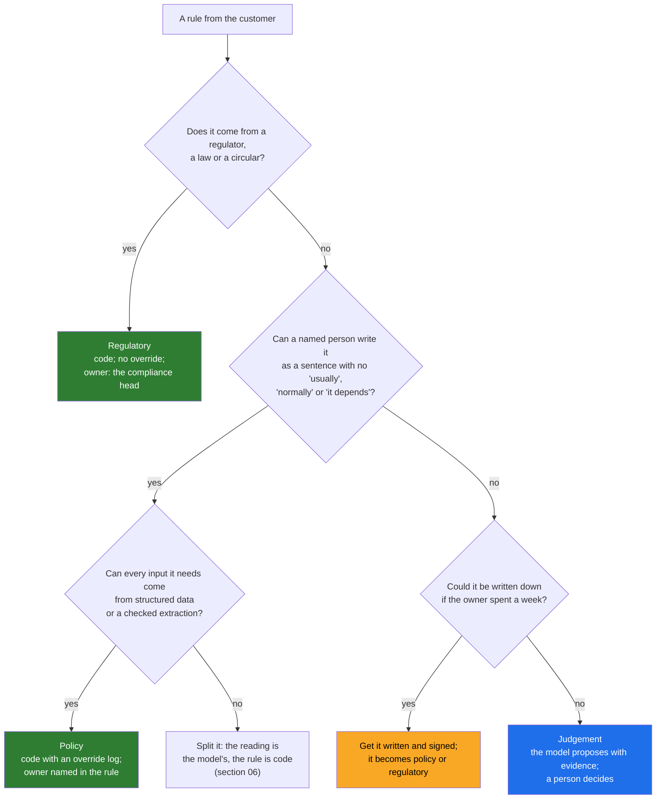

# 04 · Sorting the Customer's Rules: Regulatory, Policy, Judgement

> Day 11 · Section 4 of 16 · [Chapter overview](README.md) · Previous: [03 · Deterministic versus LLM](03-deterministic-versus-llm.md) · Next: [05 · The model proposes, code disposes](05-the-model-proposes-code-disposes.md)

---

## 4.1 Three bins, not two

"Code or model" is the right question for each piece of logic, but the customer's rules need one more cut
before you can build them. Godavari's process contains three different kinds of rule, and each one is built
differently.

| Bin | What it is | Where it lives | Can anyone override it? | Godavari examples |
|---|---|---|---|---|
| **Regulatory** | comes from the RBI, a law or a circular; Godavari has no discretion | code | **no one**; a breach blocks or sends the file back | the KYC documents (identity, address, photograph, PAN or Form 60); the Aadhaar mask; the LTV cap for gold |
| **Policy** | Godavari's own rule, written by a named owner; the company may choose an exception | code, **with an override log** | a named analyst, with a written reason, logged | the 90 percent margin on two-wheelers; tenure 12 to 48 months; age 21 to 60; statement within 30 days |
| **Judgement** | a decision a skilled person makes from evidence, that nobody can write as an exact rule | the model, **with review** | the analyst decides; the model's view is a proposal | which statement is the salary account; whether a stamped, annotated page is the address proof; how to explain a discrepancy |

The bins matter because the controls differ. A regulatory rule has no override path in the code at all:
`OverrideLog.override()` raises `PermissionError` for it, and section 11 shows the run refusing one. A
policy rule has an override path, because Godavari really does make exceptions ("the customer brought the
margin money in cash, receipt on page 31"), and the reason is part of the audit trail. A judgement has no
rule to override; it has a reviewer.

## 4.2 How to sort a rule you have never seen

When a customer tells you a rule, run it through these questions in order. The first "yes" decides the bin.



The yellow box is the one that changes engagements. Most "judgement" in an operations team is really an
unwritten policy. At Godavari, "which address proofs are acceptable?" looked like judgement: senior analysts
decided well, juniors sent files back "to be safe", and that was half of all send-backs (Day 6, finding C2).
It was not judgement. It was a list in two people's heads. The compliance head offered a week to write it,
and draft v0.3 is now a table in `rules_kyc.py` that a program applies and she signs. The day it was written,
half of the send-back problem stopped being an AI problem at all.

The test in Q2 is worth practising. "An address proof must be in the applicant's own name" passes it. "The
analyst should check the address proof looks genuine" fails it ("looks genuine" is a judgement), so the
second rule becomes a review item with the model's evidence attached, not a line of code that pretends to
know what genuine looks like.

## 4.3 Godavari's rules, sorted

These are the rules from the engagement so far, sorted. The full list with sources is in
[`worksheet/godavari-rules-sorted.md`](worksheet/godavari-rules-sorted.md); this is the core.

| Rule | Bin | Where | Rule id |
|---|---|---|---|
| The mandatory KYC documents are in the file of record (identity, address, photograph, PAN or Form 60, co-applicant KYC when named) | regulatory | code | TW-DOC-02 to 05, TW-DOC-14; GL-DOC-02 to 05 |
| The rest of the product checklist (fourteen for two-wheeler, nine for gold) | policy, or regulatory where the RBI requires the document | code | TW-DOC-01, 06 to 13; GL-DOC-01, 06 to 09 |
| Address proof is an OVD or on the signed list, in the applicant's own name | regulatory | code | TW-ADDR-LIST, GL-ADDR-LIST |
| A utility bill used as address proof is at most 60 days old | regulatory (Godavari's reading of the KYC direction) | code | TW-ADDR-AGE |
| No page shows an unmasked Aadhaar number | regulatory | code, scanning every page | TW-KYC-MASK, GL-KYC-MASK |
| PAN is five letters, four digits, a letter, with "P" fourth for an individual | format | code, in the envelope | ENV-PAN-FORMAT |
| Amount within product limits and the 90 percent margin | policy | code with override | TW-AMT-RANGE, TW-AMT-MARGIN |
| Gold amount within the tiered LTV cap of the collateral value | regulatory | code | GL-LTV |
| Date logic: quotation before application; statement recent; age on the application date; sanction before disbursement | policy | code | TW-DATE-QUOTE, TW-BANK-AGE, TW-AGE; the core write refuses disbursement before sanction |
| Branch visibility: an analyst sees only files of branches in her AD groups | regulatory (the CISO's) | code, in the query | `routing.visible_to`; Day 15 and Day 22 own the real thing |
| Reading a scanned, stamped, hand-annotated application form | judgement (perception) | model, verified | the extraction, then the envelope |
| Which of three bank statements is the salary account | judgement | model proposes; code checks the credits | ENV-SALARY-ACCT |
| The plain-language note explaining a discrepancy | judgement (language) | model writes; code checks it cites the rules | `pipeline.check_note` |
| Whether to sanction the loan | judgement, and never automated | a named credit manager | out of the system's scope (Day 10, decision D07) |

The last row is not a mistake. Some judgements belong to neither the code nor the model. Godavari's
sanction is made by a named human and retrievable for seven years (finding A6). The system's job is to put
a complete, checked file in front of that person, never to make the decision.

## 4.4 Rules as signed code: what the compliance head actually signs

"Rules as signed code" sounds like asking a compliance head to review Python. She will not, and should not
have to. Here is the mechanism the prototype uses, and it is the pattern to reuse.

**Each rule is a small object with five parts.**

```python
Rule("TW-ADDR-LIST", Kind.REGULATORY,
     "Proof of address is an OVD, or an alternative on the signed list, in the applicant's own name.",
     "RBI KYC Master Direction; Godavari alternatives list v0.3",
     lambda ctx: rules_kyc.address_proof_acceptable(ctx, "TW-ADDR-LIST"))
```

An id that appears in every finding, the analyst's note and the audit log; a kind (regulatory or policy);
the sentence she reads; the source; and the check, which is a plain function.

**The list she reads is generated from the code.** `python -X utf8 code/print_rules.py` writes
`data/rules-sheet-two-wheeler.md`: one row per rule (id, kind, sentence, source), the alternatives list,
and the fingerprint. Because the sheet is generated, it cannot drift from what the code enforces. A typed
checklist in a Word file can, and Godavari's did: three branches kept sending unmasked Aadhaar copies for
months after the rule changed (code `CHECKLIST_DRIFT`).

**The fingerprint ties the signature to the code.** `RuleSet.fingerprint()` is a SHA-256 over the rule
files, with line endings normalised. The sign-off record (`code/intake/rules_signoff.json`) stores the
fingerprint she reviewed. The run checks it before processing a single file:

```text
  two-wheeler rules v0.3: reviewed-draft (the compliance head, 2026-11-06); fingerprint matches the record
  gold rules v0.1: draft (nobody yet, -); fingerprint matches the record
```

If anyone edits a rule, even a comment, the fingerprint changes and the run refuses: "two-wheeler rules
changed since the sign-off record; re-review before running". In pilot mode it refuses anything not marked
signed:

```text
REFUSED: two-wheeler rules are reviewed-draft; pilot mode runs signed rules only
```

That line is real output, and it is correct: the two-wheeler rules are signed at milestone M10, Wednesday
2 December 2026 (Day 8), and the pilot does not start before them.

**The tests are part of what she signs.** Each boundary she cares about has a test named in her language:
`test_electricity_bill_61_days_old_is_sent_back_and_60_is_not`,
`test_amount_exactly_at_the_85_percent_cap_passes_and_one_rupee_over_blocks`,
`test_regulatory_rules_cannot_be_overridden_by_anyone`. In the review meeting you read the test names
aloud, not the code. When she says "and what about a bill in the spouse's name?", you write the test in
front of her.

## 4.5 Status: draft, reviewed, signed

At the point in the engagement this chapter describes (week 3, the prototype running end to end on
Monday 9 November 2026):

| Product | Version | Status | What it means |
|---|---|---|---|
| two-wheeler | 0.3 | reviewed draft: walked through with the compliance head on Friday 6 November, after the week-2 checkpoint | runs in prototype mode; signature due at M10 (2 December) |
| gold | 0.1 | draft, not reviewed | runs in prototype mode for the comparison; if the RBI inspection takes the compliance head away first, gold moves to the next 90 days (Day 10, risk R7) |

The address-proof definition in v0.3 is the one the compliance head later formalises as decision D04 in
Day 10's decision log: an address proof is present only if it is in the file of record, legible and on the
signed list. The code got there first because writing the rule as code forced the question.

## 4.6 Key takeaways

- Three bins: regulatory (code, no override), policy (code, override with a logged reason), judgement
  (model proposes, a person decides).
- Most "judgement" in an operations team is unwritten policy. Getting it written and signed is often the
  biggest single improvement in the engagement.
- Signed rules are objects with an id, a kind, a sentence, a source and a check; the sheet the owner reads
  is generated from the code; a fingerprint ties her signature to exactly that code.
- Some decisions belong to neither code nor model. The sanction stays with a named human.
