# 05 · The Model Proposes, Code Disposes: The Deterministic Envelope Around Every Model Call

> Day 11 · Section 5 of 16 · [Chapter overview](README.md) · Previous: [04 · Sorting the customer's rules](04-sorting-the-customers-rules.md) · Next: [06 · The seams](06-the-seams.md)

---

## 5.1 The envelope

Every model call in a production system sits inside an envelope of deterministic code: code that prepares
what goes in, a contract for what comes out, and a sequence of checks that every output passes through
before anything acts on it. The model never talks directly to a rule, a queue or a system of record.

```mermaid
flowchart LR
    subgraph BEFORE["Before the call"]
        B1["split into pages;<br/>mask what must not travel;<br/>send only what is needed"]
    end
    subgraph CALL["The call"]
        C1["Model<br/>proposes: page types,<br/>fields with page + quote,<br/>documents, 'unsure'"]
    end
    subgraph AFTER["After the call (all code)"]
        A1["1 schema and types"] --> A2["2 grounding:<br/>quote on the cited page"]
        A2 --> A3["3 value supported<br/>by its own quote"]
        A3 --> A4["4 confidence<br/>against threshold"]
        A4 --> A5["5 formats and<br/>checksums"]
        A5 --> A6["6 cross-field and<br/>cross-document"]
        A6 --> A7["7 reference<br/>lookups"]
        A7 --> A8["8 signed rules"]
    end
    B1 --> C1 --> A1
    A8 --> R["Route"] --> H["Named analyst<br/>approves"]
    style C1 fill:#1f6feb,color:#fff
    style A8 fill:#2e7d32,color:#fff
    style H fill:#2e7d32,color:#fff
```



The rest of this section walks through each part, with the code from the prototype (`code/intake/`).

## 5.2 The contract: what a model is allowed to say

The pipeline knows a model only through a two-method interface:

```python
class ExtractionModel(Protocol):
    name: str

    def read(self, bundle: LoanBundle) -> ModelOutput:
        """Classify every page, extract the fields with a page and a quote each, list the documents."""
        ...

    def draft_note(self, bundle: LoanBundle, findings: Sequence[tuple[str, str]]) -> str:
        """Write the plain-language note to the analyst for findings that code has already decided."""
        ...
```

Two implementations satisfy it: `StubModel` (deterministic, offline, the one the chapter runs) and
`AnthropicExtractionModel` (optional, real). The rules import neither. You could swap in a self-hosted
model on the machine in the Hyderabad building (Day 40) without touching a rule, which matters at Godavari,
where the CISO's position on model location is not settled until Day 24.

The unit of output is a field with its evidence:

```python
@dataclass(frozen=True)
class FieldValue:
    """One extracted field. `value` is None when the model says "unsure": a first-class answer, not an error."""

    value: str | None
    confidence: float
    page: int | None
    evidence: str = ""    # the exact text on `page` the value was read from
```

Three design choices are packed into that dataclass, and each one is there because of a Godavari finding:

- **`value` may be `None`.** The compliance head: "I would rather it says 'cannot tell' and a person looks."
  Four interviews asked for "unsure" in their own words. A model that is not allowed to say "unsure" will
  guess, and the 2019 pilot guessed.
- **Every value carries a page and a quote.** Without them, nothing after the call can check the claim, and
  Day 18's interface cannot show the crop beside the field.
- **The model returns strings, not numbers.** It copies what is printed; code converts. More on that in 5.4.

Day 12 turns this into a versioned JSON schema for structured outputs, and the optional adapter already
sends one (`llm_adapter.SCHEMA`). A schema guarantees shape. It does not guarantee truth. Anthropic's own
documentation, as of October 2026, says structured outputs "guarantee schema compliance in most cases" and
lists the cases where they do not. Everything below exists because a well-formed answer can still be wrong.

## 5.3 Check 2: grounding, or "show me where you read that"

The single most valuable check after the call is the cheapest: is the quote the model gave actually on the
page it cited, and is that page the kind of document it claimed?

```python
def grounding_errors(bundle: LoanBundle, finding: DocFinding) -> list[str]:
    page = bundle.page(finding.page)
    if page is None:
        return [f"{finding.doc} cites page {finding.page}, which is not in the file"]
    errors: list[str] = []
    if finding.evidence and finding.evidence not in page.text:
        errors.append(f"{finding.doc} quote not found on page {finding.page}")
    title = PAGE_TITLES.get(finding.doc)
    first_line = page.text.splitlines()[0] if page.text else ""
    if title and title not in first_line:
        errors.append(f"page {finding.page} is titled {first_line[:40]!r}, not {finding.doc}")
    return errors
```

In the run, the stub claims twelve documents that are not there, each with confidence 0.84 and a
plausible quote. Every one is caught, and none reaches a rule:

```text
ENV-GROUND review model claimed pan_card on page 14, but pan_card quote not found on page 14;
page 14 is titled 'THIS PAGE IS INTENTIONALLY LEFT BLANK', not pan_card
```

Without this check, that file (GF-25155) passes TW-DOC-03, because the model said the PAN card was there.
With it, the claim is dropped, the PAN card is missing, and the branch is told. Hallucinated presence is the
failure the compliance head fears most ("never mark a document present unless it is present"), and grounding
is what makes "present" mean "on a page you can open".

On real scans the page text comes from OCR, and the quote is checked against that text, so a check like this
catches the model inventing evidence; it does not catch OCR misreading the paper. That is why checks 5 and 6
exist.

## 5.4 Check 3: the model copies, code converts

The second check asks a narrower question: does the value match the quote? For amounts, the digits of the
value must appear in the digits of the quote.

```python
elif _digits(fv.value) and _digits(fv.value) not in _digits(fv.evidence):
    findings.append(Finding("ENV-EVIDENCE", "envelope", Action.REVIEW,
                            f"{name}: value {fv.value} is not what the quote says ({fv.evidence.strip()!r})",
                            field_name=name))
```

This catches the 2019 failure exactly. In the run, file GF-25019 has a handwritten Telugu income
declaration that says Rs 65,000 a month. The stub, making the 2019 mistake, reads it as annual and reports
5,416 a month. The quote is real; the value is not in it:

```text
ENV-EVIDENCE review monthly_income: value 5416 is not what the quote says
('నెలసరి ఆదాయం / Monthly income: Rs 65,000')
ENV-INCOME-MATCH review income proof gives Rs 5,416 a month, the form says Rs 65,000
```

The principle generalises: **ask the model to copy, never to convert.** If a document prints an annual
figure and the field is monthly, code divides by twelve, with a test. If a date is printed as "2 Nov 26",
code parses it with an explicit format and refuses anything else. A model that converts silently produces
values no check can trace back to the page.

## 5.5 Checks 4 to 7: confidence, formats, cross-checks, lookups

**Confidence against a threshold.** Each mandatory field has a threshold in `routing.py`; below it, the field
goes to review with its reason. The thresholds are visibly placeholders (`THRESHOLDS_VERSION =
"placeholder-2026-11-09"`) because they are not yours to choose: Day 14 measures per-field accuracy on the
golden set Lakshmi and the senior analyst label, and Day 18 sets each threshold from it. Two warnings about
model confidence:

- It is not a probability of being right until it has been calibrated against labels. A model's 0.9 is a
  score, not a promise.
- It does not know about errors upstream of the model. In the run, file GF-25140's date of birth was
  misread by OCR on a handwritten form (an 8 for a 3); the model copied it faithfully, with high confidence,
  and nothing downstream could tell. That file reaches the analyst unflagged. Section 11 shows it honestly.

**Formats and checksums.** The PAN pattern and the Aadhaar Verhoeff check are exact specifications, so they
are code. `find_unmasked_aadhaar` scans every page for a 12-digit number whose check digit is valid, which
is why a 12-digit account number is not mistaken for one.

**Cross-field and cross-document consistency.** The same fact printed in two places should agree. The PAN on
the card against the PAN on the form; the name on the form against the name on the PAN card; the income on
the proof against the income on the form; for gold, net weight no more than gross weight. Fourteen files in
the run have a PAN that differs between card and form. Nine of the ten PAN misreads the system catches are
caught this way; in the other mismatches it was the form's copy that was misread, and the analyst settles
which in seconds with the two crops side by side (Day 18).

**Reference lookups.** Anything that is a fact in a customer's table is looked up, never remembered or
inferred: whether dealer DLR-KKP-014 is empanelled for Kukatpally; the published 22-carat rate on the
appraisal date. The lookup returns `None` when there is no entry, and the rule turns that into a review:
"no published gold rate for 2027-01-04; never guessed". It does not interpolate between yesterday and
tomorrow.

## 5.6 Check 8: the signed rules, and why they come last

The signed rules run only on what survived the envelope: grounded documents and checked fields. The order is
not a detail. Rules applied to ungrounded inputs produce confident, rule-shaped wrong answers, which are worse
than no rules at all because they carry a rule id. The end-to-end test
`test_ungrounded_claims_never_reach_a_rule` checks the property on the whole batch.

The `RuleContext` a rule receives makes the property structural:

```python
@dataclass(frozen=True)
class RuleContext:
    """What a rule may look at: the bundle, the model's fields, and only the documents whose claims were
    grounded on a real page. Ungrounded claims never reach a rule (pipeline.py removes them first)."""

    bundle: LoanBundle
    output: ModelOutput
    documents: dict[Doc, DocFinding]
    as_of: date
    uncertain_pages: tuple[int, ...] = ()
```

## 5.7 Fail closed

Every check in the envelope and every rule answers "I cannot tell" by sending the file to review, never by
passing it. Look at how the margin rule treats a missing value:

```python
if amount is None or price is None:
    return [Finding("TW-AMT-MARGIN", Kind.POLICY, Action.REVIEW,
                    "amount or on-road price unreadable; the margin rule cannot be checked",
                    field_name="requested_amount")]
```

The alternative, `if amount and price and ...`, reads naturally and silently passes every file whose amount
the model could not read. The AI-written draft in exercise 3.1 does exactly that, and wraps the whole function
in `except Exception: return []`, which turns every crash into "no problems found". Failing closed costs some
review-queue volume. Failing open costs an audit finding.

## 5.8 Key takeaways

- The model proposes inside an envelope: preparation before, a contract for the output, eight checks after,
  and a human approval at the end.
- The contract allows "unsure", and every value carries a page and a quote.
- Grounding (quote on the cited page) catches hallucinated documents; "value supported by its quote" catches
  silent conversions; ask the model to copy and let code convert.
- Confidence thresholds come from the golden set, not from taste; model confidence does not see OCR errors.
- Rules run last, on grounded inputs only, and every check fails closed.
