# 06 · The Seams: Where the Model's Judgement Meets Code's Rules

> Day 11 · Section 6 of 16 · [Chapter overview](README.md) · Previous: [05 · The model proposes, code disposes](05-the-model-proposes-code-disposes.md) · Next: [07 · When the split is wrong](07-when-the-split-is-wrong.md)

---

## 6.1 Why the seams are the hard part

Sorting logic into "code" and "model" is easy for the clear cases: the LTV cap is code, the summary is the
model. Most of the real design work is at the seams, where one piece of logic needs both: a judgement only
the model can make, and a check only code can make, in the same decision. Get a seam wrong and you either
leave a rule to the model or ask code to read.

There are four seam patterns. Almost every hybrid decision in an enterprise system is one of them.

```mermaid
flowchart TB
    subgraph S1["1 · Model proposes, code verifies"]
        a1["Model: page 9 is the<br/>salary account"] --> a2["Code: does page 9 have<br/>3 monthly SAL credits?"]
    end
    subgraph S2["2 · Code decides, model explains"]
        b1["Code: TW-ADDR-LIST fired;<br/>send back"] --> b2["Model: writes the note;<br/>code checks it cites the rule"]
    end
    subgraph S3["3 · Model classifies, code counts"]
        c1["Model: a type for<br/>each of 38 pages"] --> c2["Code: which required<br/>documents are absent?"]
    end
    subgraph S4["4 · Model explores, code evaluates"]
        d1["Model: try 'two suppliers<br/>from Pune, one from Hosur'"] --> d2["Simulator and constraints:<br/>cost, delay, violations"]
    end
    style a2 fill:#2e7d32,color:#fff
    style b1 fill:#2e7d32,color:#fff
    style c2 fill:#2e7d32,color:#fff
    style d2 fill:#2e7d32,color:#fff
```



## 6.2 Seam 1: the model proposes, code verifies (the salary account)

Some files carry two or three bank statements. One is the salary account; the others are a joint savings
account, a spouse's account, an old account the customer forgot to close. Which one counts is a judgement:
account names vary, narrations vary by bank, and a person reads the whole page to decide. That is the
model's job.

But "is this a salary account?" also has a checkable consequence: a salary account shows a credit from the
employer named on the salary slip, roughly monthly. That is code's job.

```python
salaried = "Net pay" in (out.fields.get("monthly_income").evidence if out.fields.get("monthly_income") else "")
if salaried and int(picked.attributes.get("salary_credits", "0")) < 3:
    better = next((s for s in statements if int(s.attributes.get("salary_credits", "0")) >= 3), None)
    where = f"page {better.page} does" if better else "no statement in the file does"
    findings.append(Finding("ENV-SALARY-ACCT", "envelope", Action.REVIEW,
                            f"model picked page {picked.page} as the salary account, but it has no monthly "
                            f"salary credits; {where}", doc=Doc.BANK_STATEMENT))
```

Notice three things about the shape. The model's pick is used when it passes; it is not second-guessed for
sport. When it fails, code does not silently substitute its own answer; it flags the file for review and
says which page would pass, so the analyst decides with both facts in front of her. And the rule that runs
next (TW-BANK-AGE, statement recency) runs on the verified statement, not on the model's pick. In the run,
two picks are overturned this way.

The general form: **a judgement that has a checkable consequence gets the check.** "This is the address
proof" has a consequence (the page is titled as one and carries the applicant's address). "This is the
applicant's photograph" has one (it is on a page titled as one). "This document is genuine" does not have a
cheap one, so it stays a review item.

## 6.3 Seam 2: code decides, the model explains (the analyst's note)

When a file goes back to the branch, someone has to write the message: which documents are missing, which
rule fired, what the branch should send. Writing clear, polite, specific prose is the model's strength. But
the content of the message is code's decision, and the message must not add, drop or soften anything.

The prototype's contract: code passes the model only the findings it has already decided, as `(rule_id,
message)` pairs, and checks the note that comes back.

```python
def check_note(note: str, findings: list[Finding]) -> tuple[str, bool]:
    """The note is the model's prose; the rule ids in it are not optional. Missing ones are appended."""
    wanted = [f.rule_id for f in findings if f.action in (Action.SEND_BACK, Action.BLOCK)]
    missing = [r for r in dict.fromkeys(wanted) if r not in note]
    if not missing:
        return note, False
    return note + "\nRules that fired: " + ", ".join(missing), True
```

In the run, the stub forgets a rule citation in nine notes, as real models occasionally do, and code appends
it each time. The test `test_every_branch_facing_note_cites_every_rule_that_fired` holds the property across
the batch. A production version checks more (no amounts in the note that are not in the findings, no
"approved" or "rejected" wording, length), and Day 13 keeps the prompt that writes the note under version
control.

When there is nothing for the branch, the prototype does not call the model at all: a fixed sentence says
"ready for your approval" or lists the fields to check. Do not spend a model call, or take a model's risk,
on a sentence code can write.

This seam is also where the Part file's third model task lives: "writing the plain-language note that
explains a discrepancy to the analyst". The discrepancy itself (income proof says Rs 5,416, the form says
Rs 65,000) is found by code. The model's job is the sentence that makes Bhavani understand it in two seconds.

## 6.4 Seam 3: the model classifies, code counts (completeness)

The completeness check looks like a rule, and it is, but its input is a classification. "Is the proof of
address in the file?" means "is any of these 38 unordered pages a proof of address?" The model labels every
page; code counts the labels against the signed checklist.

The seam has a subtle failure: when the model cannot classify a page, a present document can look absent,
and the branch is told to send a document it already sent. That is the first failure the customer notices
(section 2.3), and it costs trust with the branch manager. The prototype's seam rule:

```python
def missing_document(rule_id: str, doc: Doc, text: str, ctx: RuleContext, kind: Kind) -> list[Finding]:
    if doc in ctx.documents:
        return []
    if ctx.uncertain_pages:
        pages = ", ".join(str(p) for p in ctx.uncertain_pages)
        return [Finding(rule_id, kind, Action.REVIEW,
                        f"{text}: not found; pages {pages} could not be classified, check them first", doc=doc)]
    return [Finding(rule_id, kind, Action.SEND_BACK, f"{text}: not in the file", doc=doc)]
```

A missing document plus unclassified pages goes to the analyst, with the page numbers, rather than to the
branch. In the run, fourteen files take that path, and the batch has zero send-backs or blocks without a real
problem behind them. The rule itself stays deterministic; it simply refuses to be more certain than its input.

## 6.5 Seam 4: the model explores, code evaluates (the simulator)

OpenAI's automotive example (section 3.3) is the fourth pattern: the model chooses what to try, a
deterministic simulator computes the result, and deterministic constraints reject anything that breaks a hard
rule. Godavari's intake does not need it yet; it will the day someone asks "what can this customer borrow
against this gold?" The model gathers the facts with quotes, code computes the cap from the published rate and
the RBI tiers, and the model explains the answer.

## 6.6 Contracts at the seams

Each seam is a contract between two components, and contracts are written down:

| Seam | What crosses it | The contract |
|---|---|---|
| model to envelope | `ModelOutput`: labels, fields, documents, salary pick | typed, nullable, every value with page and quote; Day 12 versions it as a JSON schema |
| envelope to rules | `RuleContext`: grounded documents, checked fields, uncertain pages | rules never see an ungrounded claim |
| rules to routing | `Finding`: rule id, kind, action, message, document or field | the most severe action decides; order never matters |
| code to model (note) | `(rule_id, message)` pairs | the note must cite every rule id; code appends what is missing |
| routing to integration | route plus an `Approval` with a named analyst | nothing is written without approval; blocked and send-back files are refused before any call |

When a seam breaks in production, it is almost always because one side changed its half of the contract:
a new model version that returns "N/A" instead of null, a new rule that reads a field the envelope does not
check, a prompt change that makes the note "summarise" instead of "list". Tests at each seam catch the change
in CI rather than in the pilot.

## 6.7 Key takeaways

- Four seam patterns: model proposes and code verifies; code decides and the model explains; the model
  classifies and code counts; the model explores and code evaluates.
- A judgement with a checkable consequence gets the check; when the check fails, flag with both facts rather
  than silently substituting code's answer.
- The model writes prose only about what code has decided, and code checks the prose cites the rules.
- A deterministic rule must not be more certain than its input: missing plus unclassified pages means review.
- Every seam is a written, tested contract.
