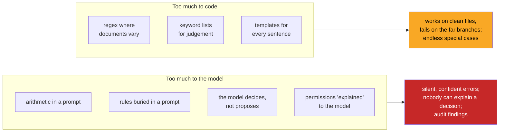

# 07 · When the Split Is Wrong: Failure Modes in Both Directions

> Day 11 · Section 7 of 16 · [Chapter overview](README.md) · Previous: [06 · The seams](06-the-seams.md) · Next: [08 · Godavari's architecture](08-godavari-architecture.md)

---

## 7.1 Two directions of wrong

The split can be wrong in two directions, and engineers tend to err in the direction of their background.
People who came to AI from machine learning trust the model with too much. People who came from backend
engineering ask code to do what only a model can. Both produce systems that fail in production, in
recognisably different ways.

## 7.2 Too much to the model

**An LLM asked to do arithmetic.** The gold LTV is a multiplication, a division and a lookup. In the run,
when the stub is asked in its prompt to judge eligibility, it sometimes uses gross weight instead of net
(the stones and wax count as gold), sometimes applies the old uniform 75 percent cap instead of the tiers the
RBI introduced in 2025, sometimes forgets that an 18-carat ornament is worth less than a 22-carat one, and
sometimes simply slips. File GF-25032 is the clearest case: the model's eligible amount is Rs 6,07,478; code's
is Rs 4,97,027; the requested Rs 5,75,000 is a breach that the model alone would have accepted. Real models
in 2026 do arithmetic far better than these error rates suggest, and that is beside the point: the cap is a
regulatory constraint, and "better" is still a rate.

Symptom in production: numbers that are almost right, in a pattern nobody can predict. Fix: the model
extracts the inputs with their quotes; code computes, in Decimal or integer rupees, with boundary tests.

**Rules buried in a prompt the compliance head cannot read.** Pipeline A in section 01 puts the checklist in
the prompt. Three things go wrong, all slowly:

1. **Nobody can say which rule was applied.** The output says `complete: false, issues: ["address proof may
   not be acceptable"]`. The auditor asks "under which rule, which version?" and there is no answer.
2. **A prompt edit silently changes policy.** An engineer improves the extraction wording on a Thursday; the
   next week the model is more lenient about rent agreements. No diff showed a rule change, because there
   was no rule. Day 13 makes prompts versioned code; even then, a prompt diff is not a rule diff the owner
   can sign.
3. **The owner cannot sign it.** The compliance head's condition was "I sign it, and if it changes, I sign the
   change." A prompt cannot be signed in that sense: the same prompt can behave differently on a new model
   version, with no change to the text she read.

In the run, the model alone shipped eleven of the twelve files with an address proof that is not on the
signed list. It was not malicious or broken. It was doing what the compliance head feared: deciding that a
gas bill looked like an address proof.

**The model decides instead of proposes.** The subtle version of this failure has the right architecture on
the diagram and the wrong wiring in the code: the rules exist, but a branch in the code says "if the model
says the file is complete, skip them" (the AI-written draft in exercise 3.1 starts with exactly that line), or
a model's high confidence is allowed to override a failed check. Symptom: the rules fire in tests and never
in production. Fix: the model's verdict is recorded for comparison and never consulted for routing; in the
prototype, `PromptOnlyVerdict` exists only so the run can show what it would have shipped.

**Permissions explained to the model.** "You are an assistant for the Guntur branch; do not reveal files from
other branches." That is a request, not a control, and Day 41 shows how easily an injected instruction in a
document overrides it. Visibility is enforced in code, inside the query, before anything is returned (Day 15,
Day 22). In the prototype, `visible_to()` is the one-line version, and the queues in the run contain only
their region's branches.

## 7.3 Too much to code

**Brittle regex where the documents vary.** A pattern like `r"PAN:\s*([A-Z]{5}\d{4}[A-Z])"` works on every
clean scan you test it on. Then Guntur's phone photos arrive: the label is cut off, the PAN is on the line
below, the "5" reads as "S", the form is the 2019 layout with "P.A.N. No." in a box, and half the labels are
in Telugu. Each failure gets a new pattern, the patterns start contradicting each other, and in month two
the code is a museum of special cases that still misses the next layout. Symptom: high accuracy on the files
you built against, falling accuracy as the pilot widens to new branches. Fix: the model reads; a regex
*validates* the value the model read. The same regex that is brittle as an extractor is perfect as a checker.

**Keyword lists for judgement.** "A salary account is a statement where some line contains SAL, SALARY or
PAYROLL." That fails the first time a bank prints "NEFT CR ACME TEXTILES" for a salary, and succeeds wrongly
on a spouse's account. The prototype keeps the keyword idea in its right place: as a *check* on the model's
pick (three credits from the employer named on the slip), with review when they disagree.

**Templates for every sentence.** A deterministic message generator with forty templates for every
combination of findings produces messages the branch staff stop reading, because they are all the same shape
and none says what to do first. This is the one place where over-coding is not dangerous, only poor. Let the
model write; let code check the content.

## 7.4 Which failures the customer notices, and when

| Failure | Direction | First visible | Who notices | Cost |
|---|---|---|---|---|
| send-back for a document the branch already sent | too much to code (no seam rule) | the same day | branch manager, then Srinivas | trust with the upstream producer |
| regex extraction failing on phone photos | too much to code | week 1 of a new branch | the analysts, who stop trusting pre-filled fields | adoption |
| wrong LTV accepted | too much to the model | the next audit sample, or never | the RBI auditor, through the compliance head | an observation; repeated, a finding |
| unlisted address proof accepted | too much to the model | the next audit sample | the RBI auditor | an observation |
| nobody can say which rule applied | too much to the model | the first auditor question | the compliance head | her confidence in the vendor, permanently |
| a branch sees another branch's file | too much to the model | the security review, or a complaint | the CISO | the engagement |

The pattern in the "first visible" column is the lesson. Over-coding fails early and visibly, and costs
adoption. Under-coding fails late and invisibly, and costs the regulator's trust. Both are failures; only one
of them is survivable without an apology to the board. When in doubt about a rule, put it in code first and
let the model help with the reading.

## 7.5 Key takeaways

- Too much to the model: arithmetic in prompts, rules in prompts, a model's verdict that bypasses the rules,
  permissions as instructions. Failures are silent and arrive late, through the auditor or the CISO.
- Too much to code: regex extraction on variable documents, keyword lists for judgement, templates for prose.
  Failures are visible and early, and cost adoption.
- Use regex and keyword checks as validators of what the model read, not as readers.
- In doubt, put the rule in code and give the reading to the model.
