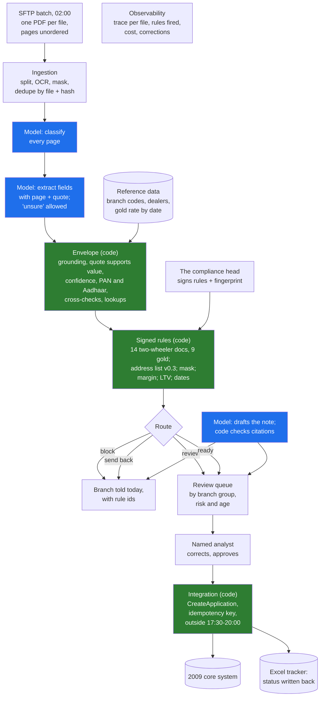

# 08 · Godavari's Architecture: Loan-File Intake on One Page

> Day 11 · Section 8 of 16 · [Chapter overview](README.md) · Previous: [07 · When the split is wrong](07-when-the-split-is-wrong.md) · Next: [09 · Advanced and 2026 patterns](09-advanced-and-2026-patterns.md)

---

## 8.1 The page that goes into the engagement folder

Day 10's discovery document says what will be built and why. It deliberately does not say how. The one-page
architecture is the "how" at the level a COO, a CISO and a compliance head can all read: eight boxes with
Godavari's names on them, the line between code and model drawn in colour, and the people placed where they
decide. It is drafted in week 3, while the skeleton is being built, and filed beside the discovery document
at the week-4 checkpoint. The filed version is
[`worksheet/godavari-architecture-one-page.md`](worksheet/godavari-architecture-one-page.md); this section
explains it.

Blue is the model: three jobs, all reading or writing language. Green is deterministic code the customer can
test, read as tables, and sign. Everything else is plumbing that Days 15 to 19 build properly.

## 8.2 One file through the system

Walk file GF-25074 through the prototype: a two-wheeler file from Day 7's sample, from the Guntur branch,
27 pages, a mix of scanned and photographed pages, the application form filled by hand with Telugu labels.

1. **Ingestion.** Twenty-seven pages in tray order. Thirteen are filler: terms and conditions, photocopy
   reverse sides, "this page is intentionally left blank".
2. **Model: classify.** Each page gets a type and a confidence. The application form happens to be on top
   this time (confidence 0.90, lower than a typed page because it is handwritten); it is not always on top.
3. **Model: extract.** Applicant name, date of birth, PAN from the card and from the form, address, mobile,
   amount, tenure, income from the proof and from the form, application date, on-road price, dealer code,
   quotation date. Each with a page and the line it was read from. The proof of address is described: kind
   "gas bill", holder "father".
4. **Envelope.** Every document claim is grounded. The PAN card and the form agree; the names match; the two
   income figures agree; the dealer is empanelled for Guntur. Two fields are under their thresholds: the
   applicant's name (0.81 against 0.90) and the date of birth (0.83 against 0.90), both read from the
   handwritten Telugu form. Each becomes a review finding with its reason.
5. **Signed rules.** All thirteen unconditional documents are present. TW-ADDR-LIST fires: a gas bill is not
   an OVD and not on the signed alternatives list v0.3. The margin, tenure, age, quotation and statement rules
   pass.
6. **Route.** The most severe finding is the send-back, so the route is `send_back`; the two review findings
   travel with the file.
7. **Note.** The model drafts the message: "Address proof 'gas bill' is not an OVD and not on the signed
   alternatives list v0.3 (rule TW-ADDR-LIST)." Code confirms the citation is there.
8. **Queue.** The file appears in the Vijayawada team's queue (Guntur is in its AD groups), marked "sent back:
   address proof", so the analysts know the branch has been told and that the name and date of birth need a
   look when the new proof arrives. The Hyderabad team cannot see it.
9. **Integration.** Nothing is written: a send-back file is refused before any call to the core system.

And the comparison that matters: asked to judge the same file in its prompt, the model said `complete: true`
with no issues. Pipeline A would have put it in front of an analyst as clean; on a busy month-end day, in
the way Lakshmi described ("I check the big ones and hope"), it would have been approved with a gas bill as
address proof.

## 8.3 What is real in week 3, and what is stubbed

The walking skeleton (Day 7, section 7.3) has every layer and each one thin. This chapter's prototype is the
reading-and-deciding half of it.

| Box | Real in the week-3 prototype | Stubbed or later | Owner Day |
|---|---|---|---|
| Ingestion | synthetic page text from Day 7's sample, in tray order with filler | real SFTP, OCR, masking, dedupe | 16, 15 |
| Retrieval | reference tables in code | permission-aware retrieval, the real rate feed | 15, 22 |
| Model | the interface and a deterministic stub; an optional real adapter | prompt design, model choice, cost budgets | 12, 13 |
| Rules | two products as signed code, fingerprinted, 81 tests across the suite | signatures (M10), the other six products | this chapter |
| Verification | the full envelope | thresholds from the golden set | 14, 18 |
| Interface | the four routes and branch-group queues, as data | the screen with crops | 18 |
| Integration | a fake sandbox that duplicates like the real one; idempotent push | the WSDL client and the batch window | 16, 17 |
| Observability | per-file CSV and a run summary | traces, cost, dashboards | 19 |

The "stubbed" column goes on the first slide of the week-3 demo (Day 20). It is not an apology. It is the
reason the COO can believe the "real" column.

## 8.4 Key takeaways

- The one-page architecture names Godavari's systems and people in eight boxes, colours the line between
  model and code, and is filed beside the discovery document.
- The model has three jobs at Godavari: classify pages, extract fields with evidence, draft the note. Every
  decision is code or a named person.
- Walking one real file through the diagram is the fastest way to test it; if a step has no owner, the
  diagram is not finished.
- Say what is real and what is stubbed, box by box.
