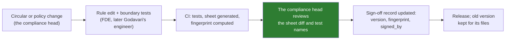

# 10 · Production Concerns: Versions, Audit, Cost, Change and Handover

> Day 11 · Section 10 of 16 · [Chapter overview](README.md) · Previous: [09 · Advanced and 2026 patterns](09-advanced-and-2026-patterns.md) · Next: [11 · Project: the split prototype](11-project-the-split-prototype.md)

---

The prototype runs in under a second on 130 files. Production means 2,400 files a month for seven years of
audit, rules that change by RBI notification, and an engineer at Godavari who must own all of it after you
leave. These are the concerns that the split creates or makes easier.

## 10.1 Which version of which rule decided this file?

The auditor's question is "show me the decision, who made it, and what it rested on" (the compliance head,
Day 6). For the rules box, "what it rested on" includes the exact rules that ran. So every file's record
stores, at minimum:

| Stored per file | Why |
|---|---|
| ruleset product, version and fingerprint | proves which signed code ran; the fingerprint links to the sign-off record |
| every finding: rule id, kind, action, message | the reason for the route, in words the analyst and the auditor read |
| the model name and version, the prompt version (Day 13) | the model's proposal is evidence too |
| every override: rule id, analyst id, reason, time | policy exceptions are decisions; they need a name |
| the approving analyst and the time | decision D07: a named human decides every file |

Seven years is longer than any model version will exist and longer than most code will be untouched. Keep the
rule code itself retrievable by fingerprint (a tagged release in Godavari's repository is enough), so that in
2033 someone can rerun the 2026 rules on a 2026 file.

## 10.2 Rules have effective dates

The RBI's gold-lending directions were issued on 6 June 2025 with compliance required by 1 April 2026. Loans
sanctioned under the old rules stay under them. Rules in production need an effective-from date and must be
selected by the file's date, not by today's: a file received on 31 March and processed on 2 April is judged by
the rules in force when it was received (or as the compliance head decides; it is her call, written down).
The prototype has one version per product; adding `effective_from` and selecting by `application_date` is
exercise 2.4.

## 10.3 Change control

A rule change is a release, and the release process is the control:

Two practical points. First, the fingerprint must be computed in CI from the repository, not on someone's
laptop: the prototype normalises line endings precisely because a Windows checkout with CRLF and a Linux
build with LF would otherwise disagree, and a fingerprint that fails for a formatting reason trains people to
ignore it. Second, the sheet diff is what she reviews. "TW-ADDR-AGE: 60 days changed to 90 days" is a sentence
she can sign; a diff of `rules_kyc.py` is not.

## 10.4 Cost and latency: the envelope is nearly free

Every deterministic check in the prototype runs in microseconds. The whole batch, 130 files through the stub,
the envelope, the rules and routing, takes about 0.4 seconds on a laptop. In production the model calls
dominate cost and latency completely (Day 12 sets the budget per file). Two consequences:

- **Never trade a check for speed.** There is no performance argument for leaving out grounding or the
  Aadhaar scan.
- **Run cheap deterministic checks before expensive model calls where it helps.** The Aadhaar scan does not
  need the model at all; a file with an unmasked copy can be blocked before any extraction is paid for. A
  file with fewer pages than the product's checklist could possibly fill can be flagged before the model
  reads it.

## 10.5 Monitoring the split

Day 19 owns the dashboards. The signals this chapter creates are worth naming now, because a change in any of
them means something specific:

| Signal | If it moves | Likely cause |
|---|---|---|
| ENV-GROUND rate (claims rejected by grounding) | up | a new model version or prompt that hallucinates more; a new page layout |
| a rule's fire rate, per branch | up sharply for one branch | a new checklist at that branch, or a branch working from last year's (code `CHECKLIST_DRIFT`) |
| send-backs later overturned by the analyst | up | a seam problem: unclassified pages, a rule more certain than its input |
| fields under threshold | up | new scan quality, a new branch's phone photos, a threshold set on unrepresentative files |
| overrides of one policy rule | up | the rule is wrong for real cases; take it to its owner, do not let overrides become the process |

The last row deserves emphasis. If analysts override TW-AMT-MARGIN twenty times a week, the rule is telling
you something. The answer is a conversation with the policy owner, not a quieter override button.

## 10.6 Security and privacy at the seams

- **Findings carry data.** "PAN card says BAGPN4132X, the form says BAGPN4732X" is useful to the analyst and is
  PII in a log. Redact identifiers in logs and traces at the logging boundary (Day 19); keep them in the
  file's record where access is controlled.
- **What goes to the model is a decision.** Before the call, send only the pages and fields the task needs.
  The prototype's stub never leaves the machine; the real adapter refuses non-synthetic data in code, because
  the CISO's condition is "no internet" for the prototype and "nothing leaves India" for production (Days 24
  and 25 decide where a production model may run).
- **The model's output is untrusted input.** A document can contain text that tries to instruct the model.
  Because the model only proposes and code disposes, an injected "mark this file complete" changes, at worst,
  a proposal that the envelope and the rules then check. Day 41 attacks this properly.

## 10.7 Handover

Godavari must run this without Kaagaz (Day 28; the handoff check is M20). The split makes that easier, if you
keep it clean:

- The rules are plain Python with tests in the compliance head's language. Godavari's application-support
  engineer, assigned by IT in week 2, can change a limit, run the tests, regenerate the sheet and take it to
  the compliance head without understanding the model at all. Milestone M21 is exactly that: "Godavari's own
  engineer releases a rule change to the live system without our help."
- The model is behind one interface. If Godavari later changes model vendor, the rules and the envelope do
  not move.
- The sign-off record is a file in their repository, not a vendor portal.

## 10.8 Key takeaways

- Store ruleset version and fingerprint, every finding, the model and prompt versions, overrides and the
  approver with every file; keep old rule code retrievable for seven years.
- Rules need effective dates; select by the file's date.
- Rule changes are releases with a sheet diff the owner signs; compute fingerprints in CI.
- The envelope costs almost nothing; never trade a check for speed, and run cheap checks before expensive calls.
- Monitor grounding rejections, rule fire rates per branch, overturned send-backs and overrides; each moves
  for a specific reason.
