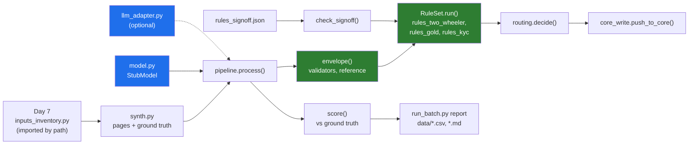

# 11 · Project: The Split Prototype, Model Stub to Signed Rules to Core Sandbox

> Day 11 · Section 11 of 16 · [Chapter overview](README.md) · Previous: [10 · Production concerns](10-production-concerns.md) · Next: [12 · Build it with AI, and how you know it's right](12-build-with-ai-and-verification.md)

---

## 11.1 The brief

It is Monday 9 November 2026, week 3 of the Godavari engagement. The walking skeleton must show ten real
files going from PDF to the core system's test copy by Friday (milestone M07, Day 8). Before the extraction
can be wired to anything, the engagement needs the reading-and-deciding half of the system built with the
split in the right place, and evidence, in numbers, of what the split buys.

You owe the engagement folder four things:

1. **A working prototype** of the split: a model interface with an offline stub and an optional real
   adapter; the envelope; the two-wheeler and gold rules as signed code; routing; an idempotent write to a
   sandbox. Runnable on the machine in the Hyderabad building with no network.
2. **Tests** for every rule boundary and every seam property, which the compliance head can read by name.
3. **A run over a synthetic batch** generated by Day 7's own generator, reporting what the rules caught that
   the model alone would have shipped, and what still gets through.
4. **The one-page architecture and the sorted rules**, filed beside the discovery document.

This is the first chapter in the course with real software, so it also sets the conventions every later
chapter follows: Python 3.12 or newer, type hints throughout, a requirements file with pinned versions,
standard library for the system itself, and everything runnable offline.

## 11.2 Files

| Path | What |
|---|---|
| [`code/intake/catalogue.py`](code/intake/catalogue.py) | the shared vocabulary: document types, pages, bundles, `FieldValue`, `DocFinding`, `ModelOutput` |
| [`code/intake/day7_inputs.py`](code/intake/day7_inputs.py) | imports Day 7's `inputs_inventory.py` by path and returns its 200-file sample; nothing copied |
| [`code/intake/synth.py`](code/intake/synth.py) | turns each Day 7 row into OCR'd page text plus a separate ground truth |
| [`code/intake/model.py`](code/intake/model.py) | the `ExtractionModel` interface and `StubModel`, deterministic, with realistic error patterns |
| [`code/intake/llm_adapter.py`](code/intake/llm_adapter.py) | optional `AnthropicExtractionModel`; refuses non-synthetic data; never needed to run |
| [`code/intake/validators.py`](code/intake/validators.py) | PAN, Aadhaar (Verhoeff), amounts, dates, names, grounding |
| [`code/intake/reference.py`](code/intake/reference.py) | branch codes, AD groups, empanelled dealers, gold rate by date (synthetic) |
| [`code/intake/ruleset.py`](code/intake/ruleset.py) | `Rule`, `Finding`, `RuleSet`, the fingerprint, sign-off checks, the override log |
| [`code/intake/rules_kyc.py`](code/intake/rules_kyc.py) | shared KYC rules: the signed address-proof list v0.3, bill age, the Aadhaar mask |
| [`code/intake/rules_two_wheeler.py`](code/intake/rules_two_wheeler.py) | fourteen documents and the product rules, v0.3 |
| [`code/intake/rules_gold.py`](code/intake/rules_gold.py) | nine documents and the tiered LTV rule, v0.1 |
| [`code/intake/rules_signoff.json`](code/intake/rules_signoff.json) | the sign-off record: version, fingerprint, status, who and when |
| [`code/intake/routing.py`](code/intake/routing.py) | thresholds (placeholders), routes, branch visibility |
| [`code/intake/pipeline.py`](code/intake/pipeline.py) | the envelope, `process()` for one file, `score()` against ground truth |
| [`code/intake/core_write.py`](code/intake/core_write.py) | a fake core sandbox that duplicates like the real one, and the idempotent push |
| [`code/run_batch.py`](code/run_batch.py) | the end-to-end run and report |
| [`code/print_rules.py`](code/print_rules.py) | generates the rule sheets the compliance head signs |
| `code/tests/` | 81 tests in six files |
| [`code/exercises/ai_draft_completeness.py`](code/exercises/ai_draft_completeness.py) | an AI-written checker with at least nine problems, for exercise 3.1 |
| `code/requirements.txt`, `code/requirements-llm.txt` | pinned test dependencies; the optional SDK pin |
| `data/` | the run CSV, the run summary and the two rule sheets, all generated |

About 3,000 lines including tests. Read `catalogue.py`, then `pipeline.py`, then one rules module; the rest
follows.



## 11.3 Setup and run

Everything was run on **Python 3.14.3** on Windows 11 in October 2026; the code needs 3.12 or newer
(`StrEnum`, modern type hints). From the chapter folder:

```bash
python -m venv .venv
# Windows: .venv\Scripts\activate      Linux and macOS: source .venv/bin/activate
pip install -r code/requirements.txt   # pytest 9.1.1 and its pinned dependencies; nothing else

python -X utf8 code/print_rules.py     # writes the two rule sheets, prints the fingerprints
python -X utf8 code/run_batch.py       # the end-to-end run, about 0.4 seconds
python -X utf8 -m pytest code          # 81 tests, about 0.3 seconds
```

The intake package itself imports only the standard library, so `run_batch.py` runs even without the venv.
`-X utf8` keeps Windows consoles happy with the middle dot and the Telugu labels in the synthetic forms.
No network, no API key, no downloads after the pip install.

## 11.4 The input: Day 7's sample, reused, not copied

Day 7's step 3 generated a two-week sample of 200 synthetic loan files from `random.Random(7)`. This chapter
imports that generator by path and calls it the same way, so both chapters talk about the same files:

```python
def day7_sample() -> list[Any]:
    """The 200 LoanFile records of Day 7's two-week sample, in Day 7's order."""
    module = load_day7_module()
    return module.make_loan_files(DAY7_SAMPLE_SIZE, random.Random(DAY7_SEED))
```

The test `test_the_sample_is_day7s_sample_not_a_copy` reads Day 7's own CSV and checks that the file ids,
products and document flags match row for row. If someone edits Day 7's generator, this chapter's test fails,
which is the right behaviour for two chapters that share data.

Of the 200 files, 130 are in scope: 81 two-wheeler and 49 gold. `synth.py` turns each row into pages and a
ground truth. Day 7's flags decide whether the PAN card, address proof, income proof and photograph are
present; the generator adds the rest of the fourteen or nine documents, filler pages to reach Day 7's page
count, tray order, and the problems real files have: an unmasked Aadhaar now and then, a gas bill in the
father's name, a stale statement, an over-limit amount, OCR confusions on phone photos, a handwritten Telugu
form.

One honest caveat before you read the numbers. **The synthetic files carry more problems than Godavari's real
ones, on purpose**, so that every rule fires at least a few times. Eighty of the 130 files have at least one
problem. Do not read the route shares below as a forecast of Godavari's send-back rate; Day 9's hand count
(28 percent sent back, 4.1 percent decided with a mandatory document missing) is the baseline, and Day 14's
golden set is where accuracy is measured.

## 11.5 The run

This is the complete, real output of `python -X utf8 code/run_batch.py`:

```text
== Day 11 · the system around the model: Godavari loan-file intake ==
mode: prototype · model: stub · as of 2026-11-09 · thresholds placeholder-2026-11-09
  two-wheeler rules v0.3: reviewed-draft (the compliance head, 2026-11-06); fingerprint matches the record
  gold rules v0.1: draft (nobody yet, -); fingerprint matches the record
input: Day 7's sample via inputs_inventory.py (seed 7): 200 files, 130 in scope (81 two-wheeler, 49 gold)

-- 1. Routes (every route ends with a named analyst; none is automatic) --
route                   two-wheeler   gold  total
blocked                           2      8     10
send_back                        35     17     52
review                           34     11     45
ready_for_approval               10     13     23

-- 2. Problems in the files, and who catches them --
   'model alone' = the same model asked, in its prompt, to extract AND judge completeness,
   with no code after it. 'system' = model + envelope + signed rules. One row per kind of problem;
   a file with two missing documents is two cases.
problem                            cases  model alone shipped  system caught  missed  caught by
required document missing             67                   16             67       0  TW-DOC-06, TW-DOC-05, GL-DOC-05
ADDRESS_NOT_ON_LIST                   12                   11             12       0  TW-ADDR-LIST, GL-ADDR-LIST
OVER_MARGIN                            6                    5              6       0  TW-AMT-MARGIN
AADHAAR_UNMASKED                       5                    0              5       0  GL-KYC-MASK, TW-KYC-MASK
ADDRESS_STALE                          5                    3              5       0  TW-ADDR-AGE
OVER_LTV                               4                    1              4       0  GL-LTV
STATEMENT_STALE                        3                    2              3       0  TW-BANK-AGE
FIELD_ERROR:pan                       11                   11             10       1  ENV-PAN-MATCH, ENV-PAN-FORMAT, ENV-CONFIDENCE
FIELD_ERROR:applicant_name             4                    4              4       0  ENV-CONFIDENCE, ENV-NAME-MATCH
FIELD_ERROR:date_of_birth              4                    4              3       1  ENV-CONFIDENCE, TW-AGE
FIELD_ERROR:monthly_income             2                    2              2       0  ENV-CONFIDENCE, ENV-EVIDENCE, ENV-INCOME-MATCH
FIELD_ERROR:requested_amount           2                    2              2       0  TW-AMT-MARGIN, TW-AMT-RANGE, GL-LTV
total                                125                   61            123       2

The model alone called 49 files complete and clean; 16 of them were not.
  GF-25013 two-wheeler -> review             real problems: FIELD_ERROR:requested_amount, OVER_MARGIN  | fired: TW-AMT-MARGIN, TW-AMT-RANGE
  GF-25016 gold        -> review             real problems: FIELD_ERROR:applicant_name  | fired: ENV-CONFIDENCE, ENV-NAME-MATCH
  GF-25031 two-wheeler -> send_back          real problems: ADDRESS_STALE  | fired: TW-ADDR-AGE
  GF-25037 gold        -> send_back          real problems: MISSING:pan_card  | fired: ENV-UNSURE, GL-DOC-03
  GF-25040 two-wheeler -> review             real problems: FIELD_ERROR:applicant_name, MISSING:customer_declaration  | fired: ENV-CONFIDENCE, ENV-NAME-MATCH
  GF-25046 two-wheeler -> send_back          real problems: ADDRESS_STALE  | fired: ENV-CONFIDENCE, TW-ADDR-AGE

-- 3. The envelope around the model --
  document claims rejected (quote not on the cited page):   12
  salary-account picks overturned by the credit check:      2
  values not supported by their own quote:                  2
  PAN card and form disagree / PAN format fails:            14 / 6
  name on form differs from PAN card:                       4
  files with a document missing but unclassified pages:    14 (review first, not send-back)
  fields under threshold / model said unsure:               184 / 80
  files in review for confidence alone:                     23
  analyst notes missing a rule citation, fixed by code:     9
  send-backs or blocks with no real problem behind them:    0

-- 4. What the system missed (it reaches the analyst unflagged) --
  GF-25106 two-wheeler FIELD_ERROR:pan                route review
  GF-25140 two-wheeler FIELD_ERROR:date_of_birth      route ready_for_approval
  Every file still waits for an analyst. Day 14 measures this rate on 150 files the analysts labelled.

-- 5. Core-system sandbox write (deterministic integration) --
  3 approved files pushed twice each: 3 created, 3 retries found the existing record, 0 duplicates
  2 pushes of send-back or blocked files refused before any call

-- 6. Overrides and who sees what --
  policy override logged: TW-AMT-MARGIN by GF-AN-1142 (1 entry)
  regulatory override refused: GL-ADDR-LIST is regulatory; it cannot be overridden
  Hyderabad team: 59 files in its queues, all from Dilsukhnagar, Kukatpally, Warangal
  Vijayawada team: 48 files in its queues, all from Guntur, Rajahmundry, Vijayawada-Benz Circle

wrote data/godavari_intake_run.csv and data/godavari_intake_summary.md
```

## 11.6 Reading the output

**The headline: 61 against 2.** Of 125 problems in the 130 files, the model alone (the same stub, asked in its
prompt to extract and also judge completeness, with no code after it) would have shipped 61. The system
caught 123 and missed 2. That is the chapter's argument in one line, and it is worth being precise about what
it does and does not show.

- It shows that **rules in code catch rule breaches every time**: every row that is a rule breach (missing
  documents, the address list, the mask, the margin, the LTV, the stale statement) has zero misses. The test
  `test_every_rule_breach_in_the_batch_is_caught` holds that property.
- It shows **where the model alone fails**: it notices missing documents most of the time (shipping 16 of
  67) and is weak exactly where the compliance head feared, applying the unwritten list (11 of 12 shipped) and
  doing arithmetic and date logic (5 of 6 margin breaches, 2 of 3 stale statements).
- It shows that **field errors are the real residual risk.** Every wrong value the model extracted would have
  gone into the core system in the model-alone design, because nothing checks it. The envelope catches 21 of
  23, mostly by cross-checks (PAN card against form, name against PAN card) and evidence checks, not by
  confidence alone.
- It does **not** show that the stub's error rates are a real model's. They are chosen to be realistic in
  kind, not calibrated in size. Day 14 measures a real model on real labels.

**Interesting rows.** The unmasked Aadhaar row shows the model alone catching all five this time. That is
the honest result of this run, and it is the point rather than a counterexample: the deterministic scan finds
every one on every run, while the model's catch is a rate that a different file mix or model version can
change. The "required document missing" row shows the system catching all 67, but 14 files took the seam path
(review first, because some pages could not be classified), which is why there are zero false send-backs.

**The two misses.** GF-25140's date of birth was misread by OCR on a handwritten form (15-08-1986 for
15-03-1986); the model copied it with confidence 0.94; no other document in the file carries the date of birth
for a cross-check in this prototype. It reaches an analyst as "ready for your approval". GF-25106's PAN card
was misread (an 8 for a 3) in a file whose application form page could not be classified, so there was no
second copy to compare against. These are not embarrassing; they are the most useful lines in the report.
They say exactly which cross-checks to add next (the PAN card also prints the date of birth; a PAN
verification lookup through an authorised service is a Day 16 integration), and they are why decision D07
keeps a named analyst on every file.

**The review queue is long.** Forty-five of 130 files are in review, 23 of them only because a field was under
a placeholder threshold. That is the cost of failing closed with thresholds nobody has measured yet, and it is
Day 14's and Day 18's job to bring it down with evidence.

## 11.7 Refusing to run unsigned rules

The same run in pilot mode, which requires signed rules:

```text
$ python -X utf8 code/run_batch.py --mode pilot
== Day 11 · the system around the model: Godavari loan-file intake ==
mode: pilot · model: stub · as of 2026-11-09 · thresholds placeholder-2026-11-09
REFUSED: two-wheeler rules are reviewed-draft; pilot mode runs signed rules only
```

It exits with status 2 and writes nothing. When the compliance head signs at M10 on 2 December, the record's
status changes to `signed`, the fingerprint is unchanged, and pilot mode runs. If anyone edits a rule between
her review and the pilot, both modes refuse until she reviews the change.

## 11.8 The tests

```text
$ python -X utf8 -m pytest code -v | head -5
============================= test session starts =============================
platform win32 -- Python 3.14.3, pytest-9.1.1, pluggy-1.7.0
rootdir: ...\11-the-system-around-the-model\code
configfile: pytest.ini
collected 81 items

$ python -X utf8 -m pytest code
........................................................................ [ 88%]
.........                                                                [100%]
81 passed in 0.31s
```

| File | Tests | What it holds |
|---|---|---|
| `test_validators.py` | 24 | PAN format and holder letter; Verhoeff catches every single-digit error; masked versus unmasked Aadhaar; strict amount and date parsing; name matching; grounding |
| `test_rules.py` | 22 | every rule's boundary: 60 against 61 days, 90 percent against one rupee more, the 85 percent cap, the LTV tiers, net not gross, age 21 on the day, unreadable means review |
| `test_signoff_and_overrides.py` | 8 | fingerprints change on a one-character edit and not on line endings; pilot refuses unsigned; regulatory overrides are impossible; overrides need a reason |
| `test_routing_and_core_write.py` | 12 | severity decides the route in any order; no all-branches fallback; no write without approval; a retry never duplicates; disbursement before sanction refused |
| `test_end_to_end.py` | 11 | the sample is Day 7's; the run is deterministic; no rule breach reaches "ready"; no false send-backs; ungrounded claims never reach a rule; every note cites its rules |
| `test_llm_adapter.py` | 4 | the adapter refuses non-synthetic data, parses structured output into the shared contract, treats a refusal as an error, and its schema is closed; all with a fake client |

## 11.9 The optional real model

`code/intake/llm_adapter.py` implements the same interface over the Anthropic Python SDK
(`anthropic==1.17.0`, pinned in `requirements-llm.txt`, as of October 2026), with structured outputs and the
server-side refusal fallback. It defaults to `claude-opus-5-5`; set `KAAGAZ_MODEL` to change it. It refuses to
run unless the caller confirms the data is synthetic, because the CISO's condition for the prototype is "no
internet". To try it on Day 7's synthetic files:

```bash
pip install -r code/requirements-llm.txt
python -X utf8 code/run_batch.py --model anthropic --limit 5
```

It was checked offline for this chapter, against the installed SDK with a mock HTTP transport (the request is
built and the response parsed correctly), but it was not run against the live API, so no live output is
shown. Run on a real model, the report's numbers will differ from the stub's; the shape of the result (rule
breaches caught by code every time, field errors as the residual) is the thing to look for.

## 11.10 What goes into the engagement folder

| Artifact | Path |
|---|---|
| the one-page architecture | [`worksheet/godavari-architecture-one-page.md`](worksheet/godavari-architecture-one-page.md) |
| Godavari's rules, sorted into regulatory, policy and judgement, with sources | [`worksheet/godavari-rules-sorted.md`](worksheet/godavari-rules-sorted.md) |
| the two rule sheets for the compliance head, generated | [`data/rules-sheet-two-wheeler.md`](data/rules-sheet-two-wheeler.md), [`data/rules-sheet-gold.md`](data/rules-sheet-gold.md) |
| the run summary and the per-file CSV | [`data/godavari_intake_summary.md`](data/godavari_intake_summary.md), [`data/godavari_intake_run.csv`](data/godavari_intake_run.csv) |
| the empty worksheet for the next customer | [`worksheet/split-worksheet-template.md`](worksheet/split-worksheet-template.md) |

## 11.11 Extend it

- Add the date-of-birth cross-check that would have caught GF-25140 (the PAN card prints it), rerun, and
  confirm the miss disappears without a new false alarm.
- Add `effective_from` to `RuleSet` and select the ruleset by `application_date` (exercise 2.4).
- Add a third product, small-business loans (sixteen documents, Day 6), from the 44 small-business files in
  Day 7's sample. Notice how little of the pipeline changes.
- Run the real adapter on five synthetic files and compare its `prompt_only` verdicts with the rules. Write
  down which rows of the table move.
