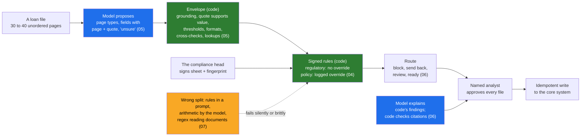

# Day 11 · The System Around the Model: What the LLM Does, What Deterministic Code Does, and Why

> **[Part 3 · Building the System Around the Model](../README.md)** · Chapter 1 of 10 · Video ~12 min · Chapter tier: big
> Builds on: [Day 7 (the walking skeleton)](../../02-discovery-and-decomposition/07-decomposition/README.md) ·
> [Day 10 (the signed scope)](../../02-discovery-and-decomposition/10-the-discovery-document/README.md) ·
> [Day 6 (findings A7, A8 and B4)](../../02-discovery-and-decomposition/06-discovery-interviews/README.md) ·
> [Day 8 (milestone M10)](../../02-discovery-and-decomposition/08-scoping-the-first-90-days/README.md)
> Sets up: Day 12 (the model box as production code), Day 13 (the prompts inside it), Day 14 (the golden set that
> sets the thresholds), Day 16 (the integration box), Day 17 and Day 41 (applying and attacking the split in
> agents), Day 18 (where verification sits in the interface), Day 19 (rule fire rates as signals), Day 20 (the
> skeleton shipped)
> **Owner:** this chapter owns **deterministic versus LLM for the course: the eight boxes of an enterprise AI
> system; why hard constraints are deterministic code that holds every time and the model handles reading,
> nuance and explanation; the decision table for where each kind of logic belongs; sorting a customer's rules
> into regulatory, policy and judgement; rules as signed code with a fingerprint; "the model proposes, code
> disposes" and the deterministic envelope around every model call; the four seam patterns; and the failure
> modes when the split is wrong in either direction.** Structured outputs and the API are Day 12's; prompts are
> Day 13's; the golden set and thresholds are Day 14's; the integration is Day 16's; the state machine is Day 17's;
> the review screen is Day 18's; prompt injection is Day 41's.
> Versions used: the code was run on **Python 3.14.3** (it needs **3.12 or newer**) with **pytest 9.1.1**,
> pinned in `code/requirements.txt`; the intake package uses the standard library only. The optional real-model
> adapter pins **anthropic 1.17.0** and is never needed (as of October 2026). Shown outputs are from real runs.
> All data is synthetic and generated by code, reusing Day 7's generator by path.

---

## Why this chapter exists

The systems that fail in production are the ones where a hard constraint was left to a prompt. At Godavari the
cost of that failure has a name and a date: an RBI auditor sampling files in March, a missing KYC document
recorded as an observation, and, repeated, a finding with the compliance head's name on the response. She set
the condition in week two: "I sign it, and if it changes, I sign the change. I do not want a machine deciding."
The 2019 OCR pilot that guessed a monthly income as annual was switched off in six weeks, and Bhavani's honest
"I would not know" says why review alone would not have saved it.

This is also the first chapter of the course with real software, and the most important architectural judgement
an FDE makes. OpenAI's FDE team keeps hard business constraints in deterministic code "checked 100% of the time"
and uses the model for nuance, explanation and exploring a simulator rather than solving directly; applied AI
work is in 80 percent or more of the 1,000 FDE postings analysed in 2026; and the system-design round listens for
the moment you say where the model stops and what stops it.

This chapter teaches the split as engineering. It draws the system as eight boxes with the model as one, gives a
decision table for where each kind of logic belongs, sorts Godavari's rules into regulatory, policy and judgement,
makes the completeness checks signed, fingerprinted code, wraps the model in a deterministic envelope, and works
through the seams where judgement and rule meet. Then it builds the whole thing as an offline prototype over Day
7's 200 synthetic files and shows, file by file, what the rules caught that the model alone would have shipped:
61 problems against 2.

## Mental model

One sentence to carry out of the chapter: **the model reads and explains; deterministic code checks what it read,
applies every rule the customer has written, does every sum and lookup, and decides the route; a named person
approves; and the rule owner signs exactly the code that runs.**

## Learning goals

After this chapter you can:

1. Draw any enterprise AI system as eight boxes (ingestion, retrieval, model, rules, verification, interface,
   integration, observability) in the customer's words, with each box's failure mode, who notices it first, and
   where the humans sit by design.
2. Explain why deterministic code enforces hard constraints every time while the model handles reading, nuance
   and explanation, and do the "99 percent of 2,400 files" arithmetic that ends the argument.
3. Use the decision table: rules, regulatory constraints, arithmetic, lookups and joins, ID and format validation,
   permissions and writes to code; reading messy documents, classification, summarising, explaining and drafting
   to the model; the seams to both, with a contract.
4. Sort a customer's rules into regulatory (code, no override), policy (code, logged override) and judgement
   (model proposes, a person decides), and spot the unwritten policy that is masquerading as judgement.
5. Build rules as signed code: ids, kinds, sentences, sources, generated rule sheets, a fingerprint, a sign-off
   record, and boundary tests named in the owner's language.
6. Wrap a model call in the deterministic envelope: a contract that allows "unsure", grounding, value-in-quote,
   confidence thresholds, formats and checksums, cross-checks, reference lookups, and rules last, all failing
   closed.
7. Design the four seams: model proposes and code verifies; code decides and the model explains; the model
   classifies and code counts; the model explores and code evaluates.
8. Recognise the failure modes of a wrong split in both directions and which the customer notices first.
9. Build and run the offline prototype: a model interface with a deterministic stub and an optional real adapter,
   rules for two products with tests, routing, an idempotent sandbox write, and a report of what the rules caught.
10. Direct a coding agent to build it while catching its characteristic mistakes: rules in the prompt, a model
    verdict that short-circuits the rules, failing open, and floats for money.

**Prerequisites:** Days 6, 7 and 10 (the findings, the skeleton, the signed scope). Python at a working level:
dataclasses, type hints, pytest.

## Reading order

| # | Section | What you get | Words |
|---|---|---|---|
| 01 | [Why the system around the model](01-why-the-system-around-the-model.md) | two pipelines on one Tuesday; the 2019 failure and the three Day 6 findings; the split in one table; the career reason; the hard parts | ~1,650 |
| 02 | [The eight boxes](02-the-eight-boxes.md) | the picture; each box's job, failure and who notices first; the order customers notice; where the humans sit | ~1,350 |
| 03 | [Deterministic versus LLM](03-deterministic-versus-llm.md) | two promises; why 99 percent is the wrong kind of number; OpenAI's two-supplier rule and simulator; the decision table | ~1,600 |
| 04 | [Sorting the customer's rules](04-sorting-the-customers-rules.md) | regulatory, policy, judgement; the sorting flowchart; Godavari's rules sorted; rules as signed code; draft, reviewed, signed | ~1,450 |
| 05 | [The model proposes, code disposes](05-the-model-proposes-code-disposes.md) | the envelope; the contract with "unsure"; grounding; copy, never convert; confidence, formats, cross-checks, lookups; rules last; fail closed | ~1,350 |
| 06 | [The seams](06-the-seams.md) | the four seam patterns, each with Godavari's code; contracts at every seam | ~1,200 |
| 07 | [When the split is wrong](07-when-the-split-is-wrong.md) | too much to the model; too much to code; which failure the customer notices, and when | ~1,250 |
| 08 | [Godavari's architecture](08-godavari-architecture.md) | the one-page architecture; one file walked through; real and stubbed, box by box | ~900 |
| 09 | [Advanced and 2026 patterns](09-advanced-and-2026-patterns.md) | structured outputs; deterministic tools; the model as rule drafter; policy engines; guardrails and judges; what is hype | ~1,200 |
| 10 | [Production concerns](10-production-concerns.md) | which rule version decided a file; effective dates; change control; cost; monitoring the split; privacy at the seams; handover | ~1,150 |
| 11 | [Project: the split prototype](11-project-the-split-prototype.md) | the code, the Day 7 batch reused, the full real run, what the numbers mean, the tests, pilot mode refusing, the optional real model | ~1,950 (plus output) |
| 12 | [Build it with AI, and how you know it's right](12-build-with-ai-and-verification.md) | context and prompts for an agent; the eleven mistakes it makes on this concept; ten checks and a review checklist | ~1,500 |
| 13 | [Mistakes and debugging](13-mistakes-and-debugging.md) | symptom, cause, fix in the design, the running system and the code; a routine for "it accepted something it should not have" | ~1,100 |
| 14 | [Interview questions](14-interview-questions.md) | 16 questions with model answers, plus a quick-fire round | ~2,000 |
| 15 | [Exercises](15-exercises.md) | 12 graded exercises: predict-the-output, break-it-then-fix-it, close a residual, change a signed rule, review AI-written code and an AI-written architecture | ~2,500 |
| 16 | [Further reading](16-further-reading.md) | the OpenAI FDE sources, structured outputs, the RBI KYC and gold-lending texts, policy engines | ~750 |

Word counts are prose only, without code blocks. **Short on time?** Read 03, 04 and 05, then run the project (11)
and do exercises 2.1 and 3.1. That is the video plus the judgement the system-design round tests.

## Files

| Path | What |
|---|---|
| [`code/intake/`](code/intake/) | the prototype: contract, Day 7 loader, synthetic files, model interface and stub, optional LLM adapter, validators, reference data, rule machinery, two products' rules, sign-off record, routing, pipeline, core write |
| [`code/run_batch.py`](code/run_batch.py) | the end-to-end run over Day 7's sample; writes `data/godavari_intake_run.csv` and `data/godavari_intake_summary.md` |
| [`code/print_rules.py`](code/print_rules.py) | generates the rule sheets the compliance head signs, with fingerprints |
| [`code/tests/`](code/tests/) | 81 tests: validators, every rule boundary, sign-off and overrides, routing and the core write, end to end, the adapter with a fake client |
| [`code/exercises/ai_draft_completeness.py`](code/exercises/ai_draft_completeness.py) | an AI-written checker with at least nine problems; exercise 3.1 |
| [`code/requirements.txt`](code/requirements.txt) · [`code/requirements-llm.txt`](code/requirements-llm.txt) | pinned test dependencies; the optional SDK pin |
| [`worksheet/godavari-architecture-one-page.md`](worksheet/godavari-architecture-one-page.md) | the one-page architecture for the engagement folder |
| [`worksheet/godavari-rules-sorted.md`](worksheet/godavari-rules-sorted.md) | every Godavari rule and judgement, sorted, with owner, source and rule id |
| [`worksheet/split-worksheet-template.md`](worksheet/split-worksheet-template.md) | the empty worksheet for the next customer |
| [`worksheet/ai-draft-architecture.md`](worksheet/ai-draft-architecture.md) | an AI-written architecture with at least twelve problems; exercise 3.2 |
| `data/` | the generated run CSV, run summary and two rule sheets |

Run from the chapter folder: `pip install -r code/requirements.txt`, then `python -X utf8 code/print_rules.py`,
`python -X utf8 code/run_batch.py` (about 0.4 seconds) and `python -X utf8 -m pytest code` (81 tests, about 0.3
seconds). No network and no API key. `-X utf8` keeps Windows consoles happy with the middle dot and the Telugu
labels on the synthetic forms.

## What this chapter does *not* teach (single-owner rule)

| Topic | Where it's taught |
|---|---|
| Calling a model in production: structured-output schemas, tool use, streaming, retries, cost budgets | Day 12 (the adapter here is a minimal preview) |
| Prompts as versioned code, page-type prompts | Day 13 |
| The golden set, per-field accuracy, setting thresholds from labels | Day 14 (thresholds here are labelled placeholders) |
| OCR quality, chunking, permission-aware retrieval | Day 15 and Day 22 (`visible_to` here is the one-line version) |
| The SOAP client, SFTP, the tracker, the metadata layer | Day 16 (the sandbox here is fake) |
| Workflows as state machines, approval gates, idempotency in depth | Day 17 |
| The review screen with crops beside fields | Day 18 |
| Traces, cost and quality dashboards | Day 19 |
| Prompt injection and data exfiltration through tools | Day 41 |
| How LLMs work underneath | learn-ai-ml |

## Analogies for the Telugu audience

- **DRS in cricket** (the chapter's main picture): ball-tracking is deterministic and nobody argues with it; the
  umpire's soft signal handles the nuance; trust comes from everyone knowing which decides what. The fourteen
  documents and the LTV cap are ball-tracking; "which statement is the salary account" is the soft signal (01.4).
- **The family biryani recipe card** (Day 13's picture, previewed): a rule written down with its date can be
  checked; a rule in someone's head, or in a prompt, cannot (04.4).
- **The tasting plate at a wedding kitchen** (Day 7 and Day 20): the prototype is one plate with every item on it,
  judged honestly, including what is still missing (08.3).

## Video map

The video (~12 min) covers a slice; the notes cover everything.

| Asset | Covers | Sections |
|---|---|---|
| **Day 11 main video** (~12 min) | Hook: two pipelines, one Tuesday; the auditor's question each one can answer (1.5 min) → the 2019 pilot and the compliance head's condition (1 min) → the eight boxes, the model as one; who notices each failure first (2 min) → deterministic versus LLM: two promises; 99 percent of 2,400 files (1.5 min) → OpenAI's two-supplier rule and the simulator (1 min) → the decision table (1 min) → sorting Godavari's rules into regulatory, policy, judgement; the unwritten address list (1.5 min) → the model proposes, code disposes: grounding and "copy, never convert" on screen (1.5 min) → the run: 61 against 2, and the two misses shown honestly (1 min) → recap; Day 12 and Day 14 teasers (0.5 min) | 01.1 to 01.4, 02.1 to 02.3, 03.2 to 03.4, 04.1 to 04.3, 05.3 to 05.4, 11.5 to 11.6 |
| **Short 1:** "The LLM is one box. The other seven decide if anyone trusts it." | the eight-box picture; the "who notices first" column; one failure each for the model with and without boxes 4 and 5 | 02.1 to 02.3 |
| **Short 2:** "Two suppliers per critical part: a rule you never leave to a prompt." | OpenAI's automotive constraint checked 100 percent of the time; Godavari's version, the gold LTV, with GF-25032's numbers: the model's Rs 6,07,478 against code's Rs 4,97,027 | 03.3, 07.2 |
| Notes only | the humans in the diagram (02.4), the sorting flowchart and signed-rules mechanics (04.2, 04.4 to 04.5), the full envelope (05), the four seams (06), both failure directions (07), the one-page architecture (08), 2026 patterns and hype (09), production (10), the project and tests (11), Build it with AI and verification (12), debugging (13), interviews (14), exercises (15) | as listed |

**Callbacks to use on screen:** "Day 6 lo compliance head cheppindi gurtunda: 'I sign it, and if it changes, I
sign the change.' Ivala aa sentence ni code ga marchutunnam." (section 01); "Day 7 skeleton lo 'checks: one
checklist, as code' ani raasam; ivala aa layer ni build chestunnam." (section 08); "Day 7 lo generate chesina
200 files ne ivala malli vaadutunnam, copy cheyakunda." (section 11).
**Forward callbacks:** Day 12 (ee model box ni production API call ga), Day 14 (ee placeholder thresholds ni
golden set tho set chestam), Day 17 (ide split ni state machine lo), Day 41 (ee split ni attack chestam).

## Callbacks

- **Builds on:** [Day 6](../../02-discovery-and-decomposition/06-discovery-interviews/README.md) (findings A1,
  A5 to A8 and B4; the compliance head's and the CISO's conditions verbatim),
  [Day 7](../../02-discovery-and-decomposition/07-decomposition/README.md) (the walking skeleton's "checks as code"
  layer; the generator this chapter imports), [Day 8](../../02-discovery-and-decomposition/08-scoping-the-first-90-days/README.md)
  (M07 in week 3; M10, the signature on 2 December), [Day 9](../../02-discovery-and-decomposition/09-success-metrics-and-business-case/README.md)
  (the baseline the synthetic numbers must not be confused with), [Day 10](../../02-discovery-and-decomposition/10-the-discovery-document/README.md)
  (the signed scope; decisions D04 and D07; risk R7).
- **Sets up:** [Day 12](../12-llm-apis-for-production/README.md) (the model box), [Day 13](../13-prompts-as-code/README.md)
  (the prompts inside it), [Day 14](../14-evals-first/README.md) (the golden set and thresholds),
  [Day 16](../16-integrating-with-what-exists/README.md) (the integration box), [Day 17](../17-agents-and-workflows/README.md)
  (the split in a state machine), [Day 18](../18-verification-and-trust/README.md) (verification in the interface),
  [Day 19](../19-observability-for-ai-systems/README.md) (rule fire rates as signals),
  [Day 20](../20-the-walking-skeleton-shipped/README.md) (the skeleton shipped),
  [Day 41](../../07-ai-era-toolkit/41-red-teaming-your-deployment/README.md) (attacking the split).

**Next chapter:** [Day 12 · LLM APIs for production: structured outputs, tool use, streaming, retries, cost and latency budgets](../12-llm-apis-for-production/README.md).
