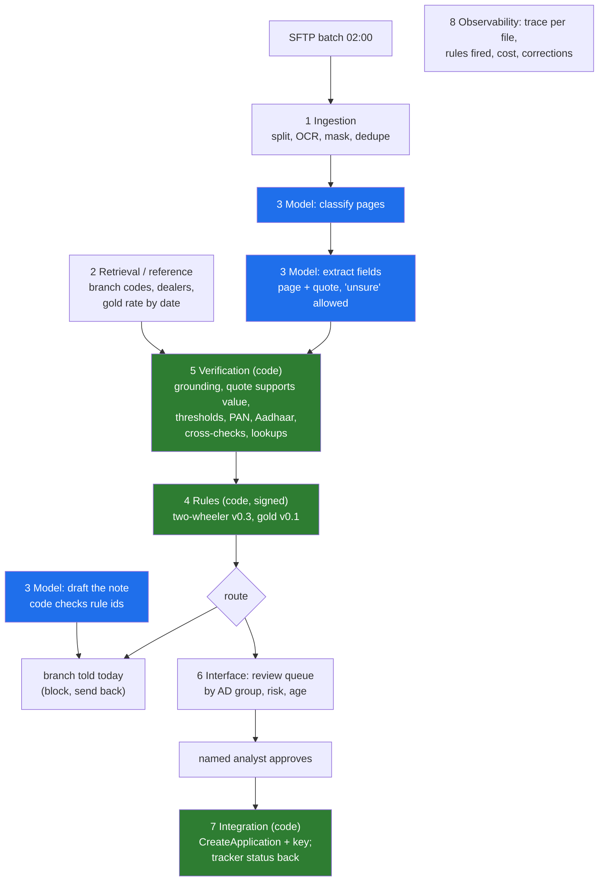

# Godavari Finance · loan-file intake · architecture on one page

> Engagement folder · Day 11 · Version 0.2, drafted in week 3 (prototype phase) and filed beside the
> [discovery document](../../../02-discovery-and-decomposition/10-the-discovery-document/worksheet/godavari-discovery-document.md)
> at the week-4 checkpoint · Author: the Kaagaz AI FDE · Reviewed with the compliance head (rules box), the
> core-system owner (integration box) and the Vijayawada team lead (interface box) · All data synthetic.

**The problem, as signed in week one (Day 4):** "New loan files take a median of nine days from receipt to
decision because intake is manual and a third of files are incomplete."

**The principle:** the model reads; code decides; a named analyst approves every file. Every rule the RBI or
Godavari has written is deterministic code the compliance head signs. The model never routes a file, writes to
the core system or overrides a rule.

## The eight boxes

| # | Box | Godavari's version | Code or model | Owner at Godavari | Week 3 (skeleton) | Built properly in |
|---|---|---|---|---|---|---|
| 1 | Ingestion | nightly SFTP batch, region folders, one PDF per file | code | IT (SFTP), the FDE | synthetic pages from Day 7's sample | Day 16 |
| 2 | Retrieval | the right page; branch codes, dealer list, gold rate by date | code | IT; treasury for the rate | tables in code | Days 15, 22 |
| 3 | Model | classify pages; extract with quotes; draft the analyst's note | **model** | Kaagaz (vendor), measured against Godavari's golden set | deterministic stub; optional real adapter on synthetic data only | Days 12, 13 |
| 4 | Rules | 14 two-wheeler documents, 9 gold; address list v0.3; Aadhaar mask; margin; LTV; dates | code, signed | **the compliance head** | v0.3 reviewed in draft 6 Nov; signature M10, 2 Dec | this chapter |
| 5 | Verification | grounding; value in quote; thresholds; PAN and Aadhaar formats; card against form; lookups | code | the FDE; thresholds from Lakshmi and the senior analyst's labels | all checks; placeholder thresholds | Days 14, 18 |
| 6 | Interface | review queue per region (Hyderabad: Kukatpally, Dilsukhnagar, Warangal; Vijayawada: Guntur, Vijayawada-Benz Circle, Rajahmundry) | code | Srinivas and the Vijayawada team lead | routes and queues as data | Day 18 |
| 7 | Integration | CreateApplication on the 2009 SOAP API; key from file number and branch code; tracker written back; no writes 17:30 to 20:00 | code | **the core-system owner** | fake sandbox, idempotent push | Days 16, 17 |
| 8 | Observability | trace per file: pages, model calls, rules fired, cost, corrections | code | Godavari's application-support engineer after handoff | per-file CSV | Day 19 |

## What goes where

| To code (deterministic, tested, signed) | To the model (proposes, with evidence) | Never automated |
|---|---|---|
| the fourteen and nine document checklists; co-applicant KYC when named | reading the hand-filled, stamped, Telugu and English application form | the sanction: a named credit manager (finding A6) |
| address proof: an OVD or on the signed list, in the applicant's own name; bill age | classifying each of 30 to 40 unordered pages | approval of each file: a named analyst (decision D07) |
| PAN format and holder letter; Aadhaar masked (Verhoeff scan of every page) | which bank statement is the salary account (code checks the credits) | |
| amount limits, 90 percent margin, tenure, age on the application date | the plain-language note explaining a discrepancy (code checks it cites the rules) | |
| gold LTV: tiered cap of net weight x purity x the published rate on the appraisal date | | |
| date logic: quotation before application; statement recent; sanction before disbursement | | |
| branch visibility from AD groups, inside every query | | |
| the write to the core system, once, after approval | | |

## Where the people are

| Person | Box | Decides |
|---|---|---|
| the compliance head | 4 | the rules and every change to them; signs the sheet and fingerprint |
| a named analyst | 6 | every file: corrects flagged fields, approves or returns |
| Lakshmi and the senior analyst | 5 (through Day 14) | what "correct" means; the labels thresholds are set from |
| branch staff (Kukatpally, Guntur first) | 1 | what to resubmit, told on day one with the rule id |
| the core-system owner | 7 | the write path; live writes only after a month of clean test calls (M14) |
| the CISO | all | where any of this may run: the building, then the Mumbai VPC (section 8 of the discovery document) |

## What the week-3 prototype showed (synthetic batch, 130 files)

- Rule breaches (missing documents, unlisted address proofs, unmasked Aadhaar, over-margin, over-LTV, stale
  statements): every one caught by code; the model alone, judging in its prompt, would have shipped 38 of 102.
- Wrong extracted values: 21 of 23 caught by verification; the 2 misses reach an analyst, and the next
  cross-checks to add are named.
- No file sent back to a branch without a real problem; no duplicate in the sandbox on retry; regulatory
  overrides refused; pilot mode refuses unsigned rules.
- Source: [`data/godavari_intake_summary.md`](../data/godavari_intake_summary.md). The synthetic files carry
  more problems than real ones on purpose; accuracy on Godavari's files is measured on the golden set (Day 14).

## Open items

| # | Item | Owner | By |
|---|---|---|---|
| 1 | sign the two-wheeler rules v0.3 (or v0.4 with changes) | the compliance head | M10, 2 Dec 2026 |
| 2 | review the gold rules v0.1, or move gold to the next 90 days (risk R7) | the compliance head | before the RBI inspection |
| 3 | thresholds per field from the golden set | the FDE with Lakshmi and the senior analyst | Day 14, then Day 18 |
| 4 | where the model runs for the pilot (in the building) and production (Mumbai VPC) | the CISO | M11, 3 Dec 2026; M15 |
| 5 | rule effective dates: which date governs a file (receipt or decision) | the compliance head | before the pilot |
