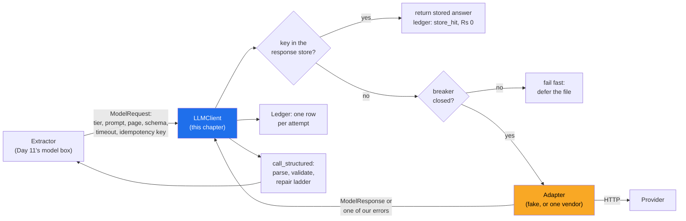

# 02 · The Call as a Dependency: One Interface, One Adapter, One Ledger Row per Attempt

> Day 12 · Section 2 of 14 · [Chapter overview](README.md) · Previous: [01 · Why production LLM calls](01-why-production-llm-calls.md) · Next: [03 · Structured outputs](03-structured-outputs.md)

---

## 2.1 What one call really is

In plain words, a model API call is an HTTP request to someone else's computer that takes between half
a second and a few minutes, costs money per token in both directions, may be refused because you are
going too fast, may fail because they are overloaded, and returns text that you must still check. Every
production concern in this chapter follows from that sentence.

Treat it the way you would treat a payment gateway or the core system's SOAP API (Day 16): behind a
thin layer of your own code, with a contract for what goes in and comes out, explicit timeouts, a
retry policy, and a record of every attempt.

Three boxes matter. The **extractor** knows about loan files and pages and nothing about vendors. The
**client** knows about retries, keys, budgets and validation and nothing about loan files. The
**adapter** knows one vendor's SDK and nothing else. Each can be replaced without touching the others.

## 2.2 The provider-neutral interface

The whole boundary is three types and one method (`code/godavari_llm/provider.py`):

| Type | Holds | Why it is shaped this way |
|---|---|---|
| `ModelRequest` | tier (small or large), the stable system prompt, the variable user text, a page reference, the JSON schema, max output tokens, timeout, idempotency key, purpose | callers ask for a **tier**, never a model name; the page is a storage reference, never bytes in a log |
| `ModelResponse` | text, usage (uncached input, cache read, cache write, output tokens), model, stop reason, latency, request id | usage is split four ways because the four are priced differently (section 07) |
| `ProviderError` and its subclasses | `RateLimited` (with retry-after), `SpendCapReached`, `Overloaded`, `ServerError`, `ProviderTimeout`, `BadRequest` | each carries `retryable` and `counts_against_health`, so the retry loop and the breaker never inspect a status code |
| `ModelProvider.complete(request)` | one attempt, no internal retries | retries live in one place, the client |

As of October 2026 every major vendor offers structured outputs and tool calling, but the shapes differ:
Anthropic's Messages API takes the schema in `output_config.format` and reports usage as
`input_tokens`, `cache_read_input_tokens`, `cache_creation_input_tokens` and `output_tokens`; OpenAI's
Responses API takes it in `text.format` with `strict: true` and reports a cached-input count. The
adapter's job is to translate those shapes into ours. The optional
`code/godavari_llm/adapters/anthropic_adapter.py` shows one, about 90 lines, and it is the only file in
the project that imports a vendor SDK.

## 2.3 Why the customer cares about the adapter

Provider neutrality is a commercial and compliance requirement at Godavari, not purity. The CISO
decides which model may be called (Day 5 named her a gate on model choice), and if Day 24 concludes
"only an endpoint that processes in India", the route may change: with an adapter, that is one file and
one price-card row. The customer wants to be able to leave, and procurement (Day 23) knows a vendor
threaded through the pipeline cannot be replaced. And swaps are decided by Day 14's golden set, which
runs against any adapter. What the adapter must not do is hide differences that change results: it
makes a swap cheap to try, and the eval decides whether to keep it.

## 2.4 Timeouts are a design decision

The Anthropic Python SDK's default request timeout is 10 minutes, and it retries connection errors,
408, 409, 429 and 5xx twice by default (SDK documentation as of October 2026). Both defaults are
reasonable for a notebook and wrong for a nightly pipeline. A page extraction that has not answered in
30 seconds is not going to be useful at the p95 you promised, and a second, hidden retry layer
multiplies attempts without a ledger row for any of them.

The rules this chapter's client follows:

- **Set the timeout per stage from the latency budget**, not from the SDK default: 15 seconds for a
  classification, 30 for an extraction (section 07).
- **Turn the SDK's own retries off** (`max_retries=0`) when your client retries. One retry loop, in one
  place, with every attempt logged.
- **Bound the whole logical call**, not just each attempt: four attempts at most and a 90-second
  deadline, and never start an attempt that could not finish inside that deadline.

## 2.5 What to record on every call

Every attempt, successful or not, becomes one ledger row (`code/godavari_llm/ledger.py`): file, page,
stage, tier, model, purpose (first try, bigger output budget, repair), attempt number, outcome, the four
token counts, whether the tokens are an estimate, dollars, rupees, start time, elapsed time and the
idempotency key. That row answers, later and without guesswork, every question in this list:

| Question someone will ask | Answered by |
|---|---|
| "Why did this file cost Rs 9.57?" | sum of its rows, grouped by stage |
| "How many 429s did we get last night, and at what time?" | outcome and start time |
| "Did the provider bill us for calls we gave up on?" | rows marked `timeout`, reconciled with the provider's invoice |

What the row must not hold: the page image, the prompt text with a customer's name in it, the model's
answer. Those are customer data with residency and retention rules (Day 19 redacts at the logging
boundary; Day 24 owns where data may live). The ledger stores keys and numbers.

## 2.6 Sync, streaming or batch: decide per use, not per project

| Use at Godavari | Who waits | Mode | Why |
|---|---|---|---|
| the 02:00 SFTP drop, 50 to 60 files | nobody until 08:00 | synchronous calls in a worker pool, or a batch API with a fallback | six hours of slack; throughput and cost matter, first-token latency does not (sections 06, 08) |
| the analyst re-runs a file from the review screen | Lakshmi, at her desk | synchronous, high priority | the p95 promise is for her (section 07) |
| the plain-language discrepancy note on her screen | Lakshmi, reading | streaming | words appear in under a second instead of after five (section 05) |
| re-scoring the golden set after a prompt change (Day 14) | nobody | batch API | half price, results within the day |
