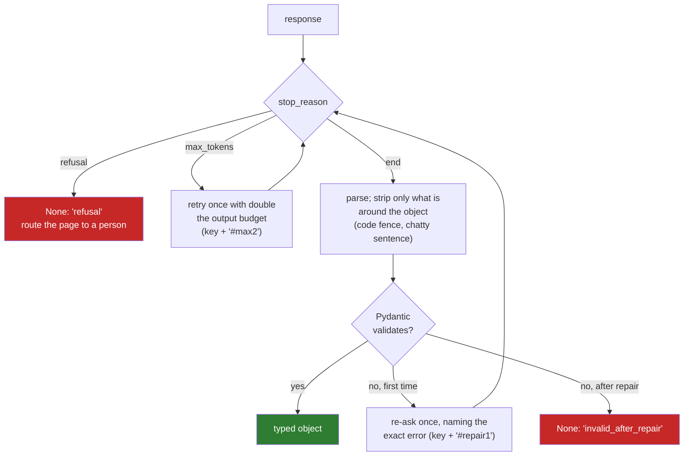

# 03 · Structured Outputs: The Model Fills a Form, Not a Page

> Day 12 · Section 3 of 14 · [Chapter overview](README.md) · Previous: [02 · The call as a dependency](02-the-call-as-a-dependency.md) · Next: [04 · Tool use](04-tool-use.md)

---

## 3.1 In plain words

Without structured outputs, you ask the model for JSON and hope. Usually you get it. Sometimes you get
it inside a code fence, or after "Here is the extracted data:", or cut off half way because the output
limit was reached. Your parser then fails at 03:10 on page 27 of file 41.

With structured outputs, you hand the provider a JSON schema, and the provider restricts what the model
is allowed to generate so that the output matches it. The model fills a form instead of writing a page.
It is the single biggest reliability improvement in LLM APIs of the last two years, and every major
vendor offers it as of October 2026.

## 3.2 How it works inside

The provider compiles your schema into a grammar and, at each step of generation, masks out the tokens
that would break it. If the schema says the next thing is a number, letters cannot be generated. This
is called constrained decoding. Three consequences follow, all documented by the vendors:

- **The first request with a new schema is slower**, while the grammar compiles. Anthropic's
  documentation says compiled grammars are cached for 24 hours from last use; OpenAI's says later
  requests with the same schema have no added latency. Keep the schema stable and versioned, and warm
  it before the 02:00 run if the first call's latency matters.
- **Not every JSON Schema keyword is supported.** As of October 2026, Anthropic lists `minimum`,
  `maximum`, `multipleOf`, `minLength` and `maxLength` as unsupported, requires `additionalProperties:
  false` on objects, and supports `pattern` only in a limited form. OpenAI's strict mode has its own
  list. An unsupported keyword is a 400, not a warning.
- **"Guaranteed" has exceptions.** Anthropic's page lists them: a refusal (`stop_reason: "refusal"`)
  takes precedence over the schema; a response cut by `max_tokens` may be incomplete; and the
  capitalisation of enum values is not guaranteed. OpenAI returns a separate `refusal` field.

## 3.3 Pydantic as the single source of the schema

Write the contract once, in code, and derive everything else from it. Day 11 wrote the vocabulary as
dataclasses; `code/godavari_llm/contract.py` writes it as Pydantic models:

```python
class TextField(Strict):                     # Strict: extra="forbid"
    value: str | None = Field(description="as printed; null means unsure or not on this page")
    confidence: Confidence                   # float, 0 to 1
    evidence: Evidence                       # the exact line, at most 200 characters

class PageExtraction(Strict):
    page_type: Doc
    applicant_name: TextField
    applicant_pan: TextField
    co_applicant_name: TextField
    product: TextField
    requested_amount: AmountField            # value: int >= 1, or null
    monthly_income: AmountField

    @field_validator("applicant_pan")
    @classmethod
    def pan_shape(cls, v):                   # five letters, four digits, one letter
        ...
```

The same model does three jobs. `provider_schema(PageExtraction)` produces the schema the provider
receives: every property required, `additionalProperties: false`, titles and defaults dropped, and the
limits the provider would reject (`minimum 1`, `maxLength 200`) moved into the field's description so
the model still reads them. Local validation then uses the full Pydantic model, limits and the PAN
validator included. And the rest of the pipeline reads typed objects, so no code can use a field before
it has been checked.

| Check | Where it runs | What it catches |
|---|---|---|
| types, required fields, no extra keys, enums | provider (constrained decoding) and locally | the shape |
| numeric and length limits, the PAN pattern | locally (Pydantic) | values the provider dialect cannot express |
| evidence on the page, value matches its evidence | locally, after validation (section 3.5) | valid shape, wrong content |
| pages disagree, PAN against surname, mandatory documents | locally, in code (the merge here, Day 11's rules) | wrong content across pages |

The schema is versioned (`SCHEMA_VERSION = "godavari-extraction/1.0"`), and the version is part of
every idempotency key, so an answer produced under one schema is never reused under another.

## 3.4 When the output is still invalid: the repair ladder

`LLMClient.call_structured` turns one logical call into a validated object or `None`, and records what
it took:



Two rules make the ladder safe:

1. **Strip wrappers, never edit content.** Removing a code fence is deterministic and loses nothing.
   Closing a truncated brace, fixing a quote or guessing a missing digit is inventing data. The
   function `lenient_json` refuses to do it, and a test (`test_truncated_json_is_not_patched`) holds it
   to that.
2. **Every rung is bounded and has its own key.** At most one bigger-budget retry and one repair per
   page, each with a suffixed idempotency key, so a re-run replays the same path from the store at no
   cost.

In the simulated night (section 10), with constrained decoding on, the ladder handled 17 truncations
and 5 refusals across 1,835 logical calls. Run the same night with `--json-mode prompt` (JSON asked for
in the prompt, no constrained decoding) and 127 responses needed a wrapper stripped. The cost barely
moves; the number of things that can go wrong does.

## 3.5 Valid shape, wrong content

This is the part that matters most, and the part demos never show. A response can match the schema
exactly, carry a confidence of 0.93, and be wrong. The fake provider serves five kinds of wrong answer,
each modelled on a real failure of document models:

| Wrong answer served | Example | Caught by | In the simulated night |
|---|---|---|---|
| amount off by a factor of ten | 12,50,000 for "Rs. 1,25,000" | value does not match its own evidence | 1 of 1 stopped |
| income read as annual | 4,80,000 for "Net monthly salary: Rs. 40,000" | value does not match its evidence | 8 of 8 stopped |
| one PAN digit misread, evidence "corrected" to match | ABCPR1294K | evidence text is not on the page | 5 of 5 stopped |
| co-applicant's name as the applicant | the line "Co-applicant name: ..." quoted as evidence | the merge: application form and PAN card disagree | 1 of 1 stopped |
| the wrong amount line on the right page | the ex-showroom price as the requested amount | **nothing**: the line is on the page and the value matches it | **1 of 1 missed** |

What to do when a check fails, in order:

1. **Do not retry blind.** The same request will usually get the same answer, and you pay for it again.
2. **Re-ask once, naming the failed check** ("value 1250000 does not match its evidence 'Loan amount
   requested: Rs. 1,25,000'; read the page again"). In the night, 10 of 13 content failures were fixed
   this way.
3. **If it still fails, withhold the field**: set it to `null` with a flag, so the file goes to the
   review queue with the reason attached (Day 18 builds the queue). Never "correct" it in code by
   guessing which number was meant.
4. **Record it.** Every content failure is a labelled example for Day 14's golden set.

The last row of the table is the honest limit. Cheap, certain checks (the API layer's share of Day 11's deterministic envelope) catch most wrong answers; they
cannot catch a value that is real, printed on the page, consistent with its evidence, and simply the
wrong one. That is why Day 14's eval measures per-field accuracy against analysts' labels, and why a
human approves every file before it reaches the core system. The test
`test_the_wrong_line_on_the_right_page_passes_every_check` exists to keep that limit visible.

## 3.6 Design rules for an extraction schema

- **Null is a first-class answer**; a required non-null field forces the model to invent one.
- **Evidence, verbatim, and a page** buy the cheapest wrong-answer check and the crop beside the field (Day 18).
- **Confidence is a ranking, not a probability**, until Day 14 calibrates it against labels.
- **Small schemas per page**; code assembles the file, not the model.
- **Version the schema and put the version in the key.**
