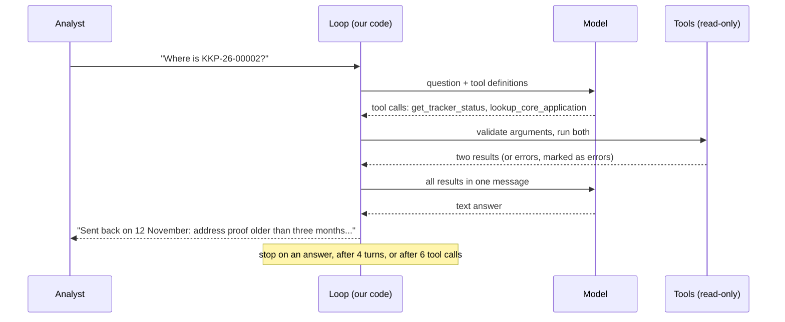

# 04 · Tool Use: Declaring Functions, the Loop, and When Not to Use Tools

> Day 12 · Section 4 of 14 · [Chapter overview](README.md) · Previous: [03 · Structured outputs](03-structured-outputs.md) · Next: [05 · Streaming](05-streaming.md)

---

## 4.1 In plain words

Tool use (also called function calling) lets the model ask your code to do something and wait for the
answer. You describe a few functions: a name, one sentence on when to use it, and a JSON schema for the
arguments. The model replies either with text or with one or more tool calls. Your code runs the calls,
sends the results back, and the model continues. The model never runs anything itself; it can only ask.

At Godavari, the natural first use is the operator assistant on Lakshmi's screen: "where is file
KKP-26-00002?" The answer is in two legacy places, the Excel tracker and the core system's lookup
operation. Two read-only tools wrap them (`code/tool_loop_demo.py`; Day 16 builds the real wrappers
around the SOAP API).

## 4.2 The loop

The demo's `run_tool_loop` is about forty lines, and every line is a production decision:

- **Validate arguments before running anything.** Each tool's arguments are a Pydantic model; a file
  number that does not match `^[A-Z]{3}-26-\d{5}$` goes back to the model as an error result, not to the
  tracker.
- **Return errors as results, marked as errors.** An unknown tool, invalid arguments or a tool that
  raised become `{"is_error": true, ...}` so the model can recover. The loop never crashes on them.
  Anthropic's documentation describes the same convention with `is_error: true` on a `tool_result`.
- **Run parallel calls together and return all results in one message.** When the model asks for the
  tracker and the core record in one turn, run both and send both back together. Anthropic's
  documentation notes that splitting results across messages discourages parallel calls.
- **Bound it twice.** A turn budget (4) and a tool-call budget (6). The third scenario in the demo is a
  model that keeps asking for the same row; the loop stops at the sixth call with "stopped: tool-call
  budget" instead of spending until someone notices.

The second scenario shows the most important property. The model reaches for `update_kyc_status`, a
write it was never given. The loop has no such tool, returns an error, and the model answers within
what it can do. **The tool list is the permission list.** Writes to the core system go through Day 17's
state machine and an analyst's approval, never through a tool the model can call on its own.

## 4.3 Defining tools well

| Rule | Why |
|---|---|
| few tools, one job each, verbs in the name | the model chooses better among four clear tools than twenty overlapping ones |
| one sentence on **when** to use it, not just what it does | the description is the only routing signal the model has |
| small argument schemas, strict where offered | Anthropic's `strict: true` on a tool, and OpenAI's strict function calling, enforce the schema on arguments as structured outputs do on answers |
| read-only by default; risk class written down for anything else | read, propose, write-reversible, write-irreversible: Day 17's classes |
| return small, structured results | a 40-row tracker dump is input tokens you pay for on every later turn |
| results are data, never instructions | a tool that returns document text can carry injected instructions (Day 41 owns this; one line here) |

## 4.4 When not to use tools

The extraction pipeline in this chapter uses **no tools at all**, on purpose.

| Temptation | Why not | Do instead |
|---|---|---|
| a `submit_fields` tool to get JSON out of the model | that is what structured outputs are for; a tool adds a turn and a loop | structured output on one call |
| a `check_product_limit` tool the model may call | the limit is a regulatory or policy rule; Day 11 put it in code that runs every time, not when the model remembers | code calls the rule after extraction |
| a `classify_page` tool inside an extraction loop | a fixed sequence (classify, then extract) is a workflow, not an agent decision | two stages in code, as in `extractor.py` |
| a `create_application` tool for the core system | an irreversible write chosen by a model, with retries, is how a duplicate loan is born | Day 17: state machine, approval, idempotency key |

Use tools when the model genuinely has to decide what to look up next: an open question from an
analyst, a lookup that depends on what the last one returned. Use code when you know the sequence.
Anthropic's "Building effective agents" draws the same line between workflows and agents; Day 17 builds
on it.

## 4.5 What changes at scale

Each turn is a full model call, and the whole conversation is resent as input every turn (prompt caching
helps, section 08). Put the loop's calls through the same `LLMClient`, so every turn has a ledger row, a
timeout and a retry policy, and give the loop a rupee budget as well as a turn budget. Day 17 makes the
loop a state machine with persisted state; Day 19 traces every turn.
