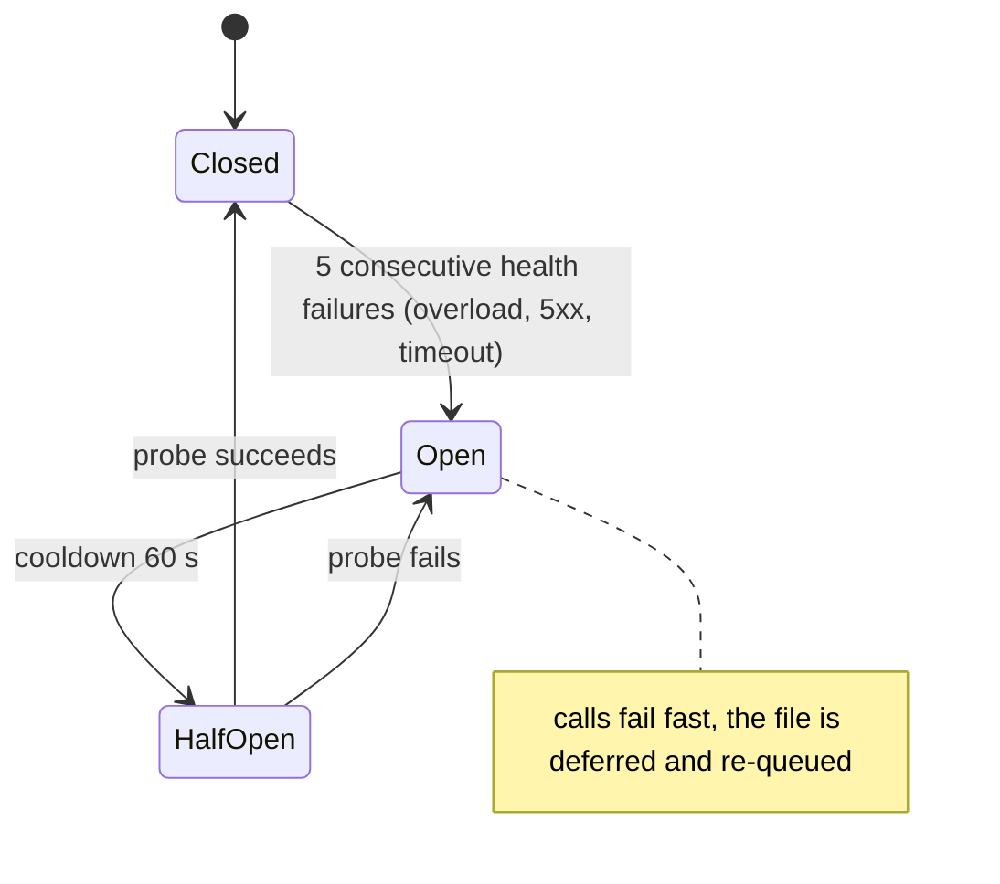

# 06 · Retries, Timeouts, Rate Limits and Circuit Breaking: Calls That Are Safe to Repeat

> Day 12 · Section 6 of 14 · [Chapter overview](README.md) · Previous: [05 · Streaming](05-streaming.md) · Next: [07 · Cost and latency budgets](07-cost-and-latency-budgets.md)

---

## 6.1 Which failures to retry

Retrying is only safe when two things are true: the failure is likely to go away, and repeating the call
cannot do harm. Sort every error by both.

| Failure (Anthropic's names as of October 2026; other vendors are similar) | Goes away? | Retry? | Counts against provider health? |
|---|---|---|---|
| 429 `rate_limit_error` with a `retry-after` header | yes, after the wait | yes, no sooner than `retry-after` | no: we were too fast |
| 429 at a monthly spend cap (no `retry-after`; `error_code: enforced_spend_limit_reached`) | not until the cap lifts | **no** | no |
| 529 `overloaded_error`, 500 `api_error`, dropped connection | usually | yes, with backoff | yes |
| our timeout, or a 504 | sometimes | yes, inside a deadline | yes |
| 400 `invalid_request_error` (bad schema, unsupported parameter), 413 too large | never | **no**: fix the request | no |
| 401, 403 | not without a person | **no**: page someone | no |
| a valid response with a refusal or wrong content | not by repeating | **no**: section 3.4 and 3.5 | no |

The client encodes this table once: each of our error classes carries `retryable` and
`counts_against_health`, and the retry loop reads those two flags instead of status codes. The test
`test_non_retryable_errors_fail_on_the_first_attempt` holds the 400 and spend-cap rows to it.

## 6.2 Backoff with full jitter

When forty workers hit a 429 in the same second and all wait exactly two seconds, they all come back in
the same second and hit it again. Jitter spreads them out. The client uses "full jitter":

```python
def backoff_delay(policy, attempt, rng, retry_after_s=None):
    ceiling = min(policy.max_delay_s, policy.base_delay_s * 2 ** (attempt - 1))   # 1, 2, 4, 8, ... 20 s
    delay = rng.uniform(0.0, ceiling)                                               # anywhere in the window
    if retry_after_s is not None:
        delay = max(delay, retry_after_s)                                           # the server's hint is a floor
    return delay
```

The ceiling doubles per retry and is capped; the actual wait is drawn uniformly below it; and a
`retry-after` from the server is a floor you never undercut (Anthropic's rate-limit page: "wait that
many seconds before retrying"; earlier retries will fail). The jitter generator is seeded in the client,
so a simulated run is reproducible; in production it need not be.

## 6.3 Timeouts and deadlines

Two clocks, both explicit:

- **Per attempt**: 15 seconds for a classification, 30 for an extraction (from section 07's budget).
  When it expires we stop waiting.
- **Per logical call**: at most 4 attempts and 90 seconds, waits included. The client never starts an
  attempt that could not finish inside the deadline even if it succeeded
  (`test_never_starts_a_retry_past_the_call_deadline`).

Without the second clock, four attempts of 30 seconds plus backoff can hold a worker for over two
minutes on one page, and the file's p95 is gone.

## 6.4 A timeout is not a failure: idempotency

When your client times out, the provider may still finish the work and bill it. In the simulated night,
11 attempts timed out; the fake provider, which bills about 70 percent of those as a real one might,
invoiced Rs 7.27 for work the client never received, against a ledger estimate of Rs 6.44. That is
small money and a big lesson: **your ledger under-counts, so reconcile it with the provider's usage
report** (Anthropic's Usage and Cost API, or the console) every week.

It also means the retried call is a second, separately billed request. For a model call, the harm of a
repeat is cost, not a duplicate record. For a write to the core system it is a second loan application,
which is why the write needs idempotency. Where the server supports it, that is an idempotency key (the
Stripe pattern: the server remembers the key and returns the first result for a repeat). Godavari's 2009
core has no such keys, so Day 16 makes every `CreateApplication` safe to retry by looking up before it
creates.

For model calls the client keeps its own memory. The key is built from content, not from time:

```python
key = idempotency_key(file_id=..., page_no=7, page_sha256=sha256(page_bytes), stage="extract",
                      prompt_version="extract-v1", schema_version="godavari-extraction/1.0",
                      model="fake-large-2026-10")
```

Before any call, the client looks the key up in the response store; after a success, it stores the
response. The night shows what that buys:

```text
re-run of the same night: 0 provider calls, Rs 0.00 new spend (1838 store hits so far)
re-scan of page 33 of KMM-26-00001: 2 new model calls, 52 store hits, Rs 0.77
```

The restarted 02:00 job costs nothing; a re-scanned page (new bytes, new key) costs its own two calls; a
file deferred in an outage pays only for what did not finish. Do not assume a vendor deduplicates
generation calls for you: send the key where a gateway accepts one, and keep your own store either way,
inside the customer's boundary with the documents' retention (Day 24).

## 6.5 Rate limits and 429s

Anthropic documents its limits as requests per minute, input tokens per minute and output tokens per
minute per model class, enforced with a token bucket that refills continuously, so a burst inside one
second can be refused even when the minute's total is fine. Two details from the same page change the
design: for most current models, **cached input tokens do not count toward the input-token limit**
(prompt caching raises effective throughput, section 08), and a sharp ramp in usage can trigger
"acceleration limits", so a new deployment should ramp up rather than open at full concurrency.

The fix for 429s is not a smarter retry. It is controlling concurrency before the call. The client runs
every call through a pool of 16 slots (`VirtualScheduler`; in production, a worker pool with a
semaphore), sized from the provider's limits and the latency budget. In the night that produced 40 rate
limits in 1,909 attempts, each absorbed by one retry. If the 429 rate climbs, lower the pool size or ask
for a higher tier; do not raise the retry count.

## 6.6 Circuit breaking: stop calling a provider that is down

The fake provider is overloaded from 02:04 to 02:07. Without a breaker, every page that came up in
those three minutes would retry up to four times into the outage, each attempt holding a worker and
each a candidate for a billed timeout. With one, the night recorded 1,448 instant `circuit_open`
refusals instead, none of them sent to the provider:



```text
breaker: 02:04:01 open, 02:05:02 half_open, 02:05:02 open, 02:06:03 half_open, 02:06:03 open, 02:07:04 half_open, 02:07:05 closed; files deferred and re-queued: 23; passes over the queue: 4
```

Twenty-three files were deferred, re-queued after the next probe time, and finished on later passes with
their completed calls served from the store. The night still ended at 02:10:07. 429s do not trip the
breaker (`test_429s_do_not_trip_the_breaker`): they say we are too fast, not that the provider is sick.

## 6.7 The hidden multiplier

The Anthropic Python SDK retries 429 and 5xx twice by default, honouring `retry-after`. If your client
also retries four times, one logical call can become twelve attempts, and the ledger sees four of them.
Pick one layer. This chapter's adapter constructs the SDK client with `max_retries=0` and lets
`LLMClient` own every retry, so every attempt has a row.
