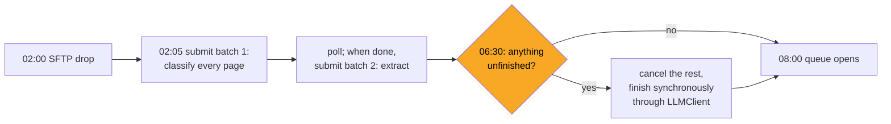

# 08 · Caching, Batch APIs and Model Choice for an India-Region Deployment

> Day 12 · Section 8 of 14 · [Chapter overview](README.md) · Previous: [07 · Cost and latency budgets](07-cost-and-latency-budgets.md) · Next: [09 · 2026 patterns and production concerns](09-2026-patterns-and-production-concerns.md)

---

## 8.1 Two different caches

People say "caching" for two unrelated things. Keep them apart.

| | Prompt caching | Response caching |
|---|---|---|
| what is reused | the provider's processing of an identical **prefix** of the input | a complete **answer** you already received |
| who holds it | the provider, for minutes (Anthropic: 5 minutes by default, 1 hour at a higher write price) | you, in the response store, as long as retention allows |
| what you save | most of the input price of the prefix, and some latency | the whole call |
| when it is safe | always: the answer is still computed fresh | only when the input, prompt, schema and model are identical and the answer does not depend on time or state |

## 8.2 Prompt caching

Providers cache a prefix of the request so the next request starting with the same bytes is cheaper and
faster. Anthropic's pricing page (October 2026): a 5-minute cache write costs 1.25 times the input price,
a cache read 0.1 times (0.05 times on Opus 5.5 and Sonnet 5.5), and caching pays off after one read.
OpenAI lists a separate, lower cached-input price.

What makes it work, or silently not:

- **Stable content first, variable last.** In the night, the extraction prefix (about 1,380 tokens) was
  written once and read about 410 times: 564,980 tokens at a twentieth of the fresh price.
- **Any byte change invalidates it**: a timestamp in the system prompt (the AI-written client in exercise
  3.1 does this), unsorted JSON, a tool list that varies.
- **Short prefixes do not cache.** The 330-token classification prompt never does; its thumbnail
  dominates its cost anyway.
- **Caches expire**, so a trickle of daytime re-runs may find it cold. **Verify**: zero cache-read tokens
  across repeated requests means something is invalidating it.

## 8.3 Response caching, where safe

The response store in section 6.4 is a response cache keyed by content. It is safe here because the key
contains everything the answer depends on: the page bytes, the prompt version, the schema version and
the model. Where it is **not** safe:

- keyed on the file number alone (a re-scanned page has the same number and new content);
- across prompt or model versions (Day 13: a new prompt must be re-scored, not served old answers);
- for answers that depend on state or time ("is this file still in the tracker?", "what is today's gold
  rate?");
- across customers or access scopes: an answer cached for one branch's analyst must never be served to
  another (Day 15 and Day 22 own permissions).

## 8.4 Batch APIs and the 02:00 window

Both Anthropic and OpenAI offer asynchronous batch endpoints at half price as of October 2026. Anthropic's
documentation: up to 100,000 requests or 256 MB per batch, most batches finish within an hour, results
are available when all are done or after 24 hours, and requests not processed within 24 hours expire
unbilled. Results come back in any order, keyed by your own ID.

Godavari's nightly drop looks like the perfect fit: nobody reads the output until 08:00. The what-if in
the run:

```text
batch-API what-if: the same tokens at a 50% discount cost Rs 194.58 instead of Rs 389.16; worth it only with a synchronous fallback for anything unfinished by 06:30
```

The catch is the deadline. "Most within an hour" is not "all by 08:00", and a batch is not a sequence:
classification must finish before extraction can be submitted. A design that works:



The custom ID of each batch request is the same idempotency key, so a request that finished in the
batch is a store hit for the synchronous fallback. Saving about Rs 195 a night is Rs 60,000 to 70,000 a year: worth
an afternoon of engineering, not worth missing the 08:00 queue once. Batch is an even better fit for
work with no deadline at all, such as re-scoring Day 14's golden set after a prompt change.

One more catch, and it matters for Godavari: **not every route offers batch**. Anthropic's page on Claude
in Amazon Bedrock lists Message Batches among the features not supported there (as of October 2026).
If residency pushes the large tier onto a cloud route, check the discount still exists before you count
it in the case.

## 8.5 Model choice for an India-region deployment (a preview)

Day 24 owns data residency and Indian law. Here is only what the model choice looks like from the API
side, because it changes the adapter and the price card. Godavari's signed will-not-do list says no
customer PII is sent, stored or processed outside India, in any environment (Day 10). What the
providers' own pages said when checked on 21 October 2026:

| Route | What the source says | Source |
|---|---|---|
| Anthropic API, first party | `inference_geo` takes `"us"` (1.1 times the price) or `"global"`; no India option is listed | Anthropic pricing page |
| Claude in Amazon Bedrock, Mumbai (`ap-south-1`) and Hyderabad (`ap-south-2`) | listed with endpoint type "Global" only, not regional or an India geography | Anthropic's Bedrock page |
| OpenAI models in Amazon Bedrock | AWS announced (18 August 2026) GPT-5.6 Terra and Luna in Mumbai and Hyderabad "with India Geo cross-Region inference" (profiles `in.openai.gpt-5.6-terra`, `in.openai.gpt-5.6-luna`) | AWS What's New |
| OpenAI API, first party | India data residency for storage was announced in 2025; third-party analyses in August 2026 report that India is storage-only, not regional processing | third-party blogs; OpenAI's own residency table was not retrieved, so verify it |

Read that table as a starting point for Day 24's conversation with the CISO, not as an answer. It shows
why the adapter matters: the compliant route in January 2027 may not be the vendor or the model you
prototyped with, its price may differ from the list price (Bedrock prices separately), and some features
(batch, server-side fallbacks) may be missing on it. With the price card as data and one adapter per
route, each option is a measured run of the golden set and the budget, not a rewrite.
