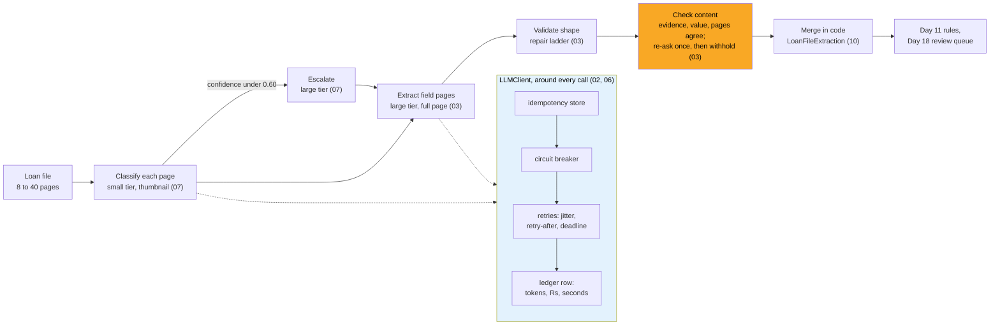

# Day 12 · LLM APIs for Production: Structured Outputs, Tool Use, Streaming, Retries, Cost and Latency Budgets

> **[Part 3 · Building the System Around the Model](../README.md)** · Chapter 2 of 10 · Video ~13 min · Chapter tier: medium
> Builds on: [Day 11 (the eight boxes, the split, the `ExtractionModel` seam)](../11-the-system-around-the-model/README.md) ·
> [Day 9 (the 26 lakh cloud line)](../../02-discovery-and-decomposition/09-success-metrics-and-business-case/README.md) ·
> [Day 10 (the will-not-do list)](../../02-discovery-and-decomposition/10-the-discovery-document/README.md) ·
> learn-ai-ml Stage 1 (API basics)
> Sets up: Day 13 (the prompt inside the call), Day 14 (thresholds and model swaps decided on the golden set),
> Day 16 (tools wrap the legacy system), Day 17 (tool loops become agents; idempotent writes), Day 18 (the
> review queue the withheld fields go to), Day 19 (cost per call traced), Day 20 (the skeleton), Day 24
> (residency decides the route)
> **Owner:** this chapter owns **the model as a production dependency: the provider-neutral client and adapter,
> structured outputs and the repair ladder, valid-but-wrong answers at the API layer, tool definitions and the
> bounded loop, when to stream, retries, timeouts, 429s, idempotency keys for model calls, circuit breaking,
> the per-file cost ledger and budgets, model tiering, caching and batch APIs.** The split is Day 11's;
> prompts Day 13's; evals Day 14's; agents and core writes Day 17's; dashboards Day 19's; residency Day 24's.
> Versions used: run on **Python 3.14.3** (needs 3.12 or newer) with **Pydantic 2.12.5** and **pytest 9.1.1**,
> pinned in `code/requirements.txt`. The optional real-provider adapter pins **anthropic 1.17.0** and was not run.
> Prices read on **21 October 2026** from the providers' official pages. Shown outputs are from real runs; all
> data is synthetic.

---

## Why this chapter exists

The week-one demo called the model once. Production calls it about 40,000 times a month for Godavari's
1,400 paper and PDF files, in the customer's AWS account, on the customer's budget. At that volume, 429s,
billed timeouts, restarted jobs, outages and confident wrong answers are routine. Applied AI is in 80
percent or more of the 1,000 FDE postings analysed in 2026 and core engineering in 95 percent or more;
this chapter is where they meet. It builds the client that makes a model a safe dependency, and measures
it against a simulated night of the 02:00 SFTP drop before anyone sees a demo.

## Mental model

One sentence to carry out of the chapter: **put the model behind your own client, make the schema the
contract and check the content as well as the shape, retry only what is safe with keys built from
content, and measure rupees per file and seconds per stage against budgets that can fail.**

## Learning goals

After this chapter you can:

1. Put a model behind a provider-neutral client: one adapter per vendor, typed errors, explicit
   timeouts, a ledger row per attempt.
2. Write the extraction contract in Pydantic, send a schema a strict provider accepts, validate the rest
   locally, and repair invalid output without inventing content.
3. Handle valid output with wrong content: checks, one targeted re-ask, withholding, review.
4. Define tools and a bounded loop, and say when not to use tools; decide when to stream.
5. Retry only what is safe, with full jitter, `retry-after`, deadlines, content-built idempotency keys
   and a circuit breaker, all tested offline.
6. Price a page and a file, set per-file and per-stage budgets from the business case, and measure
   twenty files before a demo.
7. Use prompt and response caching safely, weigh a batch API against a deadline, and frame the
   India-region model question for Day 24.

## Reading order

| # | Section | What you get | Words |
|---|---|---|---|
| 01 | [Why production LLM calls](01-why-production-llm-calls.md) | one call versus forty thousand; the career reason; what Day 12 adds to Day 11; the hard parts | ~900 |
| 02 | [The call as a dependency](02-the-call-as-a-dependency.md) | client, adapter, ledger; the neutral interface; timeouts; what to record; sync, stream or batch | ~1,150 |
| 03 | [Structured outputs](03-structured-outputs.md) | constrained decoding; Pydantic as the schema; the repair ladder; valid shape, wrong content | ~1,400 |
| 04 | [Tool use](04-tool-use.md) | the bounded loop; defining tools; the tool list is the permission list; when not to use tools | ~950 |
| 05 | [Streaming](05-streaming.md) | when it matters, measured; what it makes harder | ~600 |
| 06 | [Retries, timeouts and rate limits](06-retries-timeouts-and-rate-limits.md) | what to retry; full jitter; deadlines; idempotency keys; 429s; the circuit breaker; the hidden multiplier | ~1,250 |
| 07 | [Cost and latency budgets](07-cost-and-latency-budgets.md) | tokens per page; the dated price card; a page and a file in rupees; setting the budgets; tiering | ~1,450 |
| 08 | [Caching, batch APIs and model choice](08-caching-batch-and-model-choice.md) | prompt versus response caching; batch against the 08:00 deadline; the India-region preview | ~1,100 |
| 09 | [2026 patterns and production concerns](09-2026-patterns-and-production-concerns.md) | what practitioners use; what is hype; keys, PII, versions, capacity, monitoring | ~750 |
| 10 | [Project: the Godavari client](10-project-the-godavari-client.md) | the files; the night with real output; Build it with AI; How do you know it's right | ~2,300 (incl. output) |
| 11 | [Mistakes and debugging](11-mistakes-and-debugging.md) | symptom, cause, fix; a routine for a bad night | ~600 |
| 12 | [Interview questions](12-interview-questions.md) | 13 questions with model answers | ~1,050 |
| 13 | [Exercises](13-exercises.md) | 8 graded exercises, four tested, including "review this AI-written client" | ~1,400 |
| 14 | [Further reading](14-further-reading.md) | the vendor pages read for this chapter, dated; the patterns' sources | ~700 |

**Short on time?** Read 03, 06 and 07, run the project (10), and do exercise 3.1. That is the video plus
the two questions every interviewer asks: what do you retry, and what does a file cost.

## Files

| Path | What |
|---|---|
| `code/godavari_llm/` | the package: `contract.py`, `provider.py`, `fake_provider.py`, `retry.py`, `client.py`, `ledger.py`, `extractor.py`, `synthetic.py`, and the optional `adapters/anthropic_adapter.py` (section 10.2 describes each) |
| `code/prompts/` | `classify-v1.txt`, `extract-v1.txt` |
| `code/run_nightly_batch.py` | the simulated night and its budget report |
| `code/streaming_demo.py`, `code/tool_loop_demo.py` | sections 05 and 04 |
| `code/tests/` | 36 tests for the retry, validation and cost logic |
| `code/requirements.txt`, `code/requirements-real-provider.txt` | pinned versions; the second is optional |
| `data/` | `loan-file-extraction.schema.json`, `page-extraction.provider-schema.json`, `night-per-file.csv`, `sample-extraction.json` (regenerated by the run) |
| [`worksheet/godavari-llm-budget.md`](worksheet/godavari-llm-budget.md) | the one-page model-call budget for the engagement folder |
| [`worksheet/ai-draft-client.py`](worksheet/ai-draft-client.py) | an AI-written client with at least twelve problems (exercise 3.1) |

From the chapter folder: `pip install -r code/requirements.txt`, then
`python -X utf8 -m pytest code/tests -q` (36 passed in about 0.15 s) and
`python -X utf8 code/run_nightly_batch.py` (about 0.6 s). No API key, no network.

## What this chapter does *not* teach (single-owner rule)

| Topic | Where it's taught |
|---|---|
| which rules are code and which are the model; the deterministic envelope; signed rules | [Day 11](../11-the-system-around-the-model/README.md) |
| prompt files, versions, rollbacks, the page-40 problem | [Day 13](../13-prompts-as-code/README.md) |
| the golden set, per-field accuracy, calibrating confidence, judges | [Day 14](../14-evals-first/README.md) |
| the SOAP client, SFTP, the metadata layer | [Day 16](../16-integrating-with-what-exists/README.md) |
| state machines, approval gates, idempotent writes to the core system | [Day 17](../17-agents-and-workflows/README.md) |
| the review queue and confidence routing in the interface | [Day 18](../18-verification-and-trust/README.md) |
| traces, dashboards, PII redaction in logs | [Day 19](../19-observability-for-ai-systems/README.md) |
| data residency, DPDP, which route may process in India | [Day 24](../../04-deploying-into-their-world/24-data-residency-and-indian-law/README.md) |
| the model gateway, keys and egress | [Day 25](../../04-deploying-into-their-world/25-network-secrets-and-egress/README.md) |
| prompt injection through documents and tools | [Day 41](../../07-ai-era-toolkit/41-red-teaming-your-deployment/README.md) |

## Analogies for the Telugu audience

- **UPI** (the chapter's main picture): every bank agrees the field format before money moves (structured
  outputs); a failed payment never debits twice because every request carries a reference the bank
  remembers (idempotency keys, safe retries); the app shows "processing" while the banks talk (streaming)
  (1.2, 5.2).

## Video map

The video (~13 min) covers a slice; the notes cover everything.

| Asset | Covers | Sections |
|---|---|---|
| **Day 12 main video** (~13 min) | Hook: one call versus 40,000 a month (1 min) → client, adapter, ledger (1.5 min) → structured outputs, the contract, the repair ladder (2 min) → valid shape, wrong content: the answer that passes every check (2 min) → what to retry, full jitter, the billed timeout, the key that makes a re-run free (2 min) → the breaker through the 02:04 outage (1 min) → a page and a file in rupees; the Rs 12 and 120 s budgets (1.5 min) → tools and streaming: when, and when not (1.5 min) → recap and teasers (0.5 min) | 01.1, 02.1, 03.1 to 03.5, 06.1 to 06.6, 07.4 to 07.9, 04.4, 05.1 to 05.2 |
| **Short 1:** "Your demo called the model once. Production calls it 40,000 times a month. Budget it." | 31 calls a file times 1,400 files; one page priced on screen; a ceiling that can fail | 01.1, 07.4 to 07.6 |
| **Short 2:** "Structured outputs: the model fills a form, not a page." | constrained decoding in one picture; then the ex-showroom price in the requested-amount field: valid and wrong | 03.1, 03.3, 03.5 |
| Notes only | sections 02.2 to 02.6, 04.3, 05.3, 06.5, 06.7, 07.3, 07.7, 07.8, 08, 09, and 10 to 13 | as listed |

**Callbacks to use on screen:** "Day 11 lo model ni eight boxes lo okati ga chusam; ivala aa box ni
production code ga marchutunnam." (section 01); "Day 9 lo cloud line 26 lakh ani raasam; ivala andulo
model calls entha ani file ki rupees lo kolustunnam." (section 07).
**Forward callbacks:** Day 13 (ee call lopala unna prompt ki version), Day 14 (threshold ni golden set
decide chestundi), Day 17 (tool loop state machine avutundi), Day 19 (ee ledger row ae span avutundi).

## Callbacks

- **Builds on:** Day 11 (the split and the seam), Day 9 (the cloud line the budget is cut from), Day 10
  (no PII processed outside India), Days 6 and 7 (8 to 40 unordered pages, the 02:00 drop,
  re-scans in the next batch), Day 5 (the CISO as a gate on model choice).
- **Sets up:** Day 13, Day 14, Day 16, Day 17, Day 18, Day 19, Day 20, Day 24, Day 25, Day 43 (the
  practical coding round).

**Next chapter:** [Day 13 · Prompts as code: versioning, templates, rollbacks, and the prompt that works on page 1 and fails on page 40](../13-prompts-as-code/README.md).
