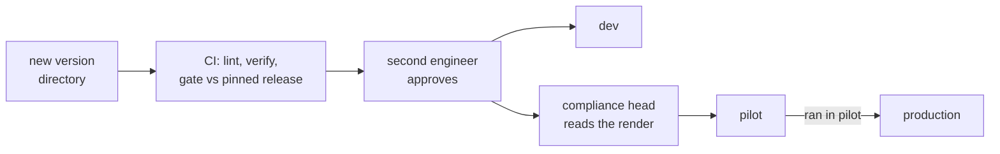

# 04 · Versions, Releases and the Registry: Which Prompt, Which Model, Which Score, Who Approved

> Day 13 · Section 4 of 13 · [Chapter overview](README.md) · Previous: [03 · Templates](03-templates.md) · Next: [05 · The prompt pull request](05-the-prompt-pull-request.md)

---

## 4.1 Semantic versioning, adapted for prompts

[Semantic Versioning](https://semver.org/) says MAJOR for incompatible API changes, MINOR for compatible additions,
PATCH for compatible fixes. For a prompt the "API" is two things: the variables the pipeline must pass, and the shape
of the answer the pipeline must parse. Behaviour sits on top, and for an LLM every change is a behaviour change until
an eval says otherwise.

| Bump | When | Godavari example | What must happen |
|---|---|---|---|
| **MAJOR** | the calls, their variables or the output contract change; the caller's code changes too | 1.1.0 to 2.0.0: one whole-file call becomes a classify call per page plus an extract call per page type | code and prompt ship together; full regression; new release record |
| **MINOR** | same contract, intended behaviour change: an instruction added or removed, a new example, a new variant | 1.0.0 to 1.1.0: the request repeated after the document; 2.0.0 to 2.1.0: glossary and example removed | full regression; new release record |
| **PATCH** | same contract, no intended behaviour change: a typo, a comment, whitespace | fixing "teh" in `_role.j2` | still a full regression, because "no intended change" is not "no change" for a model |

The last row is the one teams argue about. A patch bump still changes the content hash, so it still gets a new
release record and a new eval run. The version number tells a reviewer what the author *meant*; the eval tells
everyone what *happened*. If the PATCH run moves a score, it was not a patch.

The cricket analogy holds: the team sheet goes in before the toss and cannot be edited in the dressing room. A change
is a new sheet with the captain's signature, and the old sheet stays in the match file.

## 4.2 Released versions are immutable

Once a version is released, its directory never changes. The loader enforces it: the registry stores a SHA-256 over
every file in the version directory, and `load(..., expected_sha256=...)` refuses a directory whose hash has moved.
Deleting the four words "Never guess a digit." from 2.0.0's `_unsure.j2` in a scratch copy gives:

```text
PromptError: extraction@2.0.0 has been edited after release: hash 157adb243fa3 != recorded 05889c7b3a15
```

The hash normalises CRLF to LF before hashing. Without that, a Windows checkout with `core.autocrlf` rewrites every line
ending and every released version looks tampered with on one developer's laptop and fine on CI. That bug costs an
afternoon the first time.

The trade-off is honest: a new version is a copied directory, so a pull request that changes one sentence adds a whole
directory. Section 05 shows why that is acceptable: the CLI diffs two version directories file by file, so the reviewer
still reads a five-line change, not a thousand-line copy.

## 4.3 A release is a prompt paired with a model

The same prompt on a different model is a different system. 2.0.0 on `fake-large-2026-10` returns null for a smudged
digit; the same 2.0.0 on `fake-large-2026-11` guesses it (section 07). So the unit you release is not "prompt 2.0.0",
it is the pair, and the release id says so: `extraction@2.0.0+fake-large-2026-10`.

The release record, as `registry.py` stores it:

| Field | Example | Why it is there |
|---|---|---|
| `release_id` | `extraction@2.0.0+fake-large-2026-10` | prompt version plus the large-tier snapshot |
| `content_sha256` | `05889c7b3a15...` (2.0.0) | the files as they were scored; the loader refuses anything else |
| `models` | small `fake-small-2026-10`, large `fake-large-2026-10` | dated snapshots only; an alias is refused |
| `output_schema` | `godavari-extraction/1.0` | Day 12's schema version the prompt was written for |
| `eval` | set `kukatpally-labelled-12`, set hash, per-field correct, unsure, wrong; tokens per file | the evidence; the gate compares these |
| `author`, `approved_by` | `fde.kaagaz`, `platform.kaagaz` | the approver cannot be the author |
| `compliance_read_by` | `compliance-head.godavari` | required for pilot and production |
| `notes` | "rolled back in pilot 2026-11-12T11:40: ..." | what happened to it later |

It is grandmother's biryani recipe card with the date, the cook and who tasted it. It answers the auditor's question
for any file: the call log (Day 12's ledger, Day 19's trace) records the
`release_id` of every call, and the release record says what that release was, how it scored, and who let it run.

Day 12's idempotency key already includes the prompt version. That is not a detail. After a rollback the same file,
re-run, gets a new key, so the system does real work instead of returning the cached answer from the bad release
(section 07.2).

## 4.4 Environments and promotion

Three environments, each pinning one release per prompt:

| Environment | At Godavari | What a release needs to be pinned here |
|---|---|---|
| `dev` | the FDE's working copy and CI | an eval score |
| `pilot` | the skeleton environment for M07 on the machine in the building, then the Kukatpally and Guntur pilot from 7 December | eval, approval by a second engineer, the compliance head's read, and no field regressing against what pilot runs now |
| `production` | the Hyderabad and Vijayawada waves from January 2027 | everything pilot needs, plus a history of having run in pilot |



`Registry.promote()` checks all of it and refuses with every reason at once. Promotion is a change to
`prompts/registry.json`, so it is itself a pull request: the reviewer sees exactly which pin moved, from what, by whom,
for what reason. The pins after the week-3 work and the drill, summarised from the `history` in `registry.json`:

```text
dev        extraction@1.0.0 (9 Nov) -> 1.1.0 (10 Nov) -> 2.0.0 (11 Nov)
pilot      2.0.0 (11 Nov 18:30) -> 2.1.0 (12 Nov 10:05) -> rollback to 2.0.0 (12 Nov 11:40)
production (nothing pinned until the January waves)
```

## 4.5 What the runtime does with it

The pipeline never holds a prompt string. On every batch it asks the registry what the environment pins, loads that
version with its recorded hash, and checks that the adapter's models are the release's models:

```python
rel, pv = resolve(registry, "pilot")          # Release + PromptVersion, hash-checked
results = run_batch(rel, pv, files, provider) # check_models() first: stop if the adapter disagrees
```

Resolving per batch, not at build or deploy time, is what turns a rollback into a one-line change that takes effect on
the next file. Resolving per *call* would be wrong in the other direction: a file half-processed under two releases
cannot be explained to anyone.

## 4.6 Who decides what

| Decision | Who | Evidence |
|---|---|---|
| The prompt wording | the author (FDE or platform engineer) | the rendered prompt, the eval |
| Whether it may run in pilot | a second engineer approves the diff | the diff, the lint, the gate |
| Whether it contains rules or asks the model to decide | the compliance head reads | the rendered document (02.4) |
| Whether it is accurate enough | nobody's opinion; the eval set (Day 14) against the bar the COO and compliance head agreed (Day 10, D02 and D09) | per-field scores |
| Whether to roll back | whoever is on call, without waiting for a meeting | the alert (section 07) |
