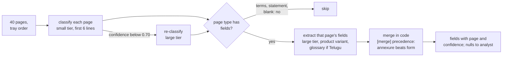

# 06 · Page 1 and Page 40: Why Long Loan Files Fail, and Classify-Then-Extract

> Day 13 · Section 6 of 13 · [Chapter overview](README.md) · Previous: [05 · The prompt pull request](05-the-prompt-pull-request.md) · Next: [07 · Rollback and drift](07-rollback-and-drift.md)

---

## 6.1 Why the three-page sample lies

The demo sample has every answer on one of three pages, near the instructions, in English, in a fixed order. A
Godavari file has none of those properties: Day 6's branch managers said files arrive as 30 to 40 page scans "in
whatever order the papers are in. Nobody sorts them", and the far branches send handwritten Telugu declarations.

The chapter's synthetic 40-page bundle (`synth.py`) is stapled the way a branch does it: the form on top; KYC, income
proof, a four-page bank statement, twelve pages of terms and some blanks in tray order; the sanction annexures at the
back (pages 36 to 40). A co-applicant added at sanction is on page 38, and page 1 still says "Co-applicant: none". On
the chapter's estimate a bundle is about 11,000 tokens; real OCR output, or a page image per page, is several times
that.

> **Analogy (Telugu audience).** Reading a 40-page court bundle the night before the hearing. You remember the first
> pages and the last, and the middle blurs. A clerk who first puts a tab on every page (vakalat, affidavit, annexure)
> and then reads each tab for one thing does not miss annexure C.

## 6.2 Six mechanisms, each with a Godavari example

| Mechanism | What happens | In a Godavari file |
|---|---|---|
| **Context position** | models use information at the start and the end of a long input more reliably than in the middle; Liu et al. measured this U-shape on multi-document QA and key-value retrieval, including on long-context models | the income proof lands anywhere from page 3 to page 35 |
| **Distance from the request** | when the instructions are only at the top, the end of the document is furthest from them; vendor guidance for long inputs says to put the documents first and the query at the end ("up to 30 percent" better in Anthropic's tests) | the co-applicant annexure on page 38 is nearly 11,000 tokens from the field list |
| **Early answers that look final** | an early page that answers the question wrongly beats a late page that answers it rightly, with no drop in confidence | the form's "Co-applicant: none" against the annexure |
| **Repeated headers and distractors** | the same name or number appears on many pages; figures that look like the answer appear in the wrong document | the applicant's name in the header of all twelve terms pages; NEFT credits in the statement that look like a salary |
| **Scan noise and split tables** | smudged digits, stamps across a field, a table whose header is on one page and its rows on the next | "Rs 1,8?,000" on a folded form; "STATEMENT OF ACCOUNT (continued)" with no column headings |
| **Mixed scripts** | Telugu often costs several times more tokens per word than English, and handwritten Telugu labels are read unevenly | "నెలసరి ఆదాయం: Rs 40,000" and "సంవత్సర ఆదాయం: Rs 4,80,000" on one page, no English label |

The last row is Day 6's sharpest finding: in the 2019 OCR pilot, a handwritten Telugu declaration of forty thousand a
month came out as four lakh eighty thousand monthly, and the senior analyst caught it the next morning only because the
EMI looked wrong for an auto driver. A model that cannot read the label takes the biggest number on the page. That is
risk R1 in the discovery document (Day 10).

## 6.3 The fake model, and why it is honest to use one

The chapter runs offline against `fake_model.py`, a deterministic stand-in that reads only the rendered prompt and
answers with three rules: its chance of using a fact falls with the fact's distance in tokens from the nearest
`<instructions>` block (near-certain within 1,500 tokens, then about three points lower per thousand); when it misses
the annexure it reads the form's "none" instead, and when it misses an amount it sometimes returns a figure from the
wrong page, both at unchanged confidence; and it reads Telugu labels only when the prompt carries the glossary.

These rules are a caricature, chosen so the failure reproduces on every run. They are not a claim about any vendor's
model, whose curve depends on the model, the layout and the task. What carries over is the method: know where every
answer is printed, score by page position as well as by field, and compare layouts by measurement.

## 6.4 Three ways to prompt a long file

| Strategy | How | Strength | Failure mode | Cost shape |
|---|---|---|---|---|
| **Whole file** (1.0.0, 1.1.0) | one call, every page, every field | simplest; the model sees cross-page context | position effects; early wrong answers win; one bad page spoils the call; output for nine fields at once | one large-tier call of the whole file |
| **Chunked** | the same prompt over windows of, say, eight pages; merge the answers | shorter contexts | the form's "none" and the annexure land in different chunks, and the merge cannot tell which to believe without knowing what each page *is* | several large-tier calls, the instructions repeated per chunk |
| **Classify, then extract** (2.0.0) | a small-tier call per page returns its type from the printed title; a large-tier call per relevant page type asks only that page's fields; code merges by a precedence table | each call is short and specific; page order stops mattering; terms and blank pages cost no large-tier tokens; failures are per page and visible | a misread title sends a page to the wrong template; mitigated by escalating low-confidence pages to the large tier (`ESCALATE_BELOW = 0.70`) and recording every page's type for the analyst's screen (Day 18) | many small calls (cacheable prefix), few large ones; more calls, more latency unless parallel |



Chunking looks like the obvious middle path and is usually a trap for extraction: it shortens the context without
telling the merge which page is authoritative. Classification first makes the merge a rule in code (`[merge]`:
`co_applicant_name = ["co_applicant_kyc", "application_form"]`). It is also the shape Day 12's tiers were built for, and
it hands Day 15 a page type for every page.

## 6.5 The lab results

Fifty synthetic 40-page files (30 Kukatpally, 20 Guntur; two-wheeler, gold, small-business and personal). Only a
generator knows the answer to every field of every file, so this is a lab experiment; on the engagement these stand in
for the fifty masked files the compliance head approved (Day 6), which get their answers only through Day 14's golden
set. From the real run (`python -X utf8 run_demo.py`):

```text
== 1. Works on page 1: extraction@1.0.0 on twelve 3-page demo samples ==
fields correct 100.0%, wrong 0.0%, input tokens per file 444

== 2. Fails on page 40: 50 synthetic 40-page files (30 Kukatpally, 20 Guntur) ==
16 files have a co-applicant added at sanction (page 38); 6 have a handwritten Telugu income page
release                                correct  wrong  co-app Telugu inc  calls small tok large tok
extraction@1.0.0+fake-large-2026-10      90.0%   4.3%    9/16        0/6    1.0         0     11802
extraction@1.1.0+fake-large-2026-10      95.3%   2.3%   16/16        0/6    1.0         0     11867
extraction@2.0.0+fake-large-2026-10      97.0%   0.0%   16/16        6/6   45.2     27784      2403

Fields read correctly, by where the answer is printed in the file:
where          fields     1.0.0     1.1.0     2.0.0
pages 1-2         144       97%       97%       97%
pages 3-12         54       96%       96%       96%
pages 13-24        26       85%       85%       96%
pages 25-35        60       78%       93%       97%
pages 36-40        16       56%      100%      100%
```

Read it in four steps.

1. **Same prompt, two worlds.** 1.0.0 is perfect on the three-page samples and loses 7 of 16 co-applicants on the
   40-page files, every one of them a confident "none". That is the page-1 versus page-40 trap, and no amount of
   testing on samples finds it.
2. **Moving the request moves the failure.** 1.1.0 repeats the request after the document. The back of the file
   recovers completely (56 to 100 percent), the middle does not (85 percent), and Telugu income is still 0 of 6.
   Layout tricks change where you lose facts; they do not stop you losing them.
3. **Per-page extraction stops confident errors.** 2.0.0 gets every co-applicant and every Telugu income right, and its
   wrong rate is zero. Its misses (3 percent) are nulls: smudged digits it refused to guess, which go to the analyst.
   That is the compliance head's "cannot tell over a guess" (Day 6, FLAG_UNSURE_NOT_GUESS) showing up as a number.
4. **It costs differently, not nothing.** 45 calls a file instead of one. Large-tier input falls from about 11,800 to
   2,400 tokens a file; small-tier input is about 27,800, nearly all of it the same classification instructions
   repeated forty times, which is exactly what Day 12's prompt caching is for. Whether this is cheaper in rupees per
   file depends on the price card and the cache hit rate, and Day 12's ledger answers it; the accuracy argument does
   not depend on it.

The pages 1-2 row is 97 percent everywhere because the misses there are smudged amounts that every version correctly
returns as null. Not every miss is a failure.

## 6.6 Is a million-token window the answer?

As of October 2026, Anthropic's models overview lists a 1M-token context window for its current models; a 40-page
file fits many times over. That removes the *capacity* problem, not the *attention* problem: the research above found
position effects on models built for long inputs, and a bigger window means more distractors. Use long context when the
task needs reasoning across documents, and split by page type when it is reading fields that each live on one page.
Godavari's extraction is the second kind; its cross-page checks (does the form's PAN match the card?) are rules in code
after extraction, where Day 11 put them.
