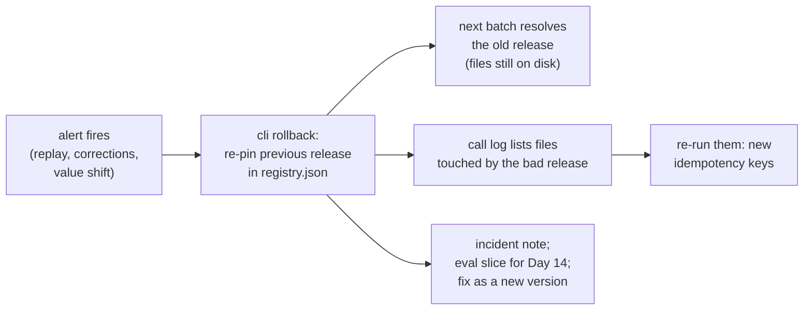

# 07 · Rollback and Drift: Undo in Minutes, and the Model That Changes Under You

> Day 13 · Section 7 of 13 · [Chapter overview](README.md) · Previous: [06 · Page 1 and page 40](06-page-1-and-page-40.md) · Next: [08 · 2026 patterns and production concerns](08-2026-patterns-and-production-concerns.md)

---

## 7.1 11:40 on Thursday

2.1.0 has been pinned in pilot since 10:05 (section 05). Before Friday's M07 demo, the FDE replays the twenty recent
Guntur files the branch manager offered in Day 6 through whatever pilot runs, comparing against the values analysts
keyed into the core system when those files were sanctioned. From the real run:

```text
== 5. Rollback drill: replaying 20 recent Guntur files through what pilot runs ==
extraction@2.1.0+fake-large-2026-10: monthly_income wrong on 12 of 20 files (Telugu declarations: 0/12 correct)
  e.g. GF-33000: read 708000 as monthly; the declaration says 59000 a month
alert rule 'monthly_income wrong > 10% of the replay window': FIRES
rollback: pilot pins extraction@2.0.0+fake-large-2026-10 (one registry change, no deploy)
  (re-pin took 4.8 ms on this machine)
re-ran the 20 files processed under 2.1.0 (new idempotency keys): monthly_income wrong on 0
re-promote 2.1.0: extraction@2.1.0+fake-large-2026-10 was rolled back in pilot; fix it as a new version, do not re-promote it
what the lab set would have said: Telugu income correct 2.0.0 6/6, 2.1.0 0/6
```

708,000 is 59,000 times twelve. Without the glossary, the model takes the biggest figure on a Telugu-only page, which
is the annual line. The 2019 pilot's failure, reintroduced by a token trim that passed its gate, caught by a replay of
one branch's traffic, and undone by one command:

```bash
python -X utf8 -m godavari_prompts.cli rollback --env pilot --by fde.kaagaz \
  --reason "Guntur replay: Telugu monthly income read as annual after 2.1.0"
```

The command re-pins in milliseconds. The minutes are the human part: reading the alert, checking two files to rule out
a labelling problem, running the command, committing `registry.json` with the reason, and telling people. Rehearse it
before you need it; that is why this is a drill in week 3 on replayed files, not a story after a December incident.

## 7.2 Four conditions for a rollback in minutes



| Condition | In the package | What breaks without it |
|---|---|---|
| **The previous release is still on disk, unchanged** | version directories are immutable and never deleted; `rollback()` refuses if the old files' hash does not match | "we cleaned up old versions" turns a one-line rollback into an emergency rewrite (a test deletes 2.0.0's template and checks the refusal) |
| **The runtime resolves the release per batch** | `pipeline.resolve()` reads the registry for every batch | if the prompt is baked into the build, rollback is a redeploy into the customer's change process (Day 26) |
| **The idempotency key includes the release** | `_key()` hashes the `release_id` with the page bytes, schema and model (Day 12's key) | re-running a file returns the cached answer from the bad release, and the "fixed" file is still wrong |
| **Every call is logged with its release** | `CallLog.release_id` | you cannot list which files the bad release touched, so you cannot re-run them |

## 7.3 The alert that triggers it

A rollback needs a trigger someone trusts without a meeting. Good triggers, fastest first:

| Signal | Example rule | Owner of the plumbing |
|---|---|---|
| A replay of known files on every promotion | wrong rate on any field above the release record's, on a branch's recent files | this chapter (the drill) |
| Value distribution shifts | median `monthly_income` on Guntur files jumps from about 40,000 to about 4,80,000 | Day 19 |
| Analyst corrections | correction rate on a field in the review queue doubles within a day | Day 18 captures them, Day 19 charts them |
| "Unsure" rate | nulls on a field halve overnight: the model stopped saying "cannot tell" (see 7.4) | Day 19 |
| Sampled eval on live traffic | the golden-set harness on a daily sample | Day 14 and Day 19 |

Write the rule and the action together, in the runbook: "if X, the on-call engineer rolls back without waiting for
approval, then tells the COO's office and the compliance head within the hour". Rolling back is always allowed to the
previous approved release, even in a change freeze; that is worth agreeing with Godavari's IT before 17 December,
because a freeze that forbids rollbacks forbids the safe move.

A rollback is not a fix: the registry refuses to re-promote 2.1.0, so the trim returns as a new version with the
glossary kept for Telugu pages. And the lesson is a gap in the eval set, so Guntur's handwritten Telugu declarations
become a named slice of Day 14's golden set. The incident note is in
`worksheet/incident-note-2026-11-12-extraction-2.1.0.md`.

## 7.4 Drift: the model changes under you

Pinning a prompt to a model only helps if the model is pinned. Three ways it moves anyway:

1. **Aliases move.** Some providers accept a short alias that points to "the latest snapshot" and is repointed when a
   new one ships. Anthropic's documentation (fetched October 2026) says that for its models before the 4.6 generation
   an alias such as `claude-sonnet-4-5` "is a convenience pointer that resolves to the most recent dated snapshot";
   from the 4.6 generation on, each dateless ID is itself a fixed snapshot. Other vendors and gateways have their own
   rules, and a cloud deployment name is whatever someone configured. Read the vendor's page for the model you use.
2. **Serving infrastructure changes under a fixed ID.** The same Anthropic page says weights are fixed per ID but "the
   serving infrastructure around the model can change over time", and occasionally that produces "minor differences in
   observable behavior even when the model ID and weights have not changed". Pinning narrows drift; it does not end it.
3. **Retirement forces a move.** Every model ID has a deprecation and retirement date. A migration is a new release:
   the same prompt version on the new snapshot, through the gate, before the old one goes away.

The package's defences, from the real run:

```text
== 6. Drift: the provider moves 'fake-large-latest' to a new snapshot on 16 November ==
adapter configured with the alias: extraction@2.0.0+fake-large-2026-10 was evaluated on large=fake-large-2026-10, but the adapter would call fake-large-2026-11; stop the batch
release pinned to the alias: refused: large model 'fake-large-latest' is not a dated snapshot; pin the snapshot, not an alias
nightly drift check, same prompt on the new snapshot: 97.2% correct, 2.8% wrong (pinned: 97.2%, 0.0%)
promotion: promotion of extraction@2.0.0+fake-large-2026-11 to pilot refused:
    - regression vs extraction@2.0.0+fake-large-2026-10: on_road_price: wrong 0 -> 1 of 5
    - regression vs extraction@2.0.0+fake-large-2026-10: requested_amount: wrong 0 -> 1 of 12
```

`check_models()` turns a silent alias move into a loud stop on the morning of the 17th; the registry refuses an alias
in a release; the nightly drift check makes the migration evidence, not a surprise. Note its first line: **accuracy did
not move.** The new snapshot guesses smudged digits instead of returning null, and the guesses are confident wrong
numbers. A chart of "percent correct" would show nothing. The wrong rate is the number the compliance head cares
about, and the gate does not let it rise.

## 7.5 One line on injection

A loan file is written by the customer, the branch and whoever handled the paper, so every page is untrusted input:
text inside a customer document is data, not instructions, which is why every page goes through the `_untrusted_page`
partial with the sentence that says so. Making that hold against someone trying is Day 41's work.
