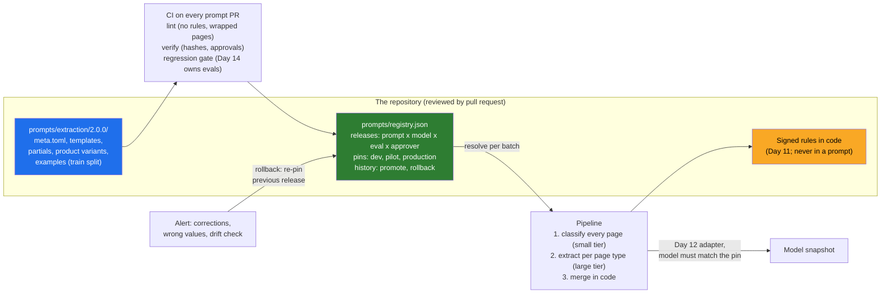

# Day 13 · Prompts as Code: Versioning, Templates, Rollbacks, and the Prompt That Works on Page 1 and Fails on Page 40

> **[Part 3 · Building the System Around the Model](../README.md)** · Chapter 3 of 10 · Video ~11 min · Chapter tier: medium
> Builds on: [Day 12 (LLM APIs for production: the provider adapter, structured outputs, the idempotency key)](../12-llm-apis-for-production/README.md) ·
> [Day 11 (the system around the model: the deterministic versus LLM split)](../11-the-system-around-the-model/README.md) ·
> [Day 6 (discovery interviews: RULES_AS_SIGNED_CODE, the 2019 OCR failure, page order)](../../02-discovery-and-decomposition/06-discovery-interviews/README.md) ·
> [Day 8 (the week-3 skeleton, milestone M07, and the labelled files of M05)](../../02-discovery-and-decomposition/08-scoping-the-first-90-days/README.md)
> Sets up: Day 14 (every prompt release gets a golden-set score), Day 15 (page types become retrieval metadata),
> Day 19 (cost and quality traced per prompt release), Day 20 (the skeleton ships with versioned prompts),
> Day 26 (the registry change rides the customer's CI/CD), Day 41 (customer text as data, not instructions)
> **Owner:** this chapter owns **prompts as code for the course: prompt files in the repository; templates with typed
> variables, partials, per-product and per-page-type variants; semantic versioning for prompts and immutable released
> versions; the release record that pairs a prompt version with a model snapshot, an eval score, an author, an
> approver and the compliance head's read; environments and promotion; prompt diffs in pull requests and the lint that
> keeps business rules out of prompts; rollback in minutes and the alert that triggers it; drift when the provider
> changes the model under you; and the long-document failure (context position, page order, repeated headers, scan
> noise, split tables, mixed Telugu and English) with classify-then-extract as the fix.** The deterministic versus LLM
> split is Day 11's; structured outputs, retries and the cost ledger are Day 12's; golden sets, judges and eval
> statistics are Day 14's; dashboards are Day 19's; prompt injection is Day 41's.
> Versions used: **Python 3.14.3**, **Jinja2 3.1.6**, **pytest 9.1.1** (pinned in `code/requirements.txt`; as of
> October 2026). Everything runs offline against a deterministic fake model. Shown outputs are from real runs. All data
> is synthetic and generated by code in `code/`.

---

## Why this chapter exists

The extraction prompt that read the vendor's three-page samples perfectly returns "Co-applicant: none", confidence
0.88, on a 40-page Godavari bundle. The co-applicant is on page 38, in the annexure added at sanction; page 1, signed
before anyone thought of a co-applicant, still says "none". Nothing crashed and nothing was flagged. That is the first
half of the chapter: why a prompt that works on page 1 fails on page 40, and how splitting the work by page type fixes
it.

The second half is the following day. A teammate trims the prompt to save tokens, the small regression check passes,
and Guntur's handwritten Telugu income declarations come back at twelve times their value: the failure that switched
off Godavari's 2019 OCR pilot (Day 6). The prompt is where most production changes happen after launch, and an
untracked prompt edit is the commonest cause of a quiet regression (Part 3 plan). So prompts get what code gets: files
in the repository, a reviewed diff, an eval score, a version, a pinned model and a one-command rollback.

The career reason: applied AI work appears in 80 percent or more of the 1,000 FDE postings analysed in 2026
(CURRICULUM.md), and the scarce skill is not writing a clever prompt but operating one inside a customer's system. An
FDE who can show the release record for every prompt change, and roll back in minutes, is trusted with the next
workflow.

## Mental model

One sentence to carry out of the chapter: **a prompt is a versioned file that changes behaviour, so it is reviewed,
scored, pinned to the model it was scored on and released by a record you can roll back in one step; and a long
document is not one prompt, it is a page classifier followed by one small prompt per page type, merged by code.**

## Learning goals

After this chapter you can:

1. Move prompts out of f-strings and dashboards into versioned files, with the business rules left in signed code.
2. Write templates with typed variables, StrictUndefined, partials, per-product and per-page-type variants, and one
   untrusted-data wrapper for customer text.
3. Version prompts semantically, keep released versions immutable, and pin each to the model snapshot it was scored on.
4. Keep a registry of releases (prompt, model, eval, author, approver, compliance read) with pins, gates and history.
5. Review a prompt pull request from its diff, lint and gate, and say what each cannot see.
6. Explain the long-document failure and choose between whole-file, chunked and classify-then-extract prompting.
7. Roll back in minutes, detect drift under a pinned name, and build all of this with a coding agent while catching its
   mistakes.

**Prerequisites:** Day 11 (what is rule and what is model) and Day 12 (the adapter and the idempotency key). Python at
a working level; Jinja2 is introduced as it is used.

## Reading order

| # | Section | What you get | Words |
|---|---|---|---|
| 01 | [Why prompts as code](01-why-prompts-as-code.md) | Week 3, page 38; the career reason; the hard parts | ~950 |
| 02 | [Where prompts live](02-where-prompts-live.md) | Files, not f-strings or dashboards; what counts as the prompt; rules stay in code | ~1,200 |
| 03 | [Templates](03-templates.md) | Typed variables, StrictUndefined, partials, variants, the untrusted wrapper | ~1,100 |
| 04 | [Versions, releases and the registry](04-versions-releases-and-the-registry.md) | Semver for prompts; immutable versions; prompt x model releases; environments and promotion | ~1,300 |
| 05 | [The prompt pull request](05-the-prompt-pull-request.md) | Reading a prompt diff; what lint, verify and the gate each miss; the review checklist | ~900 |
| 06 | [Page 1 and page 40](06-page-1-and-page-40.md) | Why long files fail; whole-file versus chunked versus classify-then-extract; the lab results | ~1,750 |
| 07 | [Rollback and drift](07-rollback-and-drift.md) | Rollback in minutes, its four conditions and its alert; drift; injection in one line | ~1,350 |
| 08 | [2026 patterns and production concerns](08-2026-patterns-and-production-concerns.md) | Prompt platforms, optimisers, million-token windows, caching and order, cost, security | ~800 |
| 09 | [Project: the Godavari prompt package](09-project-the-godavari-prompt-package.md) | The package, the runs, the drill; Build it with AI; How do you know it's right | ~2,350 (incl. output) |
| 10 | [Mistakes and debugging](10-mistakes-and-debugging.md) | Symptom, cause, fix | ~850 |
| 11 | [Interview questions](11-interview-questions.md) | 14 questions with model answers | ~1,150 |
| 12 | [Exercises](12-exercises.md) | 9 graded exercises, including "review this AI-written prompt PR" | ~1,600 |
| 13 | [Further reading](13-further-reading.md) | Long-context research, vendor guidance, Jinja2, semver, the sources behind the engagement | ~500 |

**Short on time?** Read 02, 04, 06 and 07, then run the project (09): a long file read correctly, and a bad change
undone in minutes.

## Files

| Path | What |
|---|---|
| [`code/godavari_prompts/`](code/godavari_prompts/) | `loader` (typed render, hashes), `registry` and `gate` (releases, pins, rollback), `pipeline` (two strategies, model-pin check), `fake_model`, `synth`, `regress`, `lint`, `explain`, `cli` (section 09.2) |
| [`code/prompts/extraction/`](code/prompts/extraction/) | versions 1.0.0, 1.1.0, 2.0.0, 2.1.0, each a directory with `meta.toml` and templates |
| [`code/prompts/registry.json`](code/prompts/registry.json) | release records and pins, written by the demo the way CI would |
| [`code/run_demo.py`](code/run_demo.py), [`code/tests/`](code/tests/) | the whole story in about 7 seconds; 47 pytest tests in about 3 to 16 seconds |
| [`data/`](data/) | the run report, the 2.0.0 to 2.1.0 diff, the rendered prompts the compliance head read |
| [`worksheet/`](worksheet/) | the prompt review checklist, the rollback drill's incident note, and an AI-written prompt PR for exercise 3.1 |

Run from `code/` after `python -m pip install -r requirements.txt`: `python -X utf8 run_demo.py`, then
`python -X utf8 -m pytest -q`. No network, no API keys. `-X utf8` keeps Windows consoles happy with Telugu and the
middle dot.

## What this chapter does *not* teach (single-owner rule)

| Topic | Where it's taught |
|---|---|
| Which rules are code and which judgements are the model's | [Day 11](../11-the-system-around-the-model/README.md) |
| Structured outputs, retries, the provider adapter, the cost ledger, prompt caching mechanics | [Day 12](../12-llm-apis-for-production/README.md) |
| Building the golden set with the analysts, labelling rules, judges, eval statistics | [Day 14](../14-evals-first/README.md) (this chapter runs a 12-file regression check and says so) |
| Chunking real PDFs for retrieval, page-level metadata | [Day 15](../15-retrieval-for-enterprise-documents/README.md) |
| Dashboards, traces and alert plumbing | [Day 19](../19-observability-for-ai-systems/README.md) |
| Releasing into the customer's CI/CD and environments | [Day 26](../../04-deploying-into-their-world/26-shipping-into-their-infrastructure/README.md) |
| Prompt injection and exfiltration through documents and tools | [Day 41](../../07-ai-era-toolkit/41-red-teaming-your-deployment/README.md) (one line here) |

## Analogies for the Telugu audience

- **The family biryani recipe card** (the main picture): change one spice without noting it and the next wedding's
  biryani is wrong and nobody knows why. The registry is the card with the date, the cook and who tasted it (04.3).
- **The 40-page court bundle**: you remember the first and last pages; the clerk who tabs every page first does not
  miss annexure C (06.1).
- **The cricket team sheet**: submitted before the toss, never edited in the dressing room; a change is a new sheet
  (04.1).

## Video map

The video (~11 min) covers a slice; the notes cover everything.

| Asset | Covers | Sections |
|---|---|---|
| **Day 13 main video** (~11 min) | Hook: 100 percent on the demo, "none" on page 38 (1 min) → why prompts are code: the quiet regression (1 min) → files, templates, partials, product variants on screen (1.5 min) → semver and the release record: prompt x model x score x approver (1.5 min) → the long-document failure: position, order, headers, Telugu (2 min) → classify then extract: the lab table, 9/16 to 16/16 (1.5 min) → the token trim that passed its gate, and the rollback in one command (1.5 min) → drift: the alias moves, the batch stops (0.5 min) → recap and the Day 14 teaser (0.5 min) | 01.1, 02.1, 03.2 to 03.4, 04.1 to 04.4, 06.1 to 06.5, 07.1 to 07.3, 07.5 |
| **Short 1:** "Your prompt is code. Version it or lose a weekend finding the regression." | The 2.0.0 to 2.1.0 diff, the gate that passed, the Guntur replay, the rollback line | 05.1, 07.1, 09.6 |
| **Short 2:** "Works on page 1, fails on page 40: the long-document trap." | The page-38 annexure, the form's "none", the page-band table, classify then extract | 06.1, 06.4, 06.5 |
| Notes only | 02.2, 03.5, 04.3, 05.3, 06.4, 07.2, 07.4, and sections 08 to 12 | as listed |

**Callbacks to use on screen:** "Day 6 lo compliance head cheppindi gurtunda: 'I sign it, and if it changes, I sign
the change.' Rules code lo untayi, prompt lo kaadu." (section 02); "Day 12 lo idempotency key lo prompt version
pettam; ivala rollback ki adi enduku avasaramo chustam." (section 07); "Day 6 lo 2019 OCR pilot: nelasari aadayam ni
samvatsara aadayam ga chadivindi. Ivala oka token trim adey malli chesindi." (section 07).
**Forward callbacks:** Day 14 (prati prompt release ki golden set score), Day 15 (page types retrieval metadata
avutayi), Day 20 (skeleton versioned prompts tho ship avutundi).

## Callbacks

- **Builds on:** [Day 6](../../02-discovery-and-decomposition/06-discovery-interviews/README.md) (RULES_AS_SIGNED_CODE,
  FLAG_UNSURE_NOT_GUESS, PAGE_ORDER_UNLABELLED, the handwritten Telugu declarations, the fifty masked files),
  [Day 8](../../02-discovery-and-decomposition/08-scoping-the-first-90-days/README.md) (M05's thirty labelled files,
  M07's ten-file skeleton on Friday 13 November 2026), [Day 10](../../02-discovery-and-decomposition/10-the-discovery-document/README.md)
  (risks R1 and R2), [Day 11](../11-the-system-around-the-model/README.md) (the split and the signed rules),
  [Day 12](../12-llm-apis-for-production/README.md) (the adapter, tiers, the idempotency key).
- **Sets up:** Day 14 (the golden set with Guntur's Telugu slice, so the 2.1.0 gap cannot recur), Day 15 (page types
  as metadata), Day 18 (the "unsure" values that go to the review queue), Day 19 (cost and corrections per release),
  Day 20 (the skeleton ships with `extraction@2.0.0`), Day 26 (the registry change through the customer's pipeline),
  Day 41 (the untrusted-page wrapper under attack).

**Next chapter:** [Day 14 · Evals first: the golden set with the customer's experts, judges, regression, and "LLM work without verification is unfinished"](../14-evals-first/README.md).
