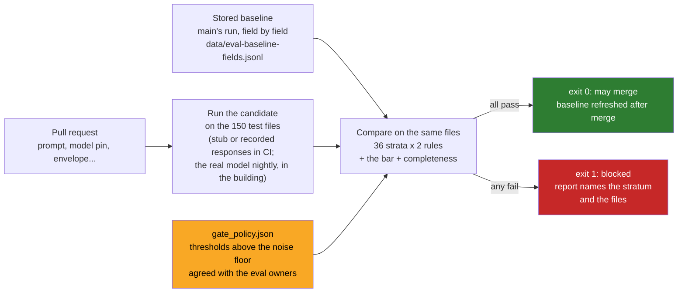

# 07 · The Regression Gate: No Eval, No Merge, and a Gate That Is Not an Average

> Day 14 · Section 7 of 16 · [Chapter overview](README.md) · Previous: [06 · Deterministic checks and LLM judges](06-checks-and-judges.md) · Next: [08 · Hygiene and the set over time](08-hygiene-and-the-set-over-time.md)

---

## 7.1 The rule

From the end of week 6, Godavari's repository has one rule that every other rule rests on: **no pull request that
can change what the system reads or decides merges unless the golden-set gate passes.** The Part 3 Short says it in
five words: "No eval, no merge."

What counts as "can change what the system reads or decides":

| Change | Why the gate runs | Owner chapter |
|---|---|---|
| a prompt release | the commonest source of quiet regressions after launch | Day 13 |
| a model pin, or a provider's model update under the same name | a new model reads differently even with the same prompt | Day 12, Day 13 (drift) |
| page classification or chunking | a missed page loses a document's fields at once | Day 13, Day 15 |
| retrieval (when it arrives) | the right passage not found is a wrong field | Day 15 |
| the envelope: thresholds, cross-checks, validators | changes which wrong values are flagged | Day 11, Day 18 |
| the signed rules | already gated by the compliance head's signature and fingerprint; the golden set shows what the change does | Day 11 |
| the normaliser or the truth file | changes the measurement itself: never in the same pull request as a system change, and signed like a metric change | this chapter |

The last row matters. If a pull request changes the prompt and the normaliser together, a regression in the prompt
can be hidden by a more forgiving normaliser, and the gate will pass. Measurement changes travel alone.

## 7.2 How it works



Five properties make it a gate rather than a dashboard:

1. **It compares against a stored baseline, field by field.** The baseline is main's last accepted run, saved as one
   row per file and field with its strata and outcome (`eval-baseline-fields.jsonl`). The comparison is paired
   (section 05.6).
2. **It refuses to compare different things.** If the candidate was scored on different files or fields than the
   baseline, or against a different version of the truth file (the gate compares the truth file's fingerprint), the
   only check is "same golden set", and it fails: "re-baseline first".
3. **It checks every stratum, not the average.** Product, branch, channel, language, pilot or not, each of the
   sixteen fields, handwritten Telugu or not: 36 strata including "all".
4. **It has hard bars that no trade can buy.** The business case's floor and the compliance head's "no misses".
5. **It exits non-zero.** A report nobody has to read before merging is not a gate.

## 7.3 The four rules

From `code/evals/gate.py`, with the thresholds in `code/gate_policy.json`:

| Rule | Fails when | Why this rule |
|---|---|---|
| **registered bar** | overall field-level accuracy under 90 percent | Day 9's floor; below it the case is negative (risk R2) |
| **completeness recall** | any incomplete golden file is not flagged by the rules | the compliance head's "no misses" |
| **regressions** | in any stratum, right-to-wrong minus wrong-to-right reaches 4 **and** the exact paired test gives p under 0.01 | a real, one-directional loss somewhere, not noise |
| **confident wrong** | in any stratum, newly confidently-wrong fields minus resolved ones exceed 2 | the metric that matters most must not rise |

```json
{
  "registered_bar": {"overall_field_accuracy_min": 0.90, "source": "Day 9 metric definitions, section C; Day 10 risk R2"},
  "completeness_recall_min": 1.0,
  "strata": ["product", "branch", "channel", "language", "pilot", "field", "handwritten_telugu"],
  "min_net_regressions": 4,
  "paired_alpha": 0.01,
  "max_new_confident_wrong": 2,
  "note": "thresholds sit above the noise floor of an unchanged model re-run five times on the development split ..."
}
```

The policy file is agreed with the eval owners and versioned. Lowering a threshold to get a change through is a
policy change, with its own pull request and their names on it.

## 7.4 Setting thresholds from the noise floor

Day 11's stub is perfectly repeatable: same file in, same output out. Real models are not. Run the same prompt on
the same file twice and the reported confidences move, and now and then a smudged character is read differently.
A gate tuned on a perfectly repeatable stub will block real pull requests for nothing.

So every candidate in this chapter runs through `RunNoise` (in `code/evals/candidates.py`): the same model, plus a
seeded run-to-run variation (confidence moves by up to 0.03 either way; about 0.8 percent of fields on handwritten
pages or phone photos are read one character differently). The baseline is "run main"; the rerun is "run rerun-1"; a
real CI system would see the same kind of wobble between any two runs.

The thresholds are then set **above the noise floor**: the biggest movement the unchanged model shows between runs,
in any stratum, measured on the **development split** so that the test split never influences the policy. The gate
prints it every time:

```text
noise floor (dev split, unchanged model re-run 5 times): max net regressions 3, max net new confident wrong 1 in any stratum; thresholds sit above it
```

Net regressions of 4 with p under 0.01, and net new confidently-wrong fields above 2, sit just above that floor. A
test (`test_the_thresholds_sit_above_the_noise_floor_measured_on_dev`) fails if a future change to the model or the
noise makes the floor rise into the thresholds.

## 7.5 The candidate that should fail: a trimmed prompt

Day 13's incident note ([`incident-note-2026-11-12-extraction-2.1.0.md`](../13-prompts-as-code/worksheet/incident-note-2026-11-12-extraction-2.1.0.md))
tells the story. On Thursday 12 November, in a rollback drill on replayed files, extraction 2.1.0, a token-saving
change that removed the Telugu label glossary and a few-shot example, passed the gate on twelve labelled Kukatpally
files. A replay of twenty Guntur files then showed monthly income read as the annual figure on all twelve
handwritten Telugu declarations ("7,08,000 a month for a declaration of 59,000 a month"), the failure that switched
off Godavari's 2019 OCR pilot. The note's own diagnosis: "The labelled set has no handwritten Telugu income
declarations, because its files are from Kukatpally." Its last line is a request to this chapter: "a named slice of
Guntur files with handwritten Telugu declarations, labelled by Lakshmi and the senior analyst." The golden set has
35 Guntur files and reports handwritten Telugu fields as their own stratum. This chapter reproduces the change as a
candidate, `TrimmedPromptStub`, and puts it through the gate:

- the instruction about handwritten Telugu income declarations is gone, so the figure is read at twelve times its value;
- the reminder to say "unsure" is gone, so handwritten pages come back about 0.08 more confident than before.

The real output (`python -X utf8 code/run_gate.py --candidate trimmed`, exit status 1):

```text
candidate: stub-model-v1 + trimmed prompt (2.1.0-style) [run candidate-1]
  overall accuracy 97.5% -> 97.0%; confident wrong 7 -> 9; fields flagged 21.8% -> 14.2%
  an average-only gate (fail if overall drops more than 2 points) would say: PASS (overall accuracy 97.5% -> 97.0% (-0.5 points))

72 checks, 1 failed
  ok   registered bar       all                            accuracy 97.0% against the floor 90%
  ok   completeness recall  all                            100.0% (0 incomplete files not flagged)
  ok   regressions          all                            17 right-to-wrong, 8 wrong-to-right of 1800 fields (+0.5 points lost), p=0.0539
  ok   confident wrong      all                            2 new, 0 resolved (net +2)
  FAIL regressions          field=monthly_income           10 right-to-wrong, 0 wrong-to-right of 100 fields (+10.0 points lost), p=0.0010

verdict: BLOCKED: do not merge
```

Five things in those lines are worth saying out loud in the pull request review.

**The average moved half a point.** An average-only gate with a two-point tolerance, the gate most teams start with,
passes it. Half a point is inside the wobble anyone would accept.

**It looks cheaper.** Fields flagged for review fell from 21.8 to 14.2 percent, because the trimmed prompt is more
confident. A reviewer looking at "review load" would call this an improvement. It is the opposite: the system is
more sure of itself and no more right, which is how confidently-wrong answers are made.

**Only one stratum failed, and it was the field.** Monthly income lost ten fields and gained none: 96 to 86 percent.
The handwritten Telugu stratum also got worse (13 right-to-wrong against 5 wrong-to-right) and so did Telugu files
(12 against 5), but noise lives in those strata too, and at p under 0.01 neither crosses the line on its own. The
per-field slice is where a one-field failure is concentrated enough to see. That is why `field` is a stratum.

**The envelope did its job, which is why it was not worse.** Every one of the twelve-times incomes was flagged by
Day 11's value-in-quote check (the quote says Rs 32,000; the value says 384000), so they are wrong-and-flagged, not
confidently wrong. Without the envelope the same change would have shipped ten wrong incomes unflagged.

**Two new confidently-wrong fields got through the confidence boost.** A date of birth read 81-12-1969 for
31-12-1969 at confidence 0.97, and a name. That is net +2, at the policy's limit, so this rule passed. One of the two
is a label error (section 11.5); the other is real. Whether +2 should fail is a fair question for the eval owners.
Section 7.6 shows what the stricter setting would cost.

The rerun of the unchanged model, through the same gate:

```text
candidate: stub-model-v1 [run rerun-1]
  overall accuracy 97.5% -> 97.7%; confident wrong 7 -> 6; fields flagged 21.8% -> 21.6%
72 checks, 0 failed
  ok   regressions          all                            5 right-to-wrong, 8 wrong-to-right of 1800 fields (-0.2 points lost), p=0.8666
verdict: PASSED: may merge
```

## 7.6 The gate's own error rates

A gate is a classifier, and like any classifier it has two error rates: blocking a harmless change (a false alarm)
and passing a harmful one (a miss). You can measure both. `code/gate_false_alarms.py` reruns the unchanged model
30 times and the trimmed prompt 10 times (each with fresh run noise) against main's baseline:

```text
stored policy
  false alarms on unchanged reruns: 0 of 30
  trimmed prompt caught:            10 of 10
looser: any net 3 regressions at p < 0.05, net new confident wrong > 1
  false alarms on unchanged reruns: 3 of 30 (most often: regressions:channel=phone_photo, regressions:channel=sftp_scan, confident wrong:all)
  trimmed prompt caught:            10 of 10
average only: overall drop over 2 points
  false alarms on unchanged reruns: 0 of 30
  trimmed prompt caught:            0 of 10
```

Three gates, three behaviours. The average-only gate never cries wolf and never catches the wolf. The looser
stratified gate catches it and blocks one harmless pull request in ten, which is how gates get switched off. The
stored policy catches it every time and blocked nothing harmless in 30 runs. That table, not an argument about
p-values, is what you show the eval owners when they ask why the thresholds are what they are. Rerun it whenever the
policy, the strata or the model changes; it takes about fifteen seconds with the stub.

## 7.7 What the gate cannot do

- **It sees only what the golden set contains.** A new kind of failure (a branch that starts uploading sixty-page
  statements, Day 19's incident) does not exist in the set until someone adds it. The gate protects against
  regressions on known cases; production monitoring finds new ones (Day 19), and the set grows (section 08).
- **It cannot accept a trade on its own.** Sometimes a change is worth a regression: a new model that is better on
  eleven fields and worse on one. The gate blocks it; the eval owners decide, in writing, with the field-level
  report in front of them, and the decision goes in the pull request. The gate's job is to make sure the trade is
  seen, not to forbid it.
- **It must not ratchet on noise.** The baseline is main's last accepted run, refreshed only when a change merges.
  Never "keep the best score so far": a lucky run becomes the baseline and every honest run after it looks like a
  regression. (Exercise 3.1's AI-written harness does exactly that.)

## 7.8 Wiring it into CI

In the repository the gate is three commands, and a CI job runs them on every pull request that touches the paths
in 7.1:

```yaml
# .github/workflows/golden-set-gate.yml (shape only; Day 26 owns shipping into Godavari's CI/CD)
on:
  pull_request:
    paths: ["prompts/**", "code/intake/**", "code/evals/**", "code/gate_policy.json"]
jobs:
  gate:
    runs-on: ubuntu-latest
    steps:
      - uses: actions/checkout@v4
      - uses: actions/setup-python@v5
        with: { python-version: "3.14" }
      - run: pip install -r code/requirements.txt
      - run: python -X utf8 -m pytest code
      - run: python -X utf8 code/run_gate.py --candidate "${CANDIDATE}"   # exit 1 blocks the merge
```

Two practical points about where it runs. **In CI, no customer data**: the gate runs on the synthetic or masked set,
with the stub or with recorded model responses (the real model's outputs for the golden files, captured once on the
machine in the building and replayed, so CI needs no network and no PII). **Nightly, the real thing**: the real model
on the real golden files, inside the building, with the same gate and the same policy, and its report goes to the
FDE in the morning. A prompt release is promoted to the pilot environment (Day 13's registry) only when both have
passed.

## 7.9 Key takeaways

- No eval, no merge: every change that can alter what the system reads or decides runs the gate.
- Measurement changes (normaliser, truth file, policy) travel alone and are signed like metric changes.
- Compare against main's stored baseline, field by field, in every stratum; refuse to compare different sets.
- Hard bars for the case's floor and completeness; paired tests for regressions; a separate rule for confident wrongs.
- Set thresholds above the noise floor measured on the development split, and measure the gate's false-alarm and
  miss rates.
- An average-only gate passed the trimmed prompt ten times in ten. Slice by field.
