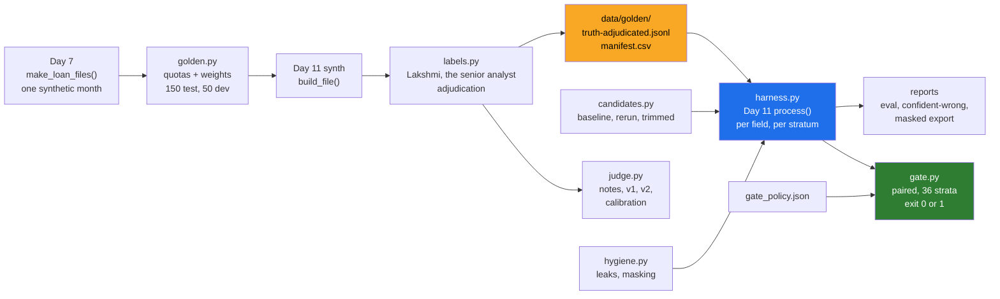

# 11 · Project: The Godavari Golden Set and Eval Harness

> Day 14 · Section 11 of 16 · [Chapter overview](README.md) · Previous: [10 · Production concerns](10-production-concerns.md) · Next: [12 · Build it with AI, and how you know it's right](12-build-with-ai-and-verification.md)

---

## 11.1 The brief

It is Monday 30 November 2026, week 6 of the Godavari engagement. On Wednesday the compliance head signs the
two-wheeler rules (M10); on Thursday the CISO approves real files from two branches on the machine in the building
(M11); on Friday the COO decides go or no-go for the two-branch pilot (M12). The question on the M12 card is about
accuracy "on your analysts' files at the agreed bar". Day 10's risks R1 (handwritten Telugu) and R2 (accuracy below
90 percent) are decided by this week's report, and change C4 says the report includes "the actual files the system
got wrong, not only a percentage".

You owe the engagement folder six things:

1. **The golden set**: 200 labelled files (150 test, 50 development), stratified, with both eval owners' labels, the
   adjudicated truth file, the adjudication log and the agreement report.
2. **The harness**: Day 11's pipeline run over the test split, imported by path, scored per field, per document and
   per file, per stratum, with intervals.
3. **The confidently-wrong report**, file by file, and its masked export for Kaagaz.
4. **A calibrated judge** for the branch notes, compared against the eval owners, with a verdict on whether it may
   gate anything.
5. **The regression gate** for CI, with its policy, its noise floor and its measured error rates, failing a
   deliberately worse candidate.
6. **The eval plan and the labelling guide**, in the worksheet folder.

On the engagement, steps 1 to 5 run on real files inside the building with the real model. In this repository they
run on synthetic files with Day 11's stub, so that every number below can be reproduced on any laptop in a few
seconds. The method is identical; the numbers are a rehearsal.

## 11.2 Files

The README's Files table lists every module. The shape:



About 1,700 lines of package code with docstrings, plus about 470 lines of tests. Read `golden.py`, `labels.py` and
`harness.py` in that order; the rest follows.

## 11.3 Setup and run

Everything was run on **Python 3.14.3** on Windows 11 in October 2026; the code needs 3.12 or newer. pytest is not
on the global Python on this machine, so the tests run in a virtual environment with the pinned requirements (the
same pins as Day 11). From the chapter folder:

```bash
python -m venv .venv
# Windows: .venv\Scripts\activate      Linux and macOS: source .venv/bin/activate
pip install -r code/requirements.txt          # pytest 9.1.1 and its pinned dependencies; nothing else

python -X utf8 code/build_golden_set.py       # the golden set, labels, adjudication, agreement   (~0.4 s)
python -X utf8 code/run_evals.py              # baseline eval, reports, masked export              (~0.6 s)
python -X utf8 code/run_evals.py --candidate trimmed                                                # (~0.5 s)
python -X utf8 code/run_judge.py              # judge calibration                                  (~0.3 s)
python -X utf8 code/run_gate.py --candidate rerun      # exit 0                                    (~0.8 s)
python -X utf8 code/run_gate.py --candidate trimmed    # exit 1                                    (~0.8 s)
python -X utf8 code/gate_false_alarms.py      # the gate's error rates, 40 runs                    (~11 to 15 s)
python -X utf8 -m pytest code                 # 68 tests                                           (~4 to 6 s)
```

The harness itself imports only the standard library and Day 11's `intake` package (which imports Day 7's generator
by path), so the scripts run without the venv; only the tests need it. No network, no API key. Day 11 and Day 7 must
be present at their FOLDERS.md paths.

## 11.4 Step 1: the golden set

`build_golden_set.py` draws the set, labels it twice, adjudicates, and writes the agreement report. Its output (the
strata and the agreement tables) is shown and read in sections 02.3 and 03.6; the opening lines:

```text
== Day 14 · the Godavari golden set ==
pool: one synthetic month from Day 7's generator (2400 files, seed 14), two-wheeler and gold only
golden files that are also in Day 7's 200-file development sample: 0
split: 150 test (the golden set the harness scores) + 50 development (few-shot examples and tuning only)
```

What it writes:

| File | Contents |
|---|---|
| `data/golden/manifest.csv` | 200 rows: file, split, product, branch, channel, language, pages, page fingerprint |
| `data/golden/labels-lakshmi.jsonl`, `labels-senior-analyst.jsonl` | each eval owner's raw labels, with trajectories and minutes |
| `data/golden/truth-adjudicated.jsonl` | the truth file the harness scores against, values in canonical form |
| `data/golden/adjudication-log.csv` | every adjudicated item: both labels, the decision, who, why |
| `data/agreement-report.md` | the adjudication rule and the agreement report |
| `data/fewshot-examples.json` | three examples for the extraction prompt, from the development split only |

## 11.5 Step 2: the baseline eval, and what it found

`run_evals.py` checks hygiene, verifies every file's fingerprint against the manifest, runs Day 11's pipeline over
the 150 test files, and writes the reports. The headline block, verbatim:

```text
== Day 14 · golden-set eval: baseline ==
hygiene: 46 prompt and example files scanned, 0 test-split values found in them; 0 name or address matches for a person to look at; test files also in dev: 0; also in Day 7's development sample: 0

model: stub-model-v1 [run main] · as of 2026-11-30 · 150 golden files, 1800 mandatory field cells · 0.12 s
  two-wheeler rules v0.3: reviewed-draft (the compliance head, 2026-11-06); fingerprint matches the record
  gold rules v0.1: draft (nobody yet, -); fingerprint matches the record

-- headline (Day 9, section C) --
  field-level accuracy (normalised)    97.5%   95% 96.7% to 98.1% (fields), 96.7% to 98.2% (files resampled)
  field-level accuracy (exact string)  89.0%
  confidently wrong (wrong, not flagged)   7 = 0.39%   95% 0.19% to 0.80%
  when a field is NOT flagged, it is right 99.50% of the time
  fields flagged for review             21.8%
  completeness recall 100.0% (0 misses of 76 incomplete files) · precision 95.0% (4 false flags)
  missing-document recall 100.0% · precision 77.1%
  send-back recall 100.0% · precision 91.1% (92 files the analysts would send back)
  page classification 98.9% · documents found: precision 100.0%, recall 98.4%
  model cited the page the analyst used: 100.0% of fields
  files with a confidently wrong field: 7 (0 of them routed ready_for_approval)
  routes: blocked 11, send_back 64, review 58, ready_for_approval 17

-- cost and cadence --
  this run: 0.12 s for 150 files with the stub (offline, every pull request)
  the same run on a real model at Day 12's measured cost per file: about Rs 951 to Rs 1,310
  labelling the 200 files twice: 303 analyst hours, about Rs 1.38 lakh at Rs 456 an hour
```

The stratum and field tables between the headline and the cost block are in `data/eval-report-baseline.md` and are
read in section 05.4. The two rule banners say what the harness ran: the two-wheeler rules are a reviewed draft
whose fingerprint matches the record, and the gold rules are still a draft (risk R7). The harness runs in Day 11's
prototype mode; from M10 on Wednesday it runs with `mode="pilot"`, which refuses any rule the compliance head has not
signed, so the eval can never score rules that production would not run.

**The confidently-wrong report** is the most useful page of the run. Verbatim from `data/confident-wrong-baseline.md`:

```text
| file | product | branch | channel | language | field | model read | label | confidence | threshold | page (model / analyst) | route |
|---|---|---|---|---|---|---|---|---|---|---|---|
| GF-40821 | two-wheeler | Guntur | sftp_scan | mixed | on_road_price | `37150` | `137150` | 0.93 | 0.85 | 10 / 10 | review |
| GF-40988 | two-wheeler | Guntur | sftp_scan | english | on_road_price | `26800` | `126800` | 0.93 | 0.85 | 4 / 4 | review |
| GF-41934 | two-wheeler | Guntur | phone_photo | english | on_road_price | `10430` | `104350` | 0.90 | 0.85 | 12 / 12 | send_back |
| GF-42254 | two-wheeler | Guntur | sftp_scan | mixed | on_road_price | `15370` | `153750` | 0.94 | 0.85 | 14 / 14 | send_back |
| GF-41214 | two-wheeler | Rajahmundry | phone_photo | english | on_road_price | `9500` | `95050` | 0.91 | 0.85 | 4 / 4 | send_back |
| GF-42017 | two-wheeler | Rajahmundry | sftp_scan | mixed | on_road_price | `12900` | `129500` | 0.97 | 0.85 | 24 / 24 | send_back |
| GF-42025 | two-wheeler | Guntur | sftp_scan | mixed | requested_amount | `70000` | `70060` | 0.87 | 0.85 | 12 / 12 | send_back |
```

Read it the way you would with the senior analyst, one pattern at a time.

**Six of seven are the on-road price, and they are all the same mistake.** Open GF-40821's dealer quotation, page 10:
the scanned line reads `On-road price: Rs I,37,150`. OCR turned the leading "1" into a capital "I". The model copied
the line faithfully, then kept only the digits, and "I,37,150" became 37150. Its confidence was 0.93, above the 0.85
threshold, and the value is literally in its own quote, so the envelope's value-in-quote check passed. There is no
second document that carries the on-road price, so no cross-check could catch it.

Something did fire on GF-40821. The margin rule said "requested Rs 100,500 is 270.5 percent of the on-road price Rs
37,150; the limit is 90 percent", and sent the file to review. But the finding is on the **requested amount**, so the
analyst's screen highlights the wrong field. She checks the requested amount, finds it correct, and either
overrides a policy rule she should not have to, or approves a file whose core-system record will carry a price of
Rs 37,150. The rule did its job; the flag pointed at the wrong field. That is a finding about the envelope, not the
model, and it is the kind of thing only a file-by-file report shows.

The fix is two lines of deterministic code in Day 11's envelope, for Day 11's owner to make and the gate to measure:
a numeric field whose quoted text contains a letter among its digits is flagged ("Rs I,37,150" is not a number), and
when the margin rule fires above, say, 150 percent, it flags both the amount and the price. Exercise 2.3 asks you to
write the first as a wrapper and measure it; the gate then shows whether it removes the six without adding noise.

**The seventh is the label's fault.** GF-42025's form says Rs 70,000; the model read 70000; the truth file says
70060. There is no adjudication entry for that field, because Lakshmi and the senior analyst both typed 70060: a
smudge on a handwritten zero, read the same way twice. This is the shared error of section 03.8, and the generator
confirms it (it is one of the three cells where the adjudicated label and the paper differ). The response is a
procedure, not an edit: the field goes back to Srinivas and the Vijayawada team lead with the page, they record
70000, and the truth file becomes version 1.1 with the change logged. The model's confidently-wrong count becomes six.
(The chapter leaves version 1.0 as it is, so that the output above stays reproducible; exercise 2.4 does the
re-adjudication.)

**The pattern by branch.** Five of the seven are Guntur files, a pilot branch. Before go-live, the Guntur branch
manager should see these files, because if Guntur's dealer quotations are printed in a font that turns 1 into I, the
pilot will produce a confidently-wrong price every few days.

**Nothing confidently wrong reached "ready for approval".** All seven files are in review or send-back for other
reasons. That is luck as much as design; the field-level flag is what decision D07 relies on.

## 11.6 What the run means for Friday

For the M12 pack (exercise 3.2 writes it in the COO's words): **R2** is answered by the real-model run on the real
files tonight; this rehearsal, at 97.5 percent (96.7 to 98.2 resampling files), says the instrument works, not that
the model does. **R1**: handwritten Telugu fields at 96.0 percent with 46 percent flagged, so pre-filling is safe but
the hours saved in Guntur stay small until Day 18 sets thresholds from data. **Completeness**: no misses in 76
incomplete files. **C4**: seven confidently-wrong fields listed, six with one cause and a two-line fix, one a label
error being corrected. Day 9's sensitivity table maps the R2 number to the case: 95 percent or more, with uncertain
fields routed to review, is the row worth +15 lakh a year at base.

## 11.7 Step 3: the judge

`run_judge.py` builds the notes, labels them, calibrates both judges on the development notes and reports on the
held-out notes. The full output and its reading are in section 06.4 and 06.5. Its verdict, which goes into the eval
plan:

```text
judge-v1 (holistic): advisory only, not in the gate (needs held-out kappa >= 0.80 and catches >= 90 percent of the notes people failed)
judge-v2 (rubric): TRUSTED in the gate (needs held-out kappa >= 0.80 and catches >= 90 percent of the notes people failed)
```

## 11.8 Step 4: the gate

`run_gate.py --candidate rerun` exits 0; `run_gate.py --candidate trimmed` exits 1, blocked on
`field=monthly_income` with an average that moved only half a point. Both outputs are read in section 07.5, and the
gate's own error rates (0 false alarms in 30 unchanged reruns, the trimmed prompt caught 10 times in 10, an
average-only gate catching it 0 times in 10) in section 07.6. In CI, the trimmed candidate stays in the suite as the
known-bad change the gate must keep failing (section 10.5).

## 11.9 The tests

```text
$ python -X utf8 -m pytest code -v | head -5
============================= test session starts =============================
platform win32 -- Python 3.14.3, pytest-9.1.1, pluggy-1.7.0
rootdir: ...\14-evals-first\code
configfile: pytest.ini
collected 68 items

$ python -X utf8 -m pytest code
....................................................................     [100%]
68 passed in 5.46s
```

| File | Tests | What it holds |
|---|---|---|
| `test_stats_and_normalise.py` | 18 | Wilson at a textbook value and at the edges; kappa at 1, at chance, and on a skewed base rate; the exact paired test; the seeded bootstrap; six things the normaliser forgives and five it never does; "not in file" |
| `test_golden_and_labels.py` | 12 | split sizes and quotas; every reported stratum at least 20 files; hard cases over-sampled; dev and test disjoint and new; deterministic pages; adjudicators are Godavari's named people; format is not disagreement; no-rule reasons rejected; PAN only from the PAN card; agreement high after normalising; trajectories cover every field; the truth file on disk is what the code produces |
| `test_harness.py` | 16 | the four outcomes on seven hand-made cases; Day 11 imported by path, not copied; every mandatory field scored; deterministic runs; strata add up; no completeness misses; confidently wrong means wrong and unflagged; changed pages refused; exact under normalised; the trimmed prompt hides in the average but not in its field |
| `test_judge_and_hygiene.py` | 14 | calibrated on dev, reported on test; the holistic judge not trusted and preferring its own family; the rubric judge trusted; a pasted PAN and an invented document caught; few-shot from dev only; a shared name is a weak match; a planted golden PAN found; the export carries no identifiers; five masking rules |
| `test_gate.py` | 8 | baseline against itself passes; three unchanged reruns pass; the trimmed prompt blocked on its field; an average-only gate would merge it; a different golden set cannot be compared, nor a different truth-file version; a completeness miss fails whatever the fields; thresholds above the dev noise floor |

## 11.10 What goes into the engagement folder

| Artifact | Path | Read by |
|---|---|---|
| the eval plan | [`worksheet/godavari-eval-plan.md`](worksheet/godavari-eval-plan.md) | the eval owners, the COO's pack |
| the labelling guide v1.0 | [`worksheet/godavari-labelling-guide.md`](worksheet/godavari-labelling-guide.md) | the eval owners, the compliance head |
| the manifest, labels, truth file and adjudication log | `data/golden/` | inside the building only |
| the agreement report | [`data/agreement-report.md`](data/agreement-report.md) | the eval owners |
| the baseline report and the confidently-wrong list | [`data/eval-report-baseline.md`](data/eval-report-baseline.md), [`data/confident-wrong-baseline.md`](data/confident-wrong-baseline.md) | the M12 pack (C4) |
| the masked export | [`data/export-for-kaagaz-baseline.json`](data/export-for-kaagaz-baseline.json) | Kaagaz product (Day 36) |
| judge calibration | [`data/judge-calibration.md`](data/judge-calibration.md) | the eval owners |
| gate reports and error rates | [`data/gate-trimmed.md`](data/gate-trimmed.md), [`data/gate-rerun.md`](data/gate-rerun.md), [`data/gate-false-alarms.md`](data/gate-false-alarms.md) | reviewers; Day 26 |
| the empty plan for the next customer | [`worksheet/golden-set-plan-template.md`](worksheet/golden-set-plan-template.md) | Day 42's capstone |

## 11.11 Extend it

- Add the "letter among the digits" check as a wrapper around Day 11's model output, rerun, and put it through the
  gate as a candidate. Does it remove the six on-road price errors? Does it add flags elsewhere? (Exercise 2.3.)
- Re-adjudicate GF-42025, write truth-file version 1.1 beside 1.0, re-baseline, and confirm the gate refuses to
  compare a 1.0 baseline with a 1.1 run until you do. (Exercise 2.4.)
- Add a `pilot x product` crossed stratum to the policy, rerun `gate_false_alarms.py`, and see whether the false-alarm
  rate moves.
- Write a third candidate: a model that is better on names and worse on gold weights. Read the gate's report as the
  eval owners would and write the one-paragraph decision.
- Run Day 11's optional real adapter on five synthetic files and score them; compare its outcomes with the stub's.
