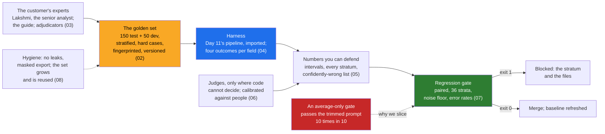

# Day 14 · Evals First: The Golden Set With the Customer's Experts, Judges, Regression, and "LLM Work Without Verification Is Unfinished"

> **[Part 3 · Building the System Around the Model](../README.md)** · Chapter 4 of 10 · Video ~13 min · Chapter tier: big
> Builds on: [Day 6 (the labellers, their conditions, the 180-file manifest)](../../02-discovery-and-decomposition/06-discovery-interviews/README.md) ·
> [Day 9 (the pre-registered metric definitions and the 90 to 95 percent bar)](../../02-discovery-and-decomposition/09-success-metrics-and-business-case/README.md) ·
> [Day 10 (risks R1, R2, R7; change C4; decisions D07, D08)](../../02-discovery-and-decomposition/10-the-discovery-document/README.md) ·
> [Day 11 (the intake package, imported by path)](../11-the-system-around-the-model/README.md) ·
> [Day 12 (cost per file)](../12-llm-apis-for-production/README.md) · [Day 13 (prompt releases; the 2.1.0 incident)](../13-prompts-as-code/README.md)
> Sets up: Day 18 (confidence thresholds set from this harness), Day 19 (the same metrics on a production stream),
> Day 20 (the golden set run against the shipped skeleton), Day 26 (the gate in the customer's CI/CD), Day 27 (the
> golden set as a production check after every deployment), Day 36 (the eval set as the currency between field and
> product), Day 42 (the capstone's golden-set plan)
> **Owner:** this chapter owns **evals and golden sets for the course: building the golden set with the customer's
> experts before serious development; its size, strata, hard-case sampling, development and test splits and
> versioning; the labelling guide, two independent labellers, expert trajectories, inter-annotator agreement and
> adjudication; what to measure (field-level exact and normalised accuracy, the four outcomes and the confidently-wrong
> rate, page and document metrics, completeness precision and recall, cost per file); intervals, slicing by stratum
> and paired comparisons; deterministic checks against LLM-as-judge, judge calibration and bias; the CI regression gate
> with its noise floor and error rates; leakage and PII hygiene; reusing and growing the set as models change.** The
> metric definitions are Day 9's; the system measured is Day 11's; prompts are Day 13's; thresholds and the review
> queue are Day 18's; dashboards are Day 19's; residency law is Day 24's; spending evals with the product team is Day 36's.
> Versions used: the code was run on **Python 3.14.3** (it needs **3.12 or newer**) with **pytest 9.1.1**, pinned in
> `code/requirements.txt` and run in a virtual environment (pytest is not on the global Python). The harness uses the
> standard library only and imports Day 11's `intake` package by path. Sources read on 21 October 2026. Shown outputs
> are from real runs. All data is synthetic and generated by code, reusing Day 7's generator and Day 11's synthesiser.

---

## Why this chapter exists

On Friday 4 December 2026 the COO decides whether two branches go live, and the question on the milestone card is
whether accuracy "on your analysts' files" is at the agreed bar. An FDE who answers with "about 97 percent on a good
sample" loses the room to the senior analyst's next question ("says who, on which files, and show me the ones it got
wrong"). An FDE who built the measuring instrument first, with Godavari's own experts, answers every follow-up from it.

That is what OpenAI's FDE team calls eval-driven development: evaluation sets built with the customer's experts
"before significant development begins", expert trajectories turned into labelled benchmarks, and the standard that
"no LLM-based code is considered done until verification exists". In the published Morgan Stanley case the pipeline
took 6 to 8 weeks and trust took about four more months of pilots and evaluation refinement. Applied AI work, of which
evals are the part that separates shipping from demoing, is in 80 percent or more of the 1,000 FDE postings analysed
in 2026.

This chapter builds the instrument. It designs a 150-file golden set (plus 50 development files) stratified by
product, branch, channel and language and drawn from the hard cases; has Lakshmi and the senior analyst label every
file independently, with trajectories, under a written guide; measures their agreement and adjudicates by a written
rule; runs Day 11's pipeline over it and reports field-level accuracy, the confidently-wrong rate, completeness
precision and recall, per stratum, with intervals; calibrates a judge for the branch notes against people and rejects
the one that is not good enough; and builds a CI gate that blocks a trimmed prompt the average would have let through,
with its own false-alarm rate measured. Then it reads the confidently-wrong list file by file and finds a misread
"1", a flag on the wrong field, and a label that was wrong.

## Mental model

One sentence to carry out of the chapter: **build the answer key with the customer's experts before you build the
system, measure every field and every slice with its uncertainty, count the wrong answers nobody was told to check,
let code grade what code can, calibrate any judge against people, and let no change merge that the golden set says
made something worse.**

## Learning goals

After this chapter you can:

1. Explain eval-driven development and why the golden set comes before serious development, with the OpenAI and
   Morgan Stanley evidence and its limits.
2. Design a golden set: 100 to 200 real examples sized by the smallest stratum you must decide about, drawn from the
   hard cases, with development and test splits, page fingerprints and a versioned truth file.
3. Run labelling with the customer's experts: a guide written with them, two independent labellers, expert
   trajectories, raw agreement and Cohen's kappa in plain words, adjudication by a written rule with named people.
4. Choose metrics that match the job: field-level accuracy with a registered normaliser (exact beside it), the four
   outcomes and the confidently-wrong rate, page and document diagnostics, completeness precision and recall, cost.
5. Report numbers you can defend: Wilson intervals, a file-level bootstrap, every stratum, a production reweighting,
   and paired comparisons between runs.
6. Decide when an LLM judge is acceptable, move what code can check into code, calibrate a judge on a development
   split, report it on a held-out split with failures caught and bias probes, and refuse to judge a model with itself
   unchecked.
7. Build a CI regression gate that compares cell by cell against a stored baseline in every stratum, sets thresholds
   above a measured noise floor, and has known false-alarm and miss rates.
8. Keep the set clean (no leakage, no PII out), reuse it to decide model switches, and grow it from production.
9. Build the harness with an AI coding agent and catch the mistakes it makes on this concept.

**Prerequisites:** Days 6, 9 and 10 (the people, the definitions, the risks); Day 11's code (you will import it).
Python at a working level; the statistics are explained as they are used.

## Reading order

| # | Section | What you get | Words |
|---|---|---|---|
| 01 | [Why evals first](01-why-evals-first.md) | two Fridays; eval-driven development; the career reason; Morgan Stanley's proportions; the hard parts | ~1,650 |
| 02 | [The golden set](02-the-golden-set.md) | what makes a set golden; 100 to 200 and why; hard cases on purpose; strata; dev and test; real, masked, synthetic; versioning | ~2,250 |
| 03 | [Labelling with the customer's experts](03-labelling-with-the-experts.md) | who and why; the guide; what a label records; trajectories; agreement and kappa; the real report; adjudication; agreement is not correctness | ~2,550 |
| 04 | [What to measure](04-what-to-measure.md) | metrics that match the job; exact and normalised; the four outcomes and the confidently wrong; pages; completeness; send-back; cost | ~2,200 |
| 05 | [Numbers you can defend](05-numbers-you-can-defend.md) | counts and intervals; Wilson; the file-level bootstrap; slicing; reweighting; paired comparisons; many slices | ~1,550 |
| 06 | [Deterministic checks and LLM judges](06-checks-and-judges.md) | code first; when a judge is acceptable; the rubric; the holistic judge's failures; the rubric split; calibration; never self-judge unchecked | ~1,850 |
| 07 | [The regression gate](07-the-regression-gate.md) | no eval, no merge; how it works; four rules; the noise floor; the trimmed prompt; the gate's own error rates; CI wiring | ~1,900 |
| 08 | [Hygiene and the set over time](08-hygiene-and-the-set-over-time.md) | leakage and the scan; looking is a leak; PII and the masked export; model switches; growing the set; cadence; what generalises | ~1,750 |
| 09 | [Advanced and 2026 patterns](09-advanced-and-2026-patterns.md) | tooling where the data lives; pre-labelling; synthetic data; agent and online evals; judges in 2026; hype | ~1,150 |
| 10 | [Production concerns](10-production-concerns.md) | where it runs; a release criterion; cost and recorded responses; monitoring; when the eval breaks; owners after handoff | ~1,050 |
| 11 | [Project: the golden set and the harness](11-project-the-golden-set-and-harness.md) | the brief; setup; every step with real output; the confidently-wrong list read file by file; the tests; the engagement folder | ~2,050 (plus output) |
| 12 | [Build it with AI, and how you know it's right](12-build-with-ai-and-verification.md) | context and prompts; the fourteen mistakes an agent makes here; twelve checks; the review checklist | ~1,850 |
| 13 | [Mistakes and debugging](13-mistakes-and-debugging.md) | symptom, cause, fix for the set, the metrics, the gate and the code; a routine for "the number looks wrong" | ~1,100 |
| 14 | [Interview questions](14-interview-questions.md) | 12 questions with model answers, plus a quick-fire round | ~1,450 |
| 15 | [Exercises](15-exercises.md) | 11 graded exercises: predict-the-output, break-it, the letter guard, re-adjudication, review an AI-written harness, the M12 paragraph, "100 percent", the capstone plan | ~2,200 |
| 16 | [Further reading](16-further-reading.md) | the OpenAI FDE sources, judge research and guides, the statistics in the original, the Indian context | ~950 |

Word counts are prose only, without code blocks. **Short on time?** Read 02, 04 and 07, run the project (11), and do
exercises 2.3 and 3.1. That is the video plus the reflex the interview tests: no number without its slice, and no
merge without the gate.

## Files

| Path | What |
|---|---|
| [`code/evals/day11.py`](code/evals/day11.py) | puts Day 11's `code/` on the path, exposes its rulesets; nothing copied; no bytecode written into Day 11's folder |
| [`code/evals/golden.py`](code/evals/golden.py) | the pool (Day 7's generator, one synthetic month), quotas, hard-case weights, the two splits, the page fingerprint |
| [`code/evals/labels.py`](code/evals/labels.py) | the label record, the paper truth, the two eval owners' labels, trajectories, the adjudication rule |
| [`code/evals/agreement.py`](code/evals/agreement.py) · [`normalise.py`](code/evals/normalise.py) · [`stats.py`](code/evals/stats.py) | agreement and kappa; the registered normaliser; Wilson, the exact paired test, the file-level bootstrap |
| [`code/evals/harness.py`](code/evals/harness.py) | runs `intake.pipeline.process()` per file; the four outcomes; metrics per stratum; reports |
| [`code/evals/candidates.py`](code/evals/candidates.py) | run-to-run noise, the trimmed-prompt candidate, `build()` |
| [`code/evals/judge.py`](code/evals/judge.py) | branch notes, human note labels, the holistic and rubric judges, calibration |
| [`code/evals/gate.py`](code/evals/gate.py) · [`code/gate_policy.json`](code/gate_policy.json) | the paired, stratified gate and its policy |
| [`code/evals/hygiene.py`](code/evals/hygiene.py) · [`store.py`](code/evals/store.py) | leakage checks, masking, the PII scan; paths, readers, the truth-file fingerprint |
| [`code/build_golden_set.py`](code/build_golden_set.py), [`run_evals.py`](code/run_evals.py), [`run_judge.py`](code/run_judge.py), [`run_gate.py`](code/run_gate.py), [`gate_false_alarms.py`](code/gate_false_alarms.py) | the five steps |
| [`code/tests/`](code/tests/) | 68 tests in five files |
| [`code/exercises/ai_draft_eval.py`](code/exercises/ai_draft_eval.py) | an AI-written eval harness with at least twelve problems; exercise 3.1 |
| [`code/requirements.txt`](code/requirements.txt) · [`code/pytest.ini`](code/pytest.ini) | pinned test dependencies (the same as Day 11's) |
| [`worksheet/godavari-eval-plan.md`](worksheet/godavari-eval-plan.md) | the eval plan for the engagement folder: the set, metrics and bars, cadence, the gate, the risks it answers |
| [`worksheet/godavari-labelling-guide.md`](worksheet/godavari-labelling-guide.md) | the labelling guide v1.0, cited by section in the adjudication log |
| [`worksheet/golden-set-plan-template.md`](worksheet/golden-set-plan-template.md) | the empty plan for the next customer (Day 42) |
| `data/golden/` | manifest, both eval owners' labels, the adjudicated truth file, the adjudication log |
| `data/` | agreement report, eval reports and per-field rows, confidently-wrong lists, masked exports, judge calibration, gate reports and error rates, few-shot examples (development split) |

Run from the chapter folder: `python -m venv .venv`, activate it, `pip install -r code/requirements.txt`, then
`python -X utf8 code/build_golden_set.py`, `python -X utf8 code/run_evals.py`, `python -X utf8 code/run_judge.py`,
`python -X utf8 code/run_gate.py --candidate rerun` (exit 0) and `--candidate trimmed` (exit 1), and
`python -X utf8 -m pytest code` (68 tests, about 4 to 6 seconds). Each script takes under a second;
`gate_false_alarms.py` takes about 11 to 15. No network, no API key. Day 7 and Day 11 must be at their FOLDERS.md paths.

## What this chapter does *not* teach (single-owner rule)

| Topic | Where it's taught |
|---|---|
| The metric ladder, pre-registration, the baseline and the business case | [Day 9](../../02-discovery-and-decomposition/09-success-metrics-and-business-case/README.md) (definitions quoted here, not reworded) |
| Which logic is code and which is the model; the envelope; signed rules | [Day 11](../11-the-system-around-the-model/README.md) (the system measured here) |
| Structured outputs, retries, the cost ledger | [Day 12](../12-llm-apis-for-production/README.md) |
| Prompt files, releases, the registry, rollback, the long-document fix | [Day 13](../13-prompts-as-code/README.md) (every release now goes through this gate) |
| Retrieval recall on the golden set | [Day 15](../15-retrieval-for-enterprise-documents/README.md) (uses this set) |
| Agent workflows and their trajectories | [Day 17](../17-agents-and-workflows/README.md) (compares with the experts' trajectories recorded here) |
| Setting confidence thresholds, the review queue, corrections as labels | [Day 18](../18-verification-and-trust/README.md) |
| Dashboards, traces, production quality signals | [Day 19](../19-observability-for-ai-systems/README.md) |
| DPDP, RBI guidance, residency and model choice | [Day 24](../../04-deploying-into-their-world/24-data-residency-and-indian-law/README.md) |
| Shipping the gate into the customer's CI/CD | [Day 26](../../04-deploying-into-their-world/26-shipping-into-their-infrastructure/README.md) |
| Evals as the currency with product and research | [Day 36](../../06-from-customer-to-product/36-feeding-product-and-research/README.md) |

## Analogies for the Telugu audience

- **Previous years' question papers and the official answer key** (the chapter's main picture): a tutor who never
  tests you is guessing; the golden set is last year's real paper with the answer key written by the customer's own
  toppers, and you may not see the paper before the exam (02.1).
- **The valuation camp**: in a board exam's valuation camp, a head examiner settles disputed answer scripts; the
  marks are trusted because the rule for disputes is written down and nobody marks their own student (03.7).
- **The family biryani recipe card** (Day 13's picture, extended): the recipe has a date and a cook; the golden set
  is the tasting panel that decides whether the new card is better, dish by dish, not on the average plate (07.5).

## Video map

The video (~13 min) covers a slice; the notes cover everything.

| Asset | Covers | Sections |
|---|---|---|
| **Day 14 main video** (~13 min) | Hook: two Fridays, "97 percent on a good sample" against 150 files and a list (1.5 min) → eval-driven development and "unfinished without verification"; Morgan Stanley's 8 weeks and 4 months (1.5 min) → the golden set: 150 files from the hard cases, strata, dev and test (1.5 min) → two labellers, the guide, 79.8 to 97.8 percent after normalising, kappa in one picture, the adjudication log (2 min) → the four outcomes and why "confidently wrong" matters most (1.5 min) → slicing: six of seven wrong are the on-road price, "Rs I,37,150" (1 min) → judges: the holistic judge catches 35 percent; the rubric split catches all (1 min) → the gate: the trimmed prompt, half a point on average, ten points on one field, blocked; the average-only gate passes it 10 times in 10 (1.5 min) → recap and the Day 18, 19, 36 teasers (0.5 min) | 01.1 to 01.4, 02.2 to 02.5, 03.5 to 03.7, 04.3, 05.4, 06.4 to 06.5, 07.5 to 07.6, 11.5 |
| **Short 1:** "No eval, no merge. The one rule that makes AI work ship." | the trimmed prompt's gate output: average 97.5 to 97.0, monthly income 96 to 86, verdict blocked; the average-only gate's "PASS"; the 30-rerun false-alarm table | 07.1, 07.5, 07.6 |
| **Short 2:** "150 files labelled by the customer's best analysts beat any benchmark." | no benchmark has a Guntur phone photo; Lakshmi and the senior analyst, every file twice; the label that was wrong and how it was found | 02.1, 03.1, 03.8, 11.5 |
| Notes only | versioning (02.7), trajectories (03.4), the analysts' own error rate (03.9), pages and send-back (04.4, 04.6), the bootstrap and reweighting (05.3, 05.5), many slices (05.7), the calibration procedure and self-judging (06.6, 06.7), the noise floor and CI wiring (07.4, 07.8), leakage and PII (08.1 to 08.3), model switches (08.4), 2026 patterns (09), production (10), the project (11), Build it with AI and verification (12), debugging (13), interviews (14), exercises (15) | as listed |

**Callbacks to use on screen:** "Day 6 lo Lakshmi cheppindi gurtunda: 'if my answers are the standard, yes.' Ivala
aa answers ni standard ga marchutunnam." (section 03); "Day 9 lo field-level accuracy ni define chesam; ivala adi
150 files meeda, prati branch ki, prati field ki measure chestunnam." (section 04); "Day 13 lo 2.1.0 token trim
twelve Kukatpally files meeda pass ayyindi; ivala Guntur slice tho adi block avutundi." (section 07).
**Forward callbacks:** Day 18 (ee harness nunchi confidence thresholds set chestam), Day 19 (ide metrics production
lo dashboard meeda), Day 36 (ee eval set ne product team ki currency).

## Callbacks

- **Builds on:** [Day 5](../../02-discovery-and-decomposition/05-the-stakeholder-map/README.md) (the eval owners as
  a named role; the sceptic), [Day 6](../../02-discovery-and-decomposition/06-discovery-interviews/README.md) (the
  labellers and conditions; the manifest from the hard cases; the 2019 failure; Bhavani's "I would not know"),
  [Day 8](../../02-discovery-and-decomposition/08-scoping-the-first-90-days/README.md) (M05, M09, M12; the experts'
  hours booked by the team leads), [Day 9](../../02-discovery-and-decomposition/09-success-metrics-and-business-case/README.md)
  (section C's definitions; the sensitivity table; about 300 labelling hours),
  [Day 10](../../02-discovery-and-decomposition/10-the-discovery-document/README.md) (R1, R2, R7, C4, D07, D08),
  [Day 11](../11-the-system-around-the-model/README.md) (the system, imported), [Day 12](../12-llm-apis-for-production/README.md)
  (cost per file), [Day 13](../13-prompts-as-code/README.md) (prompt releases; the 2.1.0 incident note and its request
  for a Guntur slice).
- **Sets up:** [Day 15](../15-retrieval-for-enterprise-documents/README.md) (recall on the golden set),
  [Day 17](../17-agents-and-workflows/README.md) (agent paths against the experts' trajectories),
  [Day 18](../18-verification-and-trust/README.md) (thresholds from the eval; corrections into the development split),
  [Day 19](../19-observability-for-ai-systems/README.md) (the same metrics in production),
  [Day 20](../20-the-walking-skeleton-shipped/README.md) (the golden set run against the skeleton),
  [Day 26](../../04-deploying-into-their-world/26-shipping-into-their-infrastructure/README.md) (the gate in their CI/CD),
  [Day 27](../../04-deploying-into-their-world/27-reliability-in-their-production/README.md) (the golden set as a
  production check), [Day 36](../../06-from-customer-to-product/36-feeding-product-and-research/README.md) (evals as
  the currency), [Day 42](../../08-capstone-and-career/42-capstone-brief/README.md) (the capstone's golden-set plan).

**Next chapter:** [Day 15 · Retrieval for enterprise documents: chunking real PDFs, hybrid search, metadata, and permission-aware retrieval](../15-retrieval-for-enterprise-documents/README.md).
