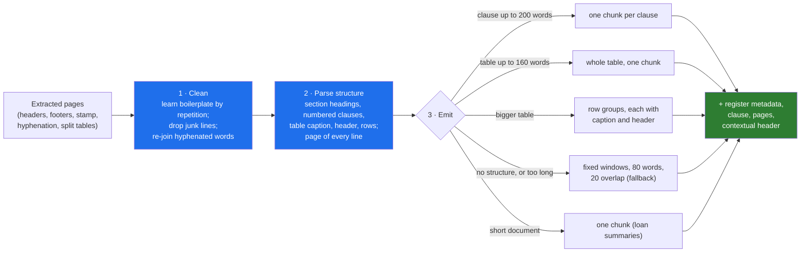

# 03 · Chunking: Structure First, Fixed Size as the Fallback, and Where Most Quality Is Lost

> Day 15 · Section 3 of 16 · [Chapter overview](README.md) · Previous: [02 · Why enterprise documents are hard](02-why-enterprise-documents-are-hard.md) · Next: [04 · Metadata as a first-class index](04-metadata-as-an-index.md)

---

## 3.1 What a chunk is, and why it decides so much

A **chunk** is the unit you index and return. The retriever never sees a document; it sees chunks. The analyst
never reads a document in the panel; she reads the chunk you show her, with its citation. So the chunk has three
jobs at once:

1. **Be findable**: contain the words and meaning a query will match, and not much else.
2. **Be readable on its own**: make sense to an analyst without the page around it ("Self-employed ... twelve-month
   bank statement ..." is useful; "... for the same period | payouts in at least five of" is not).
3. **Be citable**: map to one clause on known pages of one version of one document.

Every retrieval decision downstream (the analyzer, the embedding, the fusion, the reranker) works on what the
chunker gave it. A relevant sentence split across two chunks cannot be ranked first by anything. A chunk that is half
footer competes on the footer. This is why chunking is where most retrieval quality is lost, and why it is the first
thing to fix, not the last. The project measures it directly (section 3.7): same corpus, same retrievers, same
queries; naive fixed windows reach recall at 5 of 0.825, structure-aware chunks 0.925.



## 3.2 Clean before you chunk

Cleaning is three small functions in `chunking.py`, and each one is worth more than a better embedding.

**Boilerplate by repetition.** Take the first two and last two lines of every page in the corpus, replace digits with
`#`, and count. Any line pattern that appears on at least 10 percent of all pages is boilerplate:

```python
def learn_boilerplate(docs: list[Document], min_share: float = 0.10) -> frozenset[str]:
    """Edge lines (first two, last two) that recur on at least min_share of all pages, digits normalised."""
    edges: Counter[str] = Counter()
    pages = 0
    for d in docs:
        for p in d.pages:
            pages += 1
            for line in {*p[:2], *p[-2:]}:
                edges[_norm(line)] += 1
    return frozenset(k for k, n in edges.items() if n >= min_share * pages)
```

On the synthetic corpus it learns four patterns ("GODAVARI FINANCE LTD · CREDIT OPERATIONS", "Page # of #",
"Internal · uncontrolled when printed", and the loan summaries' running header) and removes 1,508 lines. The running
header that carries each circular's own number and title is unique per document, so repetition across the corpus
cannot find it; the cleaner also drops an edge line that starts with the document's own number from the register.
Learning boilerplate from the data, rather than hard-coding the four lines you happened to see, is what keeps
working when the branch in Warangal scans with a different footer.

**Junk lines.** A line where more than half the tokens mix letters and digits and are not known identifier
shapes (circular numbers, file numbers, clause numbers, PAN tokens) is OCR garbage; the rotated stamp
`~ D3V0RPPA · ECNA1LPM0C ~` is the example. Nine such lines in the corpus. Be conservative here: a rule that also
drops "GST 4Q returns" would delete content. The test for this lives on a hand-made page so that you can see exactly
what it removes.

**Hyphenation.** A line ending in a hyphen followed by a line starting with a lowercase letter is a word broken by
wrapping: "docu-" and "ment before" become "document before". Three in the corpus. Without this, "document" and
"docu" are different tokens and the scanned circular silently stops matching.

## 3.3 Structure first

Godavari's circulars, like most policy documents in India (RBI master directions, insurance product filings,
hospital SOPs), are numbered: "4. Income proof by applicant type", then "4.1 ...", "4.2 Table 1: ...". That numbering
is the author's own chunking, done by the person who knew where one rule ends and the next begins. Use it.

The parser walks the cleaned lines once, keeping the page number of each, and recognises five line shapes:

| Shape | Pattern | What it becomes |
|---|---|---|
| Header block | "Credit Operations Circular No.", "Subject:", "Date:", "Supersedes:" at the top | one "header" chunk: number, subject, dates (answers "what is GFL/CO/2025/027?") |
| Section heading | `4. Income proof by applicant type` | not a chunk; its heading is attached to every clause under it |
| Clause | `4.1 The table below lists ...` | one chunk; continuation lines append to it, even across a page break |
| Table caption | `4.2 Table 1: Income proof by applicant type` | starts a table block |
| Table row | `\| a \| b \| c \|` | first row is the header; a repeat of the header after a page break is dropped; the rest are rows |

Each chunk also gets a **contextual header** for indexing: the document title and section heading are prepended to
the indexed text ("Income proof for two-wheeler loans by applicant type · Income proof by applicant type · Table 1:
..."), while the text shown to the analyst stays the clause itself. That one line is why a query using the words of
the heading finds a clause that does not repeat them.

A clause longer than 200 words falls back to fixed windows (section 3.5). In the synthetic corpus none does; in
Godavari's real circulars some RBI digest sections will.

## 3.4 Keeping a table intact

Tables are where policy lives, and they are where naive chunking does the most damage. Two strategies, chosen by size:

- **A small table stays whole.** Up to 160 words, the caption, the header and every row are one chunk. The LTV table
  (three rows) is an example. The analyst sees the whole rule; the citation is one clause.
- **A big table becomes row groups, each carrying the caption and the header.** The income-proof table is about 180
  words, so it splits into two groups (154 and 44 words). Each group starts with "Table 1: Income proof by applicant type" and the
  header "Applicant type | Acceptable income proof | Conditions", so that every row can be read on its own and is
  matched with the words of its columns.

From the project's run:

```text
the income-proof table (clause 4.2) crosses pages 2 to 3; its first row group as one chunk:
    Table 1: Income proof by applicant type
    Applicant type | Acceptable income proof | Conditions
    Salaried | last three salary slips and the bank statement of the salary account for three months | statement e
    Self-employed (shop owner, trader, kirana shop) | twelve-month bank statement of the business account, or GST
a naive window over the same page break: ...hs | statement ends within 30 days before the application | Page 2 of 3 Internal · uncontrolled when printed GODAVARI FINANCE LTD · CREDIT OPERATIONS GFL/CO/2025/027 · In...
```

The structured chunk spans pages 2 to 3 because the table does, and its citation says so. The repeated header row on
page 3 appears once, not twice. The naive window over the same page break is a salaried row's tail, a footer, a
header and the start of a title.

Two rules that are easy to forget: **never split a row**, and **never let a row group lose its header**. If a single
row is longer than the limit (a long conditions cell), keep it whole and accept a long chunk; a half row is worse than
a long one.

## 3.5 Fixed size as the fallback, and what overlap is for

Fixed-size chunking cuts text every N tokens (or words, or characters), optionally overlapping consecutive chunks by
M. It is the right tool when there is no structure to follow: an OCR'd page that lost its numbering, a long free-text
note, a scanned letter. The chapter's fallback is 80 words with a 20-word overlap.

**Overlap** exists for one reason: a sentence that straddles a boundary appears whole in at least one of the two
chunks. It costs index size (25 percent more chunks at 20 of 80) and produces near-duplicate results, which is why
results are collapsed by clause before they are shown (section 07.4). Overlap does not fix a table split from its
header, a footer in the middle of a chunk, or a chunk that mixes two clauses with different rules. It is a patch for
prose, not a substitute for structure.

How big should a chunk be? There is no universal number, and anyone who gives you one without looking at the
documents is guessing. The trade-off:

| Smaller chunks (a sentence, a row) | Larger chunks (a section, a page) |
|---|---|
| precise match; the citation points at the exact rule | more context; fewer "the answer is in the next chunk" misses |
| more chunks, more index, more near-duplicates | one chunk may hold two rules, and the analyst reads the wrong one |
| dense vectors capture one idea cleanly | dense vectors average several ideas and match none strongly |
| needs a contextual header to make sense alone | wastes the model's context window if passed to a model |

At Godavari the author's clauses are already the right size (one rule each, 6 to 48 words, median 14), which is the usual
case for policy documents and the reason structure-first wins.

## 3.6 Short documents: do not split what fits

A masked loan-file decision summary is nine lines: file number, branch, product, decision, applicant type, PAN
token, income proof, address proof, reason, analyst note. It is one chunk. Splitting it would separate "Decision:
approved" from the reason, and "Branch: Guntur" from the evidence, and the precedent half of the panel exists to show
those together. The rule in code is simply `if doc.doc_type == "loan_decision": one chunk`. In general: if a whole
document fits comfortably within your chunk limit, the document is the chunk.

When Godavari's loan bundles themselves are indexed (40 pages, eight page types, [Day 13](../13-prompts-as-code/README.md)'s
classifier), the page and its page type become the structure: one chunk per page or per page section, with the page
type as metadata. Day 13 already found that the co-applicant lives on page 38; retrieval inherits that lesson.

## 3.7 Measured: the same retrievers, two chunkers

The project runs the 40 labelled queries (section 08) against both chunkings. Same BM25, same dense stand-in, same
fusion; only the chunks differ. Recall at 5:

| Chunking | Hybrid RRF | Hybrid RRF + rerank |
|---|---|---|
| naive 80-word windows, no cleaning, no overlap (707 chunks) | 0.825 | 0.750 |
| structure-aware, cleaned (635 chunks) | 0.925 | 0.975 |

Two things to take from that table. First, chunking alone moved recall at 5 by 10 points, with no change to any
model. Second, the reranker helped the good chunks and **hurt** the naive ones: a long window that contains many of
the query's words, from three different clauses and a footer, looks relevant to a reranker that scores word coverage.
A better model downstream cannot rescue bad chunks, and it can make them worse.

## 3.8 Choosing a strategy

| Documents | Strategy | Watch for |
|---|---|---|
| numbered policies, circulars, master directions, SOPs | structure: section, clause, table | lost numbering on scans; very long clauses |
| forms and loan bundles | page and page type (Day 13), fields as metadata | handwriting; page order |
| contracts | clause and sub-clause, with the definitions section attached by reference | defined terms used far from their definitions |
| emails, notes, chat logs | the message or note is the chunk | quoted replies duplicating text |
| scanned letters, free text | fixed windows with overlap | the OCR quality, not the window size |
| tables everywhere | whole if small; row groups with caption and header if large | merged cells, multi-line cells |

Layout-aware extraction tools (section 09) can give you headings, reading order and table cells directly from the PDF,
which makes "structure first" easier. They do not remove the need to check what came out on your customer's ten
worst pages, by eye, before you trust any number.
