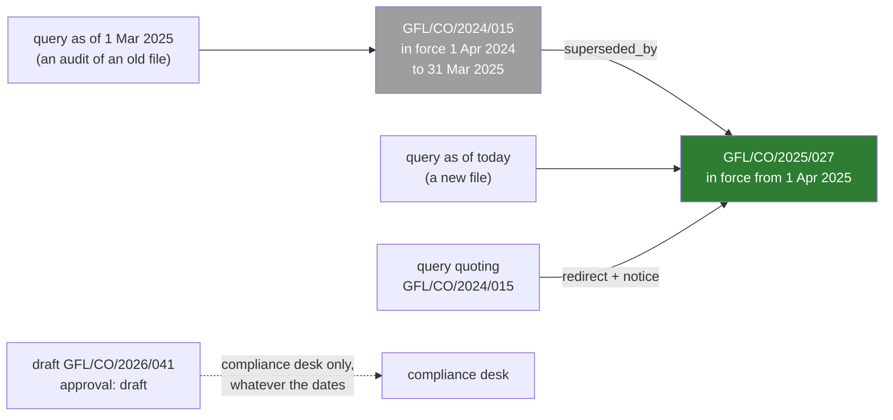

# 07 · Freshness, Superseded Documents and Citations to the Exact Clause

> Day 15 · Section 7 of 16 · [Chapter overview](README.md) · Previous: [06 · Permission-aware retrieval](06-permission-aware-retrieval.md) · Next: [08 · Evaluating retrieval](08-evaluating-retrieval.md)

---

## 7.1 The confident wrong answer

The worst output a policy lookup can give is not "nothing found". It is the superseded rule, quoted perfectly, with a
citation. An analyst trusts a citation more than a paraphrase, so a wrong citation does more damage than a vague
answer. The compliance head's August 2025 story (three branches still sending unmasked Aadhaar copies two months after
the rule changed) is what that looks like when people do it; a retriever can do it to forty analysts at once.

Freshness is a metadata problem, not a ranking problem. Do not try to make newer documents "rank higher" with a decay
on the date; a newer circular on a different topic is not more relevant, and an older circular that is still in force
(the 2024 grievance circular has no successor) is not less valid. Instead: know for each document the dates it is in
force, and filter.

## 7.2 The version in force on a date

Every policy document has `effective_from` and, once replaced, `effective_to` and `superseded_by`, from the register:

```python
def in_force(self, on: date) -> bool:
    """True if the document is the version in force on that day."""
    return self.effective_from <= on and (self.effective_to is None or on < self.effective_to)
```



The search filter carries `as_of`, which defaults to today. Two uses at Godavari:

- **Reviewing a new file**: `as_of` is today; only current versions are candidates.
- **Reviewing an old file**, during an audit or a complaint: `as_of` is the decision date, so the panel shows the rule
  the analyst was bound by then, not the rule today. The RBI auditor's question is "show me the decision, who made it,
  and what it rested on" (the compliance head, Day 6). What it rested on includes the circular in force that day.

From the project's run, the same income question on two dates:

```text
-- 5. Superseded circulars and the version in force --
  the same income question for a file decided on 1 March 2025: 2 shown, 47 matches counted
    1. GFL/CO/2024/015 · Income proof for two-wheeler loans · clause 2.2 · page 1 · in force from 01 Apr 2024
    2. GFL/CO/2024/015 · Income proof for two-wheeler loans · clause 1.1 · page 1 · in force from 01 Apr 2024
```

On 1 March 2025 the 2024 circular was in force, and its clause 2.2 ("Self-employed applicants give income tax returns
for the last two assessment years. No other income proof is accepted") was the rule. Today the same query returns
GFL/CO/2025/027's table, where the bank statement is accepted. Both answers are right for their date.

Drafts are a separate axis. A draft is not "in force in the future"; it is not approved. The project first gave the
draft video-KYC circular its proposed effective date (1 December), and the compliance desk could not find it on 25
November, because the freshness filter hid it. The eval caught that in the "access" category, and the fix was to
treat approval and effectiveness as two separate fields. That is a typical metadata bug, and a typical reason to have
a query in the eval for every kind of document.

## 7.3 Old numbers in queries

Analysts quote circular numbers from memory and from printed copies. When the query names a superseded circular, the
service follows the `superseded_by` chain to the version in force on the `as_of` date, rewrites the query, and says so:

```text
  Lakshmi quotes the 2024 circular number: 2 shown, 55 matches counted
    notice: GFL/CO/2024/007 was superseded by GFL/CO/2025/012 from 01 Jun 2025; showing GFL/CO/2025/012
    1. GFL/CO/2025/012 · Masking of Aadhaar numbers in KYC copies (revised) · document header · page 1 · in force from 01 Jun 2025
    2. GFL/CO/2025/012 · Masking of Aadhaar numbers in KYC copies (revised) · clause 2.2 · page 1 · in force from 01 Jun 2025
```

The notice matters as much as the redirect. Lakshmi learns that her printed copy is out of date, which is the
CHECKLIST_DRIFT finding fixed at the moment it bites, one analyst at a time. A number that is not in the register gets
a notice too ("not in the register"), which usually means a typo, or a circular that was emailed and never registered:
a finding for the compliance head.

## 7.4 Citations to the exact clause

Every result carries a citation built from metadata, never from the model:

```text
GFL/CO/2025/027 · Income proof for two-wheeler loans by applicant type · clause 4.2 · pages 2 to 3 · in force from 01 Apr 2025
GF-23417 · Guntur (GNT04) · decided 14 Aug 2025
```

Number, title, clause, pages and the effective date (which identifies the version). For a past file: number, branch
and decision date. Rules that make citations trustworthy:

- **Cite what you show.** The panel shows the chunk's own text (the clause, or the table row group with its header)
  beside the citation. The analyst can check in two seconds that the clause says what the note says.
- **One result per clause.** Two row groups of the same table, or two overlapping windows of one clause, collapse to
  one result before display. Without this, Lakshmi's panel showed clause 4.2 twice in the top three.
- **Pages as a range.** A table that crosses a page break is cited as "pages 2 to 3"; a citation that says "page 2"
  sends the analyst to the half without her row.
- **The note cites, too.** If a model drafts a note from the results (Day 20 wires Day 12's client in; the project
  uses a deterministic stand-in), every sentence carries the clause or file number it came from, and the note is
  drafted only from the results shown.

Section 3.1's third job of a chunk, "be citable", is what makes this possible. A naive 80-word window has no clause;
it can only be cited as "somewhere on page 2", which is not a citation an auditor accepts.

## 7.5 Checking citations automatically

A citation is a claim: "this text is on these pages of this document". The project tests the claim: for the top five
results of 20 labelled queries, the cited text must appear in the cleaned text of the cited pages. It is there for
three bugs that are easy to write and hard to see: page numbers taken from the wrong line after de-hyphenation; a row
group whose pages come from the caption only; and the contextual header (title plus section) shown to the analyst as
if it were the clause. The last one matters because the header is something the system wrote, not something
Godavari's circular says. Exercise 2.3 breaks the page tracking on purpose and watches this test fail.
