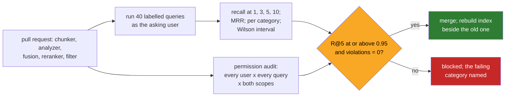

# 08 · Evaluating Retrieval: Recall at k on Labelled Queries, Before Any Model Sees a Passage

> Day 15 · Section 8 of 16 · [Chapter overview](README.md) · Previous: [07 · Freshness, superseded documents and citations](07-freshness-and-citations.md) · Next: [09 · Advanced and 2026 patterns](09-advanced-and-2026-patterns.md)

---

## 8.1 Measure the retriever on its own

When a retrieval-plus-model system gives a wrong answer, there are two suspects: the retriever did not return the
right passage, or the model misread the passage it got. If you only measure the final answer, you cannot tell which,
and every argument about the fix is a guess. So measure retrieval alone, first: for a set of questions with known
answers, did the right passage appear in the top k? That number does not involve any model, costs nothing to run,
and runs on every change to chunking, analyzers, fusion, the reranker or the filter.

[Day 14](../14-evals-first/README.md) owns evals: golden sets built with the customer's experts, labelling rules,
agreement, judges, gates. This section uses its ideas and one of its functions (the Wilson interval, imported by path
from `14-evals-first/code/evals/stats.py`); Day 14's harness scores extraction and completeness and has no retrieval
metric, so recall at k is defined here, minimally.



## 8.2 Recall at k and MRR

For one query with a set of relevant items R and the system's top k results:

```text
recall@k  = |R found in the top k| / |R|
MRR       = mean over queries of 1 / (rank of the first relevant result), 0 if none in the list
```

Recall at k answers "is the answer on the screen?". The panel shows three policy results and three past files, and
the note uses the top five, so k = 5 is the number that matters at Godavari, with k = 1, 3 and 10 reported beside it.
MRR answers "how high?", which matters because analysts read from the top. Precision at k ("how much of the screen is
relevant?") matters less here: the analyst reads three items, and a weak third item costs a second, while a missing
answer costs a send-back.

## 8.3 The labelled set: 40 queries, answer spans, the asking user

`code/godavari_retrieval/queries.py` holds 40 queries, written the way an analyst types into the panel, in nine
categories: identifier (6), table-row (5), paraphrase (7), superseded (6), Telugu script (3), access (1), precedent
(6), PAN (3), transliteration (3). Three choices in how they are labelled make the set survive real use:

1. **Labels are answer spans, not chunk IDs.** The label for "what income proof is acceptable for a self-employed
   two-wheeler applicant in Guntur" is the string "twelve-month bank statement of the business account, or gst returns
   for the last four quarters". A result counts if its text contains the span. Chunk IDs change every time you change
   the chunker; spans do not, which is how the naive and the structure-aware chunkings are scored against the same
   labels (section 03.7).
2. **Superseded labels exist only in the version in force.** For "salaried bank statement six months", the span is
   "covering about three months", which is only in the 2025 circular. Returning the 2024 version (which says six
   months) scores zero. A test checks that every span is findable in some in-force chunk, and that no superseded-
   category span appears in an old version: **test your labels, not only your system.**
3. **Each query is run as the user who asked it.** Lakshmi's precedent queries are scored against what Lakshmi may
   see. A recall number computed as an all-seeing admin user overstates quality (the admin sees the Kukatpally file
   that is "most similar") and hides the permission filter from the eval entirely. The AI draft in exercise 3.1 makes
   exactly this mistake.

## 8.4 Are the labels complete?

Recall needs to know every relevant item, and real labels never do. If an analyst labels "files like this one" and
there were three more she did not think of, the system is punished for finding them. Two ways to live with it:

- **By construction**, as in this synthetic corpus: the planted precedent files have combinations of facts that the
  generator refuses to produce elsewhere, so the label is complete. You can do this only with synthetic data.
- **By pooling**, with real data: run several systems, pool their top 10s, and have the analysts judge every pooled
  item. Anything none of the systems found is still unknown, so report recall as "against the pool", and grow the
  pool when a new system finds something. This is how evaluation campaigns have handled it for decades, and it is
  what Lakshmi and the senior analyst would do in Day 14's labelling process for the real set (open question RQ4).

## 8.5 The results, and the one miss

The final configuration (structure-aware chunks, BM25 plus the dense stand-in, RRF, rerank top 50), from the run:

```text
  configuration                            R@1    R@3    R@5    R@10   MRR
  naive chunks, hybrid RRF                 0.637  0.800  0.825  0.850 0.738
  naive chunks, hybrid RRF + rerank top 50 0.588  0.700  0.750  0.850 0.681
  structure, lexical (BM25) only           0.738  0.912  0.925  0.925 0.833
  structure, dense stand-in only           0.637  0.800  0.875  0.975 0.754
  structure, hybrid RRF                    0.662  0.900  0.925  0.950 0.792
  structure, hybrid RRF + rerank top 20    0.738  0.925  0.950  0.975 0.850
  structure, hybrid RRF + rerank top 50    0.738  0.950  0.975  0.975 0.860
  fully answered in the top 5: 39 of 40; 95 percent Wilson interval 0.87 to 1.00 (Day 14's stats.wilson, by path)
  miss at 5: q17 [paraphrase] 'oldest borrower allowed for a bike loan'; top 3 ['GFL/CO/2025/027', 'GFL/CO/2025/027', 'GFL/CO/2025/027']
```

Every row in that table is a decision you can now defend with a number: structure over naive (+10 points at 5),
hybrid over dense alone, rerank depth 50 over 20. The miss is kept. "Oldest borrower" shares no word with "The
applicant is 21 to 60 years old" and the stand-in's concept table has no entry linking "oldest" to age. Adding
"oldest" to the table would make the number 1.000 and teach you nothing: it is tuning the system to the test, the
retrieval version of training on the test split. The miss goes in the report as a known gap (a real embedding model
would probably get it; that is RQ3), and a new query of the same shape goes into the next labelling round so that the
fix, when it comes, is measured on queries it was not built from.

## 8.6 Forty queries cannot prove 95 percent

The Part plan's target is recall at 5 above 95 percent. The run shows 0.975, and 39 of 40 queries fully answered.
The 95 percent Wilson interval on 39 of 40 is **0.87 to 1.00**. Read that honestly: this set is consistent with a true
rate of 87 percent. Forty queries are enough to find gross failures (a whole category at zero) and to compare two
configurations on the same queries; they are not enough to promise a number to a COO. That needs Day 14's approach: a
few hundred queries drawn from real lookups, labelled by the analysts, with the interval reported every time. Also
remember that this is synthetic data with planted answers; real Godavari circulars will score lower, and the first
real run is the one to believe.

## 8.7 The permission audit is an eval too

Recall tells you whether the right thing was found. The permission audit tells you whether anything wrong was shown,
and it is the eval the CISO cares about:

```text
  permission audit (pre-filter): 4315 results checked for 7 users x 40 queries x 2 scopes; violations: 0
```

For every user in the snapshot (analysts from both teams, a team lead, a branch credit officer, the compliance desk,
the service account), every labelled query, both panel scopes, top 10: is each result one the user may see, by Day
11's rule? The target is exactly zero, not "low". Run it with a second snapshot (the transfer) as well, and against
the real engine, not only the pure-Python one, because the engine is where a filter can quietly become a post-filter.

## 8.8 The gate

Two numbers gate every retrieval pull request, in `tests/test_freshness_citations_eval.py` and
`tests/test_permissions_and_leaks.py`:

| Gate | Threshold | Why this threshold |
|---|---|---|
| recall at 5, all 40 queries, final configuration | at least 0.95 | the current 0.975 minus one query of slack; a regression of two queries fails |
| naive chunking below the final configuration | strictly lower | guards the claim the chapter makes, so a refactor cannot silently break the comparison |
| permission violations in the audit | exactly 0 | not negotiable |

Look per category as well as overall, because an average can hide a category falling to zero (the dense stand-in
scores 0.875 overall while missing a third of the identifier queries). Day 14's gate does exactly this for extraction,
per stratum; when the real retrieval set exists, its gate policy should carry recall at 5 per category with the same
paired comparison against the previous release.
