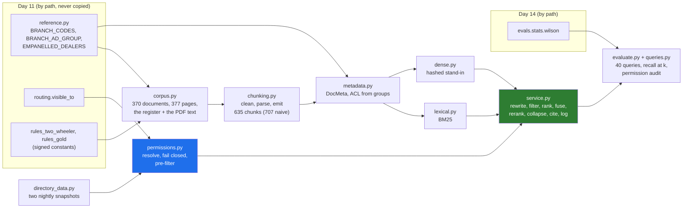

# 11 · Project: The Godavari Retrieval Service, Offline, End to End

> Day 15 · Section 11 of 16 · [Chapter overview](README.md) · Previous: [10 · Production concerns](10-production-concerns.md) · Next: [12 · Build it with AI, and how you know it is right](12-build-with-ai-and-verification.md)

---

## 11.1 The brief

It is week 5. The pilot starts on Monday 7 December (milestone M13) in Kukatpally and Guntur, and the review queue
(workstream W6) is being built. You owe the engagement folder three things before the security review's access-control
section is answered:

1. **A working retrieval service** behind the review queue's "Policy and precedent" panel: structure-aware chunking of
   the circulars, rulebooks and digests; masked decision summaries; BM25 plus a dense retriever, fused and reranked; a
   permission pre-filter from the directory snapshot; supersession; clause citations; a view log.
2. **Evidence**: recall at k on labelled queries, a permission audit with zero violations, and a side-by-side that
   shows the CISO what the rejected post-filter design would have leaked.
3. **A one-page design note** for the CISO and the compliance head (`worksheet/godavari-retrieval-design.md`).

Everything runs offline on synthetic data generated by code: no network, no model download, no API key. The real
circulars and summaries arrive only after the CISO's approval for real files on the machine in the building
(milestone M11, 3 December) and the compliance head's register (RQ1).

## 11.2 What is in `code/`



| Path | What |
|---|---|
| `code/godavari_retrieval/day11.py`, `day14.py` | the two path imports: Day 11's branch codes, groups, dealers, `visible_to` and rule constants; Day 14's Wilson interval |
| `code/godavari_retrieval/text.py` | the lexical analyzer (identifiers and Telugu whole, transliteration folds), the dense view, the naive `\w+` for contrast, PAN tokens and redaction |
| `code/godavari_retrieval/corpus.py` | the synthetic corpus: rich circulars with versions, 28 further circular topics, rulebooks from Day 11's constants, the annex, three RBI digests, a draft, 300 summaries with 10 planted files; PDF-like rendering |
| `code/godavari_retrieval/chunking.py` | boilerplate learning, junk and hyphenation, the structure parser, tables, fallback windows, the naive baseline |
| `code/godavari_retrieval/metadata.py` | `DocMeta` and the ACL rule |
| `code/godavari_retrieval/lexical.py`, `dense.py`, `fusion.py` | BM25, the dense stand-in, RRF and the reranker stand-in |
| `code/godavari_retrieval/permissions.py`, `directory_data.py` | snapshots, `Principal`, staleness, `may_see`, the pre-filter; the two synthetic snapshots |
| `code/godavari_retrieval/service.py` | `RetrievalService` and the rejected `NaivePostFilterService` |
| `code/godavari_retrieval/queries.py`, `evaluate.py` | the 40 labelled queries; recall at k, MRR, the interval, the audit |
| `code/run_demo.py` | the whole story in one run, writing `data/` |
| `code/tests/` | 36 tests |
| `code/exercises/ai_draft_retrieval.py` | the AI-written draft with at least twelve problems, for exercise 3.1 |

## 11.3 Run it

pytest is not on the global Python on the machine this was written on, and should not be: use a virtual environment
with the chapter's pinned requirements. From the chapter's `code/` folder:

```bash
python -m venv .venv
# Windows: .venv\Scripts\activate    Linux and macOS: source .venv/bin/activate
python -m pip install -r requirements.txt     # pytest 9.1.1 and its pinned dependencies; nothing else
python -X utf8 run_demo.py                    # about 5 seconds
python -X utf8 -m pytest                      # 36 tests, about 2 to 3 seconds
```

The package itself uses only the standard library; the pins are for the tests and match Day 11's. It was run on
Python 3.14.3 on Windows 11 in October 2026, and needs 3.12 or newer. `-X utf8` keeps Windows consoles happy with
Telugu and the middle dot. Day 11's and Day 14's folders must be where FOLDERS.md puts them, because both are imported
by path.

## 11.4 The run, part by part

The output below is real, from `data/run-report.md`; parts already shown in sections 02 to 08 are cut to one line.

**The corpus and the chunks** (sections 02 and 03):

```text
documents: 370 = annex 1, circular 62, loan_decision 300, rbi_digest 3, rulebook 4
approved circulars: 61 in 40 series; 21 superseded; drafts: 1
boilerplate learned from repetition: 4 line patterns; removed 1508 lines, 9 junk lines, re-joined 3 hyphenated words
structure-aware chunks: 635 (clause 261, header 70, summary 300, table 2, table_rows 2)
naive 80-word windows: 707
```

**The panel**, as Lakshmi opens the Guntur kirana-shop file:

```text
-- 3. The panel in the review queue: Lakshmi, Guntur pilot file, two-wheeler, self-employed --
indexes built in 0.09 s (BM25 and the dense stand-in over 635 chunks)
query: 'what income proof is acceptable for a self-employed two-wheeler applicant in Guntur' (two searches in 11 ms)
  Policy: 3 shown, 61 matches counted
    1. GFL/CO/2025/027 · Income proof for two-wheeler loans by applicant type · clause 4.2 · pages 2 to 3 · in force from 01 Apr 2025
    2. GFL/CO/2025/027 · Income proof for two-wheeler loans by applicant type · clause 1.1 · page 1 · in force from 01 Apr 2025
    3. GFL/CO/2025/027 · Income proof for two-wheeler loans by applicant type · clause 4.1 · page 2 · in force from 01 Apr 2025
  Similar past files (your branches only): 3 shown, 64 matches counted
    1. GF-23417 · Guntur (GNT04) · decided 14 Aug 2025
    2. GF-23726 · Rajahmundry (RJY06) · decided 29 Jun 2025
    3. GF-24105 · Rajahmundry (RJY06) · decided 10 Feb 2026
  note drafted from the shown results only: GF-23417 (Guntur, approved): approved after field visit confirmed the kirana shop; rent agreement accepted with the landlord's electricity bill | GF-23726 (Raja...
```

The top policy result is the table row group with the self-employed row, cited to pages 2 to 3. The top past file is
the Guntur file that matches her case, and the third is a Rajahmundry file that was **sent back** for an unregistered
rent agreement: a precedent for what not to accept, which is exactly what Bhavani needs to stop sending files back "to
be safe". The note is a deterministic stand-in for the model call Day 20 wires in; it is drafted only from what is
shown.

**The leak, and its absence** (section 06.3): the post-filter shows four results with "showing 4 of 62", writes the
Kukatpally file into the debug log, and drafts a note naming Sri Sai Motors and the on-road price; the pre-filter shows
five of her own region's files and the string GF-23562 appears nowhere in the response. Srinivas, who may see
Kukatpally, gets GF-23562 first for the same query: the filter is a permission, not a blacklist.

**Supersession** (section 07): the 2024 Aadhaar circular number is redirected to GFL/CO/2025/012 with a notice; the
income question as of 1 March 2025 returns the 2024 circular's clause 2.2.

**PAN** (sections 05.8 and 06.6): no PAN-shaped string in any chunk; the repeat customer's PAN returns exactly her two
files; the Warangal PAN returns nothing for Lakshmi with "no file you can see matches this PAN", and GF-23911 for
Srinivas; the view log stores the query as "prior applications PAN [PAN]".

**Groups change, the index does not** (section 06.5 and 06.6):

```text
  kkp.credit.officer, 25 Nov snapshot: branches shown ['Kukatpally']
  kkp.credit.officer, 26 Nov snapshot: branches shown ['Guntur']
  27 Nov 09:00 with the 25 Nov snapshot: refused: group snapshot ad-groups-2026-11-25.json taken 2026-11-25 02:00 is more than 36 hours old; refusing to answer
  the service account's own identity: 0 shown, 0 matches counted
    notice: no groups for this user: nothing is visible
  Lakshmi asks for the draft: 1 shown, 44 matches counted
    1. GFL/CO/2024/081 · Video-based customer identification · clause 1.1 · page 1 · in force from 16 Sep 2024
  the compliance desk asks: 1 shown, 46 matches counted
    1. GFL/CO/2026/041 · Video-based KYC for repeat customers (draft) · clause 1.1 · page 1 · in force from 16 Nov 2026
```

**The evaluation and the audit** (section 08): recall at 5 of 0.975 for the final configuration, 39 of 40 queries
fully answered (Wilson interval 0.87 to 1.00), the one miss named, every category at 1.00 except paraphrase at 0.86,
4,315 results audited with 0 violations, and the post-filter's 567 of 1,000 debug-log lines about forbidden files.

## 11.5 The tests

```text
platform win32 -- Python 3.14.3, pytest-9.1.1, pluggy-1.7.0
collected 36 items

tests\test_freshness_citations_eval.py .......                           [ 19%]
tests\test_permissions_and_leaks.py ............                         [ 52%]
tests\test_ranking.py .....                                              [ 66%]
tests\test_text_and_chunking.py ............                             [100%]

============================= 36 passed in 2.53s ==============================
```

What they pin down, by file:

| File | Tests |
|---|---|
| `test_text_and_chunking.py` | Telugu kept whole and shredded by `\w+`; identifiers whole for BM25 and split for the dense view; fold rules; PAN token and redaction; on a hand-made two-page PDF: boilerplate, junk and hyphenation removed, a table crossing the page break kept as one chunk with its header once; on the corpus: no header, footer or stamp in any chunk; the income table's rows whole with caption and header; every chunk has a clause and valid pages; no PAN anywhere; the rulebook's numbers equal Day 11's constants |
| `test_ranking.py` | BM25 against the formula by hand; a hidden chunk is never scored by either retriever; RRF by hand; the dense stand-in matches paraphrase and confuses circular numbers; collapse by clause |
| `test_permissions_and_leaks.py` | the filter agrees with Day 11's `visible_to` for every loan chunk and every user; ACLs never name users; Lakshmi sees only her region; no groups or unknown user sees nothing; a stale snapshot refuses; a transfer changes results without re-indexing; drafts for the compliance desk only; the audit at zero; the post-filter's leaks through log, note and count; the pre-filter's absence of any trace; the PAN lookup never reveals a file elsewhere |
| `test_freshness_citations_eval.py` | superseded versions filtered; old numbers redirected; `as_of` returns the old version; every citation's text is on its cited pages; recall helpers; every label answerable and superseded labels only in force; the recall gate |

## 11.6 What goes into the engagement folder

| Artifact | For whom | Where |
|---|---|---|
| the retrieval design note, version 0.3 | the CISO, the compliance head, the two team leads | `worksheet/godavari-retrieval-design.md` |
| the retrieval review checklist | whoever reviews the next retrieval pull request | `worksheet/retrieval-review-checklist.md` |
| the eval report and the run report | the eval owners (Lakshmi and the senior analyst, Day 14); Day 23's questionnaire | `data/eval-report.md`, `data/run-report.md` |
| the labelled queries | the eval owners, to extend with real lookups | `data/labelled-queries.json` |
| the corpus manifest | the compliance head, as the shape of her register | `data/corpus-manifest.csv` |
| a sample of the view log | the CISO | `data/view-log.jsonl` |

## 11.7 Extend it

- Swap the dense stand-in for a local multilingual embedding model behind `embed`, and rerun the categories (09.2).
- Add Telugu character n-grams to the lexical analyzer and measure suffixed forms like "రుజువుగా" (exercise 3.4).
- Move the chunks into PostgreSQL with full-text search, pgvector and a row-level security policy; run the permission
  audit against the database instead of the Python filter (exercise 3.5).
- Index Day 13's classified pages of the loan bundles with page type and loan ID as metadata, so the panel can search
  "income proof pages of this file".
