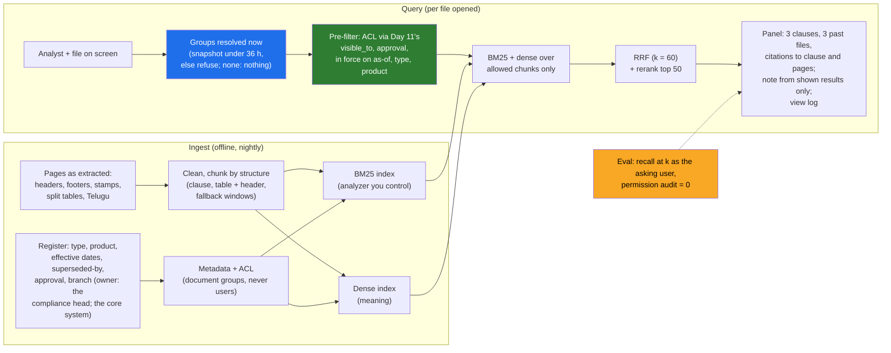

# Day 15 · Retrieval for Enterprise Documents: Chunking Real PDFs, Hybrid Search, Metadata, and Permission-Aware Retrieval

> **[Part 3 · Building the System Around the Model](../README.md)** · Chapter 5 of 10 · Video ~13 min · Chapter tier: big
> Builds on: [Day 6 (finding A1: BRANCH_ISOLATION and ACCESS_VIA_AD_GROUPS; the view log; CHECKLIST_DRIFT)](../../02-discovery-and-decomposition/06-discovery-interviews/README.md) ·
> [Day 11 (the retrieval box; `visible_to`, the branch groups and the signed rule constants)](../11-the-system-around-the-model/README.md) ·
> [Day 13 (page types; the page-38 lesson)](../13-prompts-as-code/README.md) ·
> [Day 14 (evals and the golden set; the Wilson interval)](../14-evals-first/README.md) ·
> [Day 4 and Day 10 (the branch chatbot declined: C5, decision D06)](../../02-discovery-and-decomposition/10-the-discovery-document/README.md)
> Sets up: Day 16 (where the documents come from: the read replica, masked fields), Day 18 (the panel inside the review
> screen), Day 19 (retrieval spans and the zero-result signal), Day 20 (the skeleton's model call drafts the panel's
> note), Day 22 (where the groups come from), Day 23 (the questionnaire's access-control answer), Day 24 (where the
> index may live), Day 41 (retrieved text as an attack surface)
> **Owner:** this chapter owns **retrieval for the course, and the retrieval half of permission-aware retrieval: why
> enterprise documents are hard (scans, OCR, stamps, headers and footers, split tables, Telugu script and
> transliteration, versions); cleaning and structure-first chunking with tables kept intact, fixed size as the
> fallback, overlap; metadata as a first-class index taken from the register; BM25, dense retrieval, reciprocal rank
> fusion and reranking, and why lexical wins on identifiers, PANs and transliterations; the permission pre-filter on
> document groups resolved per request, failing closed, and every way a post-filter leaks; superseded documents and the
> version in force; clause-level citations; and evaluating retrieval alone with recall at k and a permission audit.**
> Where identities and group memberships come from (SSO, AD sync) is Day 22's; evals and golden sets are Day 14's;
> residency is Day 24's; prompt injection is Day 41's.
> Versions used: **Python 3.14.3** (needs 3.12 or newer); the package is **standard library only**; **pytest 9.1.1**
> pinned in `code/requirements.txt`, installed in a virtual environment (pytest is not on the global Python). Day 11's
> intake package and Day 14's `evals.stats` are imported by path. No network, no model download, no API key. Tool
> versions cited (pgvector 0.8.7, PostgreSQL 18, OpenSearch 2.19 and later) are as read on 21 October 2026. Shown
> outputs are from real runs. All data is synthetic and generated by code.

---

## Why this chapter exists

Lakshmi has a Guntur two-wheeler file open: a kirana-shop owner, no income tax return, a twelve-month bank statement,
a notarised rent agreement with the landlord's electricity bill. She needs two answers: what the policy says, and what
analysts in her region have decided on files like this. Today the policy is a 2024 printout when a 2025 version exists,
and the precedent is whatever the senior analyst remembers; a junior analyst without the memory sends the file back
"to be safe", which the compliance head thinks is half of all send-backs. This chapter builds the retrieval that
answers both in two seconds, as a panel inside the review queue the analysts already use. It is **not** the branch
policy chatbot, which stays on the signed will-not-do list (decision D06).

The hard part is not the embedding model. Enterprise retrieval fails on document quality and permissions long before
it fails on embeddings (Part 3 plan). The circulars are scanned, stamped, footer-laden, versioned and partly in Telugu;
the most similar past file is often in a branch the analyst may not see, and Day 6 found that branch visibility is a
business rule enforced by Active Directory groups, with no all-branches group. A post-filter shows a clean list and
leaks the hidden file through the count, the debug log and the drafted note; this chapter shows that with real output
and builds the pre-filter that does not. The career reason: applied AI appears in 80 percent or more of the 1,000 FDE
postings analysed in 2026 (CURRICULUM.md), and the FDE a CISO trusts with documents is the one who can say where the
filter runs and prove it with an audit at zero.

## Mental model

One sentence to carry out of the chapter: **clean and chunk by the document's own structure, take metadata from the
owner's register, search lexically and by meaning and fuse by rank, and apply the caller's permissions before any of
it, so that nothing the analyst may not see is ever scored, counted, logged or summarised.**

## Learning goals

After this chapter you can:

1. Explain why enterprise documents are hard to retrieve from (scans and OCR, stamps, headers and footers, tables across
   page breaks, Telugu script and transliteration, versions) and what each one does to a naive pipeline.
2. Clean extracted pages (boilerplate learned by repetition, junk lines, hyphenation) and chunk them by structure,
   keeping tables intact with caption and header, with a clause and page range on every chunk and fixed windows only as
   a fallback.
3. Design metadata as a first-class index taken from the register, with ACLs that name document groups.
4. Implement BM25 and a dense retriever, fuse them with reciprocal rank fusion, rerank, and explain with numbers which
   wins on identifiers, PANs, transliterations, tables and paraphrase, and why fusion alone can bury a correct answer.
5. Enforce permission-aware retrieval as a pre-filter from directory groups resolved per request, failing closed, and
   name every channel through which a post-filter leaks.
6. Handle superseded and draft documents by metadata, answer "as of" a past date, redirect old circular numbers, and
   cite the exact clause and version.
7. Evaluate retrieval alone with recall at k and MRR on labelled queries (answer spans, run as the asking user), report
   an interval, and run a permission audit with a target of zero.
8. Build the service with a coding agent and catch the retrieval-specific mistakes it makes.

**Prerequisites:** Day 6 (the finding), Day 11 (the split and the package this chapter imports), Day 14 (why evals come
first). Python at a working level; no search engine or model knowledge is assumed.

## Reading order

| # | Section | What you get | Words |
|---|---|---|---|
| 01 | [Why retrieval for enterprise documents](01-why-retrieval-for-enterprise-documents.md) | Lakshmi's two questions; not the chatbot, in a table; finding A1; the career reason; the hard parts | ~1,350 |
| 02 | [Why enterprise documents are hard](02-why-enterprise-documents-are-hard.md) | scans, OCR and stamps; tables, headers and footers; Telugu and transliteration; versions; the generated corpus | ~1,850 |
| 03 | [Chunking](03-chunking.md) | clean first; structure first; tables intact; fixed size and overlap; short documents; measured: 0.825 to 0.925 | ~2,200 |
| 04 | [Metadata as a first-class index](04-metadata-as-an-index.md) | the fields; from the register, never the text; ACLs on document groups; filters the panel uses | ~1,300 |
| 05 | [Hybrid search and reranking](05-hybrid-search-and-reranking.md) | BM25 and dense inside; where each wins, measured; RRF and why it rewards agreement; rerank depth; identifiers as lookups | ~2,400 |
| 06 | [Permission-aware retrieval](06-permission-aware-retrieval.md) | pre-filter against post-filter; the leak with real output; real engines (pgvector, Postgres RLS, OpenSearch); transfers; fail closed; side channels; never in the prompt | ~2,450 |
| 07 | [Freshness, superseded documents and citations](07-freshness-and-citations.md) | the version in force; as-of; old numbers redirected; citations to clause and pages; checking citations | ~1,150 |
| 08 | [Evaluating retrieval](08-evaluating-retrieval.md) | recall at k and MRR; 40 labelled queries with spans; complete labels; the results and the one miss; the interval; the audit; the gate | ~1,500 |
| 09 | [Advanced and 2026 patterns](09-advanced-and-2026-patterns.md) | where the index lives; a real local embedding model; contextual headers, parent chunks, query rewriting, agentic retrieval; long context; hype | ~1,250 |
| 10 | [Production concerns](10-production-concerns.md) | latency, cost, scale and selectivity, re-indexing, security, monitoring | ~1,100 |
| 11 | [Project: the Godavari retrieval service](11-project-the-godavari-retrieval-service.md) | the package, how to run it, the run part by part, 36 tests, what goes into the engagement folder | ~1,950 (incl. output) |
| 12 | [Build it with AI, and how you know it is right](12-build-with-ai-and-verification.md) | context, a strong prompt, what the agent gets right, twelve mistakes; How do you know it's right: nine checks and the checklist | ~1,500 |
| 13 | [Mistakes and debugging](13-mistakes-and-debugging.md) | symptom, cause, fix for documents, ranking and permissions; a routine for a bad result | ~1,250 |
| 14 | [Interview questions](14-interview-questions.md) | 16 questions with model answers, plus a quick-fire round | ~1,650 |
| 15 | [Exercises](15-exercises.md) | 12 graded exercises: predict-the-output, two tested break-it runs, "review this AI-written code", the questionnaire answer, Postgres | ~2,850 |
| 16 | [Further reading](16-further-reading.md) | RRF and BM25, pgvector, Postgres RLS, OpenSearch, scripts, the Indian context | ~750 |

**Short on time?** Read 03, 05 and 06, then run the project (11). That is the video plus the two things a CISO and an
analyst will test you on: the leak that is not on the screen, and the table row that is.

## Files

| Path | What |
|---|---|
| [`code/godavari_retrieval/`](code/godavari_retrieval/) | the package: `text.py`, `corpus.py`, `chunking.py`, `metadata.py`, `lexical.py`, `dense.py`, `fusion.py`, `permissions.py`, `directory_data.py`, `service.py`, `queries.py`, `evaluate.py`, and the path imports `day11.py` and `day14.py` |
| [`code/run_demo.py`](code/run_demo.py) | the whole story in one run (about 5 seconds), writing `data/` |
| [`code/tests/`](code/tests/) | 36 pytest tests (about 2 to 3 seconds) |
| [`code/exercises/ai_draft_retrieval.py`](code/exercises/ai_draft_retrieval.py) | an AI-written draft with at least twelve problems; exercise 3.1 |
| [`code/requirements.txt`](code/requirements.txt), [`code/pytest.ini`](code/pytest.ini) | the pins (pytest 9.1.1 and its dependencies, the same as Day 11's) |
| [`data/run-report.md`](data/run-report.md), [`data/eval-report.md`](data/eval-report.md) | the run's full output; the evaluation tables |
| [`data/labelled-queries.json`](data/labelled-queries.json) | the 40 labelled queries |
| [`data/corpus-manifest.csv`](data/corpus-manifest.csv), [`data/sample-pages-GFL-CO-2025-027.txt`](data/sample-pages-GFL-CO-2025-027.txt) | the register as a table; one circular's pages as the extractor sees them |
| [`data/ad-groups-2026-11-25.json`](data/ad-groups-2026-11-25.json), [`data/ad-groups-2026-11-26.json`](data/ad-groups-2026-11-26.json) | the two synthetic nightly group snapshots |
| [`data/view-log.jsonl`](data/view-log.jsonl) | the first 40 view-log entries |
| [`worksheet/godavari-retrieval-design.md`](worksheet/godavari-retrieval-design.md) | the design note for the CISO and the compliance head |
| [`worksheet/retrieval-review-checklist.md`](worksheet/retrieval-review-checklist.md) | the checklist for every retrieval pull request |

Run from `code/`: create a virtual environment, `python -m pip install -r requirements.txt`, then
`python -X utf8 run_demo.py` and `python -X utf8 -m pytest`. Day 11 and Day 14 must be at their FOLDERS.md paths.

## What this chapter does *not* teach (single-owner rule)

| Topic | Where it's taught |
|---|---|
| Where identities and groups come from: SSO, Entra or AD, the HR sync, service accounts, RBAC across the system | [Day 22](../../04-deploying-into-their-world/22-identity-in-their-company/README.md) |
| Golden sets with the customer's experts, labelling, agreement, judges, gate policy | [Day 14](../14-evals-first/README.md) (this chapter defines a minimal recall at k and reuses Day 14's interval) |
| Which rules are code and which are the model's; the branch rule itself | [Day 11](../11-the-system-around-the-model/README.md) |
| How documents arrive: SFTP, the read replica, masking at the boundary | [Day 16](../16-integrating-with-what-exists/README.md) |
| Where the index may live; DPDP; "nothing leaves India" | [Day 24](../../04-deploying-into-their-world/24-data-residency-and-indian-law/README.md) |
| The review screen around the panel | [Day 18](../18-verification-and-trust/README.md) |
| Prompt injection through retrieved text | [Day 41](../../07-ai-era-toolkit/41-red-teaming-your-deployment/README.md) (one line here) |
| How LLMs and RAG work underneath | learn-ai-ml (outside this course) |

## Analogies for the Telugu audience

- **The wedding gift register** (the chapter's main picture, from the Part plan): you find a guest by name and by
  village, which is hybrid search, exact plus meaning; only the family may open the register, which is permissions; a
  stranger reading it afterwards is the breach. A post-filter is letting the stranger read it and then asking him to
  forget the pages that were not his (06.2).
- **The panchayat office's land records**: the pahani for a survey number is found by the number, never by "something
  like my field". Identifiers are lookups, not similarity (05.8).
- **The railway timetable on the station wall**: the one from last year is still pinned beside the new one, and both
  look official. Only the "valid from" date tells you which train runs. Superseded circulars are last year's timetable
  (07.1).

## Video map

The video (~13 min) covers a slice; the notes cover everything.

| Asset | Covers | Sections |
|---|---|---|
| **Day 15 main video** (~13 min) | Hook: Lakshmi's Guntur file, two questions, a 2024 printout (1 min) → not the chatbot: the four differences (1 min) → why documents are hard: the stamp, the footer, the table across pages, Telugu shredded by `\w+` (2 min) → chunking: structure first, the table row with its header, 0.825 to 0.925 (2 min) → hybrid: the circular number dense cannot find, the transliteration only folding finds, RRF and the paraphrase it buried (2 min) → permissions: the post-filter's clean list and its count, log and note naming the Kukatpally dealer; the pre-filter's empty trace (2.5 min) → superseded: the 2024 Aadhaar number redirected (1 min) → recall at 5 = 0.975, 39 of 40, the interval, the audit at zero (1 min) → recap and the Day 16, 22 teasers (0.5 min) | 01.1 to 01.3, 02.2 to 02.5, 03.2 to 03.4, 03.7, 05.4, 05.5, 06.2, 06.3, 07.3, 08.5 to 08.7 |
| **Short 1:** "Vector search cannot find a PAN number. Keyword search can. Use both." | the circular-number probe (lexical one exact hit, dense three wrong circulars); the PAN as a keyed token and an exact filter; "no file you can see" | 05.4, 05.8, 06.6 |
| **Short 2:** "Permission-aware retrieval: filter inside the query, or you have already leaked." | the two flow diagrams; "showing 4 of 62"; the debug-log line; the note naming Sri Sai Motors; the audit: 4,315 checked, 0 violations | 06.2, 06.3, 08.7 |
| Notes only | OCR and asking for originals (02.2), short documents (03.6), the metadata fields and the register (04.2 to 04.6), BM25 and the stand-in inside (05.2, 05.3), alternatives to RRF (05.7), real engines and selectivity (06.4), transfers and fail closed (06.5, 06.6), side channels (06.7), as-of and drafts (07.2), complete labels (08.4), the gate (08.8), 2026 patterns and hype (09), production (10), the project, tests and folder (11), Build it with AI and verification (12), debugging (13), interviews (14), exercises (15) | as listed |

**Callbacks to use on screen:** "Day 6 lo CISO cheppindi gurtunda: 'filter by the caller's groups at the moment of the
query, not at the time we indexed the file.' Ivala adi code ga marchutunnam." (section 06); "Day 4 lo branch chatbot
ni decline chesam; idi chatbot kaadu, review queue lo oka panel." (section 01); "Day 11 lo visible_to raasam; ivala
retrieval adey function ni path tho vaadutundi, copy cheyakunda." (section 06); "Day 13 lo page 38 lo co-applicant
miss ayyindi; ivala page 3 lo table row miss avvakunda chustam." (section 03).
**Forward callbacks:** Day 16 (ee documents ekkada nunchi vastayo), Day 22 (ee groups ekkada nunchi vastayo: SSO, AD
sync), Day 24 (ee index ekkada undali: residency).

## Callbacks

- **Builds on:** [Day 4](../../02-discovery-and-decomposition/04-picking-the-problem/README.md) (C5, the chatbot
  declined; "forty circulars in email with unclear versions"; nobody owns the circulars),
  [Day 6](../../02-discovery-and-decomposition/06-discovery-interviews/README.md) (finding A1 verbatim; A6, the
  seven-year view log; A7, the unwritten address alternatives; CHECKLIST_DRIFT; Srinivas's "a fifth window is a no"),
  [Day 8](../../02-discovery-and-decomposition/08-scoping-the-first-90-days/README.md) (W6, the review queue; M11 and
  M13), [Day 10](../../02-discovery-and-decomposition/10-the-discovery-document/README.md) (D06, D07),
  [Day 11](../11-the-system-around-the-model/README.md) (the retrieval box, `visible_to`, the branch groups, the rule
  constants), [Day 12](../12-llm-apis-for-production/README.md) (the 12-rupee ceiling; the client Day 20 wires in),
  [Day 13](../13-prompts-as-code/README.md) (page types; untrusted text), [Day 14](../14-evals-first/README.md) (evals
  first; the Wilson interval).
- **Sets up:** [Day 16](../16-integrating-with-what-exists/README.md) (the read replica and masked summaries; RQ2),
  [Day 18](../18-verification-and-trust/README.md) (the panel in the review screen), [Day 19](../19-observability-for-ai-systems/README.md)
  (retrieval spans, zero-result rate, the nightly audit), [Day 20](../20-the-walking-skeleton-shipped/README.md) (the
  note drafted by the real client), [Day 22](../../04-deploying-into-their-world/22-identity-in-their-company/README.md)
  (the snapshot's source), [Day 23](../../04-deploying-into-their-world/23-security-review-and-procurement/README.md)
  (the access-control answer), [Day 24](../../04-deploying-into-their-world/24-data-residency-and-indian-law/README.md)
  (where the index lives; RQ3), [Day 41](../../07-ai-era-toolkit/41-red-teaming-your-deployment/README.md) (attacks
  through retrieved text).

**Next chapter:** [Day 16 · Integrating with what exists: SOAP, SQL, files, SFTP, the metadata translation layer, and the data you are not allowed to copy](../16-integrating-with-what-exists/README.md).
