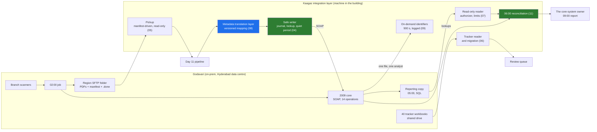

# 02 · The Integration Surface: Four Systems, Four Shapes, One Owner Each

> Day 16 · Section 2 of 18 · [Chapter overview](README.md) · Previous: [01 · Why integration slips](01-why-integration-is-where-engagements-slip.md) · Next: [03 · SOAP in 2026](03-soap-in-2026.md)

---

## 2.1 What "integration" means here

In Day 11's eight boxes, integration is one box. In practice it is four, because Godavari's data lives in
four places with four different shapes, owners and rules. Day 7's inputs inventory listed them; this
section reads that inventory as an engineer about to write the client for each.

| System | Shape | Direction | Owner | Freshness | The constraint that shapes the code |
|---|---|---|---|---|---|
| Core lending system (2009) | SOAP 1.1 over HTTPS, WSDL, 14 operations; CreateApplication has 61 fields, 23 mandatory | read and write | the core-system owner | live | no idempotency key; a write window; a sandbox three months behind |
| Nightly SFTP batch | one PDF per file in a region folder, written by the 02:00 job | read | branch operations, the core's job | nightly | partial and late files; a manifest; read-only access |
| Excel tracker | 40 workbooks, 19 columns, seven status columns, three colours | read, later one column written | the team leads | minutes to hours | no schema, no timestamps, the real state of every file |
| Reporting database | the core's nightly copy, SQL | read only | the core-system owner | as of 05:00 | holds PII; only signed-off columns; never written |

There is a fifth input you cannot integrate: the WhatsApp pages (finding A3). The integration layer's job
for that one is to make the proper channel, a re-scan in the next 02:00 batch, work well enough that the
improper one stops being faster. The pickup's re-scan handling in section 05 is that job.

## 2.2 The picture

Everything in the Kaagaz box runs on the machine inside the Hyderabad building under the staged approval
in Day 10's section 8. Nothing in this chapter calls anything outside that building.

## 2.3 One owner per system, by name

Day 7's step 3 asked "who can say yes to reading it, and who can say yes to writing it?" For an
integration, that question becomes a table you keep with the code:

| System | May we connect? | May we read? | May we write? | Who reviews the mapping? |
|---|---|---|---|---|
| core | the CISO | the core-system owner | the core-system owner, after a month of logged sandbox calls | the core-system owner |
| SFTP batch | the CISO | branch operations, through IT | never | n/a |
| trackers | the CISO (shared drive) | the team leads | one owned column, from the pilot, with the team leads' agreement | Srinivas and the Vijayawada team lead |
| reporting copy | the CISO | the core-system owner, per table and column | never | the core-system owner; the compliance head for PII |

The owner's own sentence sets the order of work: "The CISO decides whether you may connect. I decide
whether you may write." Section 13's project produces the evidence for the second half: a reconciliation
report every morning.

## 2.4 The customer's engineer, from the first day

The Part 3 plan asks for "the customer's engineer paired from day one, so the integration has an owner
after you leave". At Godavari that is the application-support engineer IT assigns (Day 8; still open as
question Q4 in the discovery document). Until he is named, design as if he will read every file:

- the agreement (`worksheet/godavari-integration-agreement.md`) names his role as co-owner;
- the mapping file and the known-drift list are plain text he can review without Python;
- the reconciliation report is written for a system owner, not for Kaagaz;
- the runbook line for every failure is in section 15, in words he would use.

Day 28 owns the handoff. This chapter makes sure there is something to hand off.

## 2.5 Integration risk in one sentence per system

Said out loud in the system-design round, or to the COO:

- **Core:** "It has no idempotency key, so a timeout can become a duplicate loan; the key, the lookup and
  the quiet period are ours to build, and the owner sees every call."
- **SFTP:** "The batch is written by a job we do not control, so we read only what its manifest promises
  and never touch its folder."
- **Tracker:** "It is the real state of every file and has no schema, so the team leads own its mapping
  and the unreadable rows go to them, not to a guess."
- **Reporting copy:** "It holds PII and is a day stale, so we read signed-off columns only and never use it
  to decide whether to write."
