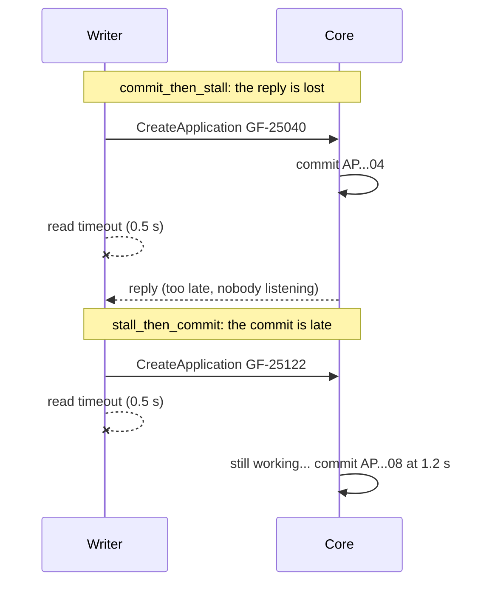
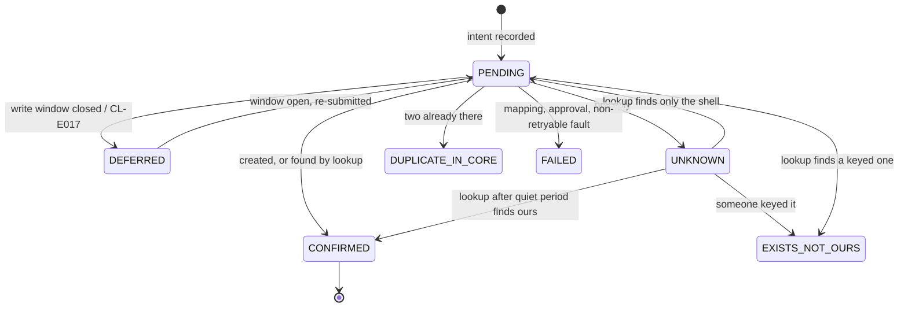

# 04 · Idempotency Without Keys: Lookup Before Create, the Quiet Period, and the Journal

> Day 16 · Section 4 of 18 · [Chapter overview](README.md) · Previous: [03 · SOAP in 2026](03-soap-in-2026.md) · Next: [05 · Files and the nightly batch](05-files-and-the-nightly-batch.md)

---

## 4.1 The problem, in the owner's words

"It creates two applications. There is no key on your side. The record ID is generated by us. The last
vendor, in 2022, had a timeout on their side, retried, and we had four hundred duplicate applications by
the time anyone noticed. I cleaned them by hand over a weekend." (Day 6, transcript 06.)

An operation is **idempotent** if doing it twice has the same effect as doing it once. Modern APIs make
writes idempotent with a key: the client sends `Idempotency-Key: abc`, the server remembers it, and a
repeat returns the first result (Stripe's documentation is the usual reference). Godavari's
`CreateApplication` has no such thing. Every call inserts a row. So the memory of "have we already done
this?" has to be built on our side, out of what the core does offer.

## 4.2 Why a timeout is the dangerous moment

A write can end three ways from the client's point of view: an answer, a fault, or silence. Silence is the
problem, and it comes in two shapes:



In both, the client cannot tell from its own side whether the application exists. What it does next
decides whether Godavari gets a duplicate. The chapter's stand-in can plant either shape on any file, and
Part A of the project runs three clients against both. These numbers are from the real run (section 13):

```text
   mode               client                     applications  files duplicated
   commit_then_stall  naive (the 2022 vendor)              12                 2
   commit_then_stall  lookup, then retry at once           10                 0
   commit_then_stall  safe writer                          10                 0
   stall_then_commit  naive (the 2022 vendor)              12                 2
   stall_then_commit  lookup, then retry at once           12                 2
   stall_then_commit  safe writer                          10                 0
```

Ten approved files, two of them with a late reply. The **naive client** retries the create on any error
and makes two duplicates in both cases. That is DUPLICATE_ON_RETRY, reproduced. The second row is the
interesting one.

## 4.3 Lookup before create, and why it is not enough

The owner pointed at the fix himself: "Check with GetApplicationByFileNumber. It exists. Nobody uses it."
Day 11's `push_to_core` already does this against its fake sandbox: refuse anything not approved, derive a
key from file number and branch code, look the file up, create only if nothing is there. Day 16 imports it
by path and drives it with a SOAP adapter, so the rule lives in one place:

```python
class SoapCoreAdapter:
    """Makes the SOAP port look like Day 11's FakeCoreSandbox, so Day 11's push_to_core drives it."""
    def get_application_by_file_number(self, file_number: str) -> dict[str, str] | None:
        summaries = self.port.get_by_file_number(file_number)
        if not summaries:
            raise FileNotRegistered(f"{file_number}: no shell and no application in the core")
        apps = [s for s in summaries if not s.is_shell]
        if len(apps) > 1:
            raise DuplicateInCore(file_number, [a.appl_id for a in apps])
        ...
```

Retrying Day 11's push immediately fixes the lost reply: the second attempt looks up first, finds the
application the core committed, and stops. It does **not** fix the late commit. The retry's lookup runs at
0.6 seconds, the core commits at 1.2, the lookup sees only the shell, and the retry creates a second
application. The table's second block shows it: two duplicates. A lookup is only as good as the moment it
runs.

## 4.4 The rule that closes the gap: never retry an ambiguous write

The safe writer adds one rule. **A write that ended in silence is never retried.** It is marked UNKNOWN in
the journal and left alone for a quiet period longer than the longest time the core could still be working
on it. Then a lookup decides:

| Lookup after the quiet period finds | The write... | New state |
|---|---|---|
| one application with our key in `EXT_REF` | happened | CONFIRMED |
| one application without our key | was beaten by a person keying it | EXISTS_NOT_OURS |
| only the shell | did not happen | PENDING (safe to create now) |
| two or more applications | duplicated somehow | DUPLICATE_IN_CORE, for a person |

The quiet period is a number you get from the owner, not from a blog: the core's own transaction
timeout. At Godavari it is 60 seconds (confirmed with the owner in week 3, recorded in the agreement); the
writer waits 90. The demo uses 2 seconds against a 1.2-second stall so the run takes a minute, and says so
in its output. If you cannot get the number, the quiet period is "until the next run": unknowns are
resolved by the next night's job, never by the run that created them.



## 4.5 The natural key, and where to stamp yours

A **natural key** is a combination of business facts that identifies the thing uniquely: here, file
number and branch code. Day 11 hashes them into a 20-character key. The owner agreed to stamp it in
`EXT_REF`, a 20-character "external reference" field nobody used. Stamping your key into the record does
three things the core cannot do for you:

- the lookup can tell **our** application from one an analyst keyed on the green screen (GF-25010 in the
  night run: the owner keyed it by hand to see what a shell looks like; the writer found it and did not
  create a second);
- the reconciliation can find anything carrying our key, including writes our journal lost;
- anyone at Godavari can answer "which applications did Kaagaz create?" with one query.

Always ask the owner for the field. Using a free-text remarks field without asking is how an integration
breaks a report somebody else depends on.

## 4.6 The journal: intent before the call, outcome after

The writer records intent in its own SQLite journal before every call and the outcome after it
(`journal.py`). It is the outbox half of the pattern: the core is the source of truth for applications;
the journal is the source of truth for "what did we try, and what do we believe happened". It holds no
customer data: the key, the file number, a hash of the payload and the payload's business fields
(amounts, codes, flags), so the reconciliation can compare them with the core. The workflow (Day 17's
state machine) keeps the approved file and re-submits it; `push()` is safe to call again in every state:

| State on entry | What `push()` does |
|---|---|
| CONFIRMED, EXISTS_NOT_OURS, DUPLICATE_IN_CORE | nothing; no call at all |
| UNKNOWN | resolves it (lookup, if the quiet period is over); never creates over it |
| none, PENDING, DEFERRED, FAILED | maps, checks the window, then Day 11's lookup-before-create |

## 4.7 The window, the busy fault, and the batch that overruns

Two more rules come straight from transcript 06:

- **"Nothing writes between five thirty and eight in the evening."** The writer checks business time
  before calling and holds the write as DEFERRED with the slot it is waiting for (20:00, or 23:00 in the
  last three days of a month, because "month end, eleven"). In the night run, GF-25179 is approved at
  17:40, held, and written at 20:05. If the batch overruns anyway, the core answers CL-E017 and the writer
  treats it as a deferral, not a failure (`test_a_batch_that_overruns_is_a_deferral_not_a_failure`).
- **The rate limit nobody documented.** The stand-in answers CL-E099 SERVICE BUSY above five calls in one
  second from one account; at Godavari this was found in week 3 from the fault text, not from any
  document. The client paces itself with a token bucket at four a second. A limit you discover belongs in
  the agreement the day you discover it.

Business time and real time are different clocks. Business time (`clock.BusinessClock`, India Standard
Time, settable) decides whether a write is allowed; real time decides timeouts, the quiet period and the
rate limit, and is never simulated.

## 4.8 Some writes are idempotent already

`UpdateKYCStatus` sets a status. Setting "complete" twice leaves it "complete", so in the sense that
matters it is idempotent. The 2009 core still appends a history row every time (the test shows `HIST_SEQ`
going 1, 2), so a careful client reads the current status first and skips the call if it already matches
(exercise 2.4 adds exactly that; the night run does not call it yet, because Day 17 puts it behind the
approval gate). Ask of
every write: is it a set, an append or a create? Sets are forgiving; appends are noisy; creates need
everything in this section.

## 4.9 What Day 17 adds

Day 17 owns idempotency in depth: the state machine around the whole file (RECEIVED to PUSHED_TO_CORE),
the approval gate as a state transition, and keys for every workflow step, where the bundle hash joins the
file number so that a re-scanned bundle re-runs extraction without re-creating the application. This
section built the piece Day 17 stands on: a write to a key-less system that is safe to repeat.
