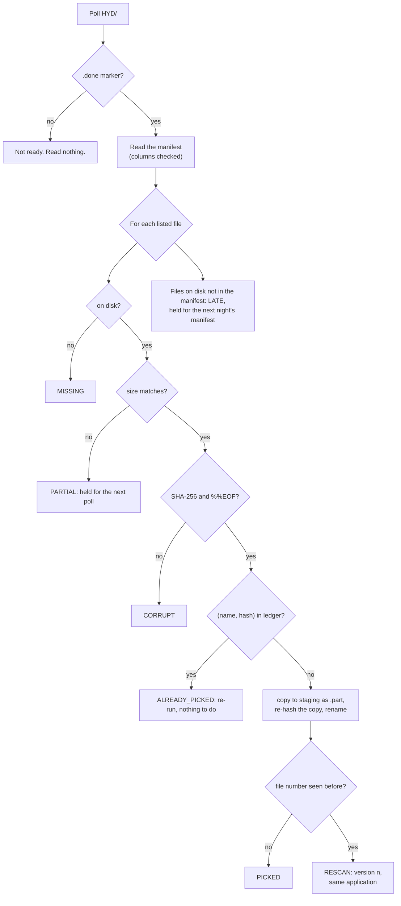

# 05 · Files and the Nightly Batch: Manifests, Partial Files, Late Files, Re-runs and Re-scans

> Day 16 · Section 5 of 18 · [Chapter overview](README.md) · Previous: [04 · Idempotency without keys](04-idempotency-without-keys.md) · Next: [06 · The Excel tracker](06-the-excel-tracker.md)

---

## 5.1 The batch as Godavari runs it

"Branch scanners drop PDFs into the branch's SFTP folder during the day. At two in the morning a job moves
them to the region folders and creates a shell application record with the branch code and the file
number." (Day 6, transcript 06.) The branch scans its tray at 17:00 (situational map, step 3). A re-scan
"arrives in the next 02:00 batch under the same file number" (step 13). That is the whole interface:
files in a folder, on a schedule, written by a job you do not own.

File drops are the oldest integration there is, and they fail in the same five ways everywhere: you read a
file that is still being written; you miss a file that arrived late; you process a file twice when the job
re-runs; you treat a corrected file as a new one; and you change the sender's folder in a way they did not
expect. The pickup in `sftp_batch.py` has one rule for each.

## 5.2 The manifest and the marker

The 02:00 job (simulated by `write_region_drop`) writes, per region and night:

```text
HYD/20261112/
  GF-25001_KKP01_20261112.pdf
  ... one PDF per file ...
  MANIFEST_HYD_20261112.csv       file_name, file_no, branch_cd, bytes, sha256, pages
  MANIFEST_HYD_20261112.done      written last, empty
```

The manifest is the sender's promise: these files, these sizes, these hashes. The `.done` marker says the
promise is complete. Writing the manifest to a temporary name and renaming it, then writing the marker
last, is how a sender makes "complete" mean something. If Godavari's job did not do this, the first thing
to agree with the owner would be that it should, because without a manifest there is no way to tell a
half-written file from a small one.

## 5.3 The pickup, rule by rule



1. **No marker, no reading.** A manifest being written is not a manifest.
2. **Only listed files.** A file on disk without a manifest line is LATE. It is never guessed at; it waits
   for the next night's manifest. In the night run, GF-25035's re-scanned address proof lands at 02:40,
   after the manifest; it is held through three polls and picked up on Friday at 02:30 when the next
   manifest lists it.
3. **Size and hash must match.** GF-25129 is half-written at 02:30 (1,793 of 3,587 bytes) and held. At
   03:30 the transfer has finished and it is picked. A file whose size matches but whose bytes do not is
   CORRUPT, which is different: something changed it after the manifest was written.
4. **Atomic pickup.** The copy goes to staging under a dot-name ending in `.part`, its hash is checked
   again, and only then is it renamed. On one filesystem, `os.replace` is atomic: a reader of staging sees
   the whole file or nothing.
5. **The ledger, keyed on (file name, SHA-256).** A re-run of the same night is a no-op: the 04:10
   accidental re-run in the night run reports `already_picked 27`. A re-scan of the same file number with
   new bytes is a new **version of the documents**, not a new application: on Friday, GF-25040's re-scan
   comes back as `rescan (version 2 of GF-25040: same application, new documents)`. The write side never
   sees a new key, because Day 11's key is file number and branch code, not the bundle's hash.
6. **Hands off their folder.** The account is read-only. The pickup never moves, renames or deletes
   anything on Godavari's side; the ledger remembers what was taken. A test hashes the whole source tree
   before and after a pickup and requires them to be equal.

## 5.4 Real SFTP with paramiko

The same pickup runs over SFTP through `ParamikoSource`, which implements the three methods the pickup
needs (`list_names`, `size`, `read_bytes`) with paramiko's `SFTPClient.listdir_attr`, `stat` and `open`.
Three decisions:

- **Pin the host key and reject unknown ones** (`RejectPolicy`, a `known_hosts` file from the CISO's team).
  `AutoAddPolicy` means "trust whatever answers", which is how credentials end up on the wrong machine.
- **Read-only by construction.** The class has no method that writes, renames or deletes.
- **Optional.** paramiko is in `requirements-sftp.txt`, pinned at 4.0.0 (the 5.x line was three days old
  when this chapter was tested). The test `test_pickup_over_sftp_matches_the_local_folder` starts a
  throwaway paramiko SFTP server on 127.0.0.1 that refuses writes, and requires the SFTP pickup's report to
  equal the local folder's, file by file. It ran; the chapter's numbers come from the local folder, which
  is also how the walking skeleton runs on files copied by hand (Day 7's step 5).

## 5.5 Naming conventions and what they are worth

`GF-25001_KKP01_20261112.pdf` carries the file number, the branch and the night. Use the names to route and
to report, never to decide: the manifest's columns are the record, and a renamed file with the right
hash is still the right file. When the convention breaks (a branch adds `_rescan` or a space), the
manifest still holds; a pickup that parsed names would not.

## 5.6 Timing

The batch window bounds everything downstream. Files picked up at 02:30 are extracted overnight and reach
the analysts' queue by 08:00; a file approved after 17:30 is held until the batch ends; anything finished
after 16:00 is effectively tomorrow's credit check (finding A4). The night run polls at 02:30 and again
at 03:30 for stragglers. A file still PARTIAL an hour later is a broken transfer, and someone at Godavari
should hear about it before the analysts start; the alert itself is Day 19's (observability) and is not
built here, but the reconciliation marks the batch "NOT OK" if anything is still partial at 06:00.
