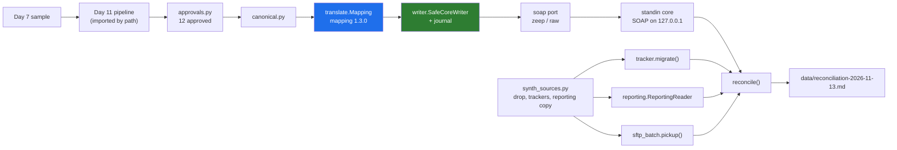

# 13 · Project: The Godavari Integration Layer, One Night End to End

> Day 16 · Section 13 of 18 · [Chapter overview](README.md) · Previous: [12 · 2026 patterns and production concerns](12-2026-patterns-and-production-concerns.md) · Next: [14 · Build it with AI, and how you know it's right](14-build-with-ai-and-verification.md)

---

## 13.1 The brief

It is Tuesday 10 November 2026, week 3. On Friday (M07, Day 8) ten real files must go from PDF to the core
system's test copy, each approved by an analyst, every step timed, in front of the Vijayawada team lead and
the core-system owner. Day 11's prototype decides what is complete; it writes to a fake. You owe the
engagement folder:

1. **An integration layer** that talks to the 2009 core over SOAP with a generated client and a hand-built
   fallback, picks up the 02:00 batch, reads the analysts' trackers, reads the reporting copy read-only,
   and translates every field through a versioned, owned mapping.
2. **Proof that it does not duplicate**: the naive client creating a duplicate loan record and the safe
   writer not, under both ways a timeout can hide a commit.
3. **Contract tests** against a recorded sandbox, with the known drift written down.
4. **The first morning reconciliation** for the core-system owner, day one of his month.
5. **The agreement and the data-handling matrix**, for the owner, the CISO and the compliance head.

Everything offline, on synthetic data generated from Day 7's sample through Day 11's pipeline, which is
imported by path and never copied.

## 13.2 Files

| Path | What |
|---|---|
| `code/godavari_integration/day11.py` | imports Day 11's `intake` by path (the push logic, the key, the pipeline, the routes) |
| `code/godavari_integration/corespec.py` | the core's data dictionary: 61 fields (23 mandatory), 14 operations, code tables, fault catalogue |
| `code/godavari_integration/standin/` | the 2009 core stand-in: `core.py` (behaviour), `server.py` (SOAP over HTTP on 127.0.0.1), `wsdl_gen.py` (served and vendored WSDL) |
| `code/godavari_integration/wsdl/LendingService.wsdl` | the vendored WSDL, with its changes listed at the top |
| `code/godavari_integration/soap/` | the port, the four outcomes, `zeep_client.py`, `raw_client.py`, pacing and logging |
| `code/godavari_integration/writer.py` · `journal.py` | the naive client, lookup-then-retry, and the safe writer with its journal |
| `code/godavari_integration/translate.py` · `canonical.py` · `mapping/` | the metadata translation layer: two TOML mappings, sign-offs, the canonical record |
| `code/godavari_integration/sftp_batch.py` · `sftp_paramiko.py` | the drop, the manifest-driven pickup, the SFTP source |
| `code/godavari_integration/tracker.py` | the tracker reader, the migration into the queue, the write-back |
| `code/godavari_integration/reporting.py` | the read-only reader with the authorizer and limits |
| `code/godavari_integration/in_place.py` | on-demand identifiers, masks, tokens |
| `code/godavari_integration/reconcile.py` | the morning report and its history |
| `code/godavari_integration/contracts.py` · `code/contracts/` | recording, replay, the WSDL contract, the cassette, the known-drift list |
| `code/godavari_integration/synth_sources.py` · `approvals.py` | Godavari's side, synthetic: the drop, the trackers, the reporting copy; the analysts' approvals |
| `code/run_integration_night.py` · `code/record_sandbox.py` | the project run; the recorder |
| `code/tests/` | 99 tests in ten files |
| `code/exercises/ai_draft_core_client.py` | an AI-written client with at least twelve problems (exercise 3.1) |

About 5,400 lines of Python including 1,230 lines of tests. Read `writer.py` first, then `translate.py` and
the core mapping, then `standin/core.py` to see what the writer is up against.



## 13.3 Setup and run

Run on **Python 3.14.3** on Windows 11, 21 October 2026; the code needs 3.12 or newer. pytest is not on the
global Python: use a virtual environment with the chapter's pins. From the chapter folder:

```bash
python -m venv .venv
# Windows: .venv\Scripts\activate      Linux and macOS: source .venv/bin/activate
pip install -r code/requirements.txt          # zeep 4.3.3, openpyxl 3.1.5, lxml 6.1.3, requests 2.34.2, pytest 9.1.1
pip install -r code/requirements-sftp.txt     # optional: paramiko 4.0.0, for the real-SFTP test

python -X utf8 code/record_sandbox.py         # re-records the cassette and the WSDL contract (about 3 s)
python -X utf8 code/run_integration_night.py  # the project run, about a minute
python -X utf8 -m pytest code                 # 99 tests, about 30 s (98 and 1 skipped without paramiko)
```

The run takes about a minute because the stand-in's stalls, the quiet period and the client's pacing are
real seconds. No network after the install: the stand-in listens on 127.0.0.1 only, and the WSDL is loaded
from the repository. `-X utf8` keeps Windows consoles happy with the middle dot and the Telugu remark.

## 13.4 The run

This is the complete, real output of `python -X utf8 code/run_integration_night.py` (also written to
`data/godavari-integration-night.txt`):

```text
== Day 16 · integrating with what exists: one night of Godavari's integration, offline ==
mapping 1.3.0 (reviewed by the core-system owner, 2026-11-10): 61 core fields, 40 mapped, 21 not ours; problems: 0
input: Day 7's sample through Day 11's pipeline: 27 Kukatpally files, 12 routed ready or review and approved by the analysts

-- A. DUPLICATE_ON_RETRY, reproduced against the stand-in core --
   two creates tonight get a late reply (1.2 s against a 0.5 s client timeout):
   commit_then_stall = the core commits, the reply is lost; stall_then_commit = the core commits after
   the client gave up. Same ten approved files each time, fresh sandbox each time.
   mode               client                     applications  files duplicated
   commit_then_stall  naive (the 2022 vendor)              12                 2
   commit_then_stall  lookup, then retry at once           10                 0
   commit_then_stall  safe writer                          10                 0
   stall_then_commit  naive (the 2022 vendor)              12                 2
   stall_then_commit  lookup, then retry at once           12                 2
   stall_then_commit  safe writer                          10                 0

-- B. The stale sandbox: the same create, July's rules against August's --
   sandbox          GF-25040 without DLR_CD -> created AP0000000001
   production-like  GF-25040 without DLR_CD -> CL-E023 MANDATORY FIELD MISSING: DLR_CD
   mapping 1.3.0 sends DLR_CD for every two-wheeler file; known drift SBX-01 records why (contracts/)

-- C. The night of Thursday 12 November 2026 --
02:00 Godavari's job (simulated): 27 files to HYD/20261112 with manifest and .done; 27 shells registered
02:30 poll: late 1, partial 1, picked 26
   GF-25129: 1793 of 3587 bytes; held for the next poll
   GF-25035: on disk, not in the manifest: held for the next night's manifest
03:30 poll: already_picked 26, late 1, picked 1
   GF-25035: on disk, not in the manifest: held for the next night's manifest
04:10 re-run: already_picked 27, late 1
   GF-25035: on disk, not in the manifest: held for the next night's manifest
picked up and staged: 27 files, each under a temporary name, hash-checked, then renamed

11:00 the owner keys GF-25010 by hand in the sandbox, to see what a shell looks like
16:10 the analysts' approved files go to the writer:
   GF-25001 confirmed        AP0000000002  created
   GF-25003 confirmed        AP0000000003  created
   GF-25010 exists_not_ours  AP0000000001  an application was already keyed for this file; not created
   GF-25040 unknown                        no reply: AmbiguousOutcome; lookup after 2 s quiet
   GF-25100 confirmed        AP0000000005  created
   GF-25115 confirmed        AP0000000006  created
   GF-25122 unknown                        no reply: AmbiguousOutcome; lookup after 2 s quiet
   GF-25129 confirmed        AP0000000007  created
   GF-25147 confirmed        AP0000000009  created
   GF-25148 failed                         mapping: INC_PRF_CD (Income proof submitted) is mandatory and income_p
   GF-25183 failed                         mapping: INC_PRF_CD (Income proof submitted) is mandatory and income_p
17:40 GF-25179 approved late: deferred: write window closed; held until 20:00
17:50 resolving no-reply writes (quiet period 2 s here; 90 s in production):
   GF-25040 confirmed        AP0000000004  resolved by lookup: the write had happened
   GF-25122 confirmed        AP0000000008  resolved by lookup: the write had happened
20:05 window open again: GF-25179 confirmed AP0000000010

on demand: GF-AN-1142 opens GF-25001; PAN read from the core and shown as XXXXX4563X in every log; 2 views logged (1 from the 900 s cache)
on demand: refused: purpose 'model_context' is not one the compliance head allowed

trackers: 3 workbooks, 40 rows -> 37 queue items; 1 for a person, 1 conflict, 1 duplicate row merged
   Tracker_GF-AN-1142_Nov26.xlsx: header on row 3, 18 columns recognised, 14 rows, skipped: row 18: a total row
   Tracker_GF-AN-1157_Nov26.xlsx: header on row 1, 19 columns recognised, 13 rows
   Tracker_GF-AN-1163_Nov26.xlsx: header on row 2, 19 columns recognised, 13 rows
reporting copy refused: SELECT APPL_NM, PAN_NO FROM APPL_MST -> access to APPL_MST.APPL_NM is prohibited
reporting copy refused: UPDATE APPL_MST SET APPL_STAT = 'K' -> not authorized
Fri 02:30 poll: GF-25035 picked; GF-25040 rescan (version 2 of GF-25040: same application, new documents)

06:00 reconciliation for the core-system owner: CLEAN
   1. Our writes to the sandbox, checked against the core: ok
      journal: confirmed 9, exists_not_ours 1, failed 2
      looked up live: 10 files; exactly one application each: 10
      duplicates: 0
      journal says written, core disagrees: 0
      GF-25010: already keyed by someone else (AP0000000001, no Kaagaz EXT_REF); we did not create a second one
      GF-25148: failed: mapping: INC_PRF_CD (Income proof submitted) is mandatory and income_proof_kind is empty
      GF-25183: failed: mapping: INC_PRF_CD (Income proof submitted) is mandatory and income_proof_kind is empty
   2. Fields changed in the core after our write: ok
      none
   3. Our call log against your access log for SVC_KAAGAZ_SBX: ok
      calls: ours 23, yours 23; 2 we logged as no-reply, which your log records as OK (the core did the work; we did not hear back)
      write calls between 17:30 and the end of the batch: 0
      files with more than one successful CreateApplication in your log: 0
      CL-E099 busy faults: 0
      | operation | outcome | our log | your log | difference
      | CreateApplication | AMBIGUOUS | 2 | 0 | 2
      | CreateApplication | OK | 7 | 9 | -2
      | GetApplication | OK | 1 | 1 | 0
      | GetApplicationByFileNumber | OK | 13 | 13 | 0
   4. The 02:00 SFTP batch: ok
      GF-25040: rescan: version 2 of GF-25040: same application, new documents
      | poll | manifest rows | picked | re-scan | already picked | partial | late | missing | corrupt
      | 1: HYD 12 Nov | 27 | 26 | 0 | 0 | 1 | 1 | 0 | 0
      | 2: HYD 12 Nov | 27 | 1 | 0 | 26 | 0 | 1 | 0 | 0
      | 3: HYD 12 Nov | 27 | 0 | 0 | 27 | 0 | 1 | 0 | 0
      | 4: HYD 13 Nov | 2 | 1 | 1 | 0 | 0 | 0 | 0 | 0
   5. The analysts' trackers against production (reporting copy): ok
      tracker rows read: 40; queue items: 37; rows for a person: 1; conflicts: 1; duplicate rows merged: 1
      for a person: Tracker_GF-AN-1163_Nov26.xlsx:4: not a file number: 'GF-2503'
      conflict: GF-25001: Tracker_GF-AN-1142_Nov26.xlsx:4 says GF-AN-1142/received, Tracker_GF-AN-1163_Nov26.xlsx:12 says GF-AN-1163/received; the team lead decides
      tracker and core disagree: 2
      | file | tracker | core | what to check
      | GF-25037 | verified | Q | tracker says verified, the core says query to branch
      | GF-25147 | keyed | S | tracker says keyed, the core says shell
   6. Codes in your CODE_MST that the mapping does not know: ok
      APPLSTAT H 'ON HOLD - FRAUD CHECK': not in mapping 1.3.0; anything reading it fails closed until the owner reviews the meaning
customer names or PANs in our journal, our log lines and the report: 0

wrote data/reconciliation-2026-11-13.md, data/reconciliation-history.csv, data/kaagaz/, data/sources/
elapsed: 60.6 s
```

## 13.5 Reading the output

**Part A is the chapter in six lines.** Ten approved files, two late replies. The naive client, the 2022
vendor's retry, makes 12 applications for 10 files in both modes: DUPLICATE_ON_RETRY, reproduced. Looking up
before retrying fixes the lost reply (10 applications) and not the late commit (12). The safe writer makes
10 in both. The demo's quiet period is 2 seconds; production's is 90, against the core's 60-second
transaction ceiling.

**Part B is the stale sandbox.** The same two-wheeler create without `DLR_CD` succeeds in the July
sandbox and fails in production with CL-E023. That is known drift SBX-01, and why mapping 1.3.0 sends the
dealer code for every two-wheeler file.

**Part C is the night.** Read it as the owner would:

- The pickup held GF-25129 while it was half-written and took it an hour later; held GF-25035, which
  arrived after the manifest, until the next night's manifest listed it; did nothing on the accidental
  04:10 re-run; and recognised Friday's GF-25040 as a second version of the same file, not a new
  application.
- Twelve files were approved. Nine were created; GF-25010 was not, because the owner had keyed it by hand
  that morning and the lookup found an application without our key; two (GF-25148, GF-25183) failed closed
  in the mapping before any call, because the model never classified their income-proof page. They go back
  to the analyst. Ten files reached the core's test copy, which is M07.
- GF-25040 and GF-25122 got no reply. Neither was retried. After the quiet period the lookup found both
  applications and confirmed them. In the owner's access log they are two successful creates, one each.
- GF-25179, approved at 17:40, waited for the window and was written at 20:05.
- The analyst's on-demand view read the PAN from the core, logged two views, and served the second from
  the 900-second cache; a request with purpose "model_context" was refused.
- The reporting copy refused the name and PAN columns and refused an UPDATE.
- The morning report is CLEAN: writes reconcile; calls are 23 on both sides, with the two no-reply creates
  explained; nothing wrote in the window; no file has two creates in his log. Its findings are for people:
  one tracker row with a mistyped file number, one file claimed by two analysts, two tracker-versus-core
  disagreements, one code the mapping does not know.
- The last line scans our journal, our output and the report for the 72 Hyderabad files' names and PANs:
  zero.

**What it does not show.** That Godavari's real core behaves exactly like the stand-in. The stand-in
encodes what the owner said; the month of logged sandbox calls is where the real behaviour is learnt, and
every surprise becomes a line in the agreement, the mapping or the known-drift list. The run also uses Day
11's routes for the night's files directly; in production the pipeline reads the staged PDFs, whose hashes
are what tie the two together.

## 13.6 The tests

```text
$ python -X utf8 -m pytest code
........................................................................ [ 72%]
...........................                                              [100%]
99 passed in 29.98s
```

| File | Tests | What it holds |
|---|---|---|
| `test_standin_and_faults.py` | 13 | the stand-in duplicates by design; shells; the window and month end; the rate limit; maintenance; SBX-01; dropped elements |
| `test_soap_clients.py` | 12 | both clients agree; faults carry code and field; ambiguous timeouts; not-sent; the dead-host WSDL; strict zeep; refusal before the network |
| `test_idempotent_write.py` | 14 | naive duplicates; lookup-then-retry passes one shape and fails the other; the safe writer passes both and never decides early; window, overrun, keyed by others, existing duplicates, no approval, no identifiers |
| `test_translation_layer.py` | 14 | coverage of the dictionary; the sign-off; unknown codes both ways; round trip; gold conventions; lengths; addresses; what the model sees |
| `test_sftp_batch.py` | 9 | marker, partial, late, re-run, re-scan, corrupt, missing, their folder untouched, bad manifest |
| `test_sftp_paramiko.py` | 1 | the same pickup over real SFTP (skipped without paramiko) |
| `test_tracker.py` | 9 | headers anywhere; defensive parsing; people, conflicts, merges; colours; formulas; no names in the queue; safe write-back |
| `test_reporting_readonly.py` | 12 | signed columns only; every write refused; read-only without the authorizer; limits; purposes |
| `test_contracts.py` | 7 | replay through both clients; request shapes; the WSDL diff; known drift; a scrubbed cassette |
| `test_reconciliation_and_in_place.py` | 8 | clean and not clean, from his log; field changes; history; no identifiers; on-demand reads |

## 13.7 What goes into the engagement folder

| Artifact | Path |
|---|---|
| the integration agreement with the core-system owner, the CISO's team and the compliance head | [`worksheet/godavari-integration-agreement.md`](worksheet/godavari-integration-agreement.md) |
| the data-handling matrix (preview for Days 23 and 24) | [`worksheet/godavari-data-handling-matrix.md`](worksheet/godavari-data-handling-matrix.md) |
| the metadata translation layer, versioned and signed | `code/godavari_integration/mapping/` |
| the known-drift list | `code/contracts/known_drift.toml` |
| the first morning report, and its history | [`data/reconciliation-2026-11-13.md`](data/reconciliation-2026-11-13.md), `data/reconciliation-history.csv` |
| the empty inventory for the next customer | [`worksheet/integration-inventory-template.md`](worksheet/integration-inventory-template.md) |

## 13.8 Extend it

- Add `APPLSTAT H` to the mapping as version 1.4.0, update the sign-off, and confirm the reconciliation's
  section 6 says "none" (exercise 2.2).
- Make `UpdateKYCStatus` part of the safe writer: read the current status first, skip if equal, obey the
  window (exercise 2.4).
- Add the orphan check the report cannot do yet: given a list of applications carrying our `EXT_REF`
  (the owner's query), find any the journal does not know (exercise 2.5).
- Run the night with the stand-in in `production-like` mode and mapping 1.2.0's payload; watch every
  two-wheeler fail with CL-E023, then explain to the owner, in two sentences, why the sandbox did not catch it.
