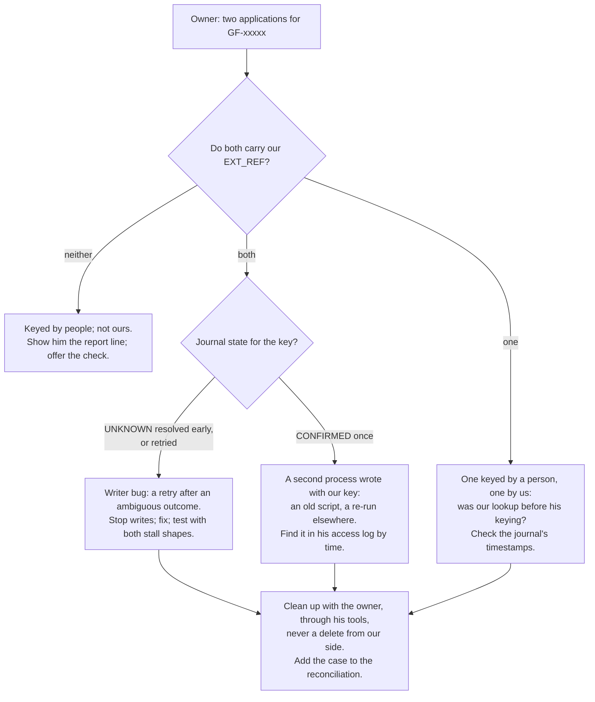

# 15 · Common Mistakes and Debugging

> Day 16 · Section 15 of 18 · [Chapter overview](README.md) · Previous: [14 · Build it with AI, and how you know it's right](14-build-with-ai-and-verification.md) · Next: [16 · Interview questions](16-interview-questions.md)

---

Each row is **symptom, cause, fix**, with the section that explains it. Written so Godavari's
application-support engineer can use it as a runbook.

## 15.1 The core

| Symptom | Likely cause | Fix |
|---|---|---|
| two applications for one file, both created by our account | a create was retried after a timeout; or a lookup ran before a late commit | never retry an ambiguous create; resolve after the quiet period (04.3, 04.4); clean up with the owner, never by a delete from our side |
| the owner's access log has more successful creates than our journal has CONFIRMED | ambiguous creates not resolved, or the journal lost writes | run `resolve_unknowns()`; compare with section 3 of the report (11.3) |
| zeep hangs for minutes at start-up | it is loading the WSDL from the server and fetching `common.xsd` from a dead host | load the vendored WSDL; use `OfflineTransport` (03.3) |
| calls never time out | only zeep's `timeout` was set; it governs document loading | set `operation_timeout` too (03.3) |
| `Fault: Unknown fault occured` on Sunday morning | the load balancer's HTML maintenance page | map to `CoreUnavailable`; retry after 09:00 (03.4) |
| `CL-E099 SERVICE BUSY` in bursts | more than five calls a second | pace with the token bucket at four; never add workers to go faster (04.7, 12.4) |
| `CL-E017` at 20:10 on the 30th | the month-end batch runs to 23:00 | defer, do not fail; the window is month-aware (04.7) |
| `CL-E052 FILE NOT REGISTERED` | no shell: the 02:00 job did not see the file, or the file number is wrong, or the branch differs | check the manifest and `FILE_REG`; never create around it (05.3) |
| `CL-E023` in production, never in the sandbox | a rule newer than the sandbox (SBX-01) | the known-drift list; mapping version bump; the owner's release note (10.4) |
| a field we sent is missing in the core, with no error | an element name the core does not know is silently dropped | the request-shape contract test; the raw client's name check (03.6, 10.3) |
| zeep raises `XMLParseError` on a reply that looks fine | strict mode: elements out of sequence order | treat as a contract break; for a write, as ambiguous (03.3) |

## 15.2 Files and the batch

| Symptom | Likely cause | Fix |
|---|---|---|
| a file extracted with half its pages | it was read while still being written | size and hash against the manifest; only after `.done` (05.3) |
| a file never picked up | it arrived after the manifest, or its manifest line is missing | it is LATE: next night's manifest, or ask branch operations (05.3) |
| a re-scan created a second application | the write key included the bundle hash, or the pickup treated it as new | Day 11's key is file number and branch; the re-scan is a version (05.3) |
| the 02:00 job's operator asks who deleted files | a pickup that moves or deletes on their side | read-only account; the ledger remembers (05.3) |

## 15.3 The tracker

| Symptom | Likely cause | Fix |
|---|---|---|
| every date in a workbook is wrong by months | month-first parsing of day-first dates | day-first, from the mapping; refuse impossible dates (06.3) |
| the reader finds no rows in one workbook | the header is not on row 1, or an alias is missing | header scoring; add the alias with the team leads (06.3) |
| one analyst's files vanish from the queue | two workbooks claim them; or a typo in the file number | conflicts and unreadable rows go to the team lead (06.4) |
| the ageing column is empty | a formula saved by a program, with no cached value | recompute from the received date (06.3) |
| an analyst's formulas became numbers | the workbook was saved after `data_only=True` | load without it for writing; write one owned column (06.6) |
| "file in use" or lost edits after a write-back | Excel had it open (`~$` lock file) | refuse while the lock exists (06.6) |

## 15.4 The reporting copy and the data rules

| Symptom | Likely cause | Fix |
|---|---|---|
| `access to APPL_MST.APPL_NM is prohibited` | the query touches an identifier column | read it on demand from the core, for one file (07.4, 09.2) |
| `more than 5000 rows` | a query that should aggregate | aggregate in SQL or page by key (07.4) |
| the report flags a correct tracker row | the reporting copy is from 05:00 and the change came later | state freshness; compare like with like (07.6) |
| a PAN appears in a log | a log call bypassed `safe_for_log` | mask at the boundary; scan logs in tests (09.4) |
| the CISO's view log has gaps | cache hits were not logged | log every view, hit or not (09.2) |

## 15.5 The mapping and the contract tests

| Symptom | Likely cause | Fix |
|---|---|---|
| `changed since it was reviewed` and nothing runs | the mapping was edited without a version bump and review | bump, review with the owner, re-record the sign-off (08.3) |
| `the core sent code 'H', which the mapping does not know` | a new code in production | add it with its meaning, as a new version (08.4) |
| contract tests fail after the quarterly refresh | the cassette or the drift list is out of date | re-record; review the diff with the owner; renew or retire drift entries (10.2, 10.4) |
| `SBX-01 expired` fails the build | nobody re-checked the drift after its date | re-check with the owner; that is the test working (10.4) |

## 15.6 A routine for "the owner says there is a duplicate"

