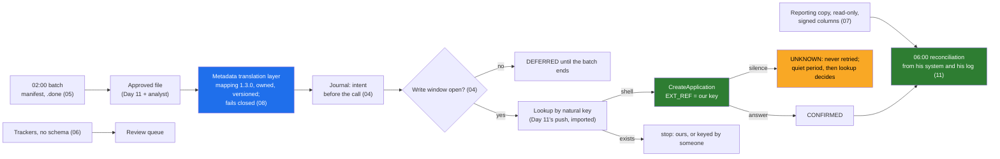

# Day 16 · Integrating With What Exists: SOAP, SQL, Files, SFTP, the Metadata Translation Layer, and the Data You Are Not Allowed to Copy

> **[Part 3 · Building the System Around the Model](../README.md)** · Chapter 6 of 10 · Video ~12 min · Chapter tier: big
> Builds on: [Day 6 (transcript 06; findings A2, A4, A5)](../../02-discovery-and-decomposition/06-discovery-interviews/README.md) ·
> [Day 7 (the inputs inventory)](../../02-discovery-and-decomposition/07-decomposition/README.md) ·
> [Day 11 (the intake package and its idempotent sandbox write)](../11-the-system-around-the-model/README.md) ·
> [Day 12 (read-only tools; retries that only cost money)](../12-llm-apis-for-production/README.md) ·
> [Day 8 (M07, M14)](../../02-discovery-and-decomposition/08-scoping-the-first-90-days/README.md)
> Sets up: Day 17 (writes behind approval, the state machine, keys per step), Day 19 (the alerts named here),
> Day 20 (the skeleton's core-system end), Day 23 and Day 24 (the contract and the law behind section 09),
> Day 25 (the network path to the core after the move to Mumbai), Day 28 (the customer owns the integration),
> Day 35 (the mapping as a product pattern)
> **Owner:** this chapter owns **integration with legacy systems for the course: SOAP in 2026 (reading a
> WSDL, a generated client with zeep, a hand-built envelope, faults and the four outcomes of a call); writes
> to a system with no idempotency key (natural keys, a stamped reference, lookup before create, the quiet
> period, the journal, the write window, the undocumented rate limit); the nightly file batch (manifests,
> atomic pickup, partial, late, re-run and re-scanned files, SFTP); reading a hand-kept spreadsheet without
> trusting it and migrating it into the review queue; read-only SQL with a per-column sign-off; the metadata
> translation layer; reading data in place instead of copying it; contract tests against a recorded sandbox;
> and the reconciliation report.** The deterministic-versus-LLM split is Day 11's; tool definitions Day 12's;
> the workflow state machine and approval gate Day 17's; observability Day 19's; the DPA Day 23's; Indian law
> and residency Day 24's; networks and secrets Day 25's; handoff Day 28's.
> Versions used: run on **Python 3.14.3** (needs 3.12 or newer) with **zeep 4.3.3**, **lxml 6.1.3**,
> **requests 2.34.2**, **openpyxl 3.1.5** and **pytest 9.1.1**, pinned in `code/requirements.txt`; the optional
> SFTP test adds **paramiko 4.0.0** (`code/requirements-sftp.txt`). Tested 21 October 2026 in a virtual
> environment. Shown outputs are from real runs. All data is synthetic, built from Day 7's sample through
> Day 11's pipeline, which is imported by path.

---

## Why this chapter exists

Every engagement has a legacy system in it, and the integration is usually where the schedule goes.
Godavari's is a 2009 core lending system with a SOAP API, run for fourteen years by one engineer who has
watched three vendors fail ("They sent me a design in week eight. By week eight I had already decided").
Its `CreateApplication` has no idempotency key: in 2022 a vendor's timeout and retry left four hundred
duplicate applications that he cleaned by hand over a weekend. Its sandbox is three months behind. Nothing
may write between 17:30 and the end of the 18:00 batch. Around it sit a nightly SFTP drop, forty Excel
trackers that are the real state of every file, and a reporting database full of PII the integration may
not copy. Core engineering is in 95 percent or more of the 1,000 FDE postings analysed in 2026, and this is
what "production-grade, in a codebase you did not write" means on a Tuesday.

This chapter builds the integration layer the walking skeleton needs for M07 (Friday 13 November 2026), and
the evidence the owner asked for before live writes on 8 December (M14): a month of logged, duplicate-free
sandbox calls. It reproduces DUPLICATE_ON_RETRY with a naive client, shows that "look up, then retry" still
duplicates when the commit is late, and builds a writer that does not. It reads the batch, the trackers and
the reporting copy without trusting any of them, translates every field through a versioned mapping the
owner reviewed ("CUST_FLG_3 means salaried"), keeps the customer's identifiers where they are, tests against
a recorded sandbox with its drift written down, and ends each night with a reconciliation report the owner
can check against his own access log.

## Mental model

One sentence to carry out of the chapter: **a write to a system with no idempotency key is safe only if you
record the intent first, look up by a natural key before creating, stamp your key in the record, and never
retry a call that ended in silence; read everything else as untrusted, translate every field through a
mapping its owner signed, keep the customer's data where it lives, and prove each night from the owner's own
records that nothing was duplicated.**

## Learning goals

After this chapter you can:

1. Map a customer's integration surface (system, shape, direction, owner, freshness, window, rate limit,
   idempotency, sandbox fidelity, what may be copied) and name the constraint each one forces.
2. Read a WSDL in ten minutes, generate a client with zeep that never fetches at run time and has both
   timeouts set, and build an envelope by hand when the WSDL will not load.
3. Classify every call's ending as fault, unavailable, not sent or ambiguous, and say which may be retried.
4. Write to a system with no idempotency key without duplicates: natural key, stamped reference, journal,
   lookup before create, quiet period, write window, pacing; and show why lookup-then-retry is not enough.
5. Pick up a nightly batch with a manifest: marker, size and hash, atomic copy, partial, late, re-run and
   re-scanned files, read-only, over SFTP.
6. Read a hand-kept Excel tracker defensively, migrate it into a review queue, and write back one column
   without breaking the workbook.
7. Read a reporting database read-only with a per-column sign-off, limits and logged purposes, and explain
   why you never write to the customer's production database.
8. Build and maintain a metadata translation layer: business meanings, canonical names, transforms, codes,
   data classes, owners, versions and tests.
9. Keep data you may not copy in place: on-demand reads, purposes, short caches, view logs, masks, hashes.
10. Test against a recorded sandbox (replay, request shape, WSDL diff, known drift with expiry) and produce
    a reconciliation report a system owner trusts.
11. Direct a coding agent to build all of it while catching its characteristic mistakes: retried creates,
    existence checks against a replica, invented field meanings, logged payloads.

**Prerequisites:** Days 6, 7 and 11. Python at a working level: dataclasses, type hints, pytest, HTTP.

## Reading order

| # | Section | What you get | Words |
|---|---|---|---|
| 01 | [Why integration is where engagements slip](01-why-integration-is-where-engagements-slip.md) | a Thursday night in week 3; four reasons the schedule goes; the career reason; Day 6's findings as code; the hard parts | ~1,150 |
| 02 | [The integration surface](02-the-integration-surface.md) | four systems, four shapes; the picture; one owner per system; the customer's engineer; risk in one sentence each | ~800 |
| 03 | [SOAP in 2026](03-soap-in-2026.md) | envelopes; reading a WSDL; zeep with offline loading, two timeouts, strict mode; faults and look-alikes; the four outcomes; the hand-built envelope | ~1,550 |
| 04 | [Idempotency without keys](04-idempotency-without-keys.md) | two shapes of silence; the real numbers; why lookup-then-retry fails; the quiet period; natural keys and EXT_REF; the journal; the window and the rate limit | ~1,400 |
| 05 | [Files and the nightly batch](05-files-and-the-nightly-batch.md) | the manifest and the marker; six pickup rules; paramiko; naming; timing | ~950 |
| 06 | [The Excel tracker](06-the-excel-tracker.md) | the messy workbooks; the defensive reader; migration into the queue; disagreements; writing back safely | ~1,200 |
| 07 | [SQL, read-only](07-sql-read-only.md) | the reporting copy; never write; never decide existence there; four locks; the per-column sign-off; freshness | ~900 |
| 08 | [The metadata translation layer](08-the-metadata-translation-layer.md) | the underrated layer; Godavari's mapping; versioned and owned; fail closed; what the model sees; tests | ~1,050 |
| 09 | [The data you may not copy](09-data-you-may-not-copy.md) | read in place; what may be cached; masks and hashes; proving it; the index; questions for Days 23 and 24 | ~950 |
| 10 | [Contract tests and drift](10-contract-tests-and-drift.md) | record once; replay on every build; the WSDL diff; known drift with an expiry | ~850 |
| 11 | [The reconciliation report](11-the-reconciliation-report.md) | "bring the log"; what makes a report trustworthy; the eight sections; clean; a separate job; a month | ~1,000 |
| 12 | [2026 patterns and production concerns](12-2026-patterns-and-production-concerns.md) | tools, MCP, facades, CDC, outboxes; agents; hype; latency, scheduling, monitoring, security, cutover, handoff | ~1,000 |
| 13 | [Project: the Godavari integration layer](13-project-the-godavari-integration-layer.md) | the brief; files; setup; the full real run; reading it; 99 tests; the engagement folder | ~1,600 (plus output) |
| 14 | [Build it with AI, and how you know it's right](14-build-with-ai-and-verification.md) | context, a strong prompt, the fourteen mistakes; twelve checks and a review checklist | ~1,350 |
| 15 | [Mistakes and debugging](15-mistakes-and-debugging.md) | symptom, cause, fix as a runbook; the routine for "there is a duplicate" | ~1,050 |
| 16 | [Interview questions](16-interview-questions.md) | 16 questions with model answers and a quick-fire round | ~1,400 |
| 17 | [Exercises](17-exercises.md) | 16 graded exercises: predict-the-output, break-it-then-fix-it, review AI-written code and an AI-written plan, a second core, your own system | ~1,000 |
| 18 | [Further reading](18-further-reading.md) | the FDE sources, SOAP and WS-Security, idempotency and integration patterns, files and databases, the Indian context | ~750 |

Word counts are prose only, without code blocks: about 20,000 across the sections. **Short on time?** Read 03, 04 and 08, run the project (13)
and do exercises 2.1 and 3.1. That is the video plus what the system-design round tests.

## Files

| Path | What |
|---|---|
| `code/godavari_integration/` | the integration layer: the Day 11 bridge, the core's data dictionary, the stand-in core (`standin/`), the SOAP port and two clients (`soap/`), the writer and journal, the mapping layer (`translate.py`, `canonical.py`, `mapping/`), the pickup and SFTP source, the tracker reader, the reporting reader, on-demand reads, contracts and the reconciliation |
| [`code/godavari_integration/mapping/godavari_core_mapping.toml`](code/godavari_integration/mapping/godavari_core_mapping.toml) | the metadata translation layer for the core, version 1.3.0, reviewed by the core-system owner |
| [`code/godavari_integration/mapping/godavari_tracker_mapping.toml`](code/godavari_integration/mapping/godavari_tracker_mapping.toml) | the tracker's mapping, version 0.4.0, owned by the team leads |
| [`code/run_integration_night.py`](code/run_integration_night.py) | the project run: Part A (duplicates), Part B (stale sandbox), Part C (the night and the morning report) |
| [`code/record_sandbox.py`](code/record_sandbox.py) | records the cassette and the pinned WSDL contract |
| `code/contracts/` | the scrubbed cassette, the WSDL contract, the known-drift list |
| `code/tests/` | 99 tests in ten files |
| [`code/exercises/ai_draft_core_client.py`](code/exercises/ai_draft_core_client.py) | an AI-written client with at least twelve problems; exercise 3.1 |
| [`code/requirements.txt`](code/requirements.txt) · [`code/requirements-sftp.txt`](code/requirements-sftp.txt) | pinned dependencies; the optional paramiko pin |
| [`worksheet/godavari-integration-agreement.md`](worksheet/godavari-integration-agreement.md) | the one-page agreement with the core-system owner, the CISO's team and the compliance head |
| [`worksheet/godavari-data-handling-matrix.md`](worksheet/godavari-data-handling-matrix.md) | what may be copied, cached, logged or shown, per data class and source |
| [`worksheet/integration-inventory-template.md`](worksheet/integration-inventory-template.md) | the empty inventory for the next customer |
| [`worksheet/ai-draft-integration-plan.md`](worksheet/ai-draft-integration-plan.md) | an AI-written plan with at least fourteen problems; exercise 3.2 |
| `data/` | the run's output, the first morning report, its history, and the generated sources (`sources/`, Godavari's side) and our side (`kaagaz/`) |

Run from the chapter folder in a virtual environment (pytest is not on the global Python):
`pip install -r code/requirements.txt`, then `python -X utf8 code/run_integration_night.py` (about a minute)
and `python -X utf8 -m pytest code` (99 tests, about 30 seconds; 98 and one skipped without paramiko). No
network after the install: the stand-in core listens on 127.0.0.1 only.

## What this chapter does *not* teach (single-owner rule)

| Topic | Where it's taught |
|---|---|
| Which logic is deterministic code and which is the model | [Day 11](../11-the-system-around-the-model/README.md) (the push logic here is Day 11's, imported) |
| Tool definitions, the bounded tool loop, retries for model calls | [Day 12](../12-llm-apis-for-production/README.md) |
| The file workflow as a state machine, the approval gate, keys for every step | [Day 17](../17-agents-and-workflows/README.md) |
| The review screen the queue feeds | [Day 18](../18-verification-and-trust/README.md) |
| Traces, alerts and dashboards for these signals | [Day 19](../19-observability-for-ai-systems/README.md) |
| The DPA, retention, subprocessors, the security questionnaire | [Day 23](../../04-deploying-into-their-world/23-security-review-and-procurement/README.md) |
| The DPDP Act, RBI directions, residency | [Day 24](../../04-deploying-into-their-world/24-data-residency-and-indian-law/README.md) |
| Private network paths, secrets, egress | [Day 25](../../04-deploying-into-their-world/25-network-secrets-and-egress/README.md) |
| Handing the integration to Godavari's engineer | [Day 28](../../04-deploying-into-their-world/28-handoff-and-self-sufficiency/README.md) |
| Delivering the news of a duplicate | [Day 30](../../05-working-with-the-customer/30-delivering-bad-news/README.md) |

## Analogies for the Telugu audience

- **The auto driver** (the chapter's main picture): your new car (the model) still cannot reach the house
  with no street name; the auto driver who knows which gully floods and which closes after six is the
  integration layer, and he charges for it (01.5).
- **The ration-shop register** (section 04): the shopkeeper writes your card number before handing over the
  rice, so when the power fails mid-weighing he checks the register instead of weighing out a second bag.
  The journal is the register; the card number is the natural key.
- **The wedding gift register** (Day 15's picture, reused in section 09): only the family opens it, one
  page at a time, and a stranger copying it is the breach.

## Video map

The video (~12 min) covers a slice; the notes cover everything.

| Asset | Covers | Sections |
|---|---|---|
| **Day 16 main video** (~12 min) | Hook: 02:30 on a Thursday in week 3; six questions nobody puts on a slide (1 min) → why integration is where engagements slip; the owner who decided in week eight (1 min) → the integration surface: four systems, one owner each (1 min) → SOAP in 2026: an envelope, a WSDL, zeep with two timeouts, faults and the maintenance page (2 min) → the duplicate: two shapes of silence, Part A's six lines on screen (2 min) → the quiet period and the journal (1 min) → the 02:00 batch: manifest, partial, late, re-scan (1 min) → CUST_FLG_3 means salaried: the mapping (1 min) → data you may not copy, in one minute (1 min) → the morning report the owner trusts; recap; Day 17 and Day 23 teasers (1 min) | 01.1 to 01.2, 02.1, 03.1 to 03.5, 04.2 to 04.4, 05.3, 08.1 to 08.2, 09.2, 11.2 |
| **Short 1:** "The core system is from 2009 and it is not going anywhere. Integrate." | the owner's sentences; no idempotency; the window; the rate limit nobody wrote down; the naive client's 12 applications for 10 files | 01.2, 04.2 |
| **Short 2:** "CUST_FLG_3 means salaried. The model will never guess that. Write it down." | the mapping entry; the model's view before and after; the gold-loan convention; `APPLSTAT H` failing closed | 08.2, 08.4, 08.5 |
| Notes only | the customer's engineer (02.4), the hand-built envelope (03.6), natural keys and sets versus creates (04.5 to 04.8), paramiko (05.4), the tracker in full (06), read-only SQL (07), contract tests (10), patterns and production (12), the project (13), Build it with AI and verification (14), debugging (15), interviews (16), exercises (17) | as listed |

**Callbacks to use on screen:** "Day 6 lo core-system owner cheppadu gurtunda: 'It creates two applications.'
Ivala aa sentence ni test ga marchutunnam." (section 04); "Day 11 lo push_to_core raasam; ivala daanini copy
cheyakunda, real SOAP client tho nadupistunnam." (section 04.3); "Day 7 inputs inventory lo nalugu systems
unnayi; ivala prati daniki oka client." (section 02).
**Forward callbacks:** Day 17 (ee writer ni state machine lo, approval gate venaka), Day 23 and Day 24 (ee
data-handling matrix ni security review lo, law tho), Day 28 (ee integration ni Godavari engineer ki
handover).

## Callbacks

- **Builds on:** [Day 6](../../02-discovery-and-decomposition/06-discovery-interviews/README.md) (transcript
  06 verbatim; DUPLICATE_ON_RETRY, IDEMPOTENCY_LOOKUP_EXISTS, SANDBOX_STALE, BATCH_6PM; findings A2, A3, A4,
  A5, A6, B1), [Day 7](../../02-discovery-and-decomposition/07-decomposition/README.md) (the inputs inventory;
  the generator this chapter reaches through Day 11), [Day 8](../../02-discovery-and-decomposition/08-scoping-the-first-90-days/README.md)
  (M07 on 13 November; M14 on 8 December; the application-support engineer),
  [Day 10](../../02-discovery-and-decomposition/10-the-discovery-document/README.md) (risks R4 and R5; D08;
  the data and security conditions), [Day 11](../11-the-system-around-the-model/README.md) (the intake
  package and `push_to_core`, imported by path), [Day 12](../12-llm-apis-for-production/README.md) (read-only
  tools that should call this port).
- **Sets up:** [Day 17](../17-agents-and-workflows/README.md) (the writer behind the approval gate),
  [Day 19](../19-observability-for-ai-systems/README.md) (the alerts), [Day 20](../20-the-walking-skeleton-shipped/README.md)
  (the skeleton's core-system end), [Day 23](../../04-deploying-into-their-world/23-security-review-and-procurement/README.md)
  and [Day 24](../../04-deploying-into-their-world/24-data-residency-and-indian-law/README.md) (the matrix
  reviewed), [Day 25](../../04-deploying-into-their-world/25-network-secrets-and-egress/README.md) (the path
  from Mumbai to the core), [Day 28](../../04-deploying-into-their-world/28-handoff-and-self-sufficiency/README.md)
  (handoff), [Day 35](../../06-from-customer-to-product/35-patterns-across-customers/README.md) (the mapping
  as a product pattern).

**Next chapter:** [Day 17 · Agents and workflows: tool calling, state machines, human approval on risky actions, idempotency](../17-agents-and-workflows/README.md).
