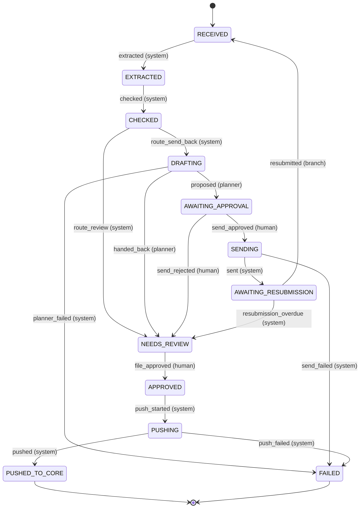

# 03 · The State Machine: Named States, Allowed Transitions, Guards, and an End

> Day 17 · Section 3 of 16 · [Chapter overview](README.md) · Previous: [02 · Agents versus workflows](02-agents-versus-workflows.md) · Next: [04 · Tool design](04-tool-design.md)

---

## 3.1 In plain words

A state machine is a list of the situations a thing can be in (states), a list of the moves allowed between them
(transitions), and for each move, who may make it and what must be true first (the actor and the guards). A railway
ticket is one: booked, waitlisted, confirmed, cancelled, travelled. You cannot travel on a cancelled ticket, a
waitlisted ticket moves to confirmed only when IRCTC's allotment says so, and "travelled" has no way out. Nobody finds
that complicated. What makes it powerful in software is that the list is written down, in one place, and nothing in the
program changes the state except through it.

For an AI workflow the state machine does three jobs at once. It **constrains the model**: the planner can only act
inside the one state that lets it. It **survives crashes**: the current state is a row on disk, so a new process knows
where the old one stopped. And it **explains itself**: the compliance head can read twelve states and seventeen
arrows, which she cannot do with a loop of model calls.

## 3.2 Godavari's machine

The Part 3 plan named seven states for the file workflow: RECEIVED, EXTRACTED, CHECKED, NEEDS_REVIEW, APPROVED,
PUSHED_TO_CORE, FAILED. The send-back adds three (DRAFTING, AWAITING_APPROVAL, AWAITING_RESUBMISSION), and the two
irreversible side effects each get an in-flight state of their own (SENDING, PUSHING). The diagram is generated from
`godavari_workflow/states.py` by `run_demo.py` (`data/state-machine.md`), so the picture cannot drift from the code:



Read the actors in brackets before anything else. The planner fires exactly two transitions, both out of DRAFTING,
and both end somewhere a person looks next. A human fires the three that matter: approving a send, rejecting it, and
approving a file for core entry. The branch fires one: resubmitting. Everything else is the system running code.

Three kinds of state, and the engine treats each differently:

| Kind | States | What the engine does |
|---|---|---|
| working | RECEIVED, EXTRACTED, CHECKED, DRAFTING, APPROVED | does the state's work and takes one transition |
| in flight | SENDING, PUSHING | a side effect is intended and may already have happened; on resume, find out, never repeat |
| resting | AWAITING_APPROVAL, AWAITING_RESUBMISSION, NEEDS_REVIEW, and the terminal PUSHED_TO_CORE, FAILED | waits for a person, the branch, a timeout, or nothing at all |

## 3.3 How it works inside

The whole shape is one table of `Transition(event, source, target, actor, note)` and one function:

```python
def check_transition(source: State, event: str, actor: Actor) -> Transition:
    """The only way to get a target state. Raises for an unknown event or the wrong kind of actor."""
    t = _BY_KEY.get((source, event))
    if t is None:
        allowed = sorted(e for (s, e) in _BY_KEY if s == source)
        raise IllegalTransition(f"no transition '{event}' from {source}; allowed: {allowed or 'none (terminal)'}")
    if t.actor != actor:
        raise IllegalTransition(f"'{event}' from {source} must be fired by {t.actor}, not {actor}")
    return t
```

Nothing else in the package assigns a state. The store's `transition()` calls `check_transition` and then, in one
SQLite transaction, updates the run's row (with an optimistic version check), records any intended side effect or new
approval-queue item, and appends the audit events. If any part fails, none of it happened. That single transaction is
what makes "the state on disk" trustworthy after a crash; section 06 builds on it.

The engine is one handler per working or in-flight state:

```python
handler = {State.RECEIVED: self._extract, State.EXTRACTED: self._check, State.CHECKED: self._route,
           State.DRAFTING: self._draft, State.SENDING: self._send, State.APPROVED: self._start_push,
           State.PUSHING: self._push}.get(run.state)
```

Each handler reads the run from disk, does its work, and takes exactly one transition. `run_until_rest(file_id)`
calls `advance` until the run reaches a resting state, with a ceiling of 25 transitions as a guard against a
workflow-level loop (a bug, not a model behaviour; it has never fired, and the test suite would show it if it did).

## 3.4 Guards: what must be true, checked where the data is

The table holds the shape. The guards that need data live next to the data, and each is tested:

| Transition | Guard | Where |
|---|---|---|
| route_send_back | there is a send-back or block finding, and fewer than 2 send-backs so far | `engine._route` |
| proposed | the draft passes every check in `drafts.problems` | `tools._propose` |
| send_approved | the approver is the assignee or her team lead, holds the branch's AD group, is not a service account; an edited text passes the draft checks | `approvals.authority_problems`, `engine.decide_send` |
| sent | the approved text and recipient hash to what was approved | `tools._send` |
| file_approved | the approver may see the branch; no send-back or block finding is open | `engine.approve_file` |
| pushed | Day 11's `push_to_core` checks the approval and the route, and looks up before creating | Day 11's `core_write.py` |

Two of those deserve a sentence each. The cycle cap is a loop guard at the level of the workflow: a branch that sends
the same wrong document twice does not get a third automated email; the analyst phones. And `file_approved` means
**approved for core entry**, an analyst saying the fields are right and the file is complete. It is not a sanction. The
sanction is Day 6's step 19, a named credit manager, and no state here touches it.

## 3.5 Why twelve states and not three

A common first design has three: "pending", "done", "error". It fails in three specific ways at Godavari:

1. **"Pending" hides who is waiting for whom.** AWAITING_APPROVAL (an analyst owes a decision, with a deadline),
   AWAITING_RESUBMISSION (a branch owes documents, with a deadline) and NEEDS_REVIEW (an analyst owns the file) have
   different owners, different timeouts and different dashboards (Day 19). Merging them makes all three invisible.
2. **"Done" cannot say whether the side effect happened.** SENDING exists so that a crash during the send leaves a
   state that means "intended, maybe done". Without it, a resumed process cannot tell "about to send" from "sent".
3. **"Error" is a bin.** A planner that hit its budget, a send whose approval no longer matches, and a core write the
   integration refused need different people. FAILED carries the reason and the trace; NEEDS_REVIEW is for "a person
   should take this", which is not an error.

The opposite mistake is also real: a state per tool call, forty states, a diagram nobody reads. The test is whether a
state changes **who owns the file, what may happen next, or what a crash leaves behind**. If none of the three, it is
a step inside a state, not a state.

## 3.6 Terminal states, and why FAILED is one

PUSHED_TO_CORE and FAILED have no outgoing transitions (`test_terminal_states_have_no_way_out`). FAILED is terminal for
**automation**: the workflow will not touch the file again. It is not terminal for the file. The analyst sees it on
her list with the reason ("loop: get_branch_contact called 2 times with the same arguments") and the trace, and works
it by hand. Making FAILED terminal is a safety decision: a workflow that retries its own failures is a loop with extra
steps. A person decides whether to restart it, after reading why it stopped.

## 3.7 Persisted after every step

Every transition commits before the next step starts; GF-25074's whole trail in the synthetic week (one send-back, a
refused edit, a recovery, a resubmission and a core write) is 28 events. In return, every question has an answer on
disk: where the file is (`runs.state`), what the model read and the rules found (`runs.data`, so a resumed run checks
the proposal it was checking, not a fresh model answer), who must act by when (`approvals`), whether the email went
(`outbox` and the relay's trace), and who decided what (`events`). A process that keeps any of this only in memory has a
state machine that forgets on restart: the naive loop of section 01 with a nicer diagram.
