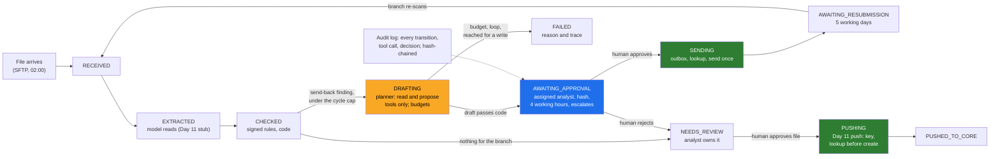

# Day 17 · Agents and Workflows: Tool Calling, State Machines, Human Approval on Risky Actions, Idempotency

> **[Part 3 · Building the System Around the Model](../README.md)** · Chapter 7 of 10 · Video ~13 min · Chapter tier: big
> Builds on: [Day 11 (the split; the rules, routes and idempotent core push imported here)](../11-the-system-around-the-model/README.md) ·
> [Day 12 (tool use, the client, the cost ledger)](../12-llm-apis-for-production/README.md) ·
> [Day 14 (the golden set and expert trajectories)](../14-evals-first/README.md) ·
> [Day 15 (permission-aware search, used as a read tool)](../15-retrieval-for-enterprise-documents/README.md) ·
> [Day 16 (the SOAP integration and lookup before create)](../16-integrating-with-what-exists/README.md) ·
> [Day 6 and Day 9 (the send-back workflow, its drift and caution; 28 percent, 6.4 days in the queue)](../../02-discovery-and-decomposition/09-success-metrics-and-business-case/README.md) ·
> [Day 10 (decision D07: a human decision on every file)](../../02-discovery-and-decomposition/10-the-discovery-document/README.md)
> Sets up: Day 18 (the review screen in front of the approval queue), Day 19 (a span per state and tool call; the
> refused-write and duplicate alarms), Day 20 (the skeleton with Day 16's writer behind PUSHING), Day 23 (the
> questionnaire's "can it act without a human?"), Day 27 (incidents in their production), Day 41 (attacks through tools)
> **Owner:** this chapter owns **agent design: workflows versus agents; the workflow as a persisted state machine with
> actors, guards, in-flight and terminal states; tools with risk classes, side-effect labels and least privilege;
> approval as a state; idempotency, the outbox and reconciliation; budgets and loop detection; the audit trail; and
> trajectory evaluation.** Tool-use mechanics are Day 12's; the split is Day 11's; the SOAP client and
> lookup-before-create are Day 16's; evals are Day 14's; prompt injection is Day 41's (one line here).
> Versions used: **Python 3.14.3** (needs 3.12 or newer), **Pydantic 2.12.5** and **pytest 9.1.1**, pinned in
> `code/requirements.txt` (the same pins as Day 12) and installed in a virtual environment, because pytest is not on the
> global Python. Days 11, 12, 14 and 15 are imported by path. No network, no API key; Day 12's real-provider adapter is
> optional and was not run. Sources read on 21 October 2026. Shown outputs are from real runs; all data is synthetic.

---

## Why this chapter exists

A naive agent with tools to read a file, email a branch and write to the core looks right on a demo. Kill its process
one line after the email and the restart sends it again; give it the core write and it creates an application for a
file whose address proof is "to follow", approved by nobody. A better model does both, because neither is a model
error. Godavari's core-system owner wants zero duplicate records, the compliance head a human decision on every file
(D07), the RBI auditor a trail for seven years (A6). Applied AI is in 80 percent or more of the 1,000 FDE postings
analysed in 2026 (CURRICULUM.md), and agents are where interviewers test whether you know a demo from a system of
record.

This chapter builds the send-back, the phone call an analyst makes today for 28 percent of files (Day 9), as a state
machine with a bounded planner in one state. It drafts the request from the signed rules' findings with read tools,
a named analyst approves before anything leaves, the email goes once whatever crashes, and the resubmitted file is
checked again and written to the core once. It never approves a loan, changes a rule, writes outside the idempotent
integration, or contacts a customer.

## Mental model

One sentence to carry out of the chapter: **let code choose the steps and own every irreversible action, let the model
work inside one bounded state, make approval a state bound to exactly what is approved, and key, record and look up
every side effect so that a crash resumes and never repeats.**

## Learning goals

After this chapter you can:

1. Decide between a workflow and an agent for a customer process with five questions, and write the decision as a
   table of who decides each part.
2. Model a workflow as a state machine with named states, transitions, actors, guards, in-flight and terminal states,
   persisted with its audit event in one transaction.
3. Design tools with a risk class and a side-effect label each, give a planner read and propose tools only, and apply
   least privilege through argument design.
4. Make human approval a state: what needs it, who may give it (checked at decision time), what it is bound to, and a
   deadline that escalates and never approves.
5. Derive idempotency keys from business intent, use an outbox and a lookup before repeat, enumerate the crash windows
   of a side effect, and prove one effect with a real process kill.
6. Bound a planner with step, rupee, time and repetition budgets, and keep an audit trail that is complete,
   tamper-evident and free of identifiers.
7. Evaluate an agent on trajectories as well as outcomes, on Day 14's golden set, and gate changes on it.
8. Build all of this with a coding agent and catch the specific mistakes it makes here.

**Prerequisites:** Days 11 and 12 (the split and tool use), Day 14 (why evals come first). Python at a working level.

## Reading order

| # | Section | What you get | Words |
|---|---|---|---|
| 01 | [Why agents and workflows](01-why-agents-and-workflows.md) | the email that went twice; career reason; the hard parts | ~1,150 |
| 02 | [Agents versus workflows](02-agents-versus-workflows.md) | Anthropic's distinction; the spectrum; five questions; the decision table | ~1,350 |
| 03 | [The state machine](03-the-state-machine.md) | twelve states, seventeen transitions; guards; why not three; FAILED | ~1,450 |
| 04 | [Tool design](04-tool-design.md) | four risk classes; least privilege as arguments; poka-yoke | ~1,300 |
| 05 | [Human approval as a state](05-human-approval-as-a-state.md) | what needs approval; who; the hash; edits; escalation that never approves | ~1,400 |
| 06 | [Idempotency, retries and durable state](06-idempotency-retries-and-durable-state.md) | keys from intent; the outbox and crash windows; compensation; reconciliation | ~1,800 |
| 07 | [Budgets, loops and the audit trail](07-budgets-loops-and-the-audit-trail.md) | four meters; rupees from Day 12's ledger; loops; the audit trail; the hash chain | ~1,700 |
| 08 | [Evaluating on trajectories](08-evaluating-on-trajectories.md) | 150 golden files; perfect outcomes, failing path; the gate | ~1,550 |
| 09 | [Advanced and 2026 patterns](09-advanced-and-2026-patterns.md) | frameworks, interrupts, durable execution, MCP; hype | ~1,150 |
| 10 | [Production concerns](10-production-concerns.md) | cost, latency, scale, security, monitoring | ~1,000 |
| 11 | [Project: the send-back workflow](11-project-the-send-back-workflow.md) | the package, the run part by part, 51 tests | ~2,200 (incl. output) |
| 12 | [Build it with AI, and how you know it is right](12-build-with-ai-and-verification.md) | context, a strong prompt, ten mistakes; ten checks | ~1,400 |
| 13 | [Mistakes and debugging](13-mistakes-and-debugging.md) | symptom, cause, fix; the duplicate routine | ~850 |
| 14 | [Interview questions](14-interview-questions.md) | 14 questions and a quick-fire round | ~1,200 |
| 15 | [Exercises](15-exercises.md) | 11 graded exercises, including the AI-written draft | ~1,100 |
| 16 | [Further reading](16-further-reading.md) | Anthropic, Stripe, Temporal, LangGraph, MCP, OWASP | ~470 |

**Short on time?** Read 02, 05 and 06, then run the project (11). That is the video, plus the two questions every
reviewer of an agent will ask you: who approved this, and what happens if it runs twice.

## Files

| Path | What |
|---|---|
| [`code/godavari_workflow/`](code/godavari_workflow/) | the package: `states.py`, `store.py`, `engine.py`, `tools.py`, `planner.py`, `drafts.py`, `approvals.py`, `budgets.py`, `systems.py`, `naive.py`, `trajectory.py`, `simulate.py`, `worker.py`, `serialize.py`, `clock.py`, and the path imports `day11.py`, `day12.py`, `day14.py`, `day15.py` |
| [`code/run_demo.py`](code/run_demo.py) | the whole story in one run (about 40 seconds), writing `data/` |
| [`code/tests/`](code/tests/) | 51 pytest tests (about 40 seconds) |
| [`code/exercises/ai_draft_workflow.py`](code/exercises/ai_draft_workflow.py) | an AI-written draft with at least twelve problems; exercise 3.1 |
| [`code/requirements.txt`](code/requirements.txt), [`code/pytest.ini`](code/pytest.ini) | the pins |
| [`data/run-report.md`](data/run-report.md), [`data/trajectory-eval.md`](data/trajectory-eval.md) | the run's full output; the evaluation table |
| [`data/state-machine.md`](data/state-machine.md), [`data/tool-inventory.md`](data/tool-inventory.md) | generated from the code: the diagram and transition table; the tools with risk and side effect |
| [`data/approval-queue.json`](data/approval-queue.json), [`data/audit-log.jsonl`](data/audit-log.jsonl), [`data/week-log.txt`](data/week-log.txt) | the synthetic week's queue, audit trail and log |
| `data/state/` | the week's SQLite files and sandbox records, regenerated on every run |
| [`worksheet/godavari-send-back-design.md`](worksheet/godavari-send-back-design.md) | the design note for the compliance head, the team leads and the CISO, with questions SB1 to SB6 |
| [`worksheet/agent-review-checklist.md`](worksheet/agent-review-checklist.md) | the checklist for every workflow pull request |

Run from `code/`: create a virtual environment, `python -m pip install -r requirements.txt`, then
`python -X utf8 run_demo.py` and `python -X utf8 -m pytest`. Days 11, 12, 14 and 15 must be at their FOLDERS.md paths.

## What this chapter does *not* teach (single-owner rule)

| Topic | Where it's taught |
|---|---|
| Declaring tools, the request-response loop, schemas, errors as results | [Day 12](../12-llm-apis-for-production/README.md) |
| Which rules are code and which judgements are the model's | [Day 11](../11-the-system-around-the-model/README.md) (applied here) |
| The SOAP client, the write window, ambiguous timeouts, lookup before create | [Day 16](../16-integrating-with-what-exists/README.md) |
| Golden sets, labelling, judges, the regression gate | [Day 14](../14-evals-first/README.md) (trajectory checks are added here) |
| The review screen in front of the approval queue | [Day 18](../18-verification-and-trust/README.md) |
| Traces, spans and dashboards | [Day 19](../19-observability-for-ai-systems/README.md) |
| Prompt injection and exfiltration through tools | [Day 41](../../07-ai-era-toolkit/41-red-teaming-your-deployment/README.md) (one line here) |

## Analogies for the Telugu audience

- **The wedding event manager with a checklist** (the chapter's main picture, from the Part plan): every item has a
  state, the muhurtham is the gate nobody passes without the priest, and no guest is served the same plate twice.
  The checklist is the workflow; the event manager's judgement inside each item is the model (02.1, 06.1).
- **The IRCTC ticket**: booked, waitlisted, confirmed, cancelled, travelled; you cannot travel on a cancelled ticket,
  and "travelled" has no way out (03.1).
- **The bank locker**: your key turns only together with the bank's; the send tool turns only with an analyst's
  approval (04.4).
- **UPI's "processing"**: press pay again and you are not debited twice, because the reference is looked up first (06.1).

## Video map

The video (~13 min) covers a slice; the notes cover everything.

| Asset | Covers | Sections |
|---|---|---|
| **Day 17 main video** (~13 min) | Hook: the naive loop emails the branch twice after a crash and writes an incomplete file to the core (1.5 min) → who chooses the next step: workflows versus agents, Anthropic's line (1.5 min) → Godavari's machine: twelve states, who fires what (2 min) → tools by risk; the send tool that takes only an approval id (1.5 min) → approval as a state: three people refused, the deadline that escalates and never approves (2 min) → idempotency: the key from intent, the outbox, the process killed after the email, one email (2.5 min) → budgets: the loop stopped, rupees per turn (1 min) → the trajectory eval: same outcomes, failing path (0.5 min) → recap and the Day 18, 19 teasers (0.5 min) | 01.1, 02.1 to 02.2, 03.2, 04.2, 04.4, 05.3 to 05.5, 06.3 to 06.4, 07.1 to 07.2, 08.3 |
| **Short 1:** "An agent in production is a state machine with a model inside." | the diagram with the planner's state highlighted; the two transitions it may fire; the three only a human fires | 02.5, 03.2 |
| **Short 2:** "Idempotency key: the reason a retry never creates two loans." | file number and branch code, not the bundle hash; the resubmission with a new hash and the same key; one record after the crash | 06.3, 06.5 |
| Notes only | sections 02.3, 03.4 to 03.6, 04.5 to 04.7, 05.6 to 05.7, 06.6 to 06.7, 07.3 to 07.6, 08.4 to 08.6, and 09 to 15 | as listed |

**Callbacks to use on screen:** "Day 12 lo 'the tool list is the permission list' annam; ivala aa list ni risk
classes tho raastunnam." (section 04); "Day 6 lo Bhavani cheppindi: 'sending back is safe'; ivala code ade 'to be safe'
item ni reject chestundi." (section 05); "Day 11 lo idempotency key file number plus branch code; ivala bundle hash
enduku kaadu chustam." (section 06); "Day 14 lo Lakshmi trajectories record chesam; ivala agent path ni check
chestunnam." (section 08).
**Forward callbacks:** Day 18 (approval queue ki screen), Day 19 (prati state ki oka span), Day 20 (Day 16 writer
PUSHING venuka).

## Callbacks

- **Builds on:** Day 6 (steps 10 and 11; CHECKLIST_DRIFT; SENDBACK_CAUTION; A1), Day 9 (28 percent; 456 rupees an
  hour), Day 10 (D07; A5; A6), Days 11, 12, 14, 15 and 16 (linked above).
- **Sets up:** [Day 18](../18-verification-and-trust/README.md), [Day 19](../19-observability-for-ai-systems/README.md),
  [Day 20](../20-the-walking-skeleton-shipped/README.md), [Day 23](../../04-deploying-into-their-world/23-security-review-and-procurement/README.md),
  [Day 27](../../04-deploying-into-their-world/27-reliability-in-their-production/README.md),
  [Day 41](../../07-ai-era-toolkit/41-red-teaming-your-deployment/README.md).

**Next chapter:** [Day 18 · Verification and trust in the interface: showing reasoning, confidence routing, the review queue](../18-verification-and-trust/README.md).
