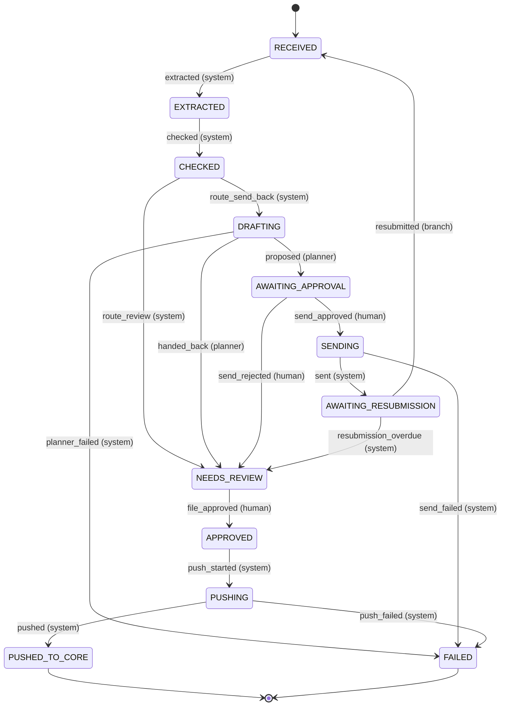

# The send-back workflow: states and transitions

Generated by `run_demo.py` from `godavari_workflow/states.py`, so the picture cannot drift from the code.

| Event | From | To | Fired by | Meaning |
|---|---|---|---|---|
| extracted | RECEIVED | EXTRACTED | system | the model read the bundle |
| checked | EXTRACTED | CHECKED | system | envelope and signed rules ran |
| route_send_back | CHECKED | DRAFTING | system | a send-back or block finding, and the cycle cap not reached |
| route_review | CHECKED | NEEDS_REVIEW | system | nothing for the branch, or the cycle cap reached: an analyst decides |
| proposed | DRAFTING | AWAITING_APPROVAL | planner | a draft that code validated is in the approval queue |
| handed_back | DRAFTING | NEEDS_REVIEW | planner | the planner says it cannot draft this one; an analyst takes it |
| planner_failed | DRAFTING | FAILED | system | budget, loop, refused tool or invalid draft twice: stop with the trace |
| send_approved | AWAITING_APPROVAL | SENDING | human | a named analyst approved this exact proposal |
| send_rejected | AWAITING_APPROVAL | NEEDS_REVIEW | human | the analyst will deal with the branch herself |
| sent | SENDING | AWAITING_RESUBMISSION | system | the relay holds the message exactly once |
| send_failed | SENDING | FAILED | system | the send tool refused: the approved text or recipient no longer matches |
| resubmitted | AWAITING_RESUBMISSION | RECEIVED | branch | a new bundle version arrived under the same file number |
| resubmission_overdue | AWAITING_RESUBMISSION | NEEDS_REVIEW | system | no documents within the agreed days: an analyst chases or closes |
| file_approved | NEEDS_REVIEW | APPROVED | human | an analyst approved the file for core entry (not a sanction) |
| push_started | APPROVED | PUSHING | system | the write is intended |
| pushed | PUSHING | PUSHED_TO_CORE | system | the core holds one application |
| push_failed | PUSHING | FAILED | system | the integration refused the write |
