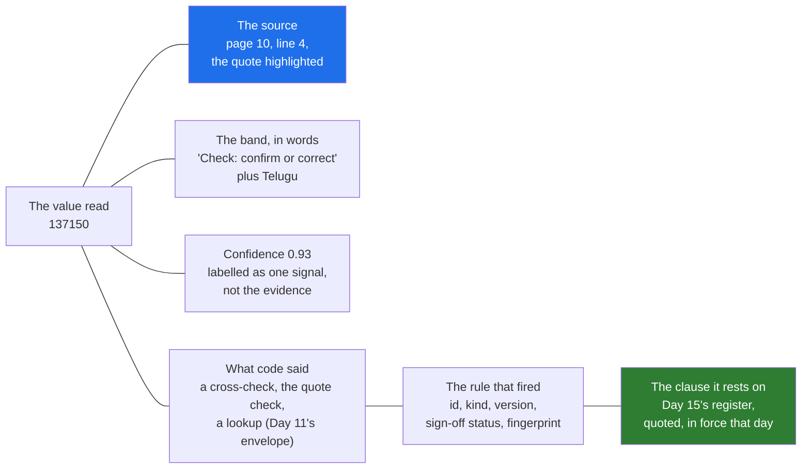

# 02 · Trust Per Field: Show the Evidence, Not the Score

> Day 18 · Section 2 of 13 · [Chapter overview](README.md) · Previous: [01 · Why verification and trust](01-why-verification-and-trust.md) · Next: [03 · Confidence routing from the golden set](03-confidence-routing-from-the-golden-set.md)

---

## 2.1 Trust is earned per field, not per system

"Do the analysts trust the system?" is the wrong question, and asking it in a steering meeting gets a wrong answer.
The senior analyst trusts the PAN reading on a printed card after a week. She will not trust the income on a
handwritten Telugu declaration for months, and she is right not to: on Day 14's golden set, handwritten Telugu fields
are 96.0 percent accurate with 46 percent flagged, and the 2019 pilot failed on exactly that kind of field.

So trust is designed **per field and per kind of source page**, and the interface makes each field's evidence
checkable on its own. A system with one "accuracy" number on a dashboard asks people to trust it all or nothing; they
choose nothing.

## 2.2 What sits beside every field



Five things, in order of how much they help the analyst decide:

1. **The source, next to the value.** In production this is a crop of the page image at the OCR bounding box of the
   quote, with a click-through to the full page. The synthetic pages in this course are text, so the project shows
   the quoted line and one line either side, numbered, with the quote marked. The rule is the same: she compares the
   value with the paper, not with the model's description of the paper.
2. **What deterministic code said about the field**, in words: "the PAN card says ABCPP1284K, the form says
   ABCPP1234K", "the quote is not on page 7", "dealer (code) is not empanelled for Guntur". These come from Day 11's
   envelope and they always send the field to a person.
3. **The band, in words and in both languages**, never as a colour alone.
4. **The confidence**, shown small and labelled. It is useful for routing (section 03) and nearly useless to a
   reader: nobody can act on "0.93".
5. **For every rule that fired: the rule, its version and the clause it rests on.**

The crop is computed from Day 11's own output, not re-derived. The model returns a quote with every field
(`FieldValue.evidence`), and Day 11's envelope already checks that the quote is on the cited page. The screen finds it:

```python
def crop(bundle: LoanBundle, page_no: int | None, quote: str, context: int = 1):
    """The text stand-in for an image crop: the quoted line and its neighbours, numbered, quote marked."""
    page = bundle.page(page_no) if page_no is not None else None
    if page is None or not quote:
        return None, []
    lines = page.text.splitlines()
    hit = next((i for i, line in enumerate(lines) if quote.strip() and quote.strip() in line), None)
    ...
```

If the quote is not on the page, the screen says so in red ("The quote is not on page 7. Open the page; do not
trust the value.") instead of showing nothing. A missing source is information.

## 2.3 Why the score alone fails

Here are the values the model got wrong on Day 14's test split that no deterministic check flagged, with the
confidence it gave (from this chapter's tuner, section 03):

| File | Field | Read | Paper | Confidence | The quote |
|---|---|---|---|---|---|
| GF-40821 | on-road price | 37150 | 137150 | 0.93 | `On-road price: Rs I,37,150` |
| GF-40988 | on-road price | 26800 | 126800 | 0.93 | `On-road price: Rs I,26,800` |
| GF-41214 | on-road price | 9500 | 95050 | 0.91 | `On-road price: Rs 95,0S0` |
| GF-41867 | date of birth | 81-12-1969 | 31-12-1969 | 0.88 | `Date of birth: 81-12-1969` |

Every one of them sits above the confidence of most correct values in its field. No threshold on the score
separates them. Every one of them is obvious in the quote: a letter among the digits, an "S" for a "5", a day of the
month that does not exist. **The evidence catches what the score cannot**, which is why the source goes next to the
value and the score goes underneath it in small type.

Two of these also point at work for Day 11's owner, not this chapter: a numeric field whose quote has a letter among
its digits should be flagged by the envelope (Day 14 proposed the two-line fix), and "81-12-1969" should fail a date
validator. The screen's job is to make such gaps visible until the code closes them.

## 2.4 The rule, its signed version, and the clause

When a rule fires, the analyst and later the auditor need three facts: which rule, which version of it, and what
Godavari's own policy says. The page shows them from three owners without copying any of them (the rule block of
GF-61000's page, with the page's banner line folded in):

```text
TW-DOC-06 · policy · send_back
Income proof: salary slip, ITR or income declaration: not in the file
Rules: two-wheeler rules v0.3: reviewed-draft (the compliance head, 2026-11-06); fingerprint matches the record
Rests on GFL/CO/2025/027 · Income proof for two-wheeler loans by applicant type · clause 4.2 · in force from 01 Apr 2025
```

- The **rule and its status** come from Day 11's sign-off record, through `check_signoff()`. Today it says
  "reviewed-draft", because the compliance head signs at M10 on 2 December. In pilot mode the screen refuses to build
  at all on unsigned rules; it does not show a page with a quiet warning.
- The **clause** comes from Day 15's register by document number and clause number, from a table the compliance head
  reviews (`rule_citations.json`). It is quoted verbatim and checked to be in force on the decision date. It is never
  found by similarity search and never written by a model: a superseded circular is the worst citation there is
  (Day 15, section 07.1), so a stale mapping raises an error and the page shows "Citation problem" in red.
- For a **table clause** such as 4.2, the project quotes only the caption and header ("Table 1: Income proof by
  applicant type ... (6 rows)"). The analyst needs the row for this applicant type; Day 15's row groups make that
  possible, and exercise 2.4 adds it.
- **Engineering checks** (Day 11's `ENV-*` findings) are labelled as such: "an engineering check, not a signed rule:
  it sends the field to a person and cites no circular." Mixing the two would let an auditor think a heuristic was
  policy.

## 2.5 Showing reasoning before the action

The automotive case's "reasoning explanations before actions" is, on this screen, the evidence chain above, not a
paragraph of model prose. Prose appears only in the branch note, where Day 11's code checks every rule is cited; an
explanation that cannot be traced to evidence borrows trust it has not earned.

## 2.6 Key takeaways

- Design trust per field and per source-page type; never ask for trust in the whole system.
- Put the source next to the value; label the confidence as one signal, not the evidence.
- The four confidently-wrong values on the golden set are invisible to a threshold and obvious in the quote.
- Show the rule, its signed status and the clause it rests on, quoted from the register, refused when stale.
- Engineering checks are labelled as checks, not as policy.
