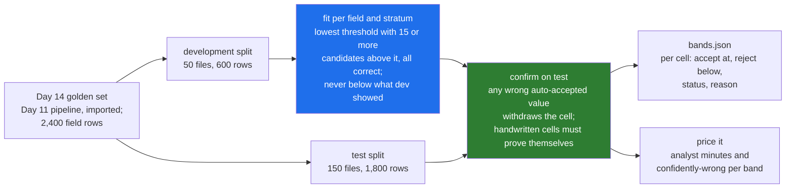

# 03 · Confidence Routing From the Golden Set: Three Bands, Per Field, Per Stratum, Priced

> Day 18 · Section 3 of 13 · [Chapter overview](README.md) · Previous: [02 · Trust per field](02-trust-per-field-show-the-evidence.md) · Next: [04 · Designing against rubber-stamping](04-designing-against-rubber-stamping.md)

---

## 3.1 From routing files to banding fields

[Day 11](../11-the-system-around-the-model/README.md) routes each **file** (blocked, send back, review, ready for
approval) and left its per-field confidence thresholds as labelled placeholders ("placeholder-2026-11-09"), for Day 14
to measure and this chapter to set. This chapter bands each **field**:

| Band | On the screen | What the analyst does | Seconds (assumed until the pilot timer) |
|---|---|---|---|
| **auto-accept** | pre-filled, with its source, under "Accepted fields" | nothing on the field; she still approves the file | 2 (a glance) |
| **review** | highlighted, with its source, under "Fields to check" | confirm or correct, with a reason | 12, plus 45 to correct |
| **reject** | not offered; the source page is pointed to | key it from the page, or mark "not in the file" | 58 (Day 9: 0.97 hours of re-keying for about sixty fields) |

Auto-accept is not auto-approval. Decision D07 (Day 10) is that a named analyst decides every file in these 90 days,
and the compliance head signed it for the auditor. Auto-accept means only "this field needs no action of its own";
the file still waits for a person, and auto-accepted fields are spot-checked after approval (section 04).

Two rules come before any threshold:

- **A deterministic finding on a field always means review.** The bands decide only among fields code had nothing to
  say about, because that is where the confidence number is the only signal left.
- **The model's "unsure" is always the reject band.** Day 6's finding A8 asked for "unsure rather than guess"; the
  screen honours it by not inventing a value to show.

## 3.2 Fit on development, confirm on test



Day 14 set the discipline (section 02.5): thresholds are fitted on the development split and confirmed on the test
split, never the other way round. The cells are a field crossed with a **stratum**, the kind of page the field was
read from: printed, or handwritten Telugu (Day 14's `handwritten_telugu` stratum). Gold and two-wheeler fields are
different fields already, so product needs no separate stratum.

The fitting rule, in `godavari_review/bands.py`:

```python
for t in grid(policy):                                   # 0.70, 0.71, ... 0.99
    above = [r for r in cand if r.confidence >= t]       # candidates: a value, no deterministic finding
    if len(above) < auto["min_support_dev"]:             # 15 fields, or there is no band
        break
    if sum(not r.correct for r in above) <= auto["max_dev_errors"]:     # 0 wrong
        # Never accept below the lowest confidence development has shown correct: no extrapolation.
        accept_at = max(t, math.floor(min(r.confidence for r in above) * 100) / 100)
        break
```

The second line of the `if` matters more than it looks. On fifty development files most cells have no wrong
candidate at all, so "the lowest threshold with zero errors" is the bottom of the grid, 0.70. A threshold of 0.70 on
a field whose correct values were never below 0.87 is an extrapolation: it auto-accepts values the system has never
been seen to get right. The floor fixes that. The fitted cells (real output, `code/tune_thresholds.py`):

```text
  field              stratum            accept at reject <  dev  why
  applicant_name     printed                 0.87     0.00   23  all 23 development candidates at or above 0.87 correct
  on_road_price      printed                 0.83     0.00   34  all 32 development candidates at or above 0.83 correct
  pan                printed                 0.88     0.00   50  all 38 development candidates at or above 0.88 correct
  monthly_income     handwritten_telugu      none     0.00    6  no threshold has 15 or more development candidates above it, all correct (5 candidates, 0 wrong)
  ... (24 cells; data/band-report.md has all of them)
```

No cell found a reject band above "unsure": no confidence range had ten or more candidates below 80 percent
accurate. That is a fact about this stub model, not a law; a real model at a different temperature will show one,
and the policy file already says how to find it.

## 3.3 What the test split found

Then the development-fitted bands meet 150 files they have never seen:

```text
-- 2. confirmed on test --
  before any withdrawal: 1589 test fields auto-accepted, 9 wrong; pooled upper bound 1.07% against a limit of 1.5%
  WITHDRAWN            date_of_birth | printed: confirmation failed: 1 wrong of 78 auto-accepted test fields
      GF-41867 read '81-12-1969', truth '31-12-1969' at 0.88 from 'Date of birth: 81-12-1969'
  WITHDRAWN            on_road_price | printed: confirmation failed: 6 wrong of 96 auto-accepted test fields
      GF-40821 read '37150', truth '137150' at 0.93 from 'On-road price: Rs I,37,150'
      GF-40988 read '26800', truth '126800' at 0.93 from 'On-road price: Rs I,26,800'
      GF-41214 read '9500', truth '95050' at 0.91 from 'On-road price: Rs 95,0S0'
  WITHDRAWN            requested_amount | handwritten_telugu: confirmation failed: 1 wrong of 59 auto-accepted test fields
      GF-42025 read '70000', truth '70060' at 0.87 from 'Loan amount requested: Rs 70,000'
  BLOCKED_UNTIL_PROVEN mobile | handwritten_telugu: 0 wrong of 68 auto-accepted test fields, upper bound 5.3%; proof needs 253 or more with none wrong
  ... (one more withdrawal and four more blocked cells; all in data/band-report.md)
  after: 971 auto-accepted, 0 wrong; upper bound 0.39% (optimistic: the withdrawals used the test split; production spot checks give the honest number)
```

Read it in four steps.

**The pooled number passes.** Nine wrong in 1,589 auto-accepted fields is an upper bound of 1.07 percent, under the
1.5 percent limit. The limit is not arbitrary: it is the senior analyst's own keying error on the golden set (98.50
percent, Day 14, section 03.9), so "no worse than a careful person re-keying it". An average-only check would ship
these bands. Six of the nine are one field.

**So the rule is per cell, and zero.** Any wrong auto-accepted value on test withdraws that cell's auto band. The
on-road price goes to review on every file, and to the standing forced-look list (section 04).

**Check the label before you blame the model.** GF-42025 is Day 14's known label error (both labellers typed 70060
from a smudged zero), and GF-41981's truth label "GOPI CHRND TADIKONDA" looks like the same kind of shared misreading.
Both cells are handwritten and blocked anyway, but both go to Srinivas and the Vijayawada team lead for
re-adjudication (Day 14's rule 2).

**Handwritten Telugu must prove itself.** The senior analyst's condition was "the reading of anything handwritten,
until it has proved itself on my hundred". The policy writes that down: a handwritten Telugu cell is auto-accepted only
when its own test fields bound its error at or below 1.5 percent. Zero wrong in 68 bounds it at 5.3 percent, which is
not proof. Proof needs 253 auto-accepted fields with none wrong, which the golden set will reach only as Day 14 adds
about twenty fresh test files a month. That is a schedule the senior analyst can hold you to.

One discipline makes this legitimate. **A failed confirmation may only remove automation, never move a threshold.**
Lowering or raising a threshold because of what the test split showed is tuning on the test split; the "after"
number is already optimistic for that reason, and the output says so. Moving a threshold needs new development data,
which the pilot's corrections provide (section 06).

## 3.4 What each band costs

The same 150 test files under three policies (seconds per field from the table in 3.1):

```text
  policy                        auto review key in  wrong, nobody told  wrong, in front of her min/file hours/month
  every field reviewed             0   1742     58                   0                      42     2.91        67.8
  Day 11 placeholder            1408    334     58                   7                      35     1.31        30.5
  bands (this chapter)           971    771     58                   0                      42     1.83        42.6
  the bands cost 12.1 analyst hours a month more than the placeholder (Rs 5,539 at Day 9's Rs 456 an hour) and leave
  no confidently wrong field on the test split; the placeholder left 7 in 150 files, about 65 a month at 1,400 files
```

For the COO: about 5,500 rupees of analyst time a month buys out roughly 65 unflagged wrong values a month at the
intake volume. For the team leads: the minutes cover the twelve mandatory fields only, and the pilot's screen timer
replaces the assumed seconds in week 1. For you: "wrong, in front of her" is not zero risk; those 42 values are caught
only if she really looks, which is what section 04 is about.

By stratum, the review band behaves very differently:

```text
  printed            auto  971 (0 wrong) · review  275 (22 wrong, 8.0%) · key in  58
  handwritten_telugu auto    0 (0 wrong) · review  496 (20 wrong, 4.0%) · key in   0
```

On printed pages a highlight is wrong one time in twelve: highlights mean something. On handwritten Telugu pages
every field is highlighted and 96 percent are right. That is the classic recipe for alert fatigue, and it is the
price of the senior analyst's condition. The answer is not to lower the bar; it is the forced look, the dwell
measurement and the proof schedule.

## 3.5 What the bands are, and are not

They are a versioned policy (`band_policy.json`, still a draft for the eval owners and the compliance head) with every
threshold traceable to development rows and every withdrawal to test rows. They are not calibrated probabilities: 0.93
means "above this cell's threshold", not "93 percent likely". And they expire with the model: a new model or prompt
release needs a refit on development before it goes anywhere (Day 14, section 08.4).

## 3.6 Key takeaways

- Band fields, not files; auto-accept is never auto-approval while D07 stands.
- Deterministic findings always mean review; "unsure" always means key in.
- Fit on development with a minimum support and no extrapolation; confirm on test per cell, with zero tolerance.
- A pooled bound can pass while one field fails; the per-cell rule caught six on-road prices the average hid.
- A failed confirmation removes automation and never moves a threshold.
- Price every policy in analyst hours and in wrong values, split into "nobody told" and "in front of her".
