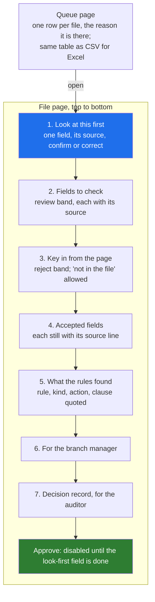

# 05 · The Review Queue Screen: What Is First, Keyboard Flow, Bulk Actions, Two Languages

> Day 18 · Section 5 of 13 · [Chapter overview](README.md) · Previous: [04 · Designing against rubber-stamping](04-designing-against-rubber-stamping.md) · Next: [06 · Corrections and explanations](06-corrections-and-explanations.md)

---

## 5.1 Two screens: the queue and the file



The senior analyst said the review screen must sit "where the tracker is" and know what the file is waiting for, or
"it is a toy". That sets the queue's job: every row says why the file is there, in words.

## 5.2 The queue's order, and the reason on every row

Monday 7 December's queue (real output, `code/run_pilot_week.py`; five of its twelve rows):

```text
   1. GF-61000 Guntur        Rs 84,500  tell the branch today; 1 for the branch (TW-DOC-06); 5 to check, 1 to key in; look first: on_road_price
   3. GF-61013 Kukatpally    Rs 75,500  tell the branch today; 1 for the branch (TW-DOC-05); 9 to check, 0 to key in; look first: on_road_price
   4. GF-61005 Guntur      Rs 1,24,000  fields to check; 9 to check, 0 to key in; look first: on_road_price
   5. GF-61011 Kukatpally  Rs 1,22,500  fields to check; 8 to check, 0 to key in; look first: on_road_price
  12. GF-61007 Guntur        Rs 50,500  ready for approval; 2 to check, 0 to key in; look first: on_road_price
```

The order is three tiers, each explainable in one sentence:

1. **Files the branch must hear about today** (Day 11's blocked and send-back routes), oldest first. Day 9's target
   is a same-day send-back notice; 6.4 of today's 9.1 days are queue time, and a missing document found on day six
   is the delay the pilot exists to remove.
2. **Files with fields to check**, largest loan first, then oldest. A wrong amount on a large loan costs more.
3. **Files ready for approval**, oldest first.

Not sorted by confidence: a queue ordered by "least sure first" starves old, confident files and teaches nobody
anything. Every sort key is visible in the row, so a team lead can disagree with it in a sentence.

**Exposed tables.** The same rows are written as `queue-2026-12-07.csv`. Godavari's analysts already live in an Excel
tracker (Day 6); letting them sort and filter the queue their own way is the automotive case's "detailed tables for
manual checking" in the form this customer already trusts.

## 5.3 Bulk actions only where safe

| Bulk allowed | Why it is safe | Never bulk | Why |
|---|---|---|---|
| claim selected files | reversible, decides nothing | approve | D07: a named analyst decides each file |
| export selected to CSV | reads only | confirm fields | it is rubber-stamping with a button |
| | | override a policy rule | each override needs its own reason (Day 11's `OverrideLog`) |
| | | send back | a false send-back costs the customer days (Day 14, section 04.5) |

The queue page states both lists in its banner, and a test checks that no button on it says "approve" or "confirm".

## 5.4 Keyboard flow and accessibility

Analysts process files all day; the mouse is the slow path. The page is built so that the keyboard order is the
working order, and so that it meets the WCAG 2.2 criteria that matter here (W3C Recommendation, 12 December 2024):

| What | How the page does it | WCAG 2.2 |
|---|---|---|
| Tab order is the work order | the DOM order is look-first, check, key in, accepted, rules, approve | 2.4.3 Focus Order (A) |
| a skip link to the look-first field | first focusable element on the page | 2.4.1 Bypass Blocks (A) |
| everything usable without a mouse | native radios, inputs, selects and buttons, no custom widgets | 2.1.1 Keyboard (A) |
| focus is always visible | a 3-pixel outline on `:focus` | 2.4.7 Focus Visible (AA) |
| the band is never colour alone | the band is written in words in both languages, the coloured edge is extra | 1.4.1 Use of Color (A) |
| text contrast | dark grey on white and black on pale yellow, well above 4.5 to 1 | 1.4.3 Contrast (AA) |
| Telugu is marked as Telugu | `lang="te"` on every Telugu span, `lang="en"` on the page | 3.1.1 and 3.1.2 Language of Page and of Parts |

The working application built on this model (Day 20 puts the screen into the skeleton) adds the key bindings (Enter to confirm, C to correct, N for "not in the file") and
enables the approve button after the forced look; the static page shows that button disabled, which is the state it
starts in.

## 5.5 English and Telugu labels

Every field label is shown in both languages:

```text
On-road price          Applicant name
ఆన్-రోడ్ ధర            దరఖాస్తుదారు పేరు
```

The three labels the application form itself prints in Telugu (applicant name, address, monthly income) are copied
from the form, so the screen and the paper use the same words. The others are the FDE's draft translations, marked
"draft" in `labels.py` and on every page's banner, for Lakshmi and the Vijayawada team lead to correct before the
pilot. Two practical points:

- **Fonts.** The page loads no web font (it loads nothing), so the font stack names fonts Windows and Android already
  have for Telugu ("Nirmala UI", "Gautami", "Noto Sans Telugu"). Check it on the analysts' actual machines.
- **Do not translate values.** Names, addresses and amounts are shown exactly as read, in the script they were written
  in. Transliterating a name on screen creates a second spelling of it.

Godavari's own fair-practices circular gives customers English and Telugu (GFL/CO/2024/057, clause 2.1); the
analysts' screen deserves the same.

## 5.6 Self-contained and escaped

Every value on these pages came from a customer's document or a model, so every value is untrusted text. The pages
are rendered with Jinja2 3.1.6 and `autoescape=True` set explicitly: Jinja2's documentation says autoescaping "is not
yet enabled by default", and `select_autoescape(["html"])` does **not** cover a template named `page.html.j2` (a test
in the project shows it). The pages load no script, stylesheet, font or image from anywhere, and carry a
Content-Security-Policy of `default-src 'none'` with inline styles only. A customer whose name field contains
`<script>` sees it printed, not run. Day 41 owns injection in general; this is the screen's share of it.

## 5.7 Key takeaways

- The queue explains every row; three tiers, each one sentence; never sorted by confidence alone; also a CSV.
- Bulk only what decides nothing; never approve, confirm, override or send back in bulk.
- Keyboard order is the work order; bands in words, not colour; Telugu marked with `lang="te"`.
- Telugu labels from the form where the form has them; drafts marked as drafts until Godavari's people check them.
- Escape everything, load nothing, set autoescape explicitly.
