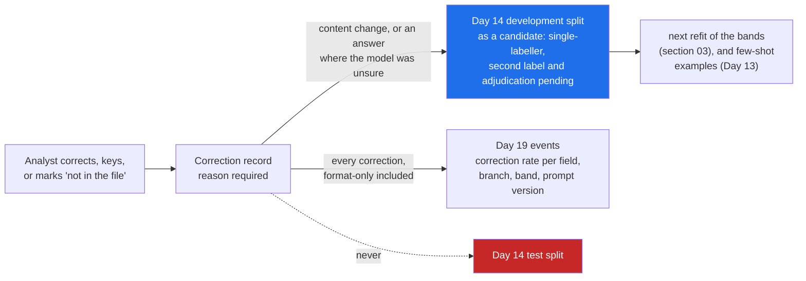

# 06 · The Correction as Data, and the Same Decision Explained Twice

> Day 18 · Section 6 of 13 · [Chapter overview](README.md) · Previous: [05 · The review queue screen](05-the-review-queue-screen.md) · Next: [07 · 2026 patterns and production concerns](07-2026-patterns-and-production-concerns.md)

---

## 6.1 Every correction is a labelled example

When analyst V2 in Vijayawada changes a monthly income of 2375 to 28500 on GF-61003 (the 2019 pilot's mistake
in reverse: 28,500 divided by twelve), she has just done what Day 14 paid four afternoons of expert
time for: she has labelled a field on a real file, and on exactly the kind of file the system gets wrong. Throwing
that away is the most common waste in deployed AI systems. Capturing it badly (the new value, nothing else) is the
second most common.

The record (`corrections.py`):

| Field | Why it is kept |
|---|---|
| file, field, stratum, band | where it happened, and whether the bands put it in the right place |
| model value and analyst value | the example itself |
| **reason**, from a fixed list | what kind of error it was; refused if missing |
| analyst, time | who labelled it, for adjudication and for the auditor |
| confidence, model name, rules fingerprint, bands version | which system made the mistake, so a fix can be measured against it |

The reasons are a short fixed list ("misread character", "wrong page or document", "not in the file", "spelling or
transliteration", "format only", "model unsure: keyed from the page", "other"), and "other" requires the analyst's own
words. A free-text-only box produces a column nobody can count; a list with no escape produces wrong reasons.

## 6.2 Where corrections go



Three rules make this safe:

- **Corrections are candidates, not truth.** One analyst's value is one label. Day 14's adjudication rule needs two
  independent labels and a written rule for disagreements; the export says "single-labeller; second label and
  adjudication pending" on every row.
- **Corrections go to development, never to test.** They were chosen by the system's failures, so they over-represent
  what it gets wrong (Day 14, section 08.5). Putting them in the test split would make every future model look worse
  on exactly the cases it was tuned on, or better, depending on who tuned what.
- **Format-only is not a model error.** Day 14's normaliser already forgives "RAVI TEJA" against "Ravi Teja". The
  correction still goes to Day 19, because a field people keep re-formatting is a display problem.

The pilot week's real output:

```text
  720 fields shown; actions {'confirmed': 272, 'accepted': 412, 'not_in_file': 21, 'corrected': 11, 'keyed': 4}
  corrections captured: 36 ({'not in the file': 21, 'misread character': 8, 'model unsure: keyed from the page': 4,
                             'spelling or transliteration': 2, 'format only': 1})
  to Day 14's development split as candidates: 35 (10 content corrections + 25 answers where the model was unsure);
  format-only ones go to Day 19 only
```

The plan said the first pilot week would add about forty examples; this run adds 35. Notice what most of them are:
not corrections of wrong values but answers where the model said "unsure", mostly a monthly income on a file whose
income proof was missing. "Not in the file" is a label too, and it is the one that teaches a model to say "unsure"
instead of borrowing the form's figure (Day 14's guide, section 4.2).

## 6.3 Explaining the decision to the branch manager

The Kukatpally and Guntur branch managers are the upstream producers (Day 5): they want to know, the same day, what
to fix and why. Their view of a send-back is the note Day 11's model drafts from what code decided, with code
checking every rule is cited, plus the clause each rule rests on:

```text
GF-61000: 1 point(s) before this file can move.
1. Income proof: salary slip, ITR or income declaration: not in the file (rule TW-DOC-06).
  TW-DOC-06: GFL/CO/2025/027 · Income proof for two-wheeler loans by applicant type · clause 4.2 · in force from 01 Apr 2025
```

What makes it trustworthy to a branch manager is that it is short, it names Godavari's own circular, and it is never
wrong about what is missing. Day 14 measured that last part as completeness precision; the four false flags it found
all sent a file to an analyst, not to the branch. A file with nothing for the branch says so in one line ("Nothing for
the branch on this file") instead of showing the analyst's internal checklist.

## 6.4 Explaining the decision to the RBI auditor

The compliance head stated the auditor's question in week one: "show me the decision, who made it, and what it rested
on" (Day 6). The decision record answers exactly that, from the same log, with no model prose in it. GF-61005's
record (real output, rendered on its page):

```text
Decided by         V3 at 2026-12-07T12:49:22
Pages decided on   bundle fingerprint a42bbff7b07e9279, 21 pages
Rules              two-wheeler rules v0.3: reviewed-draft (the compliance head, 2026-11-06); fingerprint matches the record
Fields             3 accepted, 8 confirmed, 1 corrected, 0 keyed
Look-first field   on_road_price, 10.3 s on it
Corrections        address: 87-18, Brodipet, Guntur 522002 -> 37-18, Brodipet, Guntur 522002 (V3)
```

Each line answers one of the auditor's questions: who, on which exact pages (a re-scan cannot pass as the
original), under which rules, what the machine did and what the person did, and whether she looked.

Two honest notes. The record above says "reviewed-draft" because this repository is frozen before M10; on the
engagement, pilot mode would have refused to build the page until the compliance head signed (section 02.4). And the
record is kept with the file for seven years (Godavari's retention circular, GFL/CO/2025/063, clause 2.1 in Day 15's
register); where it is stored and how an approval moves the file is Day 17's state machine, not this page.

## 6.5 Key takeaways

- Capture every correction with a reason from a fixed list, and the system versions that produced the error.
- Corrections and "unsure" answers go to Day 14's development split as candidates; never to test; never as truth.
- Format-only corrections are display feedback for Day 19, not model errors.
- The branch manager gets what to fix, the rule and Godavari's clause, the same day.
- The auditor gets who, when, which pages, which rules, what the machine did, what the person did, from the log.
