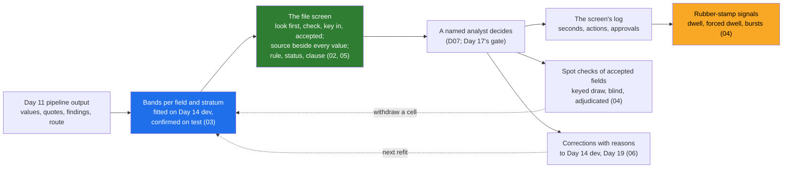

# Day 18 · Verification and Trust in the Interface: Showing Reasoning, Confidence Routing, the Review Queue

> **[Part 3 · Building the System Around the Model](../README.md)** · Chapter 8 of 10 · Video ~12 min · Chapter tier: medium
> Builds on: [Day 6 (REVIEW_WILL_NOT_CATCH_ALL; the sceptic's month-end sentence; the branch rule; the view log)](../../02-discovery-and-decomposition/06-discovery-interviews/README.md) ·
> [Day 5 (Lakshmi and the sceptic on the map)](../../02-discovery-and-decomposition/05-the-stakeholder-map/README.md) ·
> [Day 10 (decision D07; risks R1 and R4)](../../02-discovery-and-decomposition/10-the-discovery-document/README.md) ·
> [Day 11 (routing, the envelope, sign-off and pilot mode, imported)](../11-the-system-around-the-model/README.md) ·
> [Day 14 (the golden set, the confidently-wrong list, the splits, imported)](../14-evals-first/README.md) ·
> [Day 15 (the register and clause-level citations, imported)](../15-retrieval-for-enterprise-documents/README.md)
> Sets up: Day 17 (the screen in front of the approval gate), Day 19 (corrections and review signals as dashboards),
> Day 20 (the screen in the shipped skeleton), Day 31 (the Morgan Stanley lesson as workshops), Day 33 (adoption)
> **Owner:** this chapter owns **what the operator sees: the evidence beside every field; confidence bands per field
> and stratum, fitted on the golden set and priced; designing against automation bias (the forced look, spot checks,
> time-on-field and override signals); the correction as data; one decision explained to a branch manager and an RBI
> auditor; the queue's order, keyboard flow, safe bulk actions, bilingual labels and accessibility.** Routing and rules
> are Day 11's; evals are Day 14's; citations are Day 15's; the approval state is Day 17's; dashboards are Day 19's.
> Versions used: **Python 3.14.3** (needs 3.12 or newer), **Jinja2 3.1.6**, **MarkupSafe 3.0.4**, **pytest 9.1.1**,
> pinned in `code/requirements.txt` and installed in a virtual environment (pytest is not on the global Python).
> Day 11, Day 14 and Day 15 are imported by path. Sources read on 21 October 2026. Shown outputs are from real runs.
> All data is synthetic, and the analysts' behaviour is simulated.

---

## Why this chapter exists

Adoption is won or lost in the interface. In the published Morgan Stanley case the pipeline took 6 to 8 weeks and
trust took about four more months, with advisors verifying outputs and verification tools built for low-confidence
cases; in OpenAI's automotive deployment the system showed its reasoning before actions, offered verification widgets
and exposed tables for manual checking (both as the ZenML summaries report them). At Godavari the same lesson arrived
in discovery: Bhavani's "I would not know" and the senior analyst's "on a month-end day I will check nothing".

This chapter builds the screen and the routing behind it. It fits per-field bands on Day 14's golden set and watches
the test split catch six misread on-road prices that the pooled number hid; it puts the source line, the signed rule
and Godavari's own circular beside every value; it forces one look per file at the riskiest field; it spot-checks the
accepted fields blind; it detects rubber-stamping from the screen's own log without treating speed as guilt; and it
turns every correction into a labelled example.

## Mental model

One sentence to carry out of the chapter: **show the evidence beside every value, decide each field's band from the
customer's golden set and price it, make one look per file unavoidable, check what nobody looked at, measure whether
people are still looking without punishing speed, and keep every correction.**

## Learning goals

After this chapter you can:

1. Design a field row that earns trust per field: the source, the band in words, deterministic reasons, the rule's
   signed status and the clause it rests on.
2. Fit auto-accept, review and reject bands per field and stratum on development, confirm them per cell on test, and
   price them in analyst minutes and residual wrong values.
3. Design against automation bias with a forced look and blind, reproducible spot checks, and size those checks.
4. Detect rubber-stamping from a screen log with two signals, and agree its governance with the people measured.
5. Capture corrections as labelled data, and explain one decision to a branch manager and to an RBI auditor.
6. Build a static, escaped, bilingual, keyboard-first review page with an AI agent, and catch its mistakes.

**Prerequisites:** Day 11's and Day 14's code (imported here), Day 15's register. Python at a working level.

## Reading order

| # | Section | What you get | Words |
|---|---|---|---|
| 01 | [Why verification and trust](01-why-verification-and-trust.md) | two screens; Morgan Stanley; what discovery said | ~950 |
| 02 | [Trust per field: show the evidence](02-trust-per-field-show-the-evidence.md) | the field row; why the score fails; rule, status, clause | ~1,100 |
| 03 | [Confidence routing from the golden set](03-confidence-routing-from-the-golden-set.md) | three bands; fit, confirm, price | ~1,200 |
| 04 | [Designing against rubber-stamping](04-designing-against-rubber-stamping.md) | automation bias; forced look; spot checks; signals | ~1,450 |
| 05 | [The review queue screen](05-the-review-queue-screen.md) | order; bulk actions; keyboard; Telugu; escaping | ~1,000 |
| 06 | [Corrections and explanations](06-corrections-and-explanations.md) | corrections as data; branch manager and auditor | ~900 |
| 07 | [2026 patterns and production concerns](07-2026-patterns-and-production-concerns.md) | patterns, hype, crops as PII, kill switch | ~950 |
| 08 | [Project: the review-queue model](08-project-the-review-queue-model.md) | setup, both steps with real output, 31 tests | ~950 (plus output) |
| 09 | [Build it with AI, and how you know it's right](09-build-with-ai-and-verification.md) | context, prompt, fifteen agent mistakes, checklist | ~1,350 |
| 10 | [Mistakes and debugging](10-mistakes-and-debugging.md) | symptom, cause, fix | ~850 |
| 11 | [Interview questions](11-interview-questions.md) | 12 questions with model answers | ~1,100 |
| 12 | [Exercises](12-exercises.md) | 9 graded exercises, including review an AI-written screen | ~1,350 |
| 13 | [Further reading](13-further-reading.md) | FDE sources, automation bias, WCAG 2.2, Jinja2 | ~500 |

Word counts are prose only. **Short on time?** Read 02, 03 and 04, run the project (08), and do exercises 1.2 and
3.1. That is the video plus the reflex the interview tests: evidence beside the value, bands from data, one forced look.

## Files

| Path | What |
|---|---|
| [`code/godavari_review/`](code/godavari_review/) | `paths.py` (imports by path), `evidence.py`, `bands.py`, `citations.py`, `labels.py`, `queue.py`, `render.py` and `templates/`, `pilot.py`, `stamping.py`, `sampler.py`, `corrections.py` |
| [`code/band_policy.json`](code/band_policy.json) · [`code/rule_citations.json`](code/rule_citations.json) | the band policy (draft for the eval owners); one clause per signed rule (draft for the compliance head) |
| [`code/tune_thresholds.py`](code/tune_thresholds.py) | step 1: fit, confirm, price; writes `data/bands.json` and `data/band-report.md` |
| [`code/run_pilot_week.py`](code/run_pilot_week.py) | step 2: the pilot week; writes `data/pilot-week-1/` |
| [`code/tests/`](code/tests/) | 31 tests in three files |
| [`code/exercises/ai_draft_review_page.py`](code/exercises/ai_draft_review_page.py) | an AI-written screen with at least fourteen problems; exercise 3.1 |
| [`code/requirements.txt`](code/requirements.txt) · [`code/pytest.ini`](code/pytest.ini) | the pins |
| [`worksheet/godavari-review-queue-design.md`](worksheet/godavari-review-queue-design.md) | the design note for the team leads, the eval owners and the compliance head, with the five decisions before Monday |
| [`data/band-report.md`](data/band-report.md) · `data/bands.json` | the bands and their cost |
| [`data/pilot-week-1/`](data/pilot-week-1/) | `queue-2026-12-07.html` and `.csv`, `files/` (twelve pages), `action-log.jsonl`, `corrections.jsonl`, `dev-candidates.jsonl`, `pilot-week-report.md` |

Run from the chapter folder: `python -m venv .venv`, activate it, `pip install -r code/requirements.txt`, then
`python -X utf8 code/tune_thresholds.py`, `python -X utf8 code/run_pilot_week.py` and `python -X utf8 -m pytest code`
(31 tests, about one second). Each script takes under a second. No network, no API key. Day 11, Day 14 and Day 15
must be at their FOLDERS.md paths.

## What this chapter does *not* teach (single-owner rule)

| Topic | Where it's taught |
|---|---|
| Which logic is code and which the model; routing by route; signed rules and pilot mode | [Day 11](../11-the-system-around-the-model/README.md) |
| Golden sets, labelling, the confidently-wrong rate, judges and their calibration, intervals | [Day 14](../14-evals-first/README.md) (sections 04 and 06 especially) |
| The register, versions in force, clause-level citations, permission-aware retrieval | [Day 15](../15-retrieval-for-enterprise-documents/README.md) |
| The approval state machine, the gate, idempotent writes | [Day 17](../17-agents-and-workflows/README.md) |
| Dashboards, traces, feedback events in production | [Day 19](../19-observability-for-ai-systems/README.md) |
| DPDP and retention law for the timing log and the crops | [Day 24](../../04-deploying-into-their-world/24-data-residency-and-indian-law/README.md) |
| Demos and workshops that build trust; adoption | [Day 31](../../05-working-with-the-customer/31-demos-and-workshops/README.md), [Day 33](../../05-working-with-the-customer/33-adoption/README.md) |
| Injection in general | [Day 41](../../07-ai-era-toolkit/41-red-teaming-your-deployment/README.md) (the screen's share is escaping, 05.6) |

## Analogies for the Telugu audience

- **The family doctor who shows you the report** (the chapter's main picture): he points at the one number that
  matters and explains it; the other one hands over a prescription. You trust the first, and more after the day he
  says "this one I want to check again" (01.5).

## Video map

The video (~12 min) covers a slice; the notes cover everything.

| Asset | Covers | Sections |
|---|---|---|
| **Day 18 main video** (~12 min) | Hook: two screens, "Rs I,37,150" (1.5 min) → 8 weeks to build, 4 months to trust; Bhavani and the sceptic (1.5 min) → the source beside the value; why 0.93 means nothing (1.5 min) → bands: fit on 50 files, confirm on 150; the pooled 1.07 percent that hid six prices (2 min) → 30, 43 and 68 hours a month (1 min) → the forced look; 299 fields for a 1 percent error (1.5 min) → V2 flagged, H3 fast and fine (1 min) → corrections; the auditor's record (1 min) → recap and teasers (1 min) | 01.1, 01.2, 01.3, 02.2, 02.3, 03.2 to 03.4, 04.2 to 04.4, 06.2, 06.4 |
| **Short 1:** "Show the crop next to the field, and the analyst checks it in two seconds." | the two screens; the four confidently-wrong values and their quotes; confidence labelled as one signal | 01.1, 02.3 |
| **Short 2:** "Eight weeks to build, four months to be trusted. Plan for the four months." | Morgan Stanley's timeline as published; the proof schedule for handwritten Telugu (253 fields); spot checks that never stop | 01.2, 03.3, 04.3 |
| Notes only | everything else: citations (02.4), bulk actions and accessibility (05), escaping (05.6), governance (04.5), production (07), project (08), Build it with AI (09), debugging, interviews, exercises | as listed |

**Callbacks to use on screen:** "Day 6 lo Bhavani cheppindi gurtunda: 'I would not know.' Ivala aa answer ni screen
design ga marchutunnam." (section 01); "Day 14 lo confidently-wrong list lo six on-road prices chusam; ivala avi test
split lo band ni withdraw chestayi." (section 03); "Day 15 lo clause citations build chesam; ivala prati rule pakkana
aa clause kanipistundi." (section 02).
**Forward callbacks:** Day 19 (ee corrections, dwell signals dashboards meedaki vellatayi), Day 20 (ee screen skeleton
lo ship avutundi), Day 31 (four months of trust ni workshops tho ela build cheyalo).

## Callbacks

Builds on and sets up as in the header above; section 13 links every chapter named here.

**Next chapter:** [Day 19 · Observability for AI systems: traces, token cost, quality dashboards, feedback capture](../19-observability-for-ai-systems/README.md).
