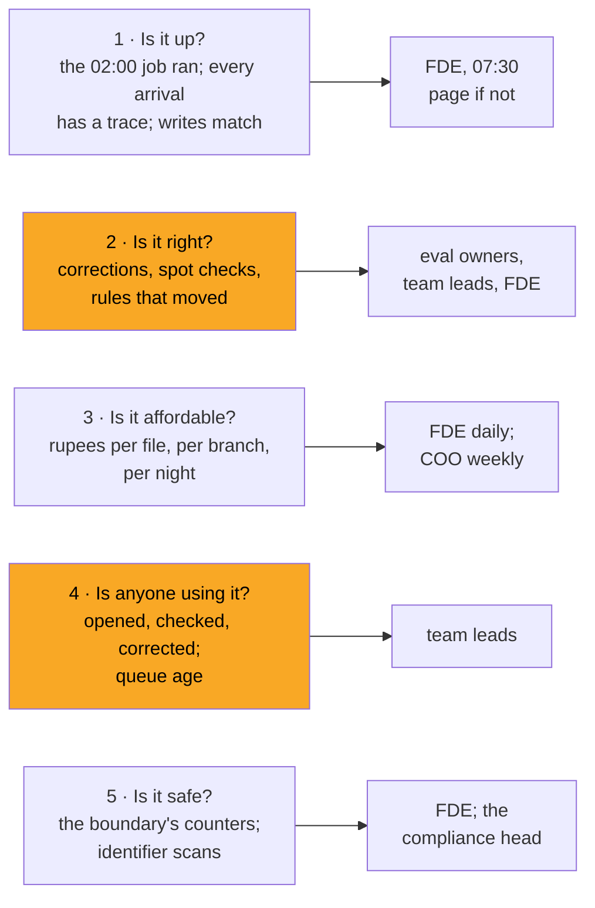

# 02 · The Five Questions a Customer-Facing AI System Answers Every Morning

> Day 19 · Section 2 of 15 · [Chapter overview](README.md) · Previous: [01 · Why observability for AI systems](01-why-observability-for-ai-systems.md) · Next: [03 · Traces for one loan file](03-traces-for-one-loan-file.md)

---

## 2.1 Up, right, affordable, used, safe

Before any tool, write down the questions. A system in front of a customer's staff must answer five every morning,
and each has a different source, a different reader and a different kind of evidence.

| Question | Evidence that answers it | Kind of evidence | Godavari, pilot week two |
|---|---|---|---|
| Is it up? | the 02:00 job finished; arrivals equal traces; core records equal write spans | exact | 120 arrivals, 120 traces; 71 records, 71 write spans; the latest-finishing night of the fortnight ended 02:02:32 |
| Is it right? | corrections per field, review-band overrides, spot checks, rule and envelope fire rates | proxies, with intervals | every field in line with the golden set; 0 wrong in 44 spot-checked fields |
| Is it affordable? | rupees per file from the ledger, against Rs 12 | exact, per call | median Rs 5.47; one file at Rs 14.00 on Tuesday |
| Is anyone using it? | files opened in the tool, queue age, dwell and forced-look signals | behavioural | every file opened the day it landed (the analysts are simulated) |
| Is it safe? | values dropped and spans quarantined at the boundary; scans of every record | exact, defensive | 0 dropped, 0 quarantined; no identifier in the store |

Three of the five have exact answers. The other two are why this is a chapter and not a Grafana tutorial.

## 2.2 Why "is it right?" is hard

In development you have the golden set: 150 files labelled by Lakshmi and the senior analyst, adjudicated, with the
truth on disk (Day 14). In production there is no truth. A value the model extracted, that an analyst accepted, that
went into the core system, may be wrong, and nothing in the system knows.

What you have instead is a set of proxies, each of which measures something adjacent to "right":

- **Corrections** measure what analysts *caught*, which is errors times attention. A falling correction rate can
  mean the model improved or the analysts stopped looking. Day 18 built the signals that tell the two apart.
- **Spot checks** measure confident-wrong values directly, but on a small sample: 44 fields in a week, which bounds
  the error rate only below 8 percent. Day 18 computed that seeing one error at a true 1 percent rate needs 299
  fields, about six weeks.
- **Rule and envelope fire rates** measure change, not error. A rule that suddenly fires is a change in the files, the
  model or the rule, and the trace says which.
- **The model's own uncertainty** ("unsure" fields, unclassified pages) measures what the model admits, which is the
  part of the error you were going to catch anyway.

None of them is "accuracy". Section 05 shows how to read them together and connect them back to the golden set, which
remains the only place accuracy is measured.

## 2.3 Why "is anyone using it?" is hard

Usage is easy to count and easy to misread. Every pilot file was opened in the tool; that says the queue works, not
that the screen is trusted. The questions that matter:

- Are analysts **checking** the fields they are shown, or accepting them? Dwell time on the look-first field and the
  share of review-band fields confirmed versus corrected (Day 18, section 04).
- Are they **working around** the tool? A file opened in the tool and also in the Excel tracker (Day 16's
  reconciliation reads the trackers) is a file someone does not trust the tool with.
- Would they **notice** if it were wrong? Only spot checks answer that.

The sceptical senior analyst's month-end sentence from Day 6, "on a month-end day I will check nothing", is a usage
signal. You will not see it in "files opened". You will see it in dwell time and in a burst of approvals inside twenty
minutes, which is why Day 18 built those detectors and this chapter routes them to the team leads. Every cell in
the table in 2.1 is a claim with a number and a source; that is the standard for the rest of the chapter.
