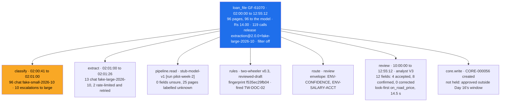

# 03 · Traces for One Loan File: From the SFTP Drop to the Core Write

> Day 19 · Section 3 of 15 · [Chapter overview](README.md) · Previous: [02 · The five questions](02-the-five-questions.md) · Next: [04 · Cost per file](04-cost-per-file-branch-and-product.md)

---

## 3.1 What a trace is, for a loan file

A trace is the record of one unit of work, built from spans: each span has a start, an end, a parent, a status and
attributes. The DevOps module teaches the mechanics ([day 5, tracing with OpenTelemetry](../../../DevOps/learn-observability/day05-tracing-opentelemetry/notes.md));
here the question is what the unit is and what the spans must carry.

At Godavari the unit is **one loan file**, not one HTTP request. A file arrives at 02:00, is classified page by page,
has fields extracted, passes through the envelope and the signed rules, is routed, waits for an analyst, is reviewed,
and is written to the core system that afternoon. That is one trace, spanning eleven hours. Here is GF-61070, the
most expensive file of pilot week two, as the store holds it:

Read top to bottom, it answers "what happened to this file" for any reader: what the model was shown, what each call
cost, which rules ran and in which signed state, why it went to review, who looked at it and for how long, and what
the core system holds now. The highlighted span is where the money went (section 04).

## 3.2 What goes on the span

Four kinds of version belong on every trace, because each is something that changes without a code deploy:

| Version | Where it comes from | Attribute | Why it is there |
|---|---|---|---|
| prompt release | Day 13's registry, the release pinned for `pilot` | `kaagaz.prompt.release` on the root; `gen_ai.prompt.name` and `gen_ai.prompt.version` on each call | a quiet regression is usually a prompt change (Day 13); every cost and quality number must group by it |
| model | the snapshot the adapter pinned | `gen_ai.request.model` on each call; `kaagaz.model.name` for what the pipeline read | a vendor snapshot change is a release; Day 13's check refuses a mismatch and the run report repeats it |
| rules | Day 11's rule set | `kaagaz.rules.version`, `.status`, `.fingerprint` | the compliance head signs a fingerprint; the trace proves which code decided |
| bands | Day 18's band policy | `kaagaz.review.bands_version` | a withdrawn cell changes what analysts see without any deploy |

And cost on every model-call span, in rupees, from the ledger (section 04). The rules span in the trace above says
`reviewed-draft`: the synthetic repository's sign-off record is still as Day 11 left it, and pilot mode would refuse to
run. The point is that the trace says so on every file, so nobody has to remember to check.

## 3.3 The OpenTelemetry generative-AI conventions, as of October 2026

Model-call spans use the attribute names of the OpenTelemetry semantic conventions for generative AI, so that the same
records can be exported to whatever backend Godavari runs. Three facts, checked on 21 October 2026:

- **They are still at Development status.** Every gen-AI attribute and span in the conventions carries the
  Development badge; only `error.type`, from the core conventions, is stable. Names have changed before and will again.
- **They moved.** The page on opentelemetry.io now says the gen-AI conventions live in a separate repository,
  `open-telemetry/semantic-conventions-genai` (created 5 May 2026; last commit the morning these notes were checked).
- **The inference span** is `gen_ai.client.inference`, named `{gen_ai.operation.name} {gen_ai.request.model}`, so
  `chat fake-small-2026-10` here. Its attributes include `gen_ai.operation.name`, `gen_ai.provider.name`,
  `gen_ai.request.model`, `gen_ai.usage.input_tokens`, `gen_ai.usage.output_tokens`,
  `gen_ai.usage.cache_read.input_tokens`, `gen_ai.usage.cache_write.input_tokens`, `gen_ai.prompt.name` and
  `gen_ai.prompt.version`. Retrieval has its own span, `retrieval {gen_ai.data_source.id}`.

Two details in the conventions matter more than the names:

1. **`gen_ai.usage.input_tokens` should include cached tokens.** Day 12's `Usage.input_tokens` is *uncached* input,
   with cache reads and writes counted separately, because they are priced differently. Copying the field across
   gives a span that under-reports input on every cached call. `model_call_spans` adds the three together, and a test
   holds it.
2. **Content capture is opt-in.** Prompts, model answers, system instructions, tool arguments and retrieval query
   text all have attributes, all marked Opt-In and "likely to contain sensitive information including user/PII data".
   The conventions' default is not to record them, and to store content externally, with its own access control,
   when it must be kept. At Godavari the answer is the default, permanently (section 07).

Everything Godavari-specific sits under `kaagaz.`, so a renamed upstream attribute is a one-line change in
`spans.py`, and the custom attributes never collide with a future official one.

## 3.4 Wrap the stages, never edit them

Every span in the trace comes from a wrapper around code that already exists. Nothing in Days 11 to 18 was changed.

| Stage | Owner | How it is traced |
|---|---|---|
| model calls | Day 12's client | its ledger already records every attempt; `model_call_spans` turns each ledger row into a span, as Day 12 promised |
| the model box | Day 11's `ExtractionModel` | `TracedModel`: same `read()`, plus a span saying what the pipeline read |
| the rules | Day 11's `RuleSet` | `TracedRuleSet`: same `run()`, plus rule ids, counts, version, status and fingerprint |
| the route | Day 11's `process()` | a span from the `FileResult` it returns |
| the review | Day 18's screen log | a span from open to approve, with one feedback event per correction |
| the core write | Day 11's `push_to_core` behind Day 16's window | `traced_push`: the window check, the push, what happened |
| retrieval | Day 15's service | `TracedRetrieval`: results, refusals and snapshot age, never the query |

A test runs twelve files through Day 11's `process()` twice, once with plain objects and once wrapped, and asserts
the routes, findings and notes are identical. Instrumentation that changes a decision is a bug, however useful it is.

One honest seam remains. Until Day 20 wires Day 12's client into Day 11's pipeline, the pipeline's answer comes from
Day 11's stub (as in Day 18's pilot week) and the bill comes from Day 12's production client reading the same pages
through its fake provider in the 02:00 job. The converter is `as_day12_file`; Day 20 removes it, and the trace shape
does not change.

## 3.5 Names, cardinality and sampling

**Span names are code-defined and few.** `loan_file`, `classify`, `extract`, `rules`, `route`, `review`, `core.write`,
`chat <model>`, `retrieval godavari-policy-register`. Never `extract GF-61070`: a name with a file number in it
explodes the backend's index, and the day a PAN lands in it, it is in every index and every backup. The store refuses
any span whose name is not on the list.

**High-cardinality values are attributes, not metric labels.** The file number is an attribute on the root span, where
you search for it. It is never a label on a metric: one time series per file is 1,400 new series a month that nobody
will ever chart.

**Do not sample at Godavari's volume.** About 1,400 intake files a month is tiny for any trace store. Head sampling
(keeping one trace in ten, decided before the work starts) would have dropped GF-61070 with 90 percent probability.
If volume ever forces sampling, sample by outcome after the trace is complete: keep every error, every file over the
ceiling, every correction, and a random share of the rest.

> **Telugu callback for the video.** "Day 12 lo ledger row prati attempt ki rupees raasindi gurtunda? Ivala aa row ae
> span avutundi. Bill, trace okate number."
