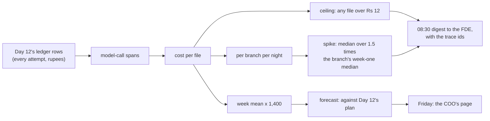

# 04 · Cost per File, per Branch and per Product, with Alerts Against the Ceiling

> Day 19 · Section 4 of 15 · [Chapter overview](README.md) · Previous: [03 · Traces for one loan file](03-traces-for-one-loan-file.md) · Next: [05 · Quality without ground truth](05-quality-without-ground-truth.md)

---

## 4.1 One source of rupees

Day 12's ledger records every attempt: tokens in, cache read and write, tokens out, tier, outcome, and the rupees at
Day 12's price card (list prices of 21 October 2026, a 10 percent residency uplift, Rs 95 to the dollar). The trace
uses those rupees and nothing else. The run report checks it every time:

```text
rupees: ledger Rs 676.5666, traces Rs 676.5666, difference Rs 0.000000
```

If the trace computed its own cost from tokens and a price, there would be two numbers, and the day they disagree
someone spends an afternoon finding out which is right. One number, written once by the client, read by everything.
A call that timed out and may have been billed carries an estimate that is shown beside the cost, never added into it
silently (Day 12, section 06).

## 4.2 The roll-ups

| Roll-up | Why someone asks | Pilot fortnight |
|---|---|---|
| per file | "why did this one cost that much" | median Rs 5.40 in week one, Rs 5.47 in week two; max Rs 14.00 |
| per branch per night | a branch's new habit shows up here first | Guntur Tuesday 15 December: median Rs 10.66 |
| per stage | where the money goes, and which lever to pull | week two: extract Rs 269.74, escalate Rs 65.93, classify Rs 20.50 |
| per prompt release | did the last prompt change move cost | one release in the pilot: `extraction@2.0.0+fake-large-2026-10`, 120 files |
| per product | a gold-loan file and a two-wheeler file are different jobs | the pilot runs two-wheeler only (Day 18); the roll-up is there for January |
| per month | the COO's question | week two's mean, times 1,400 files: about Rs 8,311, against Day 12's Rs 8,900 |

Two of these have one row today. They are built anyway, because the day there is a second prompt release or a second
product is the day you need them, and a roll-up added after the fact cannot see the past.

## 4.3 Three alerts, and why the average is not one of them



- **Ceiling.** Day 12 set Rs 12 "for every file, not the average", about 1.25 times the worst file it had measured.
  The alert is per file and carries the trace id, so the first click is the answer.
- **Spike.** A branch's median for one night against *that branch's* week-one median. The pilot's own first week is
  the baseline, not Day 12's synthetic night: the files are different and so is the cost.
- **Forecast.** The mean times the month's volume, against the plan. It goes on the COO's Friday page, not into an
  alert, because nobody can act on it at 08:30.

An alert on the monthly *average* would not have fired at all in week two: the week's mean was Rs 5.94, well under
Rs 12, while one branch's files cost twice what they should for two nights. Averages are for budgets. Alerts are on
the unit of work.

## 4.4 Guntur's Tuesday, read from the traces

The digest at 08:30 on Tuesday 15 December carried a spike for Guntur and a ceiling alert for GF-61070. The trace of
GF-61070 (section 03) shows:

```text
GF-61070 (Guntur, Tue 15 Dec): 96 pages, 59 of them statement continuation pages; 119 model calls costing Rs 14.00
calls by stage: {'classify': 96, 'escalate': 10, 'extract': 13}; on continuation pages: {'classify': 59, 'escalate': 4, 'extract': 6}, Rs 5.99 of the total
```

Three things are going on, and the spans show each one:

1. **Every page is classified.** Day 12 classifies every page on the small tier. Fifty-nine extra pages are fifty-nine
   extra calls, cheap one by one (about a paisa each) and not cheap together.
2. **The hard pages escalate.** About 3 percent of small-tier classifications come back under 0.60 confidence and go
   to the large tier at roughly 80 times the price. More pages, more escalations.
3. **The page filter in Day 12 breaks.** Day 12 extracts only the first page of a run of bank-statement pages. A
   net-banking printout repeats the bank's header on every page, so the run is fifty-nine pages long, and each time
   the small model mislabels one page in the middle, the next statement page starts a "new" run and goes to the large
   model. The most expensive call in the file was on page 38, the first continuation page: its answer was cut off at
   the output limit and asked again with a bigger budget, Rs 2.36 for a page with nothing on it.

Why did the pages appear? The branch manager in Guntur, after week one's send-backs, told staff to attach the full
statement instead of the bank's four-page summary. Nobody did anything wrong. The world changed, and only the trace
said how.

## 4.5 The fix, the freeze and the new line

The fix is deterministic and small: a statement page that says "Page k of N" with k of 2 or more carries no field the
extraction contract asks for, so it is not sent to the model at all (`statements.py`, `statement-continuation-v1`).
The analyst still sees every page; the filter changes what the model is shown, never what the file contains. It is
Day 11's advice in practice: run the cheap deterministic check before the expensive model call.

The calendar mattered. The change freeze runs from Thursday 17 to Thursday 31 December. The filter shipped on
Wednesday 16 December at 17:00, and Thursday's 02:00 batch was the first to see it. Before it shipped, the regression
gate ran, and the run report says what that was worth:

```text
the filter over Day 14's golden set: 200 files, 0 pages held back; the regression gate passes it without judging it
```

The longest golden file has 40 pages and none has a continuation page, so the gate passed a change it could not see.
Day 14 warned about exactly this ("a branch that starts uploading sixty-page statements ... does not exist in the set
until someone adds it"). The release note says so, and adding five masked long-statement files to the development
split is item O1 in the worksheet. The result in production:

```text
Guntur files with a long statement: before the filter 12 (median Rs 9.16, median 90 pages to the model);
after it 12 (median Rs 4.36, median 19 pages to the model)
```

Had the trace taken until Friday to read, the fix would have waited until January, and Guntur's files would have cost
twice as much through the freeze. Observability that is read the same morning is worth more than observability that
is complete.

The last step is the one that stops the next surprise: a **pages per file** line on the FDE page, beside **pages sent
to the model**, per branch per night. On Tuesday the two lines sat together at 95. From Thursday they separate (81.5
and 22.5), and the gap is the filter working. A branch that starts uploading something new shows up in the first line
the same night, before it shows up in the bill.

> **Telugu callback for the video.** "Cost per file double ayyindi overnight. Trace ni okka query tho chusam: 96
> classify calls, statement pages meeda. Fix Wednesday ki ship ayyindi, freeze ki mundu."
