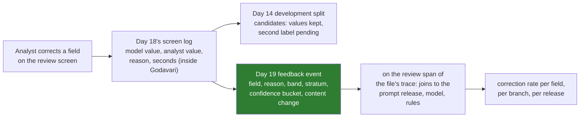

# 06 · Feedback Capture as a Product Feature

> Day 19 · Section 6 of 15 · [Chapter overview](README.md) · Previous: [05 · Quality without ground truth](05-quality-without-ground-truth.md) · Next: [07 · What must never be logged](07-what-must-never-be-logged.md)

---

## 6.1 Every thumbs-down is a labelled example, if you capture it properly

Day 18 made every correction a record with a reason: "misread character", "not in the file", "spelling or
transliteration", "model unsure: keyed from the page", "format only". Those records go to two places, and they are not
the same record:



The golden set needs the values: a correction is only a labelled example if it says what the right value was. The
trace store must not have them (section 07). So the feedback event carries everything about the correction except the
correction itself:

```text
{"kaagaz.feedback.action": "not_in_file", "kaagaz.feedback.band": "reject", "kaagaz.feedback.confidence_bucket": "0.0-0.5",
 "kaagaz.feedback.content_change": false, "kaagaz.feedback.field": "monthly_income",
 "kaagaz.feedback.reason": "not in the file", "kaagaz.feedback.stratum": "printed"}
```

## 6.2 What makes feedback useful

**It is linked to the trace that produced the output.** The event sits on the review span of the file's trace, so a
correction joins, with no extra work, to the prompt release, the model snapshot, the rules fingerprint, the bands
version and the pages the model was shown. "Corrections of monthly income doubled after release 2.1.0" is one query;
without the link it is a week of guessing.

**It has a reason from a short list.** Free text is unqueryable and unloggable. Day 18's list has seven reasons, and
"other" requires the analyst's words, which therefore never enter the trace store. The boundary's validator for
`kaagaz.feedback.reason` accepts the six coded reasons and nothing else.

**It says whether content changed.** A format-only tidy-up (a name in capitals retyped in title case) is display
feedback for the screen, not a model error. Day 18 sends it to Day 19 only; Day 14's normaliser already forgives it.
Counting it as an error would make the model look worse and the screen look fine, the opposite of the truth.

**It carries the band and the confidence bucket, not the confidence.** The question the dashboard asks is "how often
do analysts change values the bands called safe", per band. A bucket answers it; a float invites false precision and
a high-cardinality column.

## 6.3 Feedback as a feature the analysts can see

Feedback that disappears is feedback people stop giving. Day 18 cited the Morgan Stanley timeline as OpenAI published
it: weeks to build, months to be trusted. Letting the analysts see what their corrections changed is one of the
cheapest ways to spend those months well. Three small product features do it:

| Feature | What the analyst sees | Where it comes from |
|---|---|---|
| "your corrections this month" | how many of her corrections became development examples after the second label | Day 14's candidates, joined by file and field |
| "fixed" notes | when a field she corrected often gets better after a release, a one-line note on the screen | the correction rate per field, per release |
| a "this did not help" button on the policy panel | one click, linked to the retrieval span | Day 15's suggestion, as a feedback event |

Each costs a few hours. Each turns the analysts from people being measured into people improving the system, which
is what the senior analyst in Hyderabad needs to see before she trusts it.

## 6.4 The cost of asking

Every feedback control is a cost on the analyst's time, and the pilot's whole case is analyst hours (Day 9: 4.6 hours
per file at baseline). Rules of thumb that held at Godavari:

- Capture what the analyst already does. A correction is captured because she corrected; nobody is asked to rate
  anything.
- One required field: the reason, picked from the list, defaulted where the screen can infer it (Day 18's
  `reason_for` proposes, she confirms).
- No mandatory comment, ever. A required text box produces "ok", "na" and, eventually, a customer's name.
- Report back monthly, not per correction. The analyst is doing a job, not training a model.

> **Telugu callback for the video.** "Prati correction oka labelled example. Kani value golden set ki vellali, trace
> ki kaadu. Trace ki reason, band, field matrame."
