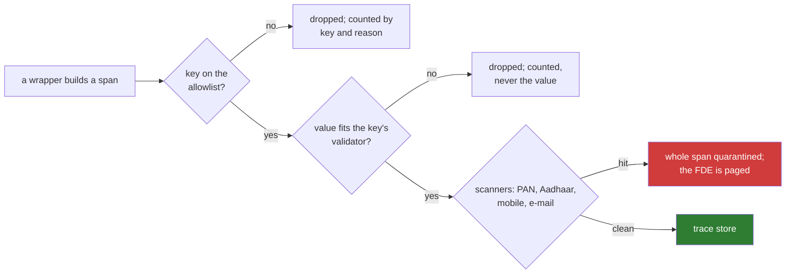

# 07 · What Must Never Be Logged: The Boundary, the Proof, and the DPA Preview

> Day 19 · Section 7 of 15 · [Chapter overview](README.md) · Previous: [06 · Feedback capture](06-feedback-capture-as-a-product-feature.md) · Next: [08 · Dashboards and paging](08-dashboards-for-three-audiences-and-paging.md)

---

## 7.1 The list

At Godavari, nothing in this list enters a log, a trace, a metric label, a dashboard or an alert:

- PAN, Aadhaar numbers (masked or not), mobile numbers, e-mail addresses
- customers' names, fathers' names, co-applicants' names, addresses, dates of birth
- page text, prompts and model answers
- Day 11's finding messages ("PAN card says ..., the form says ...")
- analysts' free-text notes, retrieval query text, staff names

Values belong in the file of record and in the review screen's log, which are inside Godavari's boundary with their
own access rules and retention. Telemetry is copied, exported, kept in backups, read by more people and searched by
tools; it must be boring.

Day 16 proved its write journal carries none of these. This chapter keeps it so: the run scans the journal every night
with the same detectors as the trace store, and a test fails the build if a surname from the synthetic files ever
appears in it.

## 7.2 Where the leaks were, in our own code base

The useful lesson of this chapter's build is that every earlier chapter, correctly designed, still produced at least
one thing that would have leaked if logged naively. The run scanned each upstream record:

```text
Day 12 night per file (CSV): none
Day 15 view log: none
Day 16 write journal (journal.sqlite): none
Day 17 audit log: none
Day 18 corrections (corrections.jsonl): pan
Day 18 screen log (action-log.jsonl): mobile, pan
```

| Source | What it carries | Right where it is? | What the trace takes |
|---|---|---|---|
| Day 11 finding messages | the PAN and the names on the form, quoted | yes: the analyst needs them on screen | rule ids and counts |
| Day 18 screen log | every field's model value and new value | yes: it is the decision record | counts per action, the look-first seconds |
| Day 18 correction events "for Day 19" | model value and analyst value | yes for the golden set; no for a trace | field, reason, band, stratum, bucket |
| Day 17 audit log | staff names ("lakshmi", "analyst.hyd.07") and their notes ("branch manager on leave") | yes: it is an audit record | counts and waits |
| Day 15 view log | the query text (PANs already redacted) | yes: the CISO asked for view records | result counts, refusals, snapshot age |

The last row is the subtle one. Day 15 redacted PANs from the query text, and the text can still carry a name ("similar
files to Ravi Teja's"). A query is free text, so it stays out.

When the boundary was fed Day 18's correction events exactly as written, as if someone had logged them raw:

```text
Day 18's correction events as written: 36, 15 carrying a value; identifier kinds in the file: ['pan'];
through the boundary as raw attributes: 36 stored, 0 quarantined; dropped 396 values
```

No value reached the store. The 36 spans that were stored carry four fields each (field, reason, band, stratum);
everything else, the model's value and the analyst's value included, was off the allowlist and dropped before the
scanner had anything to look at.

## 7.3 Allowlist, then scan, then quarantine



**The allowlist does the work.** Every key in `redact.SCHEMA` has a validator: an enumeration (routes, reasons,
bands), an identifier pattern (`GF-\d{5}`, rule ids, hex fingerprints), or a number with a range. No key accepts free
text. That is the only reliable way to keep names out. A name has no pattern; a regex that finds Indian names also
finds "LAKSHMI GANAPATHI AUTO", a dealer, and misses "Sai Kiran". So the schema has no place where a name could go.

**The scanners are a second line.** PAN, a twelve-digit number passing Day 11's Verhoeff check, a ten-digit mobile
starting 6 to 9, an e-mail address. They are bounded so that hex trace ids and SHA-256 digests do not trip them: the
first version of this chapter's scanner reported Aadhaar numbers and mobiles in Day 17's audit log, which turned out to
be digits inside 64-character hashes. A detector that cries wolf gets switched off; tune it on your own data first. And a detector has a blind spot by
construction: a *misread* PAN is still an identifier, and it does not fit the PAN pattern, which is why Day 11 flagged
it. In week two, three ENV-PAN-FORMAT messages carried one. Only the allowlist keeps those out.

**A hit quarantines the span and pages someone.** A scanner hit means a validator is too loose. That is a bug to fix
the same day, so it is one of the three things in the pilot that pages the FDE (section 08). A test loosens a validator
on purpose and checks that the scanner catches the Aadhaar number it lets through.

**Key names are checked too.** A key built from data (`f"value:{pan}"`) would carry the PAN into the "dropped" counter.
Keys that do not look like code are counted as `<unsafe key name>`.

**Span names are on a list.** `loan_file GF-61070` is refused: names are indexed everywhere.

## 7.4 Redact at the boundary, not afterwards

The tempting design is "log everything, scrub tonight". By tonight the raw lines are in the log shipper's buffer, the
backup, the search index and somebody's terminal scrollback. The boundary must be the write path, in process, before
anything leaves. In this project, `TraceStore.write` is the only way into the store, and it calls `admit` on every
span.

## 7.5 Retention and the DPA, previewed

Telemetry about customers' files is processing of personal data on Godavari's behalf, even when it carries no
identifier: the file number joins it to a person inside Godavari's systems. So it belongs in the contract and in the
compliance head's records. Day 23 owns the DPA and the questionnaire; Day 24 owns residency and India's DPDP Act. What
this chapter hands them is the worksheet's section 4:

| Question | Draft answer |
|---|---|
| retention of the trace store | 13 months, to cover a year-on-year comparison and the RBI inspection from 1 February 2027 |
| who may read it | the Kaagaz FDE and Godavari's application-support engineer; team leads see their dashboards only |
| where it lives | the pilot machine in the Hyderabad building; after cutover, Godavari's AWS Mumbai account (Day 24) |
| does it leave Godavari | no; Kaagaz's product team receives aggregate counts through Day 14's masked export |
| is it in the DPA | yes: the schedule of fields in `redact.SCHEMA` becomes an annex |

The last row is worth doing early. A schema the compliance head has signed is a schema an engineer cannot quietly
widen: adding a key becomes a change to a signed document, which is exactly the friction you want.

> **Telugu callback for the video.** "Day 16 journal lo PAN ledu ani prove chesam. Ivala aa proof ni prati raatri
> malli run chestam. Allowlist modata, scanner tarvata, quarantine chivara."
