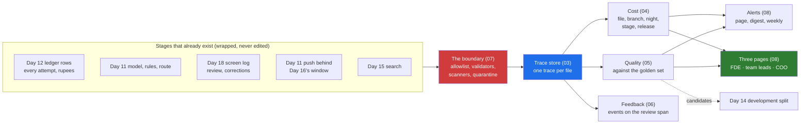

# Day 19 · Observability for AI Systems: Traces, Token Cost, Quality Dashboards, Feedback Capture

> **[Part 3 · Building the System Around the Model](../README.md)** · Chapter 9 of 10 · Video ~11 min · Chapter tier: medium
> Builds on: [Day 11 (the pipeline, rule fire rates, the sign-off fingerprint)](../11-the-system-around-the-model/README.md) ·
> [Day 12 (the ledger, the Rs 12 ceiling, latency budgets)](../12-llm-apis-for-production/README.md) ·
> [Day 13 (the prompt registry and releases)](../13-prompts-as-code/README.md) ·
> [Day 14 (the golden set's per-field baseline, the gate)](../14-evals-first/README.md) ·
> [Day 15 (retrieval and its view log)](../15-retrieval-for-enterprise-documents/README.md) ·
> [Day 16 (the write journal, the window, the reconciliation)](../16-integrating-with-what-exists/README.md) ·
> [Day 17 (the audit log, approvals, step budgets)](../17-agents-and-workflows/README.md) ·
> [Day 18 (the screen log, corrections, rubber-stamp signals, spot checks)](../18-verification-and-trust/README.md) ·
> [Day 9 (the pre-registered metrics)](../../02-discovery-and-decomposition/09-success-metrics-and-business-case/README.md)
> Sets up: Day 20 (the skeleton ships with this layer inside it), Day 23 and Day 24 (the trace store in the DPA;
> residency), Day 27 (SLOs and on-call from these alerts), Day 29 (the weekly readout quotes the COO's page), Day 36 and
> Day 37 (traces as evidence for product and for value)
> **Owner:** this chapter owns **what is different about observing an AI system for a customer: the five morning
> questions; a trace per unit of work with prompt, model, rules and bands versions and rupees on the spans; cost per
> file, branch, night, stage and release with alerts on the ceiling; quality signals without ground truth, read against
> the golden set; feedback as an event joined to its trace; the logging boundary (what is never logged, allowlist,
> scanners, quarantine) and the DPA preview; dashboards for three readers; and who gets paged at a customer.**
> Observability fundamentals (metrics, logs, traces, Prometheus, Grafana, Loki, the OpenTelemetry Collector,
> Alertmanager) are the DevOps Masterclass's [learn-observability](../../../DevOps/learn-observability/README.md);
> evals are Day 14's; review signals Day 18's; SLOs and incidents Day 27's; residency Day 24's; the DPA Day 23's.
> Versions used: **Python 3.14.3** (needs 3.12 or newer), **Pydantic 2.12.5**, **Jinja2 3.1.6**, **pytest 9.1.1**,
> pinned in `code/requirements.txt` and installed in a virtual environment (pytest is not on the global Python). Days 11
> to 16 and 18 are imported by path; Day 17's audit log is read as data. OpenTelemetry gen-AI conventions read on 21
> October 2026 (Development status). Shown outputs are from real runs. All data is synthetic; the analysts are simulated.

---

## Why this chapter exists

The Part file says the customer's first production question is "why did this one cost that much" and the second is "is
it getting worse". In Godavari's second pilot week the first question arrived on its own: on Tuesday 15 December
Guntur's files cost twice what they had in week one, and one file broke Day 12's Rs 12 ceiling. Nothing was down and
nobody had complained. A trace per file answered it before the analysts had finished their first files, a page filter
shipped the day before the change freeze, and Thursday's files cost what week one's did.

This chapter builds that layer around code that already exists: spans from wrappers round Days 11 to 18, a trace store
behind a redacting boundary, cost roll-ups with alerts, a weekly quality job read against Day 14's golden set, feedback
events from Day 18's corrections, and three static dashboards. It proves, with the actual identifiers from the files,
that no PAN, Aadhaar number, mobile number or customer name reaches any of it.

## Mental model

One sentence to carry out of the chapter: **trace every file through every stage with its versions and its rupees,
read every quality signal beside the golden set, keep every value behind the boundary, and give each reader the one
page they need to decide.**

## Learning goals

After this chapter you can:

1. State the five questions a customer-facing AI system answers every morning, the evidence for each, and why "is it
   right" and "is anyone using it" have only proxies.
2. Design a trace per unit of work whose spans carry the prompt release, model, rules fingerprint, bands version and
   rupees, using the OpenTelemetry gen-AI names, and say what in those conventions is still moving.
3. Attribute cost per file, branch, night, stage and release from the client's own ledger, and alert on the ceiling
   and on a branch's own baseline instead of the average.
4. Read corrections, overrides, spot checks, rule fire rates and refusals against the golden set and last week, and
   send what production sees back to the development split.
5. Capture feedback as an event joined to its trace, with values kept inside the boundary.
6. Build a logging boundary that keeps identifiers out by construction, and test it with the real values.
7. Design dashboards for three readers and an alert routing that pages for three things.

**Prerequisites:** Days 11 to 18 (imported here); the DevOps module for the tools underneath.

## Reading order

| # | Section | What you get | Words |
|---|---|---|---|
| 01 | [Why observability for AI systems](01-why-observability-for-ai-systems.md) | Tuesday's digest; what is different; the hard parts | ~1,050 |
| 02 | [The five questions](02-the-five-questions.md) | up, right, affordable, used, safe; why two are hard | ~850 |
| 03 | [Traces for one loan file](03-traces-for-one-loan-file.md) | GF-61070's trace; versions on spans; the gen-AI conventions; wrappers; sampling | ~1,400 |
| 04 | [Cost per file, branch and product](04-cost-per-file-branch-and-product.md) | one source of rupees; roll-ups; three alerts; the incident and the fix | ~1,350 |
| 05 | [Quality without ground truth](05-quality-without-ground-truth.md) | signals and baselines; corrections against the golden set; drift; back to Day 14 | ~1,300 |
| 06 | [Feedback capture as a product feature](06-feedback-capture-as-a-product-feature.md) | the event; reasons; what analysts see; the cost of asking | ~800 |
| 07 | [What must never be logged](07-what-must-never-be-logged.md) | the list; leaks in our own code base; allowlist, scan, quarantine; the DPA preview | ~1,300 |
| 08 | [Dashboards and paging](08-dashboards-for-three-audiences-and-paging.md) | three readers; the COO's number; alert fatigue; who is paged | ~1,100 |
| 09 | [2026 patterns and production concerns](09-2026-patterns-and-production-concerns.md) | what is used, what is hype, storage, late data, clocks | ~750 |
| 10 | [Project: the observability layer](10-project-the-godavari-observability-layer.md) | setup, the code, real output, 30 tests | ~1,100 (with output) |
| 11 | [Build it with AI, and how you know it's right](11-build-with-ai-and-verification.md) | context, prompt, eighteen agent mistakes, checks, checklist | ~1,300 |
| 12 | [Mistakes and debugging](12-mistakes-and-debugging.md) | symptom, cause, fix; a routine | ~650 |
| 13 | [Interview questions](13-interview-questions.md) | 13 questions with model answers | ~850 |
| 14 | [Exercises](14-exercises.md) | 10 graded exercises, including review an AI-written draft, with its key | ~1,150 |
| 15 | [Further reading](15-further-reading.md) | the conventions, the fundamentals, the sources | ~300 |

**Short on time?** Read 03, 04 and 07, run the project (10), and do exercises 1.3 and 3.1. That is the video plus the
reflex the interview tests: open one trace, alert on the unit, keep values behind the boundary.

## Files

| Path | What |
|---|---|
| [`code/godavari_obs/`](code/godavari_obs/) | `paths.py`, `spans.py`, `redact.py`, `store.py`, `instrument.py`, `statements.py`, `pilot.py`, `costs.py`, `quality.py`, `sources.py`, `alerts.py`, `dashboards.py` |
| [`code/run_observability.py`](code/run_observability.py) | the whole run; writes `data/` |
| [`code/tests/`](code/tests/) | 30 tests in four files |
| [`code/exercises/ai_draft_tracing.py`](code/exercises/ai_draft_tracing.py) | an AI-written draft with at least fifteen problems; exercise 3.1 |
| [`code/requirements.txt`](code/requirements.txt) · [`code/pytest.ini`](code/pytest.ini) | the pins |
| [`worksheet/godavari-observability-plan.md`](worksheet/godavari-observability-plan.md) | the plan for the team leads, the compliance head and application support: questions, routing, the never-logged list, retention and DPA questions, open items O1 to O6 |
| [`data/dashboards/`](data/dashboards/) | `fde.html`, `team-leads.html`, `coo-weekly.html` |
| [`data/run-report.md`](data/run-report.md) · `data/alerts.jsonl` · `data/sample-trace-GF-61070.jsonl` · `data/traces.sqlite` | the run, the alerts, one exported trace, the store |

Run from the chapter folder in a virtual environment (section 10.2): `python -X utf8 code/run_observability.py`
(about 13 seconds), then `python -X utf8 -m pytest code` (30 tests, about 25 seconds). No network, no API key.

## What this chapter does *not* teach (single-owner rule)

| Topic | Where it's taught |
|---|---|
| Metrics, logs, traces, Prometheus, Grafana, Loki, the Collector, Alertmanager | [DevOps Masterclass, learn-observability](../../../DevOps/learn-observability/README.md) |
| Golden sets, labelling, judges, the regression gate | [Day 14](../14-evals-first/README.md) |
| Bands, the forced look, rubber-stamp detection, spot-check design | [Day 18](../18-verification-and-trust/README.md) |
| The client, retries, the price card | [Day 12](../12-llm-apis-for-production/README.md) |
| SLOs, error budgets, on-call across two companies, postmortems | [Day 27](../../04-deploying-into-their-world/27-reliability-in-their-production/README.md) |
| The DPA and the security questionnaire | [Day 23](../../04-deploying-into-their-world/23-security-review-and-procurement/README.md) |
| Residency and the DPDP Act | [Day 24](../../04-deploying-into-their-world/24-data-residency-and-indian-law/README.md) |
| Measuring value | [Day 37](../../06-from-customer-to-product/37-measuring-value-honestly/README.md) |

## Analogies for the Telugu audience

- **Cricket** (the chapter's main picture): the scorecard is the dashboard, the ball-by-ball commentary is the trace.
  When the run rate drops you go to the ball-by-ball to find the over that did it (01.5, 04.4).

## Video map

The video (~11 min) covers a slice; the notes cover everything.

| Asset | Covers | Sections |
|---|---|---|
| **Day 19 main video** (~11 min) | Hook: Tuesday's digest, Rs 14.00 (1 min) → the five questions; why "right" and "used" are hard (1.5 min) → one trace, top to bottom: versions and rupees on the spans (2 min) → the gen-AI conventions, dated; cached tokens count as input (1 min) → the incident: 96 classify calls, a broken continuation rule, the fix before the freeze, the pages line (2 min) → quality against the golden set; ENV-CONFIDENCE split by channel (1.5 min) → what is never logged; allowlist first (1 min) → three pages, three pages-worthy alerts (0.5 min) → recap and teasers (0.5 min) | 01.1, 02.1 to 02.3, 03.1 to 03.3, 04.3 to 04.5, 05.2, 05.5, 07.1, 07.3, 08.1, 08.5 |
| **Short 1:** "Cost per file doubled overnight. The trace found it in one query." | the spike and ceiling alerts; GF-61070's spans by stage; the filter and Thursday's median | 04.4, 04.5 |
| **Short 2:** "Every thumbs-down is a labelled example. Capture it." | the feedback event; values to the golden set, reasons to the trace | 06.1, 06.2 |
| Notes only | everything else: leaks in our own code (07.2), the DPA (07.5), the COO's page (08.2), 09 to 15 | as listed |

**Callbacks to use on screen:** "Day 12 lo ledger row prati attempt ki rupees raasindi; ivala aa row ae span avutundi."
(section 03); "Day 16 journal lo PAN ledu ani prove chesam; ivala prati raatri malli prove chestam." (section 07).
**Forward callbacks:** Day 20 (ee layer skeleton tho ship avutundi), Day 27 (ee moodu page rules SLOs ga marutayi).

## Callbacks

Builds on and sets up as in the header above; section 15 links the chapters ahead.

**Next chapter:** [Day 20 · The walking skeleton, shipped: Godavari's first end-to-end slice in week 3](../20-the-walking-skeleton-shipped/README.md).
