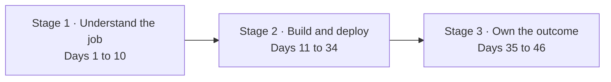

# Learn FDE: Forward Deployed Engineering

> A deep, end-to-end course on the fastest-growing engineering role in AI: the engineer a vendor
> sends into a customer to make AI actually work there. These are the course notes, one full
> chapter per Day.

In 2026 the forward deployed engineer sits where the model meets the messy reality of a real
company: the legacy system with a SOAP API, the security team that will not hand over
credentials, the forty analysts whose Tuesday you are changing, and the executive who wants a
number. The job is three jobs at once, core engineering, applied AI, and customer-facing
discovery, and most engineers have only the first two. This course teaches all three by running
one engagement from the first meeting to the handoff.

**Start here: [Day 0 · The engineer in the room](00-start-here/00-the-engineer-in-the-room/README.md)**

---

## The course: 47 chapters in 3 stages



| Stage | Part | Days | Notes |
|---|---|---|---|
| - | 0 · Start here | 0 | [00-start-here](00-start-here/00-the-engineer-in-the-room/README.md) |
| **1 · Understand the job** | 1 · The Role and the Market | 1 to 3 | [01-the-role](01-the-role/README.md) |
| | 2 · Discovery and Decomposition | 4 to 10 | [plan](curriculum/part-02-discovery-and-decomposition.md) |
| **2 · Build and deploy** | 3 · Building the System Around the Model | 11 to 20 | [plan](curriculum/part-03-building-the-system.md) |
| | 4 · Deploying Into the Customer's World | 21 to 28 | [plan](curriculum/part-04-deploying-into-their-world.md) |
| | 5 · Working With the Customer | 29 to 34 | [plan](curriculum/part-05-working-with-the-customer.md) |
| **3 · Own the outcome** | 6 · From One Customer to a Product | 35 to 38 | [plan](curriculum/part-06-from-customer-to-product.md) |
| | 7 · The AI-Era FDE Toolkit | 39 to 41 | [plan](curriculum/part-07-ai-era-toolkit.md) |
| | 8 · Capstone, Interviews and Career | 42 to 46 | [plan](curriculum/part-08-capstone-and-career.md) |

The full chapter list, the teaching approach, the running engagement and the sources are in
[CURRICULUM.md](CURRICULUM.md).

## The running engagement

You are an FDE at Kaagaz AI, a small vendor with a document-and-workflow platform. Your customer
is Godavari Finance, a mid-sized Hyderabad lender with a nine-day loan turnaround, a 2009 core
system, an on-prem data centre and an RBI audit every year. You meet the COO on Day 4, ship a
walking skeleton on Day 20, pass the security review on Day 23, go live in their AWS Mumbai
account on Day 26, and hand off on Day 28. Then you do it again, faster, for a hospital network in
the capstone. Every name and every document is invented and generated by code in this repository.

## How to use this course

1. **Read the chapter.** Each is a full textbook treatment: the concept, how it works inside,
   trade-offs, code, a project that moves the engagement, mistakes, interview questions and
   exercises.
2. **Do the project in building mode.** Let an AI coding agent draft, then review and test it with
   the chapter's "How do you know it's right?" checklist. The agent's typical mistakes for that
   task are listed, because an FDE's value is catching them.
3. **Do the role-plays out loud.** Parts 2, 5 and 8 script the conversations: the frustrated CTO,
   the security refusal, the VP who wants 100 percent. Record yourself. The interview loop has a
   round for exactly this.
4. **Keep the engagement folder.** By Day 46 you have a discovery document, an eval set, a deployed
   system, a security questionnaire, a handoff pack and a defended capstone. That folder is the
   portfolio.

## Prerequisites

Python, SQL, Git and APIs at a working level; Docker and basic cloud; some exposure to LLM APIs.
The [DevOps Masterclass](../DevOps/README.md) Parts 0 to 5 and [learn-ai-ml](../learn-ai-ml/README.md)
Stage 1 cover all of it. No machine learning theory is needed.

## Repository layout

```
learn-fde/
├── CURRICULUM.md                      the plan: 47 chapters, 9 Parts, the engagement, sources
├── curriculum/part-NN-*.md            per-Day detail for each Part
├── NN-part/NN-chapter/README.md       chapter overview, mental model, reading order, video map
├── NN-part/NN-chapter/NN-section.md   the sections
├── NN-part/NN-chapter/code/           runnable code, synthetic data generators
└── engagement/                        the Godavari Finance artifacts the course produces (coming)
```

## Status

Course design complete (October 2026). Chapter notes are authored one Day at a time in the same
house style as learn-ai-ml; the table above says which exist.
